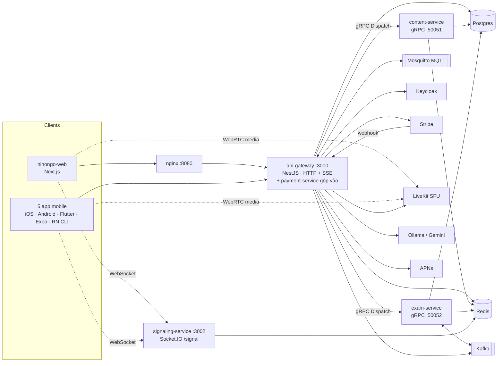
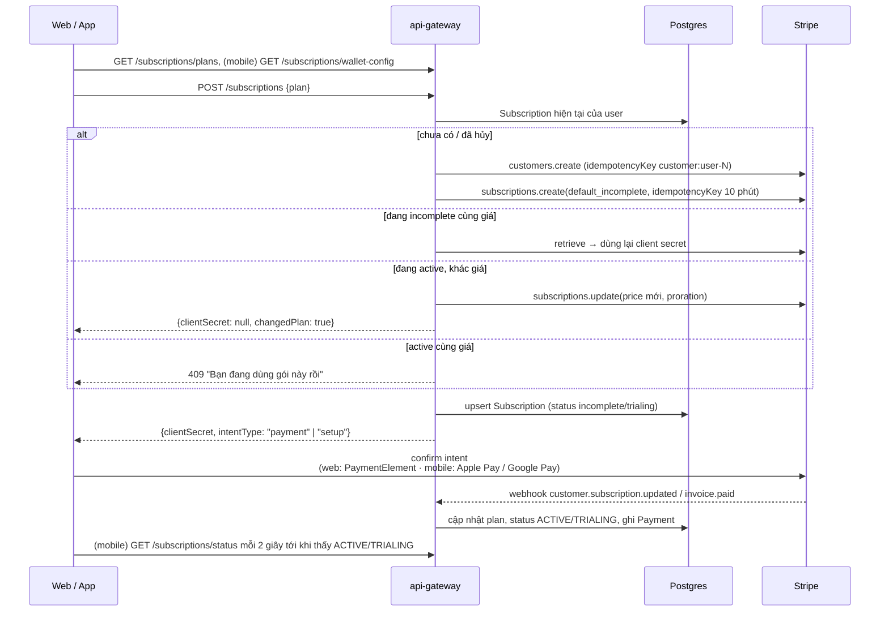
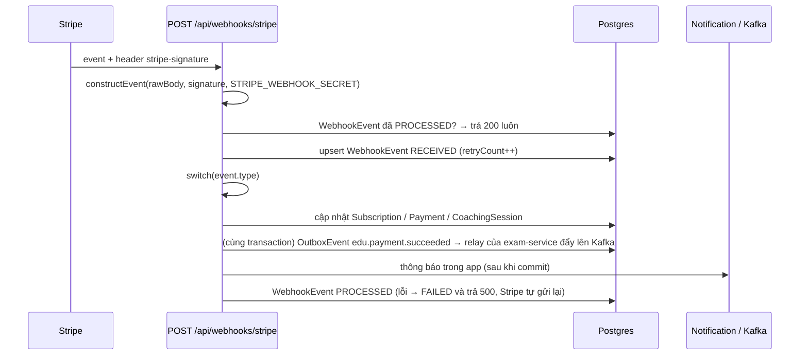
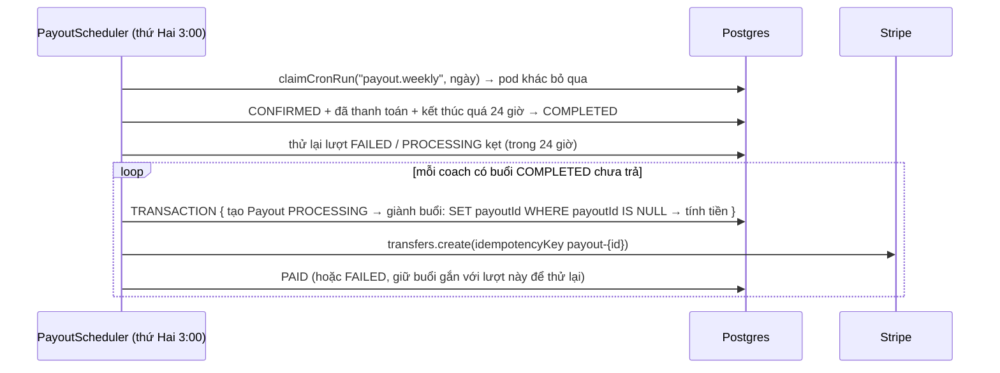
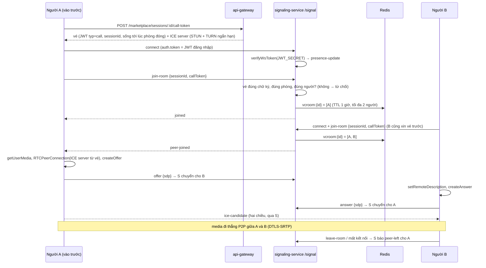
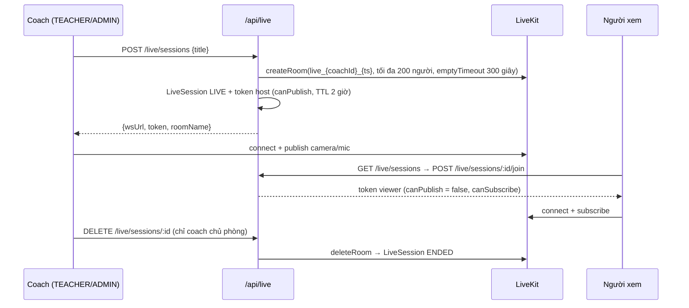
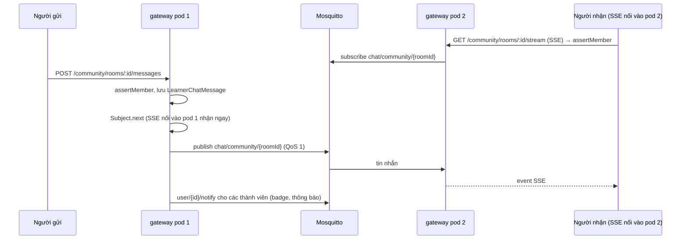
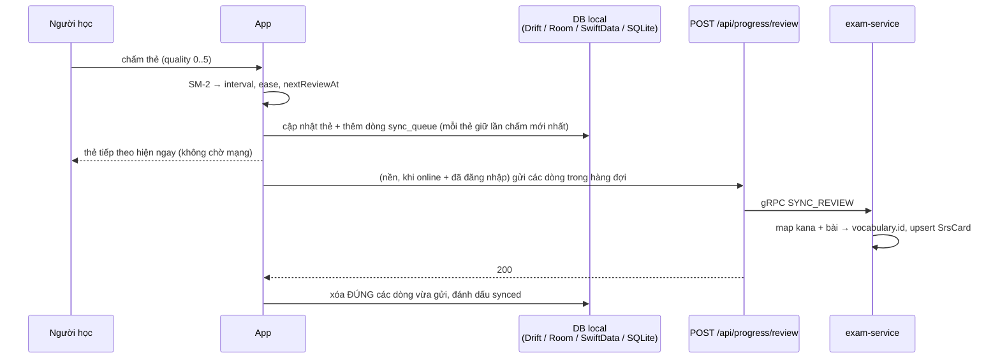
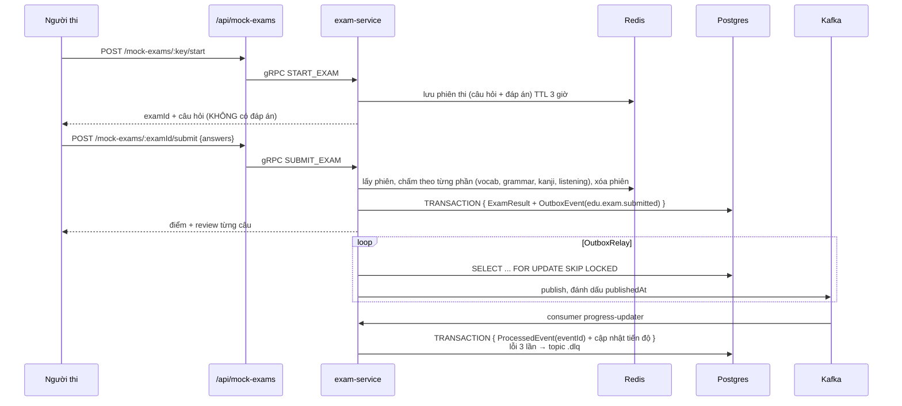
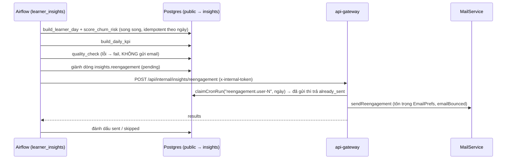

# Luồng chạy của các tính năng lõi

Tài liệu đi theo đường chạy thật trong code: request đi qua file nào, dữ liệu nằm ở đâu, chỗ nào bất đồng bộ. Sơ đồ use case và kiến trúc tổng quan có ở [analysis-design.md](./analysis-design.md); tài liệu này là tầng chi tiết hơn.

Mỗi tính năng gồm: sơ đồ luồng → file chính → điểm thiết kế đáng nói (hay bị hỏi khi phỏng vấn) → rủi ro đã thấy trong code. Các rủi ro tìm thấy lúc viết tài liệu đã được sửa, ghi ở [mục 11](#11-rủi-ro-đã-sửa).

Viết ngày 21/10/2026, cập nhật sau đợt sửa 12 rủi ro cùng ngày.

**Mục lục**
- [0. Bản đồ hệ thống](#0-bản-đồ-hệ-thống)
- [1. Đăng nhập và phiên](#1-đăng-nhập-và-phiên)
- [2. Thanh toán](#2-thanh-toán)
- [3. Video call 1-1](#3-video-call-1-1)
- [4. Livestream](#4-livestream)
- [5. Chat cộng đồng realtime](#5-chat-cộng-đồng-realtime)
- [6. Ôn SRS và đồng bộ offline](#6-ôn-srs-và-đồng-bộ-offline)
- [7. Thi thử JLPT](#7-thi-thử-jlpt)
- [8. Nội dung học](#8-nội-dung-học)
- [9. AI](#9-ai)
- [10. Nhắc ôn (push, email)](#10-nhắc-ôn-push-email)
- [10b. Học viên sắp bỏ học (Airflow)](#10b-học-viên-sắp-bỏ-học-airflow)
- [11. Rủi ro đã sửa](#11-rủi-ro-đã-sửa)

---

## 0. Bản đồ hệ thống



- **api-gateway là cổng duy nhất của HTTP.** `payment-service` không chạy thành process riêng: gateway import thẳng các service của nó (`services/api-gateway/src/http/subscription.controller.ts` import `../../../payment-service/src/...`). "Microservice" ở đây là thư mục tách module, không phải process tách rời.
- **Gọi nội bộ:** gateway → content/exam qua gRPC với một method chung `Dispatch` (pattern + payload). Xem `services/api-gateway/src/microservices/grpc-clients.ts`.
- **Event bất đồng bộ:** Kafka (`packages/nest-contracts/src/kafka-topics.ts`). Realtime giữa các pod gateway: MQTT.
- **Response luôn bọc** `{ success, data, timestamp }`. Client nào quên mở lớp này sẽ đọc ra `undefined`, và lỗi này từng gặp ở nhiều app.

---

## 1. Đăng nhập và phiên

Có ba cách vào (email/mật khẩu, Google, Keycloak OIDC). Cả ba cùng kết thúc bằng một cặp token **do gateway tự phát**: app không bao giờ dùng thẳng token của Keycloak/Google để gọi API.

```mermaid
sequenceDiagram
  participant App
  participant GW as api-gateway /api/auth
  participant KC as Keycloak
  participant DB as Postgres

  alt Email + mật khẩu
    App->>GW: POST /auth/login {email, password}
    GW->>DB: tìm user, bcrypt.compare
  else Keycloak OIDC
    App->>KC: Authorization Code + PKCE (AppAuth / expo-auth-session)
    KC-->>App: access_token + id_token
    App->>GW: POST /auth/oidc {accessToken, idToken}
    GW->>KC: lấy JWKS, jwtVerify(issuer)
    GW->>DB: tìm theo keycloakId hoặc email → tạo / cập nhật, ĐỒNG BỘ role
  end
  GW->>DB: tạo RefreshToken {id, hash(secret), expiresAt +7 ngày}
  GW-->>App: { access_token (JWT 15 phút) }<br/>Set-Cookie: refresh_token=id.secret; HttpOnly; Path=/api/auth

  Note over App,GW: ... 15 phút sau, request trả 401 ...
  App->>GW: POST /auth/refresh (Cookie)
  GW->>DB: tìm theo id, kiểm tra revoked / hết hạn, bcrypt.compare(secret)
  GW->>DB: revoke token cũ, tạo token mới (rotation)
  GW-->>App: access_token mới + cookie mới
  App->>GW: gửi lại request ban đầu
```

**File chính**
- Server: `services/api-gateway/src/auth/auth.controller.ts` (cookie, rate limit), `auth.service.ts` (`loginWithOidc`, `refreshTokens`, `generateTokens`), `keycloak-roles.ts` (map role Keycloak → ADMIN/TEACHER/USER).
- Client, 401 → refresh → gửi lại:

  | App | File |
  |---|---|
  | web | `apps/nihongo-web/src/lib/api-client.ts` |
  | Flutter | `lib/data/remote/auth_interceptor.dart` |
  | Android | `TokenAuthenticator.kt` + `RefreshCookieJar.kt` |
  | iOS | `APIClient.swift` (`RefreshCoordinator`) |
  | RN CLI | `src/api/client.ts` |

**Điểm thiết kế**
- **Refresh token dạng `id.secret`:** DB chỉ lưu hash bcrypt của `secret`, tra cứu bằng `id`. Lộ DB không dùng được token.
- **Cookie `Path=/api/auth`:** trình duyệt chỉ gửi refresh token tới đúng các endpoint auth, không gửi kèm mọi request.
- **Single-flight ở client:** 10 request cùng 401 chỉ refresh **một** lần. Nếu không, 10 lần refresh đua nhau quay vòng token, và lần thứ 2 trở đi dùng token đã bị revoke → đăng xuất người dùng.
- **Lỗi mạng khi refresh thì giữ phiên.** Chỉ 400/401/403 mới đăng xuất.
- **Mobile tự lưu cookie:** app native không có trình duyệt giữ cookie. Flutter/Android đọc `Set-Cookie` lúc login/refresh rồi tự gửi header `Cookie`.
- **Role lấy từ Keycloak mỗi lần login OIDC:** đổi role trên Keycloak có hiệu lực ở lần đăng nhập sau, không phải ngay lập tức (JWT cũ vẫn mang role cũ tới khi hết 15 phút).

- **Thu hồi nguyên tử + phát hiện token bị đánh cắp (R5):**
  - `updateMany({ where: { id, revoked: false } })`: hai request cùng token không thể cùng "thắng".
  - Token vừa quay vòng **trong 30 giây** vẫn được cấp token mới, vì hai tab web dùng chung cookie có thể refresh cùng lúc.
  - Dùng lại token đã quay vòng lâu hơn, hoặc token đã đăng xuất / đổi mật khẩu, nghĩa là bị đánh cắp: thu hồi **mọi** phiên của user.
  - `revokedAt` chỉ ghi khi quay vòng, nên các token bị thu hồi vì lý do khác không bao giờ được hưởng khoảng 30 giây.
  - Test: `auth.refresh.db-spec.ts`.

---

## 2. Thanh toán

Stripe làm hết phần tiền. Server tạo intent, client xác nhận intent (thẻ không đi qua server mình), **webhook là nguồn sự thật**: DB chỉ chuyển sang "đã trả" khi webhook về.

### 2a. Mua gói Premium (subscription)



- **`intentType`:** gói có dùng thử → Stripe tạo **SetupIntent** (chỉ lưu thẻ/ví, hôm nay trừ $0); không dùng thử → **PaymentIntent** trừ kỳ đầu. Server tự phân biệt theo tiền tố `seti_` (`clientSecretIntentType` trong `stripe.helpers.ts`), để client không phải đoán.
- **File:**
  - server: `services/payment-service/src/subscription/subscription.service.ts` (`createOrUpgrade`), `stripe/stripe.service.ts`;
  - web: `apps/nihongo-web/src/views/CheckoutView.tsx`, `components/SubscriptionPaymentForm.tsx`;
  - mobile: xem [payment-wallets.md](./payment-wallets.md).
- **Điểm thiết kế:**
  - **Idempotency key** cho `customers.create` và `subscriptions.create`: bấm hai lần hoặc mạng gửi lại thì vẫn ra **cùng một** subscription.
  - **Không tạo subscription mới khi đổi gói:** đổi giá trên chính subscription đang chạy. Bản cũ từng tạo cái thứ hai, khiến gói cũ vẫn bị trừ tiền.
  - **Mobile hỏi lại trạng thái:** client không tự coi là đã kích hoạt khi ví báo thành công, mà đợi webhook về.
- Hoàn tiền subscription: `POST /subscriptions/refund`, chỉ trong 7 ngày đầu (mục 2d).

### 2b. Webhook Stripe



| Event | Xử lý |
|---|---|
| `customer.subscription.updated/deleted` | đồng bộ plan, status, kỳ hạn, `cancelAtPeriodEnd` |
| `invoice.paid` | ghi/cập nhật `Payment` SUCCEEDED, lưu link hóa đơn (bỏ qua invoice $0 lúc dùng thử) |
| `invoice.payment_failed` | Subscription → PAST_DUE |
| `payment_intent.succeeded` | Payment SUCCEEDED; nếu là buổi coach → session CONFIRMED; gửi thông báo |
| `payment_intent.payment_failed` | Payment FAILED |
| `charge.refunded` | đồng bộ trạng thái hoàn tiền |

- **File:** `services/payment-service/src/webhook/webhook.service.ts`, `webhook.controller.ts`. Gateway bật `rawBody: true` (`main.ts`) vì xác thực chữ ký cần đúng byte gốc, không phải JSON đã parse.
- **Điểm thiết kế:**
  - **Xác thực chữ ký** trước khi đọc nội dung.
  - **Bảng `WebhookEvent` để chống xử lý trùng:** Stripe gửi *ít nhất một lần*.
  - **Lỗi thì trả 500** để Stripe tự gửi lại theo lịch backoff.
- Dev: `stripe listen --forward-to localhost:3000/api/webhooks/stripe` (xem [payment-checklist.md](./payment-checklist.md)).

### 2c. Đặt buổi học với coach

```mermaid
sequenceDiagram
  participant L as Học viên
  participant GW as /api/marketplace
  participant DB as Postgres
  participant ST as Stripe

  L->>GW: POST /marketplace/sessions {coachId, scheduledAt, topic}
  GW->>DB: coach active?
  GW->>DB: TRANSACTION { pg_advisory_xact_lock(coach) → có buổi CHỒNG giờ? → CoachingSession PENDING + Payment PENDING }
  GW->>ST: paymentIntents.create(metadata sessionId, coachId, learnerId)
  GW-->>L: {session, clientSecret}
  L->>ST: confirm PaymentIntent (thẻ)
  ST-->>GW: webhook payment_intent.succeeded
  GW->>DB: Payment SUCCEEDED, session PENDING → CONFIRMED, thông báo "Lịch học đã xác nhận"
  Note over L,GW: Hủy: POST /marketplace/sessions/:id/cancel<br/>trước 24 giờ → hoàn tiền tự động; dưới 24 giờ → hủy, không hoàn
```

- **File:** `services/payment-service/src/booking/booking.service.ts` (`bookSession`, `cancelSession`), `coach/coach.service.ts`, `services/api-gateway/src/http/marketplace.controller.ts`.
- **Chống đặt trùng (R4):** bước kiểm tra trùng và bước tạo buổi nằm trong **cùng** transaction, giữ `pg_advisory_xact_lock` theo coach, nên hai lượt đặt cùng một coach phải chạy lần lượt. Kiểm tra theo **khung giờ chồng nhau** (`scheduledAt` + `durationMin`), không chỉ so giờ bắt đầu bằng nhau. Test: `booking.db-spec.ts`.

### 2d. Hoàn tiền

`services/payment-service/src/refund/refund.service.ts` (`refundPayment`). Thứ tự kiểm tra:
1. Chỉ chủ giao dịch hoặc ADMIN.
2. Giao dịch phải SUCCEEDED, có `stripeChargeId`, chưa hoàn.
3. Người dùng thường: buổi coach chỉ hoàn khi còn **hơn 24 giờ**; subscription chỉ hoàn trong **7 ngày** đầu.
4. Hoàn một phần: chỉ ADMIN.
5. Gọi `refunds.create`, rồi ghi `REFUNDED` / `PARTIALLY_REFUNDED` cùng `stripeRefundId`.

Hoàn subscription xong thì **hủy gói ngay** (`subscription.service.ts` → `requestRefund`).

`refunds.create` kèm idempotency key `refund-payment-{id}` (R8). Bấm hai lần, hoặc hai request cùng qua bước kiểm tra trạng thái, thì ra cùng một refund trên Stripe; hai request khác số tiền thì Stripe từ chối request thứ hai.

### 2e. Trả tiền cho coach (payout)

Coach liên kết tài khoản Stripe Connect Express (`POST /coach/stripe/onboard` → `accountLinks.create`, bật `payoutEnabled`).



- **File:** `services/payment-service/src/payout/payout.service.ts` (`runPayouts`), `payout.scheduler.ts`. Test: `payout.db-spec.ts`.
- **Điểm thiết kế (R1):**
  - **Mỗi buổi gắn `payoutId` lúc được gom:** một buổi thuộc tối đa **một** lượt trả. Chạy lại, chạy song song, hay pod chết giữa chừng cũng không trả hai lần.
  - **Idempotency key theo lượt:** thử lại lượt lỗi không chuyển tiền hai lần. Key của Stripe hết hạn sau 24 giờ, nên chỉ tự thử lại trong 24 giờ; quá hạn thì cần người kiểm tra.
  - **Đệm 24 giờ sau khi buổi kết thúc** mới tính là COMPLETED, để còn thời gian khiếu nại. Trước đợt sửa, không có code nào đặt COMPLETED, nên cả payout lẫn đánh giá coach đều không chạy được.
  - **Phí tính theo từng buổi** (mỗi buổi có `platformFeePercent` riêng).

---

## 3. Video call 1-1

Media đi **thẳng giữa hai máy** (WebRTC P2P). Server chỉ chuyển "tín hiệu" để hai bên tìm thấy nhau: SDP offer/answer và ICE candidate.



- **File:**
  - server: `services/signaling-service/src/signaling/signaling.gateway.ts`, `room.service.ts` (Redis), `presence/presence.service.ts`, `auth/verify-call-token.ts`; vé và ICE server: `services/payment-service/src/booking/call-token.service.ts`; TURN: service `coturn` trong `docker-compose.yml`;
  - web: `apps/nihongo-web/src/hooks/useVideoCall.ts`, `components/VideoCallUI/`.
- **Điểm thiết kế:**
  - **Người đến sau kích hoạt bắt tay:** server báo `peer-joined` cho người đã ở trong phòng, người đó tạo offer. Nhờ vậy không có chuyện hai bên cùng tạo offer (glare).
  - **Trạng thái phòng nằm trong Redis**, không nằm trong RAM: nhiều instance signaling dùng chung được, và vào lại thì cập nhật `socketId` mới.
  - **Dùng chung JWT với gateway:** signaling tự verify bằng `JWT_SECRET`, không cần gọi gateway.
  - **Vé vào phòng (R2):** signaling không có DB, nên gateway kiểm tra quyền và ký vé: học viên/coach của buổi, buổi CONFIRMED, từ 15 phút trước giờ học tới 30 phút sau khi buổi kết thúc. Signaling chỉ kiểm vé. `offer` / `answer` / `ice-candidate` / `leave-room` chỉ có tác dụng trong phòng mà socket đã vào hợp lệ, nên người ngoài không bơm được tín hiệu vào phòng khác. Test: `signaling.db-spec.ts`, `call-token.db-spec.ts`.
  - **TURN (R6):** coturn với `use-auth-secret`. Mật khẩu = `HMAC-SHA1(TURN_SECRET, "hạn:userId")`, do gateway sinh kèm vé và hết hạn cùng lúc phòng đóng; coturn tự kiểm, không lưu tài khoản. Chạy thật phải đặt `TURN_EXTERNAL_IP` và mở UDP 3478, 49160–49200.
  - **Presence trong Redis (R10):** mỗi user một set socket, cộng một sorted set "online" chấm điểm theo thời điểm hết hạn. Nhiều instance dùng chung, nên đóng tab ở instance A không làm user bị coi là offline khi tab ở instance B còn mở. Instance chết thì TTL tự dọn. Test: `presence.db-spec.ts`.

---

## 4. Livestream

Một coach phát, nhiều người xem: P2P không chịu nổi (coach phải gửi N luồng), nên dùng **SFU** là LiveKit. Coach gửi một luồng lên LiveKit, LiveKit nhân ra cho người xem.



- **File:** `services/api-gateway/src/http/live.service.ts`, `live.controller.ts`. Client:

  | App | File |
  |---|---|
  | web | chưa có (web không dùng `livekit-client`) |
  | Expo | `app/live/host.tsx`, `app/live/viewer.tsx` |
  | Android | `presentation/live/*` (foreground service để phát khi tắt màn hình) |
  | iOS | `Presentation/Live/LiveViews.swift` |
  | Flutter | `presentation/live/*` |

- **Điểm thiết kế:** quyền (host phát, viewer chỉ xem) **nằm trong token** do server ký, nên LiveKit tự chặn. Client sửa code cũng không phát được.
- **Phiên "ma" (R7):** LiveKit gửi webhook `room_finished` tới `POST /api/live/webhook` (khai báo trong `infra/livekit.yaml`, kiểm chữ ký bằng `WebhookReceiver`), và phiên được đánh dấu ENDED ngay. Lớp dự phòng: khi liệt kê hoặc vào xem, đối chiếu với `listRooms`; phòng đã mất trên LiveKit thì ENDED (bỏ qua phòng vừa tạo dưới 1 phút).

---

## 5. Chat cộng đồng realtime



- **File:** `services/api-gateway/src/realtime/chat-events.service.ts` (gộp và lọc trùng), `mqtt.bus.ts`, `group-chat.service.ts`, `http/community.controller.ts`. Support chat có cùng kiểu (`support-chat.service.ts`, `GET /api/support/stream`).
- **Điểm thiết kế:**
  - **SSE thay vì WebSocket:** chat chủ yếu là server → client, còn gửi tin dùng POST bình thường. SSE chạy trên HTTP thường, đi qua nginx/proxy dễ hơn, trình duyệt tự nối lại.
  - **MQTT làm bus giữa các pod:** tin gửi vào pod 1 vẫn tới người nối vào pod 2. Không có `MQTT_URL` thì chạy bằng Subject trong process (dev một pod).
  - **Lọc tin trùng** (`distinct` theo `type:roomId:messageId`, cửa sổ 60 giây): pod gửi sẽ nhận lại chính tin của nó từ broker (echo QoS 1).
  - **`switchMap` theo trạng thái kết nối MQTT:** broker rớt rồi nối lại thì hủy subscription cũ, không nhận tin hai lần.
  - **Header `X-Accel-Buffering: no`:** để nginx không gom SSE lại.
  - **Kiểm tra thành viên ở cả hai đầu:** khi gửi và khi mở stream.

---

## 6. Ôn SRS và đồng bộ offline

Ôn tập phải chạy **không cần mạng**, nên mọi app ghi local trước rồi đồng bộ sau (offline-first, outbox ở client).



- **File:**
  - client:

    | App | File |
    |---|---|
    | Flutter | `lib/data/repository/vocabulary_repository_impl.dart` |
    | Android | WorkManager: `data/sync/ReviewSyncWorker.kt`, `SyncScheduler.kt` |
    | iOS | `SyncEngine` (`Data/Local/SyncService.swift`) |
    | Expo | `src/data/repository.ts` |
    | RN CLI | `src/db/vocabRepo.ts` |

  - server: `services/exam-service/src/modules/progress/progress.service.ts` (`syncReviewBank`), `packages/nest-prisma/src/srs-card.repository.ts`.
- **Điểm thiết kế:**
  - **Gửi trước, thành công mới xóa,** và chỉ xóa đúng dòng đã gửi. Bản cũ ở Flutter từng xóa trước khi gửi, mất dữ liệu khi API lỗi.
  - **Chỉ một lượt sync tại một thời điểm.**
  - **Hàng đợi lọc theo thẻ:** chấm một thẻ 3 lần lúc offline thì chỉ gửi 1 bản.
  - **Android dùng WorkManager:** đóng app hệ điều hành vẫn gửi khi có mạng.
  - **Lọc "đến hạn" theo giờ hiện tại:** màn SRS lọc lại mỗi phút, chứ không chốt giờ lúc mở màn hình.
- **Thống kê tiến độ:** `GET /api/learning-progress` đọc materialized view `learner_progress_summary`. Cron mỗi 5 phút chạy `REFRESH ... CONCURRENTLY` dưới `pg_try_advisory_xact_lock`, nên nhiều pod chỉ một pod refresh (`learning-progress/`).
- **Bản mới hơn thắng (R3):** server chỉ ghi khi `lastReviewedAt` gửi lên mới hơn bản đang lưu. Điều kiện nằm trong `WHERE` của `updateMany`, nên không đua được. Máy offline lâu đẩy hàng đợi cũ lên không đè được tiến độ mới hơn. Test: `srs-sync.db-spec.ts`.

---

## 7. Thi thử JLPT



- **File:** `services/exam-service/src/modules/mock-exams/mock-exams.service.ts` (`start`, `submit`), `kafka/outbox-relay.service.ts`, `kafka/exam-events.consumer.ts`, `kafka/progress-updater.ts`.
- **Điểm thiết kế (rất hay được hỏi):**
  - **Đáp án không bao giờ ra client:** nằm trong phiên ở Redis, chấm ở server.
  - **Transactional outbox:** ghi kết quả và event trong **cùng một** transaction. Không còn trường hợp lưu điểm xong mà mất event vì Kafka chết giữa chừng.
  - **`FOR UPDATE SKIP LOCKED`:** nhiều instance relay chạy song song không gửi trùng một dòng.
  - **Consumer idempotent:** relay có thể gửi trùng (gửi xong nhưng chết trước khi đánh dấu). Bảng `ProcessedEvent` khóa theo `eventId`, ghi chung transaction với phần cập nhật.
  - **DLQ:** một message hỏng không chặn cả partition.
  - **Không đăng nhập vẫn thi được** (`OptionalJwtAuthGuard`): khi đó chỉ chấm, không lưu theo user.
- Điểm trực tiếp từng câu: `exam:question-scored` qua Redis pub/sub (cho màn xem điểm realtime).

---

## 8. Nội dung học

`GET /api/vocabularies?lessonNumber=…` (tương tự cho kanji, ngữ pháp, bài đọc, nghe):

1. Gateway nhận request và gọi gRPC `Dispatch` sang **content-service**.
2. Content-service đọc cache Redis theo khóa của bài (`CacheKeys.vocabByLesson`). Trúng cache thì trả luôn, trượt thì đọc Postgres rồi ghi lại cache.
3. Gateway bọc response `{ success, data }`.

- **File:** `services/content-service/src/modules/*/…service.ts`, `services/api-gateway/src/http/*.controller.ts`.
- **App mobile:** tải về DB local theo bài, đọc offline (mục 6).
- **Cache ghi theo cặp `page` + `limit`:** mỗi bài chỉ giữ một trang trong cache. Đọc trang khác thì trượt cache và ghi đè trang cũ. App mobile luôn đọc `limit=100` nên ít gặp.

---

## 9. AI

```mermaid
sequenceDiagram
  participant App
  participant GW as /api/ai
  participant M as Ollama (mặc định) / Gemini

  App->>GW: POST /ai/chat {question, history, context}<br/>hoặc POST /ai/sentence-feedback {sentence}
  GW->>GW: JWT + throttle 30 lần / 10 phút
  GW->>M: system prompt + 10 tin gần nhất của history
  M-->>GW: câu trả lời (sentence-feedback: JSON)
  GW->>GW: cắt lấy phần JSON, parse; lỗi → báo lỗi, không trả kết quả rỗng
  GW-->>App: {answer} / {corrected, reading, meaning, explanation, examples}
```

- **File:** `services/api-gateway/src/ai/ai.service.ts`, `ai.controller.ts`. Chọn nhà cung cấp bằng `AI_PROVIDER=ollama|gemini`.
- **Điểm thiết kế:**
  - **Key AI chỉ nằm ở server.** Bản cũ của app mobile từng gọi thẳng Gemini bằng key biên dịch vào app: giải nén app là lấy được key.
  - **Throttle riêng cho AI** vì mỗi lần gọi tốn tiền / GPU.
  - **Chỉ gửi 10 tin gần nhất** để giới hạn token.

---

## 10. Nhắc ôn (push, email)

| Việc | Lịch (giờ VN) | File |
|---|---|---|
| Push "Bạn có N thẻ cần ôn" | 9:00 mỗi ngày | `services/api-gateway/src/push/push.scheduler.ts` → `push.service.ts` (APNs) |
| Email nhắc / tổng kết | 9:00 mỗi ngày, 8:00 Chủ nhật | `mail-scheduler/mail-scheduler.service.ts` (Brevo) |
| Refresh thống kê tiến độ | mỗi 5 phút | `learning-progress/application/learner-progress.scheduler.ts` (có advisory lock) |

Luồng push:
1. `claimCronRun("push.daily-srs", ngày VN)`: mọi pod gateway đều nổ cron, chỉ pod giành được lượt mới gửi (R11).
2. Cron đếm thẻ đến hạn theo từng user (`srsCard.groupBy`).
3. Token iOS gửi qua APNs; token Android gửi qua FCM HTTP v1 (`push/fcm.sender.ts`, bật bằng `FCM_SERVICE_ACCOUNT_JSON`). Cả hai đều hết hạn sau 1 giờ. Token giả `android-<uuid>` của bản Flutter cũ thì bỏ qua và xóa.
4. Token APNs `BadDeviceToken` / `Unregistered`, hoặc FCM `UNREGISTERED`, thì xóa.
5. Bấm thông báo → app mở màn SRS (payload `screen: srs`, deep link `nihongo://srs`).

App Android native nhắc ôn bằng thông báo **local** (`SrsReminderWorker`, WorkManager), không cần server.

**Vì sao không dùng advisory lock cho cron (R11):** khóa kiểu "đang chạy" không chặn được trường hợp pod A chạy xong trong vài giây rồi nhả khóa, sau đó pod B nổ trễ vài trăm mili giây vẫn lấy được khóa. Cần ghi nhớ "lượt này **đã** chạy": khóa chính `(name, slot)` của bảng `CronRun`. Test: `cron-run.db-spec.ts`.

---

## 10b. Học viên sắp bỏ học (Airflow)

Pipeline `learner_insights` (Airflow 3, chạy 2:00 sáng giờ VN) tính số liệu của ngày hôm trước và gửi email kéo học viên quay lại. Chi tiết, cách chạy và test: [infra/airflow/README.md](../infra/airflow/README.md).



- **File:**
  - Airflow: `infra/airflow/dags/learner_insights.py`, `infra/airflow/dags/insights/queries.py`;
  - schema: `infra/flyway/sql/V2__learner_insights.sql`;
  - gateway: `services/api-gateway/src/insights/`;
  - web: `apps/nihongo-web/src/views/admin/AdminInsightsPage.tsx` (`/admin/insights`).
- **Điểm thiết kế:**
  - **Đúng việc cho Airflow:** nhiều bước phụ thuộc nhau, retry từng bước, kiểm tra chất lượng chặn bước có tác dụng phụ (gửi email), backfill, và lịch sử chạy trên UI.
  - **Bảng `insights` do Flyway quản** (read model), Prisma chỉ quản `public`, nên không có drift.
  - **Mọi bước idempotent theo ngày:** xóa rồi ghi lại trong một transaction.
  - **Backfill không gửi email:** lần chạy cho ngày cũ hơn 2 ngày tự bỏ qua bước gửi.
  - **Chống gửi trùng hai lớp:** Airflow giành dòng `pending`, gateway chặn theo (học viên, ngày). Đã thử thật: gateway nhận 4 request (lần chạy đầu + retry), học viên nhận đúng 1 email.

## 11. Rủi ro đã sửa

Tìm thấy khi viết tài liệu này, sửa cùng ngày 21/10/2026. Phần lớn có test chạy trên **Postgres / Redis / Socket.IO thật** (`*.db-spec.ts`, `npm run test:db` trong `services/`, CI chạy ở job `backend`). Với các chỗ dễ đua nhau, từng test đã được chạy trên code lỗi để chắc nó **đỏ** (bỏ điều kiện / khóa thì test fail).

| # | Mức | Vấn đề cũ | Đã sửa | Test |
|---|---|---|---|---|
| R1 | Cao | Payout không được gọi ở đâu; nếu gọi thì trả gấp đôi khi chạy lại, bỏ sót buổi cũ, không thử lại, % phí sai. **Không có code nào đặt COMPLETED.** | Tự COMPLETED sau 24 giờ; mỗi buổi gắn `payoutId`; idempotency key theo lượt; thử lại lượt lỗi; cron thứ Hai 3:00 | `payout.db-spec.ts` |
| R2 | Cao (bảo mật) | Ai đăng nhập cũng vào được phòng gọi bất kỳ; người ngoài còn bơm được offer/ICE và gửi `peer-left` giả vào phòng người khác | Vé vào phòng do gateway ký; signaling chỉ chuyển tín hiệu trong phòng đã vào hợp lệ | `signaling.db-spec.ts`, `call-token.db-spec.ts` |
| R3 | Trung bình | Server ghi đè thẻ SRS, ai gửi sau thắng | Chỉ ghi khi bản gửi lên mới hơn (điều kiện trong `WHERE`) | `srs-sync.db-spec.ts` |
| R4 | Trung bình | Hai người đặt cùng slot đều thành công; giờ chồng nhau vẫn lọt | Kiểm tra trùng + tạo trong một transaction có khóa theo coach; kiểm tra theo khung giờ | `booking.db-spec.ts` |
| R5 | Trung bình (bảo mật) | Refresh không nguyên tử; token bị lộ dùng được, không ai biết | Thu hồi nguyên tử; khoảng 30 giây cho hai tab; dùng lại token cũ → thu hồi mọi phiên | `auth.refresh.db-spec.ts` |
| R6 | Trung bình | Chỉ STUN: mạng 4G/5G, mạng công ty không gọi được | coturn + mật khẩu TURN ngắn hạn kèm vé (đã thử cấp phát relay với coturn thật) | `call-token.db-spec.ts` |
| R7 | Thấp | Phiên livestream "ma" còn LIVE | Webhook `room_finished` + đối chiếu `listRooms` | `live.service.spec.ts` |
| R8 | Thấp | Hoàn tiền không có idempotency key | Key `refund-payment-{id}` | `refund.service.spec.ts` |
| R9 | Thấp | Chỉ gửi APNs (tài liệu cũ ghi nhầm là Android không có nhắc ôn: Android native có nhắc local) | Thêm FCM HTTP v1 cho token Android (Expo); dọn token giả của Flutter | `push.service.spec.ts`, `fcm.sender.spec.ts` |
| R10 | Thấp | Presence trong RAM từng instance (tài liệu cũ đánh giá quá tay phần "phát cho mọi người": đó đúng là tính năng danh sách online của cộng đồng) | Presence trong Redis; gateway bỏ lệnh `KEYS` | `presence.db-spec.ts` |
| R11 | Thấp | 2 pod → 2 push / 2 email | Bảng `CronRun` (mỗi lượt một pod) | `cron-run.db-spec.ts` |
| R12 | Thấp | `edu.payment.succeeded` gửi thẳng Kafka, lỗi là mất | Ghi `OutboxEvent` cùng transaction với `Payment` | `webhook.service.spec.ts` |

**Lỗi khác tìm thấy trong lúc sửa:**
- **Chạy dev load code cũ.** `packages/nest-*/src` có 123 file `.js` / `.d.ts` biên dịch bị commit nhầm cạnh `.ts`. Khi chạy dev (ts-node + tsconfig-paths), Node chọn `.js` trước `.ts`, nên sửa code trong `packages/*` không có tác dụng khi chạy `npm run dev:gateway`. Đã gỡ các file đó và thêm vào `.gitignore`.
- **signaling-service không đóng kết nối Redis khi tắt**, và lỗi dọn kết nối lúc tắt thành rejection không ai bắt. Đã sửa.
- **DB dev local lệch lịch sử migration** (bảng `OutboxEvent` có sẵn nhưng migration `20260929120000` chưa được ghi nhận), nên `prisma migrate deploy` trên DB dev dừng giữa chừng. Chưa sửa vì là DB của bạn. Migration mới (`20261021090000_payout_claim_refresh_reuse_cron_run`) đã được kiểm tra áp sạch trên DB trống.
