# Luồng chạy của các tính năng lõi

Tài liệu đi theo đường chạy thật trong code: request đi qua file nào, dữ liệu nằm ở đâu, chỗ nào bất đồng bộ. Sơ đồ use case và kiến trúc tổng quan có ở [analysis-design.md](./analysis-design.md); tài liệu này là tầng chi tiết hơn.

Mỗi tính năng gồm: **nói ngắn gọn** (luồng bằng lời thường, đọc trước) → sơ đồ luồng → file chính → điểm thiết kế đáng nói (hay bị hỏi khi phỏng vấn) → rủi ro đã thấy trong code. Các rủi ro tìm thấy lúc viết tài liệu đã được sửa, ghi ở [mục 17](#17-rủi-ro-đã-sửa).

Viết ngày 21/10/2026, cập nhật sau đợt sửa 12 rủi ro cùng ngày. Bổ sung 03/11/2026: phần "Nói ngắn gọn" ở đầu mỗi tính năng, và các mục 11–16 (dự đoán đề thi, phát âm, sơ đồ tư duy, từ điển hình ảnh, cấu tạo kanji, hành trình đặt lịch coach).

**Mục lục**
- [0. Bản đồ hệ thống](#0-bản-đồ-hệ-thống)
- [1. Đăng nhập và phiên](#1-đăng-nhập-và-phiên)
- [2. Thanh toán](#2-thanh-toán)
- [3. Video call 1-1](#3-video-call-1-1)
- [4. Livestream](#4-livestream)
- [5. Chat cộng đồng realtime](#5-chat-cộng-đồng-realtime)
- [6. Ôn SRS và đồng bộ offline](#6-ôn-srs-và-đồng-bộ-offline)
- [7. Thi thử JLPT](#7-thi-thử-jlpt)
- [8. Nội dung học](#8-nội-dung-học)
- [9. AI](#9-ai)
- [9b. Hỏi đáp ngữ pháp có trích nguồn (RAG)](#9b-hỏi-đáp-ngữ-pháp-có-trích-nguồn-rag)
- [10. Nhắc ôn (push, email)](#10-nhắc-ôn-push-email)
- [10b. Học viên sắp bỏ học (Airflow)](#10b-học-viên-sắp-bỏ-học-airflow)
- [11. Dự đoán đề thi JLPT](#11-dự-đoán-đề-thi-jlpt)
- [12. Phát âm (TTS)](#12-phát-âm-tts)
- [13. Sơ đồ tư duy](#13-sơ-đồ-tư-duy)
- [14. Từ điển hình ảnh](#14-từ-điển-hình-ảnh)
- [15. Phân tích cấu tạo kanji](#15-phân-tích-cấu-tạo-kanji)
- [16. Đặt lịch học với coach: đầu đến cuối](#16-đặt-lịch-học-với-coach-đầu-đến-cuối)
- [17. Rủi ro đã sửa](#17-rủi-ro-đã-sửa)

---

## 0. Bản đồ hệ thống

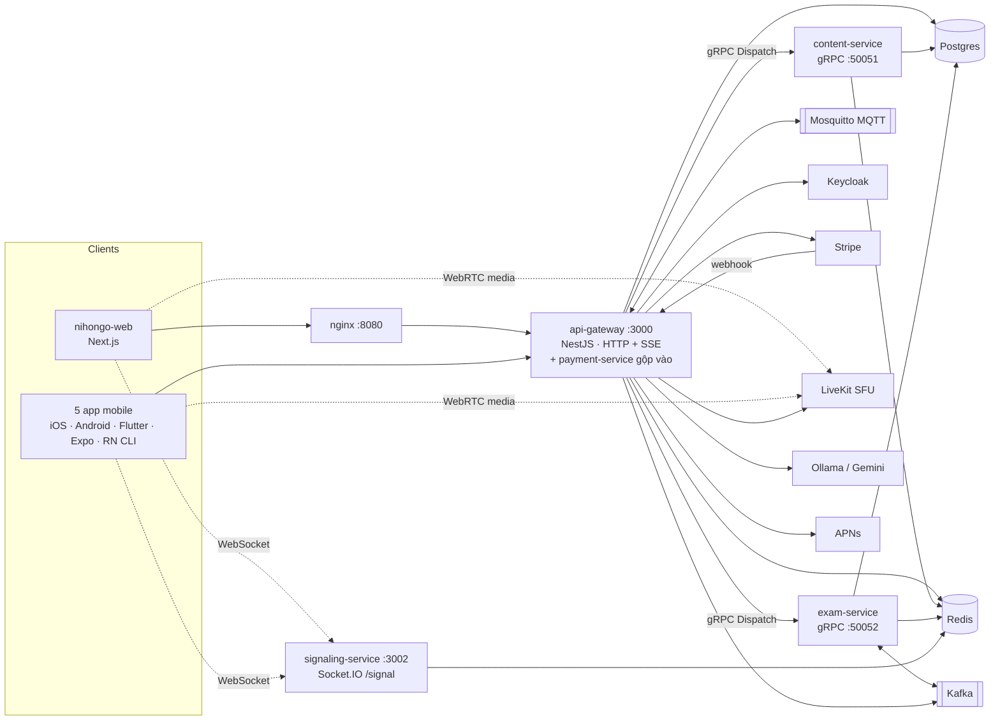

- **api-gateway là cổng duy nhất của HTTP.** `payment-service` không chạy thành process riêng: gateway import thẳng các service của nó (`services/api-gateway/src/http/subscription.controller.ts` import `../../../payment-service/src/...`). "Microservice" ở đây là thư mục tách module, không phải process tách rời.
- **Gọi nội bộ:** gateway → content/exam qua gRPC với một method chung `Dispatch` (pattern + payload). Xem `services/api-gateway/src/microservices/grpc-clients.ts`.
- **Event bất đồng bộ:** Kafka (`packages/nest-contracts/src/kafka-topics.ts`). Realtime giữa các pod gateway: MQTT.
- **Response luôn bọc** `{ success, data, timestamp }`. Client nào quên mở lớp này sẽ đọc ra `undefined`, và lỗi này từng gặp ở nhiều app.

---

## 1. Đăng nhập và phiên

> **Nói ngắn gọn**
> 1. Người dùng đăng nhập bằng email/mật khẩu, Google hoặc Keycloak.
> 2. Dù vào bằng cách nào, gateway cũng **tự phát** cho app một vé ngắn hạn (access token, sống 15 phút) và một vé dài hạn (refresh token, 7 ngày, nằm trong cookie).
> 3. Mỗi request gửi kèm vé ngắn hạn. Hết 15 phút, server trả 401.
> 4. App lặng lẽ đổi vé dài hạn lấy cặp vé mới, rồi gửi lại request vừa lỗi. Người dùng không thấy gì.
> 5. Vé dài hạn chỉ dùng được một lần. Ai dùng lại vé cũ (dấu hiệu bị đánh cắp) thì mọi phiên của tài khoản bị thu hồi.

Có ba cách vào (email/mật khẩu, Google, Keycloak OIDC). Cả ba cùng kết thúc bằng một cặp token **do gateway tự phát**: app không bao giờ dùng thẳng token của Keycloak/Google để gọi API.

```mermaid
sequenceDiagram
  participant App
  participant GW as api-gateway /api/auth
  participant KC as Keycloak
  participant DB as Postgres

  alt Email + mật khẩu
    App->>GW: POST /auth/login {email, password}
    GW->>DB: tìm user, bcrypt.compare
  else Keycloak OIDC
    App->>KC: Authorization Code + PKCE (AppAuth / expo-auth-session)
    KC-->>App: access_token + id_token
    App->>GW: POST /auth/oidc {accessToken, idToken}
    GW->>KC: lấy JWKS, jwtVerify(issuer)
    GW->>DB: tìm theo keycloakId hoặc email → tạo / cập nhật, ĐỒNG BỘ role
  end
  GW->>DB: tạo RefreshToken {id, hash(secret), expiresAt +7 ngày}
  GW-->>App: { access_token (JWT 15 phút) }<br/>Set-Cookie: refresh_token=id.secret; HttpOnly; Path=/api/auth

  Note over App,GW: ... 15 phút sau, request trả 401 ...
  App->>GW: POST /auth/refresh (Cookie)
  GW->>DB: tìm theo id, kiểm tra revoked / hết hạn, bcrypt.compare(secret)
  GW->>DB: revoke token cũ, tạo token mới (rotation)
  GW-->>App: access_token mới + cookie mới
  App->>GW: gửi lại request ban đầu
```

**File chính**
- Server: `services/api-gateway/src/auth/auth.controller.ts` (cookie, rate limit), `auth.service.ts` (`loginWithOidc`, `refreshTokens`, `generateTokens`), `keycloak-roles.ts` (map role Keycloak → ADMIN/TEACHER/USER).
- Client, 401 → refresh → gửi lại:

  | App | File |
  |---|---|
  | web | `apps/nihongo-web/src/lib/api-client.ts` |
  | Flutter | `lib/data/remote/auth_interceptor.dart` |
  | Android | `TokenAuthenticator.kt` + `RefreshCookieJar.kt` |
  | iOS | `APIClient.swift` (`RefreshCoordinator`) |
  | RN CLI | `src/api/client.ts` |

**Điểm thiết kế**
- **Refresh token dạng `id.secret`:** DB chỉ lưu hash bcrypt của `secret`, tra cứu bằng `id`. Lộ DB không dùng được token.
- **Cookie `Path=/api/auth`:** trình duyệt chỉ gửi refresh token tới đúng các endpoint auth, không gửi kèm mọi request.
- **Single-flight ở client:** 10 request cùng 401 chỉ refresh **một** lần. Nếu không, 10 lần refresh đua nhau quay vòng token, và lần thứ 2 trở đi dùng token đã bị revoke → đăng xuất người dùng.
- **Lỗi mạng khi refresh thì giữ phiên.** Chỉ 400/401/403 mới đăng xuất.
- **Mobile tự lưu cookie:** app native không có trình duyệt giữ cookie. Flutter/Android đọc `Set-Cookie` lúc login/refresh rồi tự gửi header `Cookie`.
- **Role lấy từ Keycloak mỗi lần login OIDC:** đổi role trên Keycloak có hiệu lực ở lần đăng nhập sau, không phải ngay lập tức (JWT cũ vẫn mang role cũ tới khi hết 15 phút).

- **Thu hồi nguyên tử + phát hiện token bị đánh cắp (R5):**
  - `updateMany({ where: { id, revoked: false } })`: hai request cùng token không thể cùng "thắng".
  - Token vừa quay vòng **trong 30 giây** vẫn được cấp token mới, vì hai tab web dùng chung cookie có thể refresh cùng lúc.
  - Dùng lại token đã quay vòng lâu hơn, hoặc token đã đăng xuất / đổi mật khẩu, nghĩa là bị đánh cắp: thu hồi **mọi** phiên của user.
  - `revokedAt` chỉ ghi khi quay vòng, nên các token bị thu hồi vì lý do khác không bao giờ được hưởng khoảng 30 giây.
  - Test: `auth.refresh.db-spec.ts`.

---

## 2. Thanh toán

> **Nói ngắn gọn**
> 1. Người dùng chọn gói (hoặc chọn buổi học với coach). App báo cho server.
> 2. Server nhờ Stripe tạo một "phiếu thu" (intent), rồi trả cho app một mã bí mật của phiếu đó.
> 3. App đưa mã cho Stripe cùng thẻ hoặc ví (Apple Pay / Google Pay). **Số thẻ đi thẳng tới Stripe**, không qua server mình.
> 4. Stripe trừ tiền xong thì **tự gọi về server** (webhook). Chỉ lúc này DB mới ghi "đã trả" và mở gói Premium hoặc xác nhận buổi học.
> 5. App hỏi lại trạng thái tới khi thấy đã kích hoạt.
>
> Vì sao không tin app báo "thanh toán xong"? App có thể bị sửa, mạng có thể đứt giữa chừng. Webhook có chữ ký của Stripe nên server biết chắc tiền đã về.

Stripe làm hết phần tiền. Server tạo intent, client xác nhận intent (thẻ không đi qua server mình), **webhook là nguồn sự thật**: DB chỉ chuyển sang "đã trả" khi webhook về.

### 2a. Mua gói Premium (subscription)

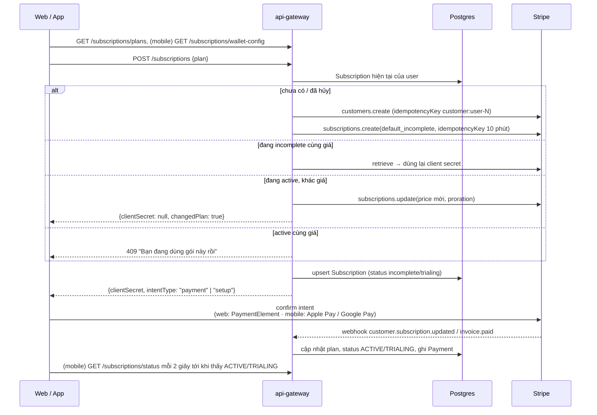

- **`intentType`:** gói có dùng thử → Stripe tạo **SetupIntent** (chỉ lưu thẻ/ví, hôm nay trừ $0); không dùng thử → **PaymentIntent** trừ kỳ đầu. Server tự phân biệt theo tiền tố `seti_` (`clientSecretIntentType` trong `stripe.helpers.ts`), để client không phải đoán.
- **File:**
  - server: `services/payment-service/src/subscription/subscription.service.ts` (`createOrUpgrade`), `stripe/stripe.service.ts`;
  - web: `apps/nihongo-web/src/views/CheckoutView.tsx`, `components/SubscriptionPaymentForm.tsx`;
  - mobile: xem [payment-wallets.md](./payment-wallets.md).
- **Điểm thiết kế:**
  - **Idempotency key** cho `customers.create` và `subscriptions.create`: bấm hai lần hoặc mạng gửi lại thì vẫn ra **cùng một** subscription.
  - **Không tạo subscription mới khi đổi gói:** đổi giá trên chính subscription đang chạy. Bản cũ từng tạo cái thứ hai, khiến gói cũ vẫn bị trừ tiền.
  - **Mobile hỏi lại trạng thái:** client không tự coi là đã kích hoạt khi ví báo thành công, mà đợi webhook về.
- Hoàn tiền subscription: `POST /subscriptions/refund`, chỉ trong 7 ngày đầu (mục 2d).

### 2b. Webhook Stripe

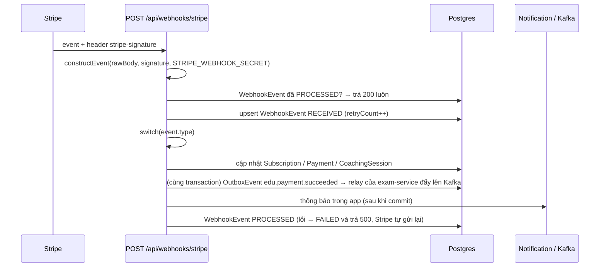

| Event | Xử lý |
|---|---|
| `customer.subscription.updated/deleted` | đồng bộ plan, status, kỳ hạn, `cancelAtPeriodEnd` |
| `invoice.paid` | ghi/cập nhật `Payment` SUCCEEDED, lưu link hóa đơn (bỏ qua invoice $0 lúc dùng thử) |
| `invoice.payment_failed` | Subscription → PAST_DUE |
| `payment_intent.succeeded` | Payment SUCCEEDED; nếu là buổi coach → session CONFIRMED; gửi thông báo |
| `payment_intent.payment_failed` | Payment FAILED |
| `charge.refunded` | đồng bộ trạng thái hoàn tiền |

- **File:** `services/payment-service/src/webhook/webhook.service.ts`, `webhook.controller.ts`. Gateway bật `rawBody: true` (`main.ts`) vì xác thực chữ ký cần đúng byte gốc, không phải JSON đã parse.
- **Điểm thiết kế:**
  - **Xác thực chữ ký** trước khi đọc nội dung.
  - **Bảng `WebhookEvent` để chống xử lý trùng:** Stripe gửi *ít nhất một lần*.
  - **Lỗi thì trả 500** để Stripe tự gửi lại theo lịch backoff.
- Dev: `stripe listen --forward-to localhost:3000/api/webhooks/stripe` (xem [payment-checklist.md](./payment-checklist.md)).

### 2c. Đặt buổi học với coach

```mermaid
sequenceDiagram
  participant L as Học viên
  participant GW as /api/marketplace
  participant DB as Postgres
  participant ST as Stripe

  L->>GW: POST /marketplace/sessions {coachId, scheduledAt, topic}
  GW->>DB: coach active?
  GW->>DB: TRANSACTION { pg_advisory_xact_lock(coach) → có buổi CHỒNG giờ? → CoachingSession PENDING + Payment PENDING }
  GW->>ST: paymentIntents.create(metadata sessionId, coachId, learnerId)
  GW-->>L: {session, clientSecret}
  L->>ST: confirm PaymentIntent (thẻ)
  ST-->>GW: webhook payment_intent.succeeded
  GW->>DB: Payment SUCCEEDED, session PENDING → CONFIRMED, thông báo "Lịch học đã xác nhận"
  Note over L,GW: Hủy: POST /marketplace/sessions/:id/cancel<br/>trước 24 giờ → hoàn tiền tự động; dưới 24 giờ → hủy, không hoàn
```

- **File:** `services/payment-service/src/booking/booking.service.ts` (`bookSession`, `cancelSession`), `coach/coach.service.ts`, `services/api-gateway/src/http/marketplace.controller.ts`.
- **Chống đặt trùng (R4):** bước kiểm tra trùng và bước tạo buổi nằm trong **cùng** transaction, giữ `pg_advisory_xact_lock` theo coach, nên hai lượt đặt cùng một coach phải chạy lần lượt. Kiểm tra theo **khung giờ chồng nhau** (`scheduledAt` + `durationMin`), không chỉ so giờ bắt đầu bằng nhau. Test: `booking.db-spec.ts`.

### 2d. Hoàn tiền

`services/payment-service/src/refund/refund.service.ts` (`refundPayment`). Thứ tự kiểm tra:
1. Chỉ chủ giao dịch hoặc ADMIN.
2. Giao dịch phải SUCCEEDED, có `stripeChargeId`, chưa hoàn.
3. Người dùng thường: buổi coach chỉ hoàn khi còn **hơn 24 giờ**; subscription chỉ hoàn trong **7 ngày** đầu.
4. Hoàn một phần: chỉ ADMIN.
5. Gọi `refunds.create`, rồi ghi `REFUNDED` / `PARTIALLY_REFUNDED` cùng `stripeRefundId`.

Hoàn subscription xong thì **hủy gói ngay** (`subscription.service.ts` → `requestRefund`).

`refunds.create` kèm idempotency key `refund-payment-{id}` (R8). Bấm hai lần, hoặc hai request cùng qua bước kiểm tra trạng thái, thì ra cùng một refund trên Stripe; hai request khác số tiền thì Stripe từ chối request thứ hai.

### 2e. Trả tiền cho coach (payout)

Coach liên kết tài khoản Stripe Connect Express (`POST /coach/stripe/onboard` → `accountLinks.create`, bật `payoutEnabled`).

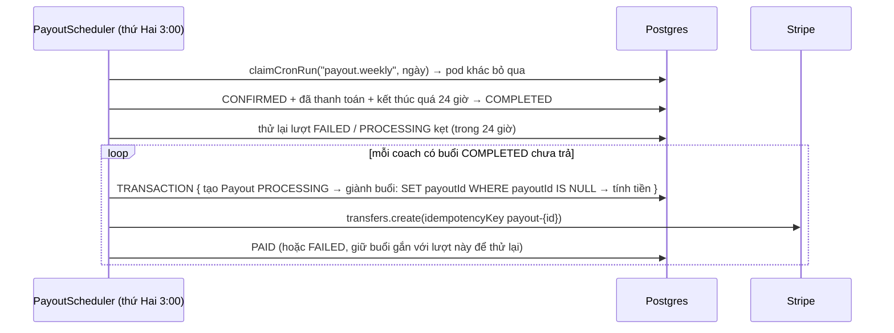

- **File:** `services/payment-service/src/payout/payout.service.ts` (`runPayouts`), `payout.scheduler.ts`. Test: `payout.db-spec.ts`.
- **Điểm thiết kế (R1):**
  - **Mỗi buổi gắn `payoutId` lúc được gom:** một buổi thuộc tối đa **một** lượt trả. Chạy lại, chạy song song, hay pod chết giữa chừng cũng không trả hai lần.
  - **Idempotency key theo lượt:** thử lại lượt lỗi không chuyển tiền hai lần. Key của Stripe hết hạn sau 24 giờ, nên chỉ tự thử lại trong 24 giờ; quá hạn thì cần người kiểm tra.
  - **Đệm 24 giờ sau khi buổi kết thúc** mới tính là COMPLETED, để còn thời gian khiếu nại. Trước đợt sửa, không có code nào đặt COMPLETED, nên cả payout lẫn đánh giá coach đều không chạy được.
  - **Phí tính theo từng buổi** (mỗi buổi có `platformFeePercent` riêng).

---

## 3. Video call 1-1

> **Nói ngắn gọn**
> 1. Đến giờ học, học viên và coach bấm "Vào phòng". Mỗi người xin gateway một **vé vào phòng**. Gateway chỉ cấp khi đúng người của buổi đó, buổi đã thanh toán, và đang trong khung giờ.
> 2. Hai bên kết nối tới **signaling-service** và trình vé. Signaling giống "tổng đài": chỉ giúp hai máy tìm thấy nhau.
> 3. Người vào sau làm người vào trước nhận tín hiệu "có người vào". Người vào trước gửi lời mời (offer), người kia trả lời (answer), hai bên trao địa chỉ mạng (ICE).
> 4. Từ đó **hình và tiếng đi thẳng giữa hai máy** (P2P), không qua server. Nếu mạng chặn đường thẳng (4G, mạng công ty), media đi vòng qua máy chủ TURN (coturn).
> 5. Một người rời phòng thì người kia được báo.

Media đi **thẳng giữa hai máy** (WebRTC P2P). Server chỉ chuyển "tín hiệu" để hai bên tìm thấy nhau: SDP offer/answer và ICE candidate.

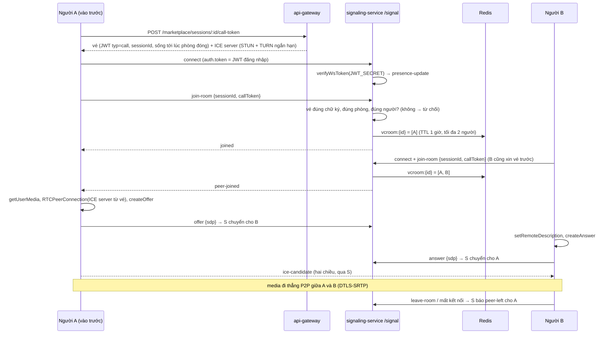

- **File:**
  - server: `services/signaling-service/src/signaling/signaling.gateway.ts`, `room.service.ts` (Redis), `presence/presence.service.ts`, `auth/verify-call-token.ts`; vé và ICE server: `services/payment-service/src/booking/call-token.service.ts`; TURN: service `coturn` trong `docker-compose.yml`;
  - web: `apps/nihongo-web/src/hooks/useVideoCall.ts`, `components/VideoCallUI/`.
- **Điểm thiết kế:**
  - **Người đến sau kích hoạt bắt tay:** server báo `peer-joined` cho người đã ở trong phòng, người đó tạo offer. Nhờ vậy không có chuyện hai bên cùng tạo offer (glare).
  - **Trạng thái phòng nằm trong Redis**, không nằm trong RAM: nhiều instance signaling dùng chung được, và vào lại thì cập nhật `socketId` mới.
  - **Dùng chung JWT với gateway:** signaling tự verify bằng `JWT_SECRET`, không cần gọi gateway.
  - **Vé vào phòng (R2):** signaling không có DB, nên gateway kiểm tra quyền và ký vé: học viên/coach của buổi, buổi CONFIRMED, từ 15 phút trước giờ học tới 30 phút sau khi buổi kết thúc. Signaling chỉ kiểm vé. `offer` / `answer` / `ice-candidate` / `leave-room` chỉ có tác dụng trong phòng mà socket đã vào hợp lệ, nên người ngoài không bơm được tín hiệu vào phòng khác. Test: `signaling.db-spec.ts`, `call-token.db-spec.ts`.
  - **TURN (R6):** coturn với `use-auth-secret`. Mật khẩu = `HMAC-SHA1(TURN_SECRET, "hạn:userId")`, do gateway sinh kèm vé và hết hạn cùng lúc phòng đóng; coturn tự kiểm, không lưu tài khoản. Chạy thật phải đặt `TURN_EXTERNAL_IP` và mở UDP 3478, 49160–49200.
  - **Presence trong Redis (R10):** mỗi user một set socket, cộng một sorted set "online" chấm điểm theo thời điểm hết hạn. Nhiều instance dùng chung, nên đóng tab ở instance A không làm user bị coi là offline khi tab ở instance B còn mở. Instance chết thì TTL tự dọn. Test: `presence.db-spec.ts`.

---

## 4. Livestream

> **Nói ngắn gọn**
> 1. Coach bấm "Phát trực tiếp". Gateway tạo phòng trên LiveKit và đưa coach một token **được phép phát**.
> 2. Coach gửi một luồng hình và tiếng duy nhất lên LiveKit.
> 3. Người xem bấm vào phòng, nhận token **chỉ được xem**. LiveKit nhân luồng của coach ra cho từng người xem (tối đa 200).
> 4. Coach kết thúc, hoặc phòng trống quá 5 phút, thì phòng bị đóng và buổi live chuyển sang ENDED.

Một coach phát, nhiều người xem: P2P không chịu nổi (coach phải gửi N luồng), nên dùng **SFU** là LiveKit. Coach gửi một luồng lên LiveKit, LiveKit nhân ra cho người xem.

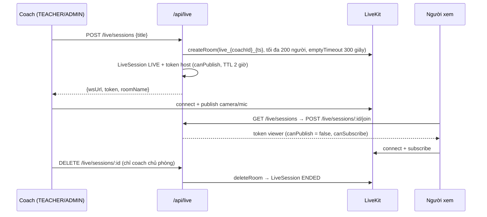

- **File:** `services/api-gateway/src/http/live.service.ts`, `live.controller.ts`. Client:

  | App | File |
  |---|---|
  | web | chưa có (web không dùng `livekit-client`) |
  | Expo | `app/live/host.tsx`, `app/live/viewer.tsx` |
  | Android | `presentation/live/*` (foreground service để phát khi tắt màn hình) |
  | iOS | `Presentation/Live/LiveViews.swift` |
  | Flutter | `presentation/live/*` |

- **Điểm thiết kế:** quyền (host phát, viewer chỉ xem) **nằm trong token** do server ký, nên LiveKit tự chặn. Client sửa code cũng không phát được.
- **Phiên "ma" (R7):** LiveKit gửi webhook `room_finished` tới `POST /api/live/webhook` (khai báo trong `infra/livekit.yaml`, kiểm chữ ký bằng `WebhookReceiver`), và phiên được đánh dấu ENDED ngay. Lớp dự phòng: khi liệt kê hoặc vào xem, đối chiếu với `listRooms`; phòng đã mất trên LiveKit thì ENDED (bỏ qua phòng vừa tạo dưới 1 phút).

---

## 5. Chat cộng đồng realtime

> **Nói ngắn gọn**
> 1. Mở phòng chat thì app giữ một kết nối "nghe" (SSE) tới gateway.
> 2. Gửi tin là một request POST bình thường. Gateway lưu tin vào DB.
> 3. Gateway phát tin lên MQTT. Mọi máy gateway đang có người nghe phòng đó đều nhận được, rồi đẩy xuống app qua kết nối SSE.
> 4. Nhờ MQTT, người gửi và người nhận nối vào hai máy gateway khác nhau vẫn thấy tin của nhau ngay.

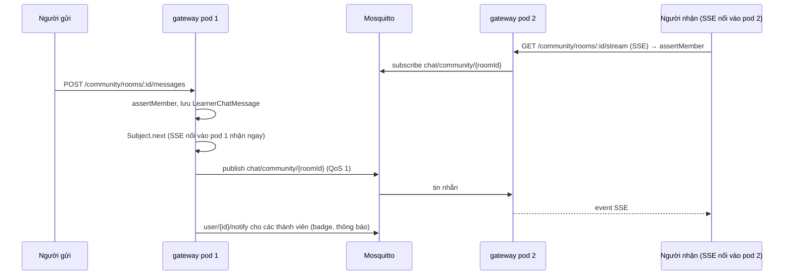

- **File:** `services/api-gateway/src/realtime/chat-events.service.ts` (gộp và lọc trùng), `mqtt.bus.ts`, `group-chat.service.ts`, `http/community.controller.ts`. Support chat có cùng kiểu (`support-chat.service.ts`, `GET /api/support/stream`).
- **Điểm thiết kế:**
  - **SSE thay vì WebSocket:** chat chủ yếu là server → client, còn gửi tin dùng POST bình thường. SSE chạy trên HTTP thường, đi qua nginx/proxy dễ hơn, trình duyệt tự nối lại.
  - **MQTT làm bus giữa các pod:** tin gửi vào pod 1 vẫn tới người nối vào pod 2. Không có `MQTT_URL` thì chạy bằng Subject trong process (dev một pod).
  - **Lọc tin trùng** (`distinct` theo `type:roomId:messageId`, cửa sổ 60 giây): pod gửi sẽ nhận lại chính tin của nó từ broker (echo QoS 1).
  - **`switchMap` theo trạng thái kết nối MQTT:** broker rớt rồi nối lại thì hủy subscription cũ, không nhận tin hai lần.
  - **Header `X-Accel-Buffering: no`:** để nginx không gom SSE lại.
  - **Kiểm tra thành viên ở cả hai đầu:** khi gửi và khi mở stream.

---

## 6. Ôn SRS và đồng bộ offline

> **Nói ngắn gọn**
> 1. Người học lật thẻ và tự chấm nhớ hay quên.
> 2. App tính ngay lần ôn tiếp theo (thuật toán SM-2) và lưu vào DB **trên máy**. Thẻ tiếp theo hiện ra liền, không chờ mạng.
> 3. Lần chấm được xếp vào hàng đợi. Khi có mạng, app gửi cả hàng đợi lên server và chỉ xóa những dòng đã gửi thành công.
> 4. Server chỉ nhận bản **mới hơn** bản đang lưu. Máy offline lâu ngày đẩy dữ liệu cũ lên cũng không đè được tiến độ mới.
>
> Trên web, mỗi thẻ còn tự đọc to từ tiếng Nhật: xem [mục 12](#12-phát-âm-tts).

Ôn tập phải chạy **không cần mạng**, nên mọi app ghi local trước rồi đồng bộ sau (offline-first, outbox ở client).

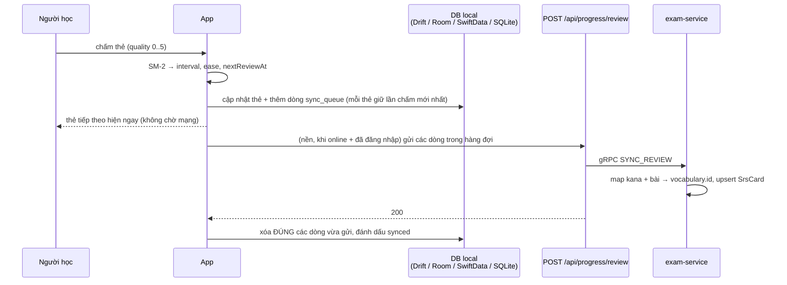

- **File:**
  - client:

    | App | File |
    |---|---|
    | Flutter | `lib/data/repository/vocabulary_repository_impl.dart` |
    | Android | WorkManager: `data/sync/ReviewSyncWorker.kt`, `SyncScheduler.kt` |
    | iOS | `SyncEngine` (`Data/Local/SyncService.swift`) |
    | Expo | `src/data/repository.ts` |
    | RN CLI | `src/db/vocabRepo.ts` |

  - server: `services/exam-service/src/modules/progress/progress.service.ts` (`syncReviewBank`), `packages/nest-prisma/src/srs-card.repository.ts`.
- **Điểm thiết kế:**
  - **Gửi trước, thành công mới xóa,** và chỉ xóa đúng dòng đã gửi. Bản cũ ở Flutter từng xóa trước khi gửi, mất dữ liệu khi API lỗi.
  - **Chỉ một lượt sync tại một thời điểm.**
  - **Hàng đợi lọc theo thẻ:** chấm một thẻ 3 lần lúc offline thì chỉ gửi 1 bản.
  - **Android dùng WorkManager:** đóng app hệ điều hành vẫn gửi khi có mạng.
  - **Lọc "đến hạn" theo giờ hiện tại:** màn SRS lọc lại mỗi phút, chứ không chốt giờ lúc mở màn hình.
- **Thống kê tiến độ:** `GET /api/learning-progress` đọc materialized view `learner_progress_summary`. Cron mỗi 5 phút chạy `REFRESH ... CONCURRENTLY` dưới `pg_try_advisory_xact_lock`, nên nhiều pod chỉ một pod refresh (`learning-progress/`).
- **Bản mới hơn thắng (R3):** server chỉ ghi khi `lastReviewedAt` gửi lên mới hơn bản đang lưu. Điều kiện nằm trong `WHERE` của `updateMany`, nên không đua được. Máy offline lâu đẩy hàng đợi cũ lên không đè được tiến độ mới hơn. Test: `srs-sync.db-spec.ts`.

---

## 7. Thi thử JLPT

> **Nói ngắn gọn**
> 1. Người dùng bấm "Bắt đầu". Server bốc đề, cất **đáp án** vào Redis, chỉ gửi câu hỏi xuống app.
> 2. Người dùng làm bài: từ vựng, ngữ pháp, đọc hiểu, nghe (nghe do máy đọc từng câu thoại, xem [mục 12](#12-phát-âm-tts)), có câu chọn tranh.
> 3. Bấm "Nộp bài". Server lấy đáp án trong Redis ra chấm từng phần, rồi xóa phiên.
> 4. Điểm được lưu cùng một "sự kiện đã nộp bài" trong **cùng một** giao dịch DB. Sau đó sự kiện được đẩy lên Kafka để cập nhật tiến độ.
> 5. Các kết quả này là đầu vào của tính năng [dự đoán điểm](#11-dự-đoán-đề-thi-jlpt).

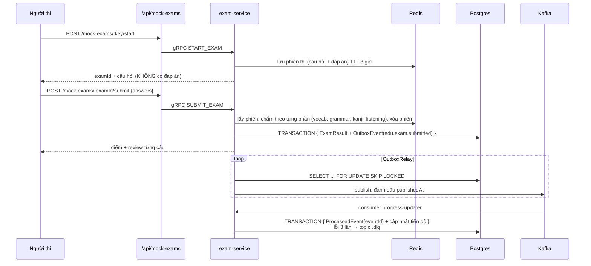

- **File:** `services/exam-service/src/modules/mock-exams/mock-exams.service.ts` (`start`, `submit`), `kafka/outbox-relay.service.ts`, `kafka/exam-events.consumer.ts`, `kafka/progress-updater.ts`.
- **Điểm thiết kế (rất hay được hỏi):**
  - **Đáp án không bao giờ ra client:** nằm trong phiên ở Redis, chấm ở server.
  - **Transactional outbox:** ghi kết quả và event trong **cùng một** transaction. Không còn trường hợp lưu điểm xong mà mất event vì Kafka chết giữa chừng.
  - **`FOR UPDATE SKIP LOCKED`:** nhiều instance relay chạy song song không gửi trùng một dòng.
  - **Consumer idempotent:** relay có thể gửi trùng (gửi xong nhưng chết trước khi đánh dấu). Bảng `ProcessedEvent` khóa theo `eventId`, ghi chung transaction với phần cập nhật.
  - **DLQ:** một message hỏng không chặn cả partition.
  - **Không đăng nhập vẫn thi được** (`OptionalJwtAuthGuard`): khi đó chỉ chấm, không lưu theo user.
- Điểm trực tiếp từng câu: `exam:question-scored` qua Redis pub/sub (cho màn xem điểm realtime).

---

## 8. Nội dung học

> **Nói ngắn gọn:** app xin danh sách từ vựng / kanji / ngữ pháp của một bài. Gateway hỏi content-service. Content-service xem cache Redis trước, không có mới đọc Postgres rồi cất vào cache cho lần sau.

`GET /api/vocabularies?lessonNumber=…` (tương tự cho kanji, ngữ pháp, bài đọc, nghe):

1. Gateway nhận request và gọi gRPC `Dispatch` sang **content-service**.
2. Content-service đọc cache Redis theo khóa của bài (`CacheKeys.vocabByLesson`). Trúng cache thì trả luôn, trượt thì đọc Postgres rồi ghi lại cache.
3. Gateway bọc response `{ success, data }`.

- **File:** `services/content-service/src/modules/*/…service.ts`, `services/api-gateway/src/http/*.controller.ts`.
- **App mobile:** tải về DB local theo bài, đọc offline (mục 6).
- **Cache ghi theo cặp `page` + `limit`:** mỗi bài chỉ giữ một trang trong cache. Đọc trang khác thì trượt cache và ghi đè trang cũ. App mobile luôn đọc `limit=100` nên ít gặp.

---

## 9. AI

> **Nói ngắn gọn:** người dùng hỏi AI hoặc nhờ sửa câu. App gửi lên gateway, gateway gắn lời dặn hệ thống (system prompt) rồi gọi Ollama trên máy hoặc Gemini, sau đó trả câu trả lời về. Key AI chỉ nằm ở server, mỗi người bị giới hạn 30 lần / 10 phút.

```mermaid
sequenceDiagram
  participant App
  participant GW as /api/ai
  participant M as Ollama (mặc định) / Gemini

  App->>GW: POST /ai/chat {question, history, context}<br/>hoặc POST /ai/sentence-feedback {sentence}
  GW->>GW: JWT + throttle 30 lần / 10 phút
  GW->>M: system prompt + 10 tin gần nhất của history
  M-->>GW: câu trả lời (sentence-feedback: JSON)
  GW->>GW: cắt lấy phần JSON, parse; lỗi → báo lỗi, không trả kết quả rỗng
  GW-->>App: {answer} / {corrected, reading, meaning, explanation, examples}
```

- **File:** `services/api-gateway/src/ai/ai.service.ts`, `ai.controller.ts`. Chọn nhà cung cấp bằng `AI_PROVIDER=ollama|gemini`.
- **Điểm thiết kế:**
  - **Key AI chỉ nằm ở server.** Bản cũ của app mobile từng gọi thẳng Gemini bằng key biên dịch vào app: giải nén app là lấy được key.
  - **Throttle riêng cho AI** vì mỗi lần gọi tốn tiền / GPU.
  - **Chỉ gửi 10 tin gần nhất** để giới hạn token.

---

## 9b. Hỏi đáp ngữ pháp có trích nguồn (RAG)

Trang `/grammar/hoi-dap`. Người học hỏi bằng tiếng Việt hoặc gõ thẳng mẫu (「たことがある」); AI trả lời **chỉ dựa trên ngữ pháp có trong app** và đánh số nguồn [1], [2].

> **Nói ngắn gọn**
> 1. Mỗi mẫu ngữ pháp (mẫu + nghĩa + giải thích + 3 ví dụ) được biến thành một **vector embedding**: một dãy 1.024 số mô tả nghĩa. Làm một lần, lưu trong bảng `GrammarEmbedding`.
> 2. Người học hỏi → câu hỏi cũng thành vector → tìm 5 mẫu có vector **gần nhất** (cộng thêm điểm nếu câu hỏi chứa đúng chữ Nhật của mẫu).
> 3. Điểm quá thấp (câu hỏi lạc đề) → báo "không tìm thấy" luôn, **không gọi AI**.
> 4. Ngược lại → gửi AI câu hỏi kèm 5 nguồn đánh số, dặn chỉ trả lời từ nguồn và ghi số nguồn.
> 5. Server đọc lại các số [n] trong câu trả lời: số không tồn tại bị bỏ; không trích nguồn nào thì gắn cờ `grounded: false` để giao diện cảnh báo.

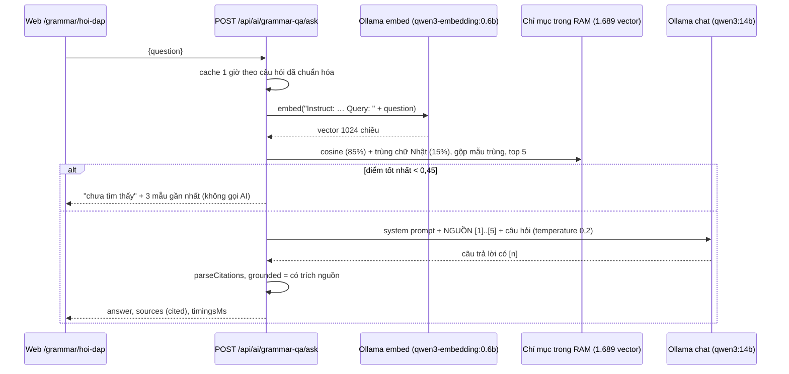

- **File:** `services/api-gateway/src/ai/grammar-qa/` — `grammar-qa.ts` (hàm thuần: ghép nội dung, xếp hạng, prompt, đọc trích dẫn), `embedding.service.ts`, `grammar-qa.service.ts`, `grammar-qa.controller.ts`; bảng `GrammarEmbedding` (migration `20261109090000_grammar_embedding`); web `apps/nihongo-web/src/views/GrammarQaView.tsx`.
- **API:** `POST /ask` (đăng nhập, 30 lần / 10 phút), `GET /search?q=` (chỉ tìm nguồn, không gọi AI), `POST /reindex` và `GET /status` (ADMIN).
- **Tạo chỉ mục:** `POST /api/ai/grammar-qa/reindex` (admin). Lần đầu 1.689 mẫu mất **50 giây**; chạy lại chỉ **38 ms** vì so `contentHash` (hash của nội dung + tên model) và chỉ embed mẫu có thay đổi. Đổi model embedding thì mọi hash đổi → embed lại toàn bộ, dòng của model cũ bị xóa.
- **Đánh giá:** `node services/api-gateway/scripts/grammar-qa-eval.mjs` (bộ câu hỏi trong `grammar-qa-eval.json`). Kết quả ngày 09/11/2026:

  | Chỉ số | Kết quả |
  |---|---|
  | hit@5 (mẫu đúng trong 5 nguồn) | 18/18 = 1,00 |
  | hit@1 (mẫu đúng đứng đầu) | 0,72 |
  | MRR | 0,82 |
  | Câu ngoài phạm vi bị từ chối | 3/3 |

  Script thoát mã 1 nếu hit@5 < 0,8 hoặc có câu ngoài phạm vi được trả lời như có nguồn: chạy lại mỗi khi đổi model, cách ghép nội dung hay trọng số.

- **Điểm thiết kế (hay được hỏi khi phỏng vấn AI production):**
  - **Bám nguồn và trích dẫn:** AI chỉ được dùng nguồn đã đánh số; server tự kiểm số trích dẫn thay vì tin AI. Không trích nguồn nào → cảnh báo trên giao diện.
  - **Hai lớp chặn câu lạc đề:** chỉ dùng ngưỡng điểm là không đủ — câu "thời tiết Hà Nội" đạt 0,529, cao hơn câu đúng chủ đề "nếu trời mưa" (0,515). Lớp 1: ngưỡng thấp loại câu chắc chắn lạc đề, **không tốn lượt gọi AI**. Lớp 2: prompt dặn AI từ chối, và câu trả lời không trích nguồn bị gắn `grounded: false`.
  - **Kết hợp vector + chữ:** embedding xếp sai thứ tự giữa các mẫu gần nghĩa; người học gõ 「たことがある」 (thể thường) trong khi DB lưu 「たことがあります」, nên so bằng chuỗi con chung ≥ 3 ký tự chứ không so nguyên chuỗi.
  - **Chi phí và độ trễ:** cache câu hỏi 1 giờ; câu lạc đề không gọi AI; mỗi câu ghi một dòng log `grammar_qa` gồm thời gian embed / tìm / AI và điểm nguồn tốt nhất. Đo thật: tìm nguồn ~120 ms, AI ~12 giây (`qwen3:14b` chạy trên máy).
  - **Chưa dùng pgvector:** image Postgres hiện tại không có extension này. 1.689 vector tìm tuyến tính trong RAM dưới 5 ms. Khi lên hàng trăm nghìn tài liệu thì chuyển sang pgvector với chỉ mục HNSW.
  - **Model "nghĩ" (qwen3):** phải gửi `reasoning_effort: "none"`, nếu không model dùng hết `max_tokens` để suy nghĩ và câu trả lời **rỗng** (xem `LOCAL_AI_REASONING`).
  - **Cấu hình:** `LOCAL_AI_MODEL`, `LOCAL_AI_EMBED_MODEL` (mặc định `qwen3-embedding:0.6b`, cài bằng `ollama pull`), `LOCAL_AI_TIMEOUT_MS` (mặc định 120 giây), `GRAMMAR_QA_MIN_SCORE` (mặc định 0,45).

---

## 10. Nhắc ôn (push, email)

> **Nói ngắn gọn:** 9 giờ sáng mỗi ngày, server đếm số thẻ đến hạn của từng người và gửi thông báo đẩy (iOS qua APNs, Android qua FCM) hoặc email. Nhiều máy gateway cùng chạy lịch này, nhưng chỉ một máy được gửi. Bấm thông báo thì app mở thẳng màn ôn tập.

| Việc | Lịch (giờ VN) | File |
|---|---|---|
| Push "Bạn có N thẻ cần ôn" | 9:00 mỗi ngày | `services/api-gateway/src/push/push.scheduler.ts` → `push.service.ts` (APNs) |
| Email nhắc / tổng kết | 9:00 mỗi ngày, 8:00 Chủ nhật | `mail-scheduler/mail-scheduler.service.ts` (Brevo) |
| Refresh thống kê tiến độ | mỗi 5 phút | `learning-progress/application/learner-progress.scheduler.ts` (có advisory lock) |

Luồng push:
1. `claimCronRun("push.daily-srs", ngày VN)`: mọi pod gateway đều nổ cron, chỉ pod giành được lượt mới gửi (R11).
2. Cron đếm thẻ đến hạn theo từng user (`srsCard.groupBy`).
3. Token iOS gửi qua APNs; token Android gửi qua FCM HTTP v1 (`push/fcm.sender.ts`, bật bằng `FCM_SERVICE_ACCOUNT_JSON`). Cả hai đều hết hạn sau 1 giờ. Token giả `android-<uuid>` của bản Flutter cũ thì bỏ qua và xóa.
4. Token APNs `BadDeviceToken` / `Unregistered`, hoặc FCM `UNREGISTERED`, thì xóa.
5. Bấm thông báo → app mở màn SRS (payload `screen: srs`, deep link `nihongo://srs`).

App Android native nhắc ôn bằng thông báo **local** (`SrsReminderWorker`, WorkManager), không cần server.

**Vì sao không dùng advisory lock cho cron (R11):** khóa kiểu "đang chạy" không chặn được trường hợp pod A chạy xong trong vài giây rồi nhả khóa, sau đó pod B nổ trễ vài trăm mili giây vẫn lấy được khóa. Cần ghi nhớ "lượt này **đã** chạy": khóa chính `(name, slot)` của bảng `CronRun`. Test: `cron-run.db-spec.ts`.

---

## 10b. Học viên sắp bỏ học (Airflow)

> **Nói ngắn gọn:** mỗi đêm Airflow tính xem học viên nào có dấu hiệu sắp bỏ học. Số liệu phải qua bước kiểm tra chất lượng, rồi Airflow nhờ gateway gửi email mời quay lại. Mỗi người nhận tối đa một email mỗi ngày, kể cả khi pipeline chạy lại.

Pipeline `learner_insights` (Airflow 3, chạy 2:00 sáng giờ VN) tính số liệu của ngày hôm trước và gửi email kéo học viên quay lại. Chi tiết, cách chạy và test: [infra/airflow/README.md](../infra/airflow/README.md).

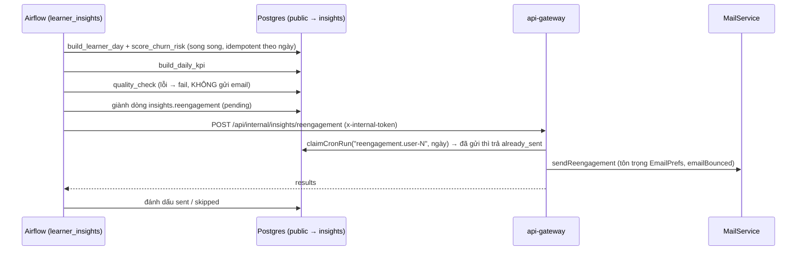

- **File:**
  - Airflow: `infra/airflow/dags/learner_insights.py`, `infra/airflow/dags/insights/queries.py`;
  - schema: `infra/flyway/sql/V2__learner_insights.sql`;
  - gateway: `services/api-gateway/src/insights/`;
  - web: `apps/nihongo-web/src/views/admin/AdminInsightsPage.tsx` (`/admin/insights`).
- **Điểm thiết kế:**
  - **Đúng việc cho Airflow:** nhiều bước phụ thuộc nhau, retry từng bước, kiểm tra chất lượng chặn bước có tác dụng phụ (gửi email), backfill, và lịch sử chạy trên UI.
  - **Bảng `insights` do Flyway quản** (read model), Prisma chỉ quản `public`, nên không có drift.
  - **Mọi bước idempotent theo ngày:** xóa rồi ghi lại trong một transaction.
  - **Backfill không gửi email:** lần chạy cho ngày cũ hơn 2 ngày tự bỏ qua bước gửi.
  - **Chống gửi trùng hai lớp:** Airflow giành dòng `pending`, gateway chặn theo (học viên, ngày). Đã thử thật: gateway nhận 4 request (lần chạy đầu + retry), học viên nhận đúng 1 email.

## 11. Dự đoán đề thi JLPT

Trang `/jlpt/du-doan` có hai phần: **dự đoán điểm** của chính người học, và **nội dung dễ ra** của từng cấp.

> **Nói ngắn gọn**
> 1. Người học chọn cấp (N5–N1).
> 2. **Dự đoán điểm:** server lấy tối đa 10 bài thi thử gần nhất (bài mới nặng ký hơn), cộng thêm bằng chứng từ luyện tập (thẻ SRS, bài đọc, bài chép chính tả). Sau đó nó "thi thử ảo" 4.000 lần để ra **xác suất đỗ**, điểm dự kiến từng phần và phần yếu nhất.
> 3. **Nội dung dễ ra:** server xếp hạng từ vựng, kanji, ngữ pháp của cấp đó theo độ phổ biến trên báo chí, số giáo trình có chúng, và số lần chúng xuất hiện trong kho ~15.500 câu tiếng Nhật của app.
> 4. Web hiện xác suất đỗ, mức tin cậy, và danh sách "Rất hay ra / Hay ra / Có thể ra". Mỗi mục có lý do và link tới bài học.

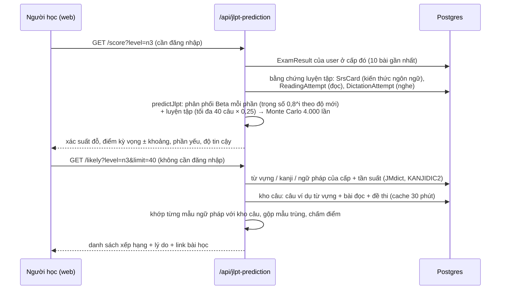

- **File:**
  - server: `services/api-gateway/src/http/jlpt-prediction.ts` (mô hình, khớp ngữ pháp), `jlpt-prediction.service.ts` (SQL, kho câu), `jlpt-prediction.controller.ts`; test `jlpt-prediction.spec.ts`;
  - web: `apps/nihongo-web/src/views/ExamPredictionView.tsx`, route `app/(main)/jlpt/du-doan/`;
  - dữ liệu tần suất: `packages/prisma-nihongo/scripts/import-frequency.mjs`.
- **Điểm thiết kế:**
  - **Đỗ phải đạt cả tổng điểm lẫn điểm sàn từng phần** (ví dụ N3: tổng ≥ 95/180 và mỗi phần ≥ 19). Mô phỏng Monte Carlo kiểm cả hai điều kiện trong cùng một lần thi ảo, nên ra đúng xác suất đỗ, không chỉ "điểm trung bình đủ chưa".
  - **Ít dữ liệu thì nói rõ là ít:** chưa thi bài nào thì độ tin cậy `none`, có ít bài thì khoảng điểm rộng ra. Luyện tập được tính nhưng nhẹ ký, và bị chặn trần, để ôn thẻ dễ không làm điểm dự đoán phồng lên.
  - **Seed cố định cho bộ sinh số ngẫu nhiên** (mulberry32): cùng dữ liệu thì luôn ra cùng kết quả, test được.
  - **Khớp ngữ pháp với kho câu:** mỗi mẫu được chuyển thành biểu thức chính quy (lấy phần chữ Nhật đặc trưng, hoặc dùng luật riêng). Các mẫu dễ nhầm có luật riêng: tôn kính và bị động cùng dạng れる/られる, sai khiến bị động, お〜になる, động từ tôn kính đặc biệt. Mẫu không đo được thì ghi rõ thay vì đoán.

---

## 12. Phát âm (TTS)

Dùng ở thẻ SRS (loa + tự đọc), từ điển hình ảnh, ví dụ ngữ pháp, và phần nghe của đề thi thử.

> **Nói ngắn gọn**
> 1. Người dùng bấm loa, hoặc thẻ SRS tự đọc khi lật sang mặt tiếng Nhật.
> 2. Nếu máy có sẵn giọng tiếng Nhật, trình duyệt **tự đọc** bằng Web Speech API. Không tốn gì của server.
> 3. Nếu máy không có giọng phù hợp (và luôn luôn với tiếng Việt), web gửi câu lên `POST /api/tts`. Gateway đọc thành file mp3 (giọng Nanami / HoaiMy) bằng **Azure Speech** (nếu có khóa), không thì thử **Edge TTS**, rồi trả về cho web phát.
> 3b. Server không đọc được thì trả **503** ngay. Web nhớ điều đó 5 phút và trong thời gian đó đọc luôn bằng giọng của máy, không chờ.
> 4. Phần nghe của đề thi: đoạn hội thoại được tách thành từng câu và đọc lần lượt, nghỉ khoảng 0,5 giây giữa các câu.

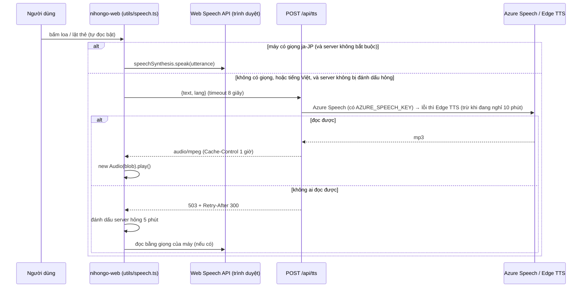

- **File:** `apps/nihongo-web/src/utils/speech.ts` (`playAudio`, `playAudioSequence`, `isServerTtsDown`), `config/speech.ts` (thứ tự ưu tiên giọng, tốc độ), `views/SrsView.tsx` (nút loa, công tắc tự đọc, phím tắt R), `components/ListeningPlayer.tsx`, `utils/mockExam.ts` (`listeningLines`); server `services/api-gateway/src/http/tts.controller.ts`, `tts.service.ts`; test `tts.service.spec.ts`.
- **Điểm thiết kế:**
  - **Ưu tiên đọc trên máy:** nhanh, không tốn băng thông, không tạo tải cho server. Server chỉ là đường dự phòng.
  - **Azure Speech trước, Edge TTS sau:** Azure là dịch vụ chính thức (cần `AZURE_SPEECH_KEY` + `AZURE_SPEECH_REGION`, gói F0 miễn phí 500.000 ký tự/tháng). Edge TTS là endpoint nội bộ của trình duyệt Edge, không có hợp đồng sử dụng; từ 11/2026 Microsoft trả 403 cho nó. Edge lỗi thì gateway nghỉ 10 phút mới thử lại, để không request nào phải chờ 10 giây.
  - **Hỏng thì báo nhanh:** server trả 503 kèm `Retry-After`, web nhớ 5 phút. Trước đây web chờ hết 8 giây ở **mỗi** câu rồi mới chuyển sang giọng của máy.
  - **Mỗi lần phát có mã phiên** (`playSessionId`): bấm sang thẻ khác thì âm thanh cũ bị bỏ, không chồng tiếng.
  - **Công tắc tự đọc lưu trong `localStorage`:** chỉ là tiện ích của từng máy, không cần lưu lên server.
  - **Giới hạn 60 lần/phút theo IP** (`@Throttle` trên `tts.controller.ts`): endpoint công khai và mỗi lần gọi tốn một lượt Edge TTS. Web luôn phát tuần tự (đọc xong câu này mới gọi câu sau), nên mức này dư cho người dùng thật.
  - **Giới hạn tính theo IP thật của người dùng:** gateway bật `trust proxy` (một lớp, là nginx), nên mỗi người có bộ đếm riêng. Trước 03/11/2026 chưa bật, nên mọi người dùng đi qua nginx chung **một** bộ đếm 120 request/phút của throttler toàn cục.

---

## 13. Sơ đồ tư duy

Trang sơ đồ tư duy từ vựng / kanji / ngữ pháp theo cấp N5–N1.

> **Nói ngắn gọn**
> 1. Người dùng mở sơ đồ của một loại (từ vựng, kanji, ngữ pháp).
> 2. Web gọi `GET /api/mind-maps/data?kind=VOCAB`. Gateway **tự dựng sơ đồ từ toàn bộ dữ liệu trong DB**: chia theo cấp, rồi gom nhóm (theo từ loại, theo bài…), mỗi cấp tối đa 8 nhánh.
> 3. Kết quả được nhớ trong RAM của gateway. Lần sau chỉ dựng lại khi dữ liệu đổi (số dòng hoặc thời điểm sửa gần nhất khác đi).
> 4. Admin vẫn có thể lưu sơ đồ soạn tay qua `POST /api/mind-maps/bulk-upsert`.

- **File:** `services/api-gateway/src/http/mind-maps.controller.ts`, `mind-map-data.service.ts` (`build`, `version`), `mind-maps.service.ts`; web `apps/nihongo-web/src/views/VocabMindMapView.tsx`, `KanjiMindMapView.tsx`, `data/jlpt-mind-map-shared.ts` (bố trí nhánh: quá 8 nhánh thì so le bán kính); dữ liệu soạn sẵn: `packages/prisma-nihongo/scripts/build-mind-maps.mjs`. Quyết định đưa sơ đồ xuống DB: [ADR-0002](./adr/0002-mind-map-content-in-db.md).
- **Điểm thiết kế:**
  - **Cache theo "phiên bản dữ liệu"** (`count:maxUpdatedAt`) thay vì hẹn giờ: thêm từ mới là sơ đồ cập nhật ngay ở lần gọi sau, không phải đợi cache hết hạn.
  - **Route `data` đặt trước `:id`:** nếu không, NestJS hiểu chữ `data` là một `id` và báo lỗi parse số.

---

## 14. Từ điển hình ảnh

> **Nói ngắn gọn**
> 1. Người dùng chọn bài. Web tải danh sách từ vựng của bài như bình thường ([mục 8](#8-nội-dung-học)).
> 2. **Ngay trên trình duyệt**, mỗi từ được tra trong gói `@edu/vocab-images` để tìm ảnh minh họa: ưu tiên ảnh gán riêng cho từ, rồi khớp theo nghĩa tiếng Việt.
> 3. Từ nào không có ảnh phù hợp thì bị loại khỏi từ điển hình ảnh, thay vì hiện ảnh sai.
> 4. Bấm từ để nghe phát âm ([mục 12](#12-phát-âm-tts)) và xem thứ tự nét.

- **File:** `apps/nihongo-web/src/views/PictureDictionaryView.tsx`; `packages/vocab-images/src/index.ts` (`resolveVocabImage`, `isPictureEligible`, `WORD_OVERRIDES`, `viMeaningSegments`); ảnh nằm ở `packages/vocab-images/media/{openmoji,exam}`, được đồng bộ sang `apps/nihongo-web/public/media`.
- **Điểm thiết kế:**
  - **Khớp nghĩa chặt:** tách nghĩa tiếng Việt thành từng cụm và chỉ nhận khi khớp trọn cụm, để "bàn" không ăn nhầm vào "bàn tay". Từ có kanji thì không tra theo kana / romaji, tránh hai từ đồng âm dùng chung một ảnh.
  - **Ảnh là file tĩnh** do Next.js phục vụ (đi qua nginx), không qua gateway.
  - **Câu hỏi chọn tranh trong đề thi thử** dùng chung kho ảnh nhưng theo cách khác: câu hỏi lưu sẵn `imageUrl` (thư mục `/media/exam/`) trong DB. Phương án chỉ có tranh được đánh dấu `［図］`: lúc làm bài chỉ hiện tranh, lúc xem đáp án mới hiện chữ (`utils/mockExam.ts` → `pictureOption`, `views/MockExamTakePage.tsx`).

---

## 15. Phân tích cấu tạo kanji

Bảng "cấu tạo" ở trang kanji: một chữ gồm những bộ nào, mỗi bộ nghĩa là gì.

> **Nói ngắn gọn**
> 1. Người dùng mở một chữ kanji.
> 2. Web tải **cây cấu tạo** của chữ (sinh sẵn từ dữ liệu nét KanjiVG, nằm ở `/media/kanji-components.json`, là file tĩnh).
> 3. Web tải **thông tin các bộ** (tên Hán Việt, nghĩa) từ `GET /api/kanji-components`. Request đi gateway → content-service → bảng `KanjiComponent`.
> 4. Web ghép cây với thông tin bộ để vẽ bảng cấu tạo. Cả hai được tải một lần rồi giữ lại cho các chữ khác.

- **File:** web `apps/nihongo-web/src/utils/kanji-structure-fetch.ts`, `utils/kanji-structure.ts`, `api/index.ts` (`fetchKanjiComponents`); server `services/api-gateway/src/http/kanji.controller.ts` (`kanji-components`), `services/content-service/src/content.ms.controller.ts` (`GET_KANJI_COMPONENTS`); dữ liệu `packages/prisma-nihongo/scripts/kanji-components.sql`, migration `20261101090000_kanji_component`.
- **Điểm thiết kế:**
  - **Tách hai loại dữ liệu:** cây nét (lớn, không đổi) là file tĩnh; thông tin bộ (nhỏ, cần sửa được) nằm trong DB. Sửa nghĩa một bộ không cần build lại web.
  - **Promise dùng chung** (`indexPromise ??=`, `infoPromise ??=`): mở nhiều chữ liên tiếp cũng chỉ tải mỗi thứ một lần.

---

## 16. Đặt lịch học với coach: đầu đến cuối

Ghép các mục ở trên thành một hành trình hoàn chỉnh, để thấy các phần nối với nhau thế nào:

1. **Đặt buổi:** học viên chọn coach và giờ, rồi trả tiền bằng thẻ ([2c](#2c-đặt-buổi-học-với-coach)). Buổi ở trạng thái PENDING.
2. **Stripe báo đã thu tiền** qua webhook ([2b](#2b-webhook-stripe)). Buổi chuyển sang CONFIRMED, học viên và coach nhận thông báo.
3. **Trước giờ học:** hủy sớm hơn 24 giờ thì được hoàn tiền tự động ([2d](#2d-hoàn-tiền)).
4. **Đến giờ học** (từ 15 phút trước): hai bên xin vé và vào phòng gọi video ([3](#3-video-call-1-1)).
5. **24 giờ sau khi buổi kết thúc:** buổi thành COMPLETED. Thứ Hai tuần sau, lúc 3 giờ sáng, coach nhận tiền qua Stripe Connect, đã trừ phí nền tảng ([2e](#2e-trả-tiền-cho-coach-payout)).

---

## 17. Rủi ro đã sửa

Tìm thấy khi viết tài liệu này, sửa cùng ngày 21/10/2026. Phần lớn có test chạy trên **Postgres / Redis / Socket.IO thật** (`*.db-spec.ts`, `npm run test:db` trong `services/`, CI chạy ở job `backend`). Với các chỗ dễ đua nhau, từng test đã được chạy trên code lỗi để chắc nó **đỏ** (bỏ điều kiện / khóa thì test fail).

| # | Mức | Vấn đề cũ | Đã sửa | Test |
|---|---|---|---|---|
| R1 | Cao | Payout không được gọi ở đâu; nếu gọi thì trả gấp đôi khi chạy lại, bỏ sót buổi cũ, không thử lại, % phí sai. **Không có code nào đặt COMPLETED.** | Tự COMPLETED sau 24 giờ; mỗi buổi gắn `payoutId`; idempotency key theo lượt; thử lại lượt lỗi; cron thứ Hai 3:00 | `payout.db-spec.ts` |
| R2 | Cao (bảo mật) | Ai đăng nhập cũng vào được phòng gọi bất kỳ; người ngoài còn bơm được offer/ICE và gửi `peer-left` giả vào phòng người khác | Vé vào phòng do gateway ký; signaling chỉ chuyển tín hiệu trong phòng đã vào hợp lệ | `signaling.db-spec.ts`, `call-token.db-spec.ts` |
| R3 | Trung bình | Server ghi đè thẻ SRS, ai gửi sau thắng | Chỉ ghi khi bản gửi lên mới hơn (điều kiện trong `WHERE`) | `srs-sync.db-spec.ts` |
| R4 | Trung bình | Hai người đặt cùng slot đều thành công; giờ chồng nhau vẫn lọt | Kiểm tra trùng + tạo trong một transaction có khóa theo coach; kiểm tra theo khung giờ | `booking.db-spec.ts` |
| R5 | Trung bình (bảo mật) | Refresh không nguyên tử; token bị lộ dùng được, không ai biết | Thu hồi nguyên tử; khoảng 30 giây cho hai tab; dùng lại token cũ → thu hồi mọi phiên | `auth.refresh.db-spec.ts` |
| R6 | Trung bình | Chỉ STUN: mạng 4G/5G, mạng công ty không gọi được | coturn + mật khẩu TURN ngắn hạn kèm vé (đã thử cấp phát relay với coturn thật) | `call-token.db-spec.ts` |
| R7 | Thấp | Phiên livestream "ma" còn LIVE | Webhook `room_finished` + đối chiếu `listRooms` | `live.service.spec.ts` |
| R8 | Thấp | Hoàn tiền không có idempotency key | Key `refund-payment-{id}` | `refund.service.spec.ts` |
| R9 | Thấp | Chỉ gửi APNs (tài liệu cũ ghi nhầm là Android không có nhắc ôn: Android native có nhắc local) | Thêm FCM HTTP v1 cho token Android (Expo); dọn token giả của Flutter | `push.service.spec.ts`, `fcm.sender.spec.ts` |
| R10 | Thấp | Presence trong RAM từng instance (tài liệu cũ đánh giá quá tay phần "phát cho mọi người": đó đúng là tính năng danh sách online của cộng đồng) | Presence trong Redis; gateway bỏ lệnh `KEYS` | `presence.db-spec.ts` |
| R11 | Thấp | 2 pod → 2 push / 2 email | Bảng `CronRun` (mỗi lượt một pod) | `cron-run.db-spec.ts` |
| R12 | Thấp | `edu.payment.succeeded` gửi thẳng Kafka, lỗi là mất | Ghi `OutboxEvent` cùng transaction với `Payment` | `webhook.service.spec.ts` |

<!-- nav:start -->

---

## Đi tiếp

Bạn đang ở **2. Kiến trúc hệ thống** — bài 3/7.

- Bài trước: [learn-microservices.md](./learn-microservices.md) — Microservice là gì, vì sao project tách service, cái giá phải trả và chỗ còn thiếu
- **Bài tiếp: [microservices-communication.md](./microservices-communication.md)** — Các service nói chuyện với nhau bằng gì, vì sao

Mục lục toàn bộ tài liệu: [docs/README.md](./README.md)

<!-- nav:end -->
