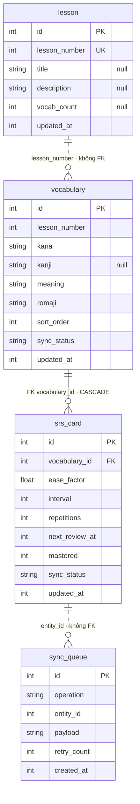
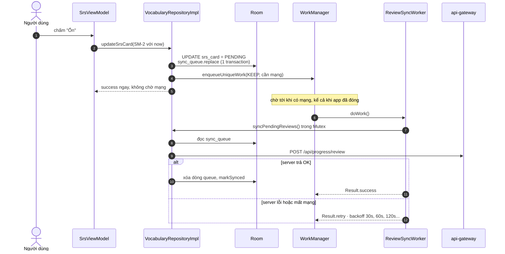
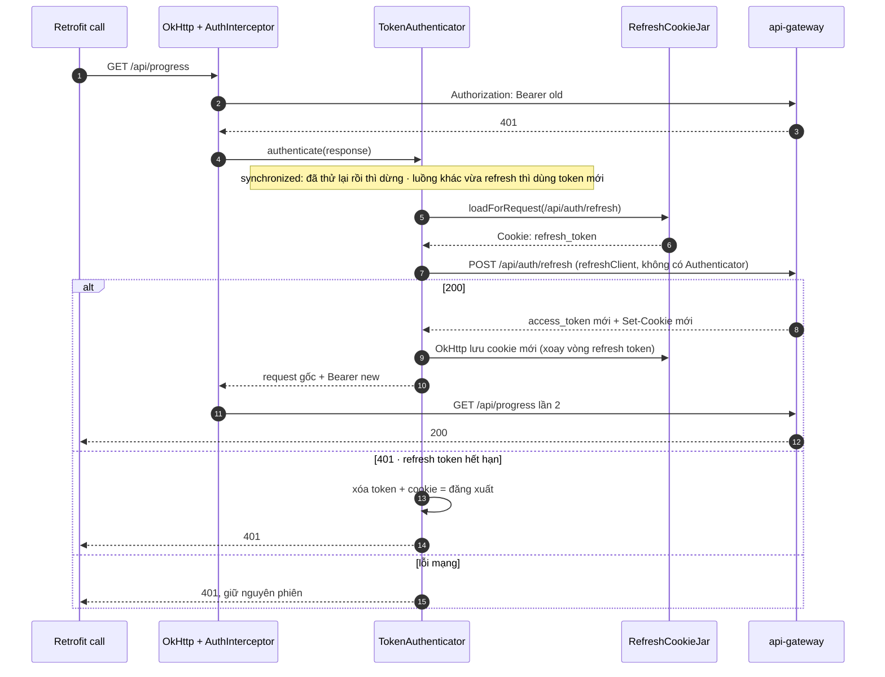

# Android 2: Kiến trúc, dữ liệu, mạng và test của `nihongo-android`

> **Mục tiêu:** Học xong bài này bạn:
> - giải thích được các lớp của app (UI → ViewModel → use case → repository → Room/mạng) và hai chỗ từng lệch;
> - dùng được ViewModel với `SavedStateHandle`, Navigation Compose;
> - thiết kế được dữ liệu offline-first: Room làm nguồn sự thật, hàng đợi sync, migration an toàn;
> - nối mạng đúng cách: Retrofit, thứ tự interceptor OkHttp, làm mới token bằng CookieJar + Authenticator, Hilt;
> - viết test cho hàm thuần, ViewModel có coroutine, OkHttp thật (MockWebServer) và migration;
> - kể được 14 lỗi đã tìm và sửa (L1–L14), mỗi lỗi có test chứng minh.
>
> **Cần biết trước:** [learn-android-kotlin.md](./learn-android-kotlin.md) (bài 1: Kotlin, coroutine, Compose). Biết SQL cơ bản giúp đọc phần Room dễ hơn ([learn-sql.md](./learn-sql.md)).
> **Thời gian:** khoảng 4 tuần, 1,5–2 giờ mỗi ngày (tuần 4–7 trong [lộ trình 9 tuần](./learn-android-kotlin.md#lộ-trình-9-tuần-cho-cả-bốn-bài)).

Đây là bài **2/4** của lộ trình Android. Số mục tiếp nối bài 1 (bắt đầu từ mục 26), để mã lỗi và tham chiếu "mục N" giống nhau ở mọi tài liệu. Câu hỏi phỏng vấn: [interview-android.md](./interview-android.md).

**Tìm code được nhắc tới:** như bài 1, đường dẫn trong comment tính từ `apps/nihongo-android/app/src/main/java/com/edu/nihongo/`; mở file rồi tìm theo tên hàm.

## Từ khóa trong bài

| Từ | Nghĩa ngắn gọn |
|---|---|
| Kiến trúc nhiều lớp | Chia code thành giao diện, nghiệp vụ, dữ liệu; mỗi lớp chỉ biết lớp bên dưới qua interface |
| Repository | Lớp duy nhất biết dữ liệu đến từ DB hay mạng. ViewModel chỉ gọi repository |
| Use case | Một hành động nghiệp vụ, ví dụ "lấy từ vựng của bài" |
| `SavedStateHandle` | Chỗ ViewModel cất dữ liệu nhỏ để sống qua process death |
| Room / DAO / Entity | Room: thư viện SQLite. DAO: interface khai báo câu query. Entity: class ứng với một bảng |
| Migration | Code nâng cấu trúc DB từ phiên bản cũ lên mới mà không mất dữ liệu người dùng |
| Offline-first | App luôn đọc từ DB trên máy; mạng chỉ dùng để cập nhật DB |
| Hàng đợi sync | Bảng ghi các thay đổi làm lúc offline, gửi lên server khi có mạng |
| WorkManager | Thư viện chạy việc nền chắc chắn, kể cả sau khi tắt app hay khởi động lại máy |
| Interceptor (OkHttp) | Hàm chen vào mọi request/response, ví dụ gắn token |
| Authenticator (OkHttp) | Hàm OkHttp gọi khi nhận 401, để làm mới token rồi gửi lại |
| DI / Hilt | Dependency Injection: Hilt tự tạo object và truyền vào constructor |
| Fake (bản giả) | Class viết tay thay cho DB/mạng thật trong unit test |
| MockWebServer | Server HTTP giả chạy trong test, trả response do test quy định |

## Mục lục

- **Phần D — Kiến trúc**: 26. Các lớp và chỗ từng lệch · 27. ViewModel, `SavedStateHandle` · 28. Navigation
- **Phần E — Dữ liệu**: 29. Room · 30. Offline-first và hàng đợi sync · 31. Retrofit, OkHttp, Hilt
- **Phần F — Tính năng native**: 32. AppAuth · 33. CameraX, ML Kit · 34. TTS, push, LiveKit
- **Phần G — Test**
- **Phần H — 14 lỗi đã tìm và sửa** (mục 35)

---

# Phần D — Kiến trúc

### Hiểu nhanh

Bài 1 dạy viết từng mảnh: một hàm Kotlin, một coroutine, một màn hình Compose. Phần này trả lời câu hỏi **đặt mảnh nào ở đâu**. Nếu bạn đã đọc [learn-nestjs.md](./learn-nestjs.md), ý tưởng giống backend: controller không gọi thẳng database mà đi qua service; ở Android, màn hình không gọi thẳng API mà đi qua ViewModel và repository. Nhờ vậy mỗi phần thay được bằng bản giả khi test.

## 26. Các lớp — và hai chỗ từng lệch

```text
presentation  ──▶  domain  ◀──  data
(Screen, VM)      (entity,       (Room, Retrofit,
                   repository     RepositoryImpl)
                   interface,
                   use case)
```

`VocabularyRepository` là interface trong `domain/`; `VocabularyRepositoryImpl` ở `data/`; Hilt nối hai bên bằng `@Binds` (`AppModule.kt`). ViewModel chỉ biết interface, nên test thay bằng bản giả được (mục G làm đúng như vậy).

Hai chỗ bản cũ không theo luật, giờ đã sửa:

1. **Domain import Android (L10).** `OverlayLabel(val rect: android.graphics.RectF, ...)` từng nằm trong `domain/entity`. Domain dính Android thì không test được bằng JVM thuần và không tách thành module Kotlin thuần được. **Đã chuyển** sang `presentation/camera/OverlayLabel.kt`, vì nó vốn là model của UI. Kiểm tra: `grep -rn "android\." app/src/main/java/com/edu/nihongo/domain/` không ra gì.
2. **ViewModel gọi thẳng API và đưa DTO lên UI (L11).** `LessonListViewModel` từng inject `LessonsApi` và đưa `LessonDto` (model mạng) thẳng tới Screen: server đổi tên field là UI hỏng theo, và màn bài học không chạy offline. **Đã sửa** theo đúng khuôn của Vocab: `domain/entity/Lesson` + `LessonRepository` (domain) ← `LessonRepositoryImpl` (data) + bảng Room `lesson`. ViewModel `combine` Flow từ Room với trạng thái refresh, nên offline vẫn thấy danh sách cũ kèm thông báo lỗi.

Biết chỉ ra chỗ lệch trong code của chính mình và nói được cái giá của nó là điều được đánh giá cao khi phỏng vấn.

---

## 27. ViewModel, `SavedStateHandle`, vòng đời

```kotlin
// VocabViewModel.kt
@HiltViewModel
class VocabViewModel @Inject constructor(
    savedStateHandle: SavedStateHandle,
    getVocabByLesson: GetVocabByLessonUseCase,
    private val syncLesson: SyncLessonUseCase,
) : ViewModel() {
    private val lessonNumber: Int = savedStateHandle.get<Int>("lesson") ?: 1
```

- `@HiltViewModel` + `@Inject constructor`: Hilt biết cách tạo. `hiltViewModel()` trong Composable lấy instance gắn với **back stack entry** của route đó.
- `SavedStateHandle` tự chứa argument của route (`"lesson"` từ `vocab/{lesson}`), và sống qua process death. ViewModel không cần Screen truyền `lessonNumber` vào.
- Tham số không có `val`/`private val` (như `getVocabByLesson`) chỉ dùng được trong `init` và khởi tạo property; không thành field.

Vòng đời: ViewModel sống qua xoay màn hình (Activity bị tạo lại, ViewModel thì không), và bị clear khi route bị pop. Lúc đó `onCleared()` chạy: camera VM đóng `recognizer` và `cameraExecutor` ở đây (`CameraTranslateViewModel.kt`).

Vì `init` chạy sync mỗi khi ViewModel được tạo, mỗi lần vào màn bài 3 là một lần gọi mạng. Xoay màn hình thì không gọi lại (ViewModel vẫn sống). Đây là hành vi đúng.

---

## 28. Navigation Compose

```kotlin
// NihongoApp.kt
const val VOCAB = "vocab/{lesson}"
fun vocab(lesson: Int) = "vocab/$lesson"

composable(route = Routes.VOCAB, arguments = listOf(navArgument("lesson") { type = NavType.IntType })) { entry ->
    VocabScreen(lessonNumber = entry.arguments?.getInt("lesson") ?: 1, onBack = { navController.popBackStack() })
}
```

- Route là chuỗi giống URL; argument dạng `{tên}` có kiểu (`IntType`, `StringType`).
- Chuỗi có ký tự đặc biệt phải encode: `Routes.pronunciation()` dùng `URLEncoder.encode(kana, "UTF-8")`, nơi nhận `URLDecoder.decode`. Không encode thì chữ có `/` sẽ làm hỏng route.
- Screen không giữ `navController`, chỉ nhận lambda `onBack`, `onOpenLesson`. Screen dễ preview và test, và chỉ `NihongoApp` biết về điều hướng.

**Vì sao có `LiveNavigationStore`** (`data/LiveNavigationStore.kt`): màn xem live cần token LiveKit. Đặt token vào route (`live/viewer?token=...`) thì token nằm trong back stack, có thể bị log, và có giới hạn độ dài. Nên ViewModel trước ghi vào một singleton, ViewModel sau đọc ra một lần (`consumeJoin()`). Đánh đổi: nếu process bị hệ điều hành giết khi đang ở màn viewer thì mất token, màn hình phải xử lý trường hợp `null`.

Navigation 2.8 hỗ trợ route an toàn kiểu (`@Serializable data class Vocab(val lesson: Int)`), thay cho chuỗi. Đây là refactor hay cho tuần 6.

---

# Phần E — Dữ liệu

### Hiểu nhanh

App học tiếng Nhật phải dùng được trên tàu điện mất sóng. Vì vậy dữ liệu đi theo một chiều:

```text
Server ──(khi có mạng)──▶ Room trên máy ──(luôn luôn)──▶ màn hình
Màn hình ──(người dùng chấm thẻ)──▶ Room + hàng đợi ──(khi có mạng, WorkManager)──▶ Server
```

Room là "nguồn sự thật" cho giao diện. Cấu trúc Room và cách nâng cấp nó an toàn ở mục 29; hàng đợi ở mục 30; gọi mạng và làm mới token ở mục 31. Biết SQL cơ bản ([learn-sql.md](./learn-sql.md)) giúp đọc phần này dễ hơn nhiều.

## 29. Room

### Sơ đồ dữ liệu: từ vựng, SRS, hàng đợi sync

Sinh từ `app/schemas/.../3.json`. Nét liền là khóa ngoại thật trong SQLite; nét đứt là quan hệ chỉ có trong code (không có FK). Các bảng thêm ở v3 (tiến độ, ngữ pháp, kanji, đọc hiểu, bài thi) nằm ở [learn-android-features.md](./learn-android-features.md) mục 0.



`sync_queue.entity_id` trỏ tới `srs_card` nhưng không có khóa ngoại, nên DB không đảm bảo thẻ còn tồn tại. Code tự xử lý: `flushSyncQueue` gặp dòng mà từ vựng không còn thì **bỏ dòng đó, không gửi**, vì không còn kana và nghĩa để gửi lên server. Nếu thêm FK `ON DELETE CASCADE`, DB sẽ tự dọn các dòng này; đánh đổi là phải viết migration, và lỗi logic (xóa nhầm thẻ) sẽ lặng lẽ xóa luôn lần chấm chưa gửi.

`lesson` và `vocabulary` nối qua `lesson_number` cũng không có FK: hai bảng được tải độc lập (danh sách bài và từ của một bài), có FK thì phải tải bài trước mới ghi được từ.

### Entity, index, khóa ngoại

```kotlin
// data/local/entity/Entities.kt
@Entity(
    tableName = "srs_card",
    foreignKeys = [ForeignKey(entity = VocabularyEntity::class, parentColumns = ["id"],
                              childColumns = ["vocabulary_id"], onDelete = ForeignKey.CASCADE)],
    indices = [Index("vocabulary_id"), Index("next_review_at"), Index("sync_status")],
)
data class SrsCardEntity(@PrimaryKey val id: Long, @ColumnInfo(name = "vocabulary_id") val vocabularyId: Long, ...)
```

- `@ColumnInfo(name = "...")` đặt tên cột kiểu snake_case, field Kotlin vẫn là camelCase.
- Index trên `next_review_at` phục vụ `WHERE next_review_at <= :now ORDER BY next_review_at`.
- Khóa ngoại `CASCADE`: xóa từ vựng thì xóa luôn thẻ SRS. Room cảnh báo nếu cột khóa ngoại không có index, nên mới có `Index("vocabulary_id")`.

### Query có JOIN trả về class tự định nghĩa

```kotlin
// Daos.kt — trả về ReviewRow, không phải entity
SELECT s.id, s.vocabulary_id AS vocabularyId, ..., v.kana, v.kanji, v.meaning, v.romaji
FROM srs_card s INNER JOIN vocabulary v ON v.id = s.vocabulary_id
WHERE s.next_review_at <= :now ORDER BY s.next_review_at ASC LIMIT :limit
```

Room kiểm tra SQL **lúc biên dịch** (qua KSP): sai tên cột là build lỗi chứ không đợi crash lúc chạy. `AS vocabularyId` để cột khớp tên field của `ReviewRow`. Flow này theo dõi **cả hai bảng** trong JOIN.

### Migration — chỗ nguy hiểm nhất (L3)

```kotlin
// bản cũ — di/AppModule.kt + AppDatabase.kt
Room.databaseBuilder(context, AppDatabase::class.java, AppDatabase.DB_NAME)
    .fallbackToDestructiveMigration()
    .build()
version = 1, exportSchema = false
```

`fallbackToDestructiveMigration()` nghĩa là: tăng `version` mà không có `Migration` thì Room **xóa sạch DB rồi tạo lại**. Từ vựng tải lại được, nhưng **thẻ SRS đang `PENDING` và `sync_queue` chưa gửi lên server sẽ mất vĩnh viễn**, tức người dùng mất lịch sử ôn tập. Cùng với `exportSchema = false`, không có file schema để viết hay test migration.

**Đã sửa**, theo đúng thứ tự cần làm:

1. Bật `exportSchema = true` + `ksp { arg("room.schemaLocation", "$projectDir/schemas") }` khi vẫn ở **version 1**, build một lần để có `app/schemas/.../1.json`. Đây là ảnh chụp schema mà người dùng đang có trên máy, là mốc để so.
2. Thêm bảng `lesson` (L11), nâng `version = 2`, khai báo `autoMigrations = [AutoMigration(from = 1, to = 2)]`. Room so `1.json` với schema mới và tự sinh `CREATE TABLE lesson ...`. Build lại có `2.json`.
3. Bỏ `fallbackToDestructiveMigration()`. Thiếu migration thì app crash ngay khi dev, dễ thấy hơn nhiều so với âm thầm xóa dữ liệu người dùng.
4. Test: `app/src/androidTest/.../AppDatabaseMigrationTest.kt` tạo DB v1, chèn một thẻ `PENDING` và một dòng `sync_queue`, chạy migration, kiểm tra dữ liệu còn nguyên và schema khớp `2.json`.

```bash
# test migration chạy trên emulator hoặc máy thật (MigrationTestHelper cần SQLite của Android)
~/Library/Android/sdk/emulator/emulator -avd pixel_api_35 -no-window &
sh ./gradlew connectedDebugAndroidTest
```

Commit các file `schemas/*.json` vào git: thiếu `1.json` thì không bao giờ test được migration từ v1 nữa.

AutoMigration làm được khi thêm bảng, thêm cột có default. Đổi tên hoặc xóa cột/bảng thì cần `@RenameColumn` / `@DeleteColumn` trong một `AutoMigrationSpec`, còn đổi kiểu dữ liệu hoặc tách bảng thì phải viết `Migration(1, 2) { db -> db.execSQL(...) }` tay.

---

## 30. Offline-first và hàng đợi sync

Luồng khi chấm một thẻ SRS:

```text
SrsScreen ─ bấm "Ổn" (quality 3) ─▶ SrsViewModel.onCardReviewed
   SrsAlgorithm.calculateNextReview(card, 3)     ← SM-2, hàm thuần, syncStatus = PENDING
   VocabularyRepositoryImpl.updateSrsCard(updated)
     1. srsDao.updateAfterReview(...)            ← ghi local trước, set sync_status = 'PENDING'
     2. syncQueueDao.replace(UPDATE_SRS, payload = JSON của card)   ← xóa lần chấm cũ của thẻ này rồi thêm, trong 1 transaction
     3. syncScheduler.schedulePendingSync()                          ← hẹn WorkManager, KHÔNG gửi ngay
WorkManager (khi có mạng, kể cả app đã đóng) ─▶ ReviewSyncWorker.doWork()
   repository.syncPendingReviews()
     chưa login → bỏ qua (lần login sau sẽ hẹn lại)
     flushMutex.withLock { lặp flushSyncQueue() tới khi hàng trống, tối đa 5 vòng }
           đọc sync_queue → gom thành ReviewSyncItem → POST /api/progress/review
           thành công: xóa dòng queue, markSynced (chỉ thẻ không còn lần chấm mới hơn trong hàng)
           server lỗi: ném lỗi → hàng giữ nguyên → Worker trả Result.retry() (backoff 30s, 60s, 120s...)
Room thấy srs_card đổi → getReviewQueue phát lại → thẻ vừa chấm (next_review_at ở tương lai) biến khỏi danh sách
```



Ghi local trước nên UI phản hồi ngay, chạy được khi offline; mạng có lại thì lần sau sẽ đẩy lên. Đây là **outbox pattern** phía client, cùng ý tưởng với `OutboxEvent` ở backend.

Bản cũ có 5 vấn đề (L12), giờ đã sửa:

| Vấn đề (bản cũ) | Hậu quả | Đã sửa bằng | Test |
| --- | --- | --- | --- |
| Không có ai gửi lại khi mạng có lại | Offline chấm 50 thẻ rồi đóng app → nằm chờ tới lần dùng sau | `ReviewSyncWorker` + `Constraints(CONNECTED)`; hẹn lại lúc mở app, sau login, sau sync bài | chạy trên emulator: log `Worker result SUCCESS` |
| Hai lần flush chạy cùng lúc | Gửi trùng | `Mutex` + `enqueueUniqueWork(..., KEEP)` | `concurrentSync_sendsOnce` |
| Mỗi lần chấm một dòng queue | Chấm 3 lần → gửi 3 item | `SyncQueueDao.replace` (`@Transaction`: xóa cũ + thêm mới) | `reviewingSameCardTwice_keepsOneQueueItem` |
| Gửi lỗi làm `updateSrsCard` báo lỗi | UI báo lỗi dù đã lưu máy | Lưu máy là kết quả; gửi là việc của Worker | `updateSrsCard_savesLocallyAndSchedules_withoutCallingServer`, `serverError_keepsQueue_thenRetrySucceeds` |
| Tạo thẻ SRS: 2 query mỗi từ | Bài 100 từ = 200 query | Một lệnh `@Insert(onConflict = IGNORE)` cho cả list | `syncLesson_keepsProgressOfExistingCards` |

Vì sao `ExistingWorkPolicy.KEEP` chứ không phải `APPEND` hay `REPLACE`: `REPLACE` hủy lượt đang gửi giữa chừng. `APPEND` nối thêm một lượt cho mỗi lần chấm, nên offline chấm 50 thẻ thành chuỗi 50 Worker. `KEEP` giữ đúng một lượt chờ; lượt đó đọc hàng đợi **lúc chạy** nên gửi luôn cả item mới. Item thêm vào **trong lúc** đang gửi thì `syncPendingReviews` tự lặp thêm vòng.

Nối WorkManager với Hilt cần ba thứ: `@HiltWorker` + `@AssistedInject constructor(@Assisted context, @Assisted params, ...)` trên Worker; `EduApp : Configuration.Provider` trả `HiltWorkerFactory`; và trong Manifest tắt `WorkManagerInitializer` mặc định (`tools:node="remove"`). Thiếu bước cuối thì WorkManager tự khởi tạo với factory mặc định, và Worker crash vì không tạo được dependency.

Còn lại một việc chưa làm: xung đột giữa nhiều thiết bị. `SyncStatus.CONFLICT` có khai báo nhưng chưa dùng; hai máy cùng chấm một thẻ thì máy gửi sau thắng. Cách sửa: so `updatedAt`, hoặc để server quyết định.

---

## 31. Retrofit, OkHttp, Hilt

### Retrofit: envelope và phân trang

```kotlin
// data/remote/Api.kt — gateway luôn trả { success, data }
data class ApiEnvelope<T>(val success: Boolean? = null, val data: T? = null)

interface VocabularyApi {
    @GET("vocabularies")
    suspend fun list(@Query("lessonNumber") lessonNumber: Int, @Query("page") page: Int = 1,
                     @Query("limit") limit: Int = 100): ApiEnvelope<VocabPageDto>
}
```

Interface + annotation, Retrofit sinh code lúc chạy. `suspend fun` trả thẳng body; HTTP lỗi (4xx, 5xx) sẽ ném `HttpException`. Muốn đọc status code mà không bị ném lỗi thì trả `Response<T>`.

`VocabularyRemoteDataSource.fetchAllForLesson` lặp trang tới khi một trang trả ít hơn `limit`. Bản cũ không có điểm dừng nào khác: server lỗi mà trang nào cũng đủ 100 dòng là lặp mãi. **Đã thêm** giới hạn 50 trang và dừng khi đã lấy đủ `total`.

### OkHttp: thứ tự interceptor

```kotlin
// AppModule.kt
OkHttpClient.Builder()
    .addInterceptor(AuthInterceptor(tokenStore))   // 1: thêm header
    .addInterceptor(logging)                       // 2: log, nên thấy cả header vừa thêm (đã che token)
```

Interceptor chạy theo thứ tự thêm vào. Logging đặt sau Auth nên log thấy cả `Authorization`, tức **token lộ trong Logcat**. **Đã thêm** `redactHeader("Authorization")`, `"Cookie"`, `"Set-Cookie"`.

### Token hết hạn: CookieJar + Authenticator (L13)

Bản cũ không xử lý 401: token hết hạn là mọi request đều lỗi, app không làm mới, cũng không đăng xuất. Tệ hơn, refresh token **mất ngay sau khi login**: server gửi nó dưới dạng cookie httpOnly (`Set-Cookie: refresh_token=...; Path=/api/auth`), mà OkHttp mặc định không lưu cookie.

Bản sửa có ba phần:

```kotlin
// di/AppModule.kt
val cookieJar = RefreshCookieJar(tokenStore, allowSecureOverHttp = BuildConfig.DEBUG)
val refreshClient = OkHttpClient.Builder().cookieJar(cookieJar).build()   // không có Authenticator
OkHttpClient.Builder()
    .cookieJar(cookieJar)
    .addInterceptor(AuthInterceptor(tokenStore))
    .addInterceptor(logging)
    .authenticator(TokenAuthenticator(tokenStore, refreshClient, BuildConfig.API_BASE_URL.toHttpUrl()))
```

1. **`RefreshCookieJar`**: chỉ giữ cookie `refresh_token`, lưu bền vào DataStore (`TokenStorage.saveRefreshCookie`). `Cookie.matches(url)` bảo đảm cookie chỉ đi tới `/api/auth/...`, không đi kèm request thường.
2. **`TokenAuthenticator`**: OkHttp gọi khi gặp 401.
   - Request đã thử lại một lần (`response.priorResponse != null`) → dừng, không lặp vô hạn.
   - Luồng khác vừa refresh xong (token hiện tại khác token của request lỗi) → gửi lại bằng token mới, không refresh lần nữa.
   - Gọi `POST auth/refresh`. Thành công thì lưu token, gửi lại request. Server từ chối thì xóa token và cookie, tức là đăng xuất. **Lỗi mạng thì giữ nguyên**: mất mạng không phải lý do đăng xuất người dùng.
   - `synchronized(lock)`: mười request cùng nhận 401 thì chỉ một lần refresh.
3. **`refreshClient` riêng**, không có Authenticator: nếu chính lệnh refresh trả 401 thì không gọi ngược vào Authenticator.



Logout giờ cũng đúng: `authApi.logout()` mang theo cookie nên server thu hồi được refresh token.

**Một lỗi chỉ lộ ra khi chạy với backend thật.** Đo bằng curl qua nginx `:8080`:

```text
Set-Cookie: refresh_token=...; Max-Age=604800; Path=/api/auth; HttpOnly; Secure; SameSite=Lax
```

Gateway trong Docker chạy `NODE_ENV=production` nên đặt cờ `Secure` dù đang là HTTP. OkHttp đúng chuẩn **không gửi cookie `Secure` qua HTTP**, nên khi dev với `http://10.0.2.2` refresh sẽ không bao giờ chạy. Test với server giả đều pass vì cookie giả không có `Secure`. Sửa: `allowSecureOverHttp = BuildConfig.DEBUG`, chỉ bản debug và chỉ với URL HTTP mới bỏ cờ `Secure`; bản release vẫn đúng chuẩn. Bài học: **test với server giả chỉ tốt bằng độ giống thật của dữ liệu giả**. Test `secureCookie_overHttp_*` giờ dùng đúng header đã đo từ backend.

Test: `TokenAuthenticatorTest` (9 test) chạy OkHttp thật với `MockWebServer`.

### Hilt: `@Inject constructor`, `@Provides`, `@Binds`

| Cách | Khi nào | Ví dụ |
| --- | --- | --- |
| `@Inject constructor` | class của mình | `TokenStore`, `NetworkMonitor`, `WorkManagerSyncScheduler`, use case |
| `@Provides` trong `object` | class thư viện, cần builder, hoặc lambda | `OkHttpClient`, `Retrofit`, `AppDatabase`, `TimeSource` |
| `@Binds` trong `abstract class` | nối interface với implementation | `VocabularyRepository` ← `VocabularyRepositoryImpl`, `TokenStorage` ← `TokenStore`, `NetworkStatus` ← `NetworkMonitor`, `SyncScheduler` ← `WorkManagerSyncScheduler` |

Các interface `TokenStorage`, `NetworkStatus`, `SyncScheduler` được thêm vào chủ yếu **để test**: class thật cần `Context` của Android, bản giả trong `app/src/test/.../testing/Fakes.kt` thì không.

`@Binds` gọn hơn `@Provides` (không sinh thêm hàm factory), nhưng chỉ dùng được khi tham số chính là implementation.

Scope:

- `@Singleton` + `@InstallIn(SingletonComponent::class)`: một instance cho cả app.
- `@Provides` **không** `@Singleton` (như `provideVocabDao`, `provideVocabApi`) thì mỗi lần inject gọi lại hàm. Rẻ vì `db.vocabDao()` và `retrofit.create()` có cache nội bộ, nhưng cần hiểu là không phải singleton.
- `@ApplicationContext context: Context`: Context của Application, an toàn để giữ lâu. Không bao giờ inject Activity Context vào singleton.

---

# Phần F — Tính năng native

### Hiểu nhanh

"Native" là dùng phần cứng và dịch vụ của điện thoại: trình duyệt hệ thống để đăng nhập, camera, đọc chữ bằng ML, đọc to bằng giọng máy, gọi video. Mỗi thứ có vòng đời và quyền riêng, và hay hỏng ở chỗ: xin quyền sai lúc, quên giải phóng tài nguyên, làm việc nặng trên main thread.

## 32. Đăng nhập Keycloak bằng AppAuth

Luồng OAuth 2.0 Authorization Code + PKCE (AppAuth tự sinh `code_verifier`):

```text
LoginScreen ─ bấm "Đăng nhập Keycloak"
  KeycloakAuth.fetchServiceConfig()     ← tự ghép URL thay vì đọc .well-known (giải thích bên dưới)
  launcher.launch(createAuthIntent)     ← mở Custom Tab trình duyệt tới trang login Keycloak
Người dùng đăng nhập trên trình duyệt
Keycloak redirect về com.edu.nihongo:/oauth2redirect?code=...
  AndroidManifest: RedirectUriReceiverActivity bắt scheme "com.edu.nihongo"
  → kết quả quay về launcher trong LoginScreen
KeycloakAuth.exchangeCode(intent)       ← đổi code lấy access_token (POST /token)
LoginViewModel.loginWithOidc(accessToken) ← gửi token Keycloak cho gateway: POST /api/auth/oidc
Gateway trả JWT của app → TokenStore.save()
```

Các quyết định đáng chú ý trong code:

- **Không dùng discovery** (`KeycloakAuth.kt`): Keycloak trả `issuer` là `auth.localhost`, emulator không phân giải được. Nên tự ghép URL từ `10.0.2.2`.
- **`HttpConnectionBuilder`**: AppAuth mặc định chỉ cho HTTPS; local Keycloak chạy HTTP. Chỉ dùng cho dev.
- **Đổi token Keycloak lấy JWT của app**: phần còn lại của app chỉ biết một loại token.
- **`manifestPlaceholders["appAuthRedirectScheme"]`** (`app/build.gradle.kts`): AppAuth cần biến này để khai báo activity nhận redirect.

Vì sao dùng trình duyệt chứ không dùng WebView: app không thấy được mật khẩu; trình duyệt có sẵn cookie SSO; Google cấm đăng nhập Google trong WebView. Chi tiết server: [keycloak-setup.md](./keycloak-setup.md).

## 33. CameraX + ML Kit: dịch chữ trực tiếp

```text
CameraX ImageAnalysis (STRATEGY_KEEP_ONLY_LATEST)   ← chậm thì bỏ frame cũ, không xếp hàng
  analyzer, mỗi frame:
    paused? / đang xử lý? / chưa đủ 900 ms?  → imageProxy.close(), bỏ qua
    InputImage.fromMediaImage(image, rotation)
    ML Kit TextRecognition (Japanese, chạy trên máy, không cần mạng)
      → textBlocks → lines (tối đa 8)
      → mỗi dòng: TranslateRepository (POST /api/translate, có cache)
      → mapRect: toạ độ ảnh → toạ độ preview (xử lý xoay 90/270 và scale kiểu fill)
    imageProxy.close()  ← BẮT BUỘC, không đóng thì camera ngừng gửi frame
UI vẽ nhãn chồng lên preview
```

- **Backpressure** có ba lớp: `KEEP_ONLY_LATEST`, cờ `processing`, và giới hạn 900 ms. Không có chúng thì OCR 30 frame mỗi giây sẽ làm nóng máy và gọi API dịch liên tục.
- **`imageProxy.close()`** nằm trong `addOnCompleteListener`, chạy cả khi thành công lẫn thất bại.
- **Luồng**: analyzer chạy trên `cameraExecutor` (một luồng riêng), callback ML Kit chạy trên main, xử lý kết quả trong `viewModelScope`. Bản cũ đọc ghi biến `processing` từ nhiều luồng mà không đồng bộ; chạy được nhờ throttle 900 ms, tức là may mắn. **Đã đổi** sang `AtomicBoolean` với `compareAndSet(false, true)`: chỉ một frame "giành" được quyền xử lý. `lastProcessedAt` là `@Volatile`.
- **Cache dịch**: bản cũ là `mutableMapOf` không giới hạn, không thread-safe. **Đã đổi** sang `LinkedHashMap(accessOrder = true)` với `removeEldestEntry` (LRU 200 mục), bọc `Collections.synchronizedMap`. Không dùng `android.util.LruCache` để class vẫn test được trên JVM.
- **Quyền**: `rememberPermissionState(CAMERA)` của Accompanist. Người dùng từ chối hai lần thì Android không hiện hộp thoại nữa; cần nút mở Settings (`shouldShowRationale`).
- Lỗi px/dp khi vẽ nhãn: [learn-android-kotlin.md](./learn-android-kotlin.md) mục 25.

## 34. TTS, push, LiveKit

- **`TtsHelper`**: `TextToSpeech` khởi tạo bất đồng bộ (callback `status`), nên có cờ `ready`. Gọi `speak` trước khi sẵn sàng thì im lặng bỏ qua, nên lần chạm đầu tiên có thể không có tiếng. `init` được gọi cả ở `EduApp` lẫn mỗi lần chạm trong `VocabScreen` (dư, nhưng vô hại nhờ `if (tts != null) return`). `shutdown()` không được gọi ở đâu.
- **Push (L14, mới sửa được một phần)**: bản cũ gửi `"android-" + ANDROID_ID` làm "token". Đó không phải token FCM; server lưu được nhưng không push được, lại làm rác bảng `PushDeviceToken`. Thêm nữa, backend hiện **chỉ gửi qua APNs** (`push.service.ts` lọc `platform: "ios"`). **Đã sửa:** không đăng ký token giả nữa, và lần login sau tự gỡ token giả cũ khỏi server. **Còn thiếu** để có push thật trên Android: Firebase project + `google-services.json`, thư viện `firebase-messaging`, `FirebaseMessagingService.onNewToken`, xin quyền `POST_NOTIFICATIONS` lúc chạy (Android 13+), và bộ gửi FCM ở backend (`firebase-admin`).
- **LiveKit**: `LiveKit.init(this)` trong `EduApp`; danh sách và tham gia qua `LiveApi`; token truyền qua `LiveNavigationStore` (mục 28). Màn host xin nhiều quyền cùng lúc bằng `rememberMultiplePermissionsState(CAMERA, RECORD_AUDIO)`.

---

# Phần G — Test

### Hiểu nhanh

Có hai loại test trong app:

| Loại | Chạy ở đâu | Lệnh | Số test (10/11/2026) |
| --- | --- | --- | --- |
| Unit test (`app/src/test`) | Máy tính, JVM | `./gradlew testDebugUnitTest` | 108 |
| Test trên thiết bị (`app/src/androidTest`) | Emulator hoặc điện thoại | `./gradlew connectedDebugAndroidTest` | 17 |

Unit test chạy nhanh (dưới một phút sau lần đầu) nên chạy sau mỗi lần sửa. Test trên thiết bị chậm hơn, dùng cho những gì cần Android thật: SQLite cho migration, `NotificationManager`, giao diện Compose. Chiến lược test chung: [learn-testing.md](./learn-testing.md).

```bash
cd apps/nihongo-android                  # tính từ thư mục gốc repo
./gradlew testDebugUnitTest              # 108 unit test, JVM thuần
./gradlew connectedDebugAndroidTest      # 17 test trên thiết bị, cần emulator đang chạy

# Bảng dưới là các test của 14 lỗi; test của 9 tính năng mới: learn-android-features.md mục 9
```

| File test | Số test | Kiểm tra |
| --- | --- | --- |
| `utils/SrsAlgorithmTest` | 8 | SM-2, chính xác tới mili giây nhờ truyền `now` (L6) |
| `utils/RunCatchingCancellableTest` | 2 | ném lại `CancellationException` (L5) |
| `presentation/vocab/VocabViewModelTest` | 7 | đọc argument, lỗi sync, không nháy rỗng (L2) |
| `presentation/lessons/LessonListViewModelTest` | 2 | offline vẫn có danh sách (L11) |
| `presentation/login/LoginViewModelTest` | 2 | sự kiện đăng nhập không mất (L7) |
| `presentation/live/LiveListViewModelTest` | 1 | sự kiện điều hướng không mất (L8) |
| `data/repository/VocabularyRepositoryImplTest` | 8 | hàng ôn tự cập nhật theo giờ (L1), hàng đợi sync (L12) |
| `data/remote/TokenAuthenticatorTest` | 9 | cookie, refresh, đăng xuất, không lặp, cookie `Secure` (L13) |
| `androidTest/.../AppDatabaseMigrationTest` | 2 | v1 → v2 và v1 → v3 giữ thẻ `PENDING` và hàng đợi (L3) |
| `androidTest/.../PlatformHardeningTest` | 4 | token không vào bản sao lưu, chặn HTTP, foreground service gọi video ([bài 3](./learn-android-fundamentals.md) mục 13) |

## Test hàm thuần: `SrsAlgorithmTest`

Kiểm tra SM-2: điểm < 3 thì reset, lần đúng thứ 1 → 1 ngày, lần 2 → 6 ngày, lần 3 trở đi → `interval × ease`, ease không dưới 1.3, đạt "mastered" khi `reps ≥ 5` và `interval ≥ 21`.

Helper `card(...)` có giá trị mặc định, nên mỗi test chỉ ghi phần khác biệt (pattern "test data builder"). Vì `now` là tham số, test viết được `assertEquals(now + 6 * DAY_MS, next.nextReviewAt)`, chính xác tuyệt đối thay vì "khoảng ±5 giây" như bản cũ.

## Bản giả dùng chung: `testing/Fakes.kt`

```kotlin
class FakeTokenStorage(var token: String? = "token", ...) : TokenStorage
class FakeNetworkStatus(var online: Boolean = true) : NetworkStatus
class FakeSyncScheduler : SyncScheduler { var scheduled = 0 ... }
class FakeVocabularyDao : VocabularyDao            // MutableStateFlow thay Room, Flow tự phát lại khi ghi
class FakeSyncQueueDao : SyncQueueDao()            // kế thừa abstract class → dùng lại đúng hàm replace() thật
class FakeSrsCardDao(vocab, queue) : SrsCardDao    // mô phỏng cả WHERE next_review_at <= :now và JOIN
class FakeVocabularyApi : VocabularyApi            // đếm request, giả lỗi server, giả độ trễ
```

**Fake hay mock?** Fake là implementation thật nhưng đơn giản. Không cần thư viện mock, đọc dễ, và hành vi giống thật hơn mock. Cái giá là phải giữ fake đúng với SQL thật. Ví dụ `FakeSrsCardDao.markSynced` phải mô phỏng đúng điều kiện `NOT IN (SELECT entity_id FROM sync_queue ...)`. Test DAO thật (mục cuối) bù cho chỗ này.

## Test ViewModel có coroutine

```kotlin
// testing/MainDispatcherRule.kt — viewModelScope cần Dispatchers.Main, JVM không có
@get:Rule val main = MainDispatcherRule()

@Test
fun loggedInEvent_isBufferedUntilScreenCollects() = runTest(main.dispatcher) {
    val vm = LoginViewModel(FakeAuthRepository(), FakePushRegistrar())
    vm.login("a@b.c", "pw")
    advanceUntilIdle()                                      // login xong khi CHƯA có ai collect
    assertEquals(LoginEvent.LoggedIn, vm.events.first())    // vẫn nhận được: Channel có buffer
}
```

- **`StandardTestDispatcher`**: coroutine không chạy ngay mà xếp hàng; `advanceUntilIdle()` chạy hết. Nhờ vậy kiểm soát được thứ tự.
- **`CompletableDeferred`** (trong `VocabViewModelTest`): giữ sync ở trạng thái "đang chạy" tới khi test cho kết quả. Đây là cách test trạng thái loading.
- **`backgroundScope.launch { vm.uiState.collect {} }`**: `uiState` dùng `stateIn(WhileSubscribed)`, không ai collect thì không chạy. Test phải đóng vai UI. `backgroundScope` tự hủy khi test xong.
- **Thời gian ảo**: `runTest` có đồng hồ ảo. `advanceTimeBy(2 * 60_000 + 1)` "tua" 2 phút trong vài mili giây thật. `VocabularyRepositoryImplTest` truyền `TimeSource { start + testScheduler.currentTime }`, nên `delay()` của ticker và `timeSource.now()` chạy cùng một đồng hồ.

## Test OkHttp thật với `MockWebServer`

```kotlin
server.enqueue(MockResponse().setResponseCode(401))                        // request gốc
server.enqueue(MockResponse().setBody("""{"success":true,"data":{"access_token":"new"}}"""))  // refresh
server.enqueue(MockResponse().setBody("ok"))                               // gửi lại

assertEquals(200, get("/api/progress"))
assertEquals("Bearer old", server.takeRequest().getHeader("Authorization"))
assertEquals("/api/auth/refresh", server.takeRequest().path)
assertEquals("Bearer new", server.takeRequest().getHeader("Authorization"))
```

`MockWebServer` là server HTTP thật chạy trong test. OkHttp thật nói chuyện với nó, nên test được cả cookie, header, thứ tự request, lẫn lỗi mạng (`SocketPolicy.DISCONNECT_AT_START`).

## Test migration trên emulator

`MigrationTestHelper` cần SQLite thật của Android, nên nằm trong `androidTest` và chạy bằng `connectedDebugAndroidTest`. File schema JSON được đưa vào test qua `sourceSets { getByName("androidTest").assets.srcDir("$projectDir/schemas") }` trong `app/build.gradle.kts`.

## Test đã chứng minh lỗi trước khi sửa

Trước khi sửa L2, một test chạy thử trên bản cũ in ra:

```text
isLoading=false items=0 syncDone=false
```

Room phát list rỗng ngay lập tức, ViewModel cũ đặt `isLoading = false` dù sync chưa xong. Test `emptyRoom_whileSyncing_staysLoading` khẳng định điều ngược lại, nên thất bại với code cũ và pass với code mới. Thứ tự đúng khi sửa lỗi: **viết test tái hiện lỗi → thấy nó đỏ → sửa → thấy nó xanh**.

## Những loại test còn thiếu

| Loại | Công cụ | Đã có | Còn nên test |
| --- | --- | --- | --- |
| DAO thật | Room `inMemoryDatabaseBuilder` trong androidTest | Một phần: `SrsReminderWorkerTest` đếm thẻ đến hạn trên Room thật | `getReviewQueue` lọc đúng hạn, `markSynced` đúng điều kiện `NOT IN` |
| Worker | `TestListenableWorkerBuilder` của `work-testing` | `SrsReminderWorkerTest` | `ReviewSyncWorker`: lỗi → `Result.retry()`, quá số lần → `failure()` |
| Flow | Turbine (`flow.test { awaitItem() }`) | Chưa (repo chưa dùng Turbine) | chuỗi state loading → data → error |
| Compose UI | `createComposeRule`, `onNodeWithText` | `ProgressContentTest`, `DeepLinkTest`, `DueCardsWidgetTest` ([bài 4](./learn-android-features.md) mục 9) | màn SRS: bấm "Ổn" thì sang thẻ kế |
| Screenshot | Paparazzi hoặc Roborazzi | Chưa | giao diện không vỡ |

Thêm về chiến lược test: [learn-testing.md](./learn-testing.md).

---

# Phần H — 14 lỗi đã tìm và sửa

## 35. Bảng tổng hợp

| # | Lỗi (bản cũ) | Hậu quả | Sửa ở | Kiểm chứng |
| --- | --- | --- | --- | --- |
| L1 | `now` mặc định bị đóng băng trong `getReviewQueue` | Thẻ đến hạn sau lúc mở màn hình không hiện | `Daos.kt`, `VocabularyRepositoryImpl.getReviewQueue` (ticker + `flatMapLatest`) | unit test, thời gian ảo |
| L2 | `isLoading = false` khi Room phát list rỗng | Nháy "Chưa có từ vựng" lúc đang sync | `VocabViewModel` (`combine` + `stateIn`) | unit test, đỏ với bản cũ |
| L3 | `fallbackToDestructiveMigration` + `exportSchema = false` | Nâng version DB → mất lịch sử ôn chưa sync | `AppDatabase` (v2 rồi v3, `AutoMigration`), `AppModule`, `schemas/` | test migration trên emulator |
| L4 | Nhãn dịch dùng px như dp | Nhãn lệch hoặc ra ngoài màn hình | `CameraTranslateScreen` (`offset { IntOffset }`, `LocalDensity`) | build; cần thử bằng camera thật |
| L5 | `runCatching` nuốt `CancellationException` | Coroutine bị hủy vẫn chạy tiếp | `utils/RunCatchingCancellable.kt` + mọi chỗ gọi | unit test |
| L6 | `SrsAlgorithm` đọc thẳng đồng hồ hệ thống | Test không chính xác được | `SrsAlgorithm(…, now)`, `TimeSource` | unit test chính xác tuyệt đối |
| L7 | Lambda điều hướng truyền vào ViewModel | Xoay màn hình lúc login → gọi navController cũ | `LoginViewModel` (`Channel` + `LoginEvent`), `LoginScreen` | unit test |
| L8 | Event `SharedFlow` không buffer | Mất sự kiện điều hướng khi đang xoay | `LiveListViewModel`, `LiveHostViewModel` (`Channel.BUFFERED`) | unit test |
| L9 | `remember` thay vì `rememberSaveable` | Mất email đã gõ khi xoay | `LoginScreen` | đọc code |
| L10 | Domain import `android.graphics.RectF` | Domain không còn là Kotlin thuần | chuyển `OverlayLabel` sang `presentation/camera` | `grep "android\." domain/` rỗng |
| L11 | ViewModel gọi thẳng API, DTO lên UI | Không offline, dính chặt format server | `Lesson`, `LessonRepository(Impl)`, bảng `lesson`, `LessonListViewModel` | unit test |
| L12 | Hàng đợi sync: không gộp, không `Mutex`, không WorkManager, lỗi gửi làm hỏng lần chấm | Gửi trùng; dữ liệu offline nằm chờ mãi | `SyncQueueDao.replace`, `Mutex`, `ReviewSyncWorker`, `WorkManagerSyncScheduler` | unit test + Worker chạy trên emulator |
| L13 | Không lưu refresh token, không xử lý 401 | Token hết hạn → mọi request lỗi, không tự đăng xuất | `RefreshCookieJar`, `TokenAuthenticator`, `AppModule` | unit test MockWebServer + curl với backend thật |
| L14 | Push token giả `android-<ANDROID_ID>` | Không có push thật; rác dữ liệu ở server | `PushService` (bỏ token giả, gỡ token cũ) | **chưa xong**, cần Firebase + backend FCM |

Sửa kèm theo (docs có nhắc tới):

- `KeycloakAuth`: `suspendCoroutine` → `suspendCancellableCoroutine`.
- Camera: cờ `processing` là `AtomicBoolean`; hai `DisposableEffect` rỗng → `LaunchedEffect`.
- `TranslateRepositoryImpl`: cache LRU 200 mục, an toàn đa luồng.
- `VocabularyRemoteDataSource`: giới hạn 50 trang, dừng khi đủ `total`.
- Log OkHttp: che `Authorization`, `Cookie`, `Set-Cookie`.

## Lỗi chỉ lộ ra khi chạy thật

Unit test đều xanh, nhưng ba việc kiểm chứng sau mới bắt được lỗi hoặc xác nhận được điều unit test không nói được:

1. **Cookie `Secure` qua HTTP** (mục 31): test với server giả pass; curl với backend thật lộ cờ `Secure` làm refresh không chạy khi dev. Đã sửa và thêm test dùng đúng header thật.
2. **WorkManager + Hilt**: cấu hình sai (quên `tools:node="remove"`, quên `Configuration.Provider`) chỉ crash lúc mở app. Đã cài lên emulator, mở app, thấy log `WM-WorkerWrapper: Worker result SUCCESS for ... ReviewSyncWorker`.
3. **Migration**: schema có thể khớp trên giấy mà sai trên SQLite thật. `MigrationTestHelper` chạy trên emulator xác nhận v1 → v2 và v1 → v3 giữ nguyên dữ liệu.

## Việc còn lại

| Việc | Vì sao chưa làm |
| --- | --- |
| Push FCM thật (L14) | Cần Firebase project của bạn và bộ gửi FCM ở backend (backend hiện chỉ gửi APNs) |
| Xung đột nhiều thiết bị (`SyncStatus.CONFLICT`) | Cần quyết định quy tắc nghiệp vụ: ai thắng khi hai máy cùng chấm một thẻ |
| Báo cho UI khi bị đăng xuất do refresh thất bại | Token đã bị xóa, nhưng màn hình chưa có chỗ hiện "phiên đã hết hạn" |
| Kiểm tra L4 bằng camera thật | Emulator không có camera hướng vào chữ Nhật |
| Đổi `Triple` trong `SrsScreen` thành `data class Rating` | Refactor cho dễ đọc, không phải lỗi; là bài tập 3 của [bài 1](./learn-android-kotlin.md#bài-tập) |

---

## Lỗi hay gặp khi làm việc với lớp dữ liệu

| Triệu chứng | Nguyên nhân | Cách sửa |
| --- | --- | --- |
| Cập nhật app xong, dữ liệu ôn tập chưa sync biến mất | `fallbackToDestructiveMigration`: Room xóa DB cũ khi đổi version | Export schema, `AutoMigration`, test migration (mục 29, L3) |
| Build báo `Schema export directory is not provided` | Thiếu khai báo thư mục schema cho KSP/Room | Giữ dòng `arg("room.schemaLocation", "$projectDir/schemas")` trong khối `ksp { }` của `app/build.gradle.kts` |
| Màn hình không cập nhật sau khi gọi API | ViewModel đọc thẳng kết quả mạng thay vì đọc Room | Mạng chỉ ghi Room, UI đọc Flow của Room (mục 30, L11) |
| Mọi request trả 401 sau 15 phút | Không làm mới access token | `TokenAuthenticator` + `RefreshCookieJar` (mục 31, L13) |
| Làm mới token chạy được với server giả, hỏng với backend thật khi dev | Cookie có cờ `Secure` không được gửi qua HTTP | Mục 31; thử với backend thật sau khi unit test xanh |
| App crash ngay khi mở sau khi thêm Worker có Hilt | Quên gỡ bộ khởi tạo mặc định của WorkManager hoặc `Configuration.Provider` | Mục 30; [bài 3](./learn-android-fundamentals.md) mục 5 |
| Unit test ViewModel treo hoặc không thấy state mới | Thiếu `MainDispatcherRule`, hoặc `stateIn(WhileSubscribed)` chưa có ai collect | Phần G: `backgroundScope.launch { uiState.collect {} }` |

## Tự kiểm tra

1. Vì sao domain không được import gì từ `android.*`?
2. `SavedStateHandle` giữ được gì qua process death, và không nên giữ gì?
3. Vì sao `fallbackToDestructiveMigration` nguy hiểm với app offline-first?
4. Hàng đợi sync gộp theo thẻ để làm gì? `Mutex` để làm gì?
5. Interceptor khác Authenticator thế nào trong OkHttp?
6. Vì sao dùng interface nhỏ như `TokenStorage`, `NetworkStatus` thay vì class thật?
7. Unit test và test trên thiết bị khác nhau thế nào? Migration test thuộc loại nào, vì sao?

<details>
<summary>Đáp án</summary>

1. Để domain là Kotlin thuần: test chạy nhanh trên JVM, không phụ thuộc phiên bản Android (L10).
2. Giữ dữ liệu nhỏ, kiểu Bundle hiểu được (số câu đang xem, chữ đang gõ). Không giữ dữ liệu lớn hay dữ liệu không được mất; thứ đó nằm trong Room.
3. Đổi version là Room xóa sạch DB, gồm cả các lần ôn làm lúc offline chưa kịp gửi lên server (L3).
4. Gộp theo thẻ để chấm một thẻ nhiều lần chỉ gửi trạng thái cuối, không gửi trùng. `Mutex` để hai coroutine không cùng đọc-sửa-ghi hàng đợi (L12).
5. Interceptor chạy với mọi request (gắn token). Authenticator chỉ chạy khi nhận 401: làm mới token rồi gửi lại request.
6. Class thật cần `Context` của Android; interface nhỏ cho phép thay bằng bản giả trong unit test chạy trên JVM.
7. Unit test chạy trên máy tính, nhanh; test trên thiết bị cần Android thật. Migration test chạy trên thiết bị vì `MigrationTestHelper` cần SQLite của Android.

</details>

## Bài tập

1. **Chạy đủ hai loại test.** Mở emulator, chạy `./gradlew testDebugUnitTest` rồi `./gradlew connectedDebugAndroidTest`. Kiểm: 108 và 17 test đều pass. Mở báo cáo HTML trong `app/build/reports/`.
2. **Thấy hàng đợi sync làm việc.** Đăng nhập trên emulator, bật chế độ máy bay, chấm 3 thẻ SRS, tắt chế độ máy bay. Xem log: `adb logcat | grep -i "WM-WorkerWrapper"`. Kiểm: có dòng `Worker result SUCCESS for ... ReviewSyncWorker`.
3. **Tự gây lỗi L2 rồi để test bắt.** Trong `VocabViewModel`, đổi `isLoading = items.isEmpty() && isSyncing` thành `isLoading = false`. Chạy `./gradlew testDebugUnitTest --tests "*VocabViewModelTest*"`. Kết quả đo thật: `VocabViewModelTest > emptyRoom_whileSyncing_staysLoading FAILED`, `7 tests completed, 1 failed`. Đọc test đó để hiểu nó bắt lỗi gì, rồi hoàn tác (`git checkout -- <file>`).
4. **Thêm một cột vào Room (luyện L3).** Thêm một cột tùy chọn vào một entity, nâng `version = 4`, khai báo `AutoMigration(from = 3, to = 4)`, build để sinh `4.json`, viết test migrate 3 → 4 theo mẫu `AppDatabaseMigrationTest`. Làm trên branch riêng, không commit vào `main`.


<!-- nav:start -->

---

## Đi tiếp

Bạn đang ở **9. Mobile** — bài 4/16.

- Bài trước: [learn-android-kotlin.md](./learn-android-kotlin.md) — Android 1/4: Kotlin, coroutine/Flow, Compose. Có lộ trình 9 tuần cho cả 4 bài Android
- **Bài tiếp: [learn-android-fundamentals.md](./learn-android-fundamentals.md)** — Android 3/4: hệ điều hành chạy app thế nào: tiến trình, vòng đời, chạy nền, quyền, bảo mật

Mục lục toàn bộ tài liệu: [docs/README.md](./README.md)

<!-- nav:end -->
