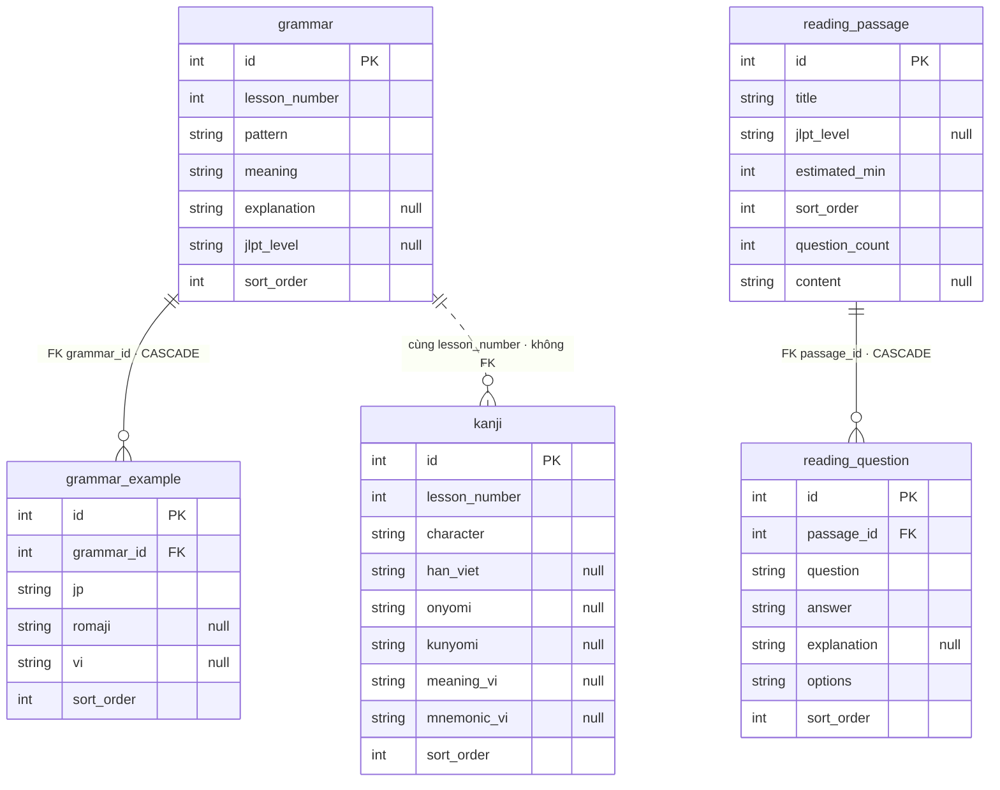
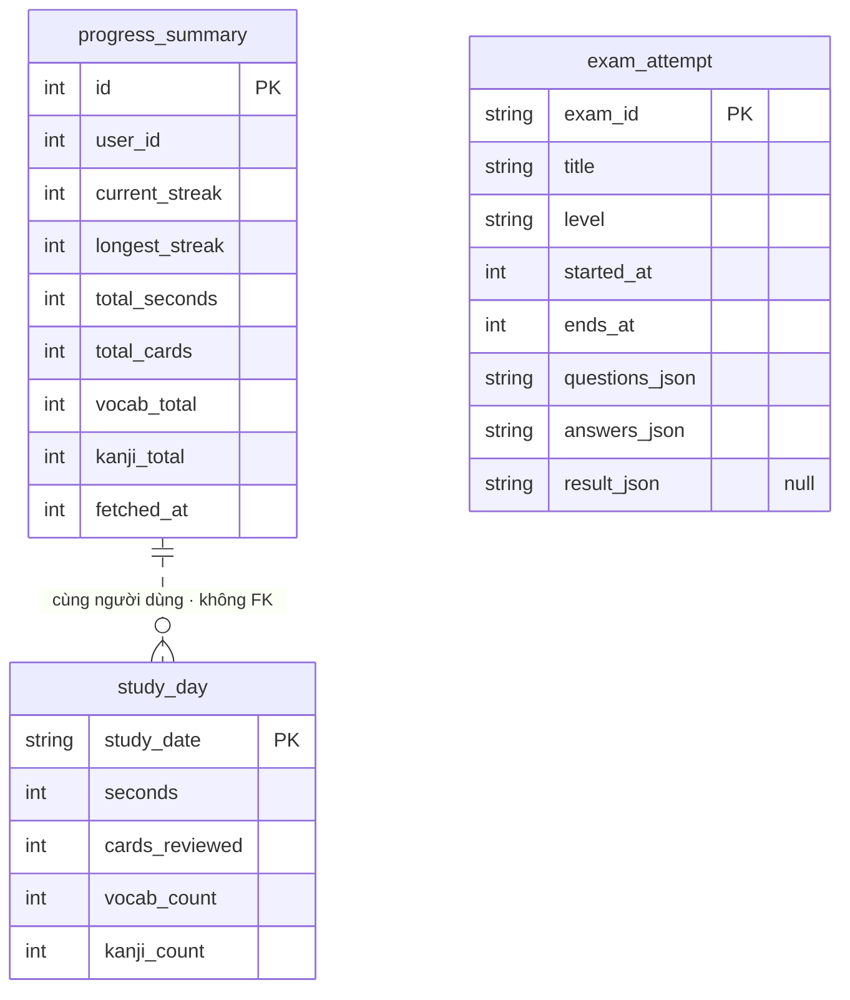
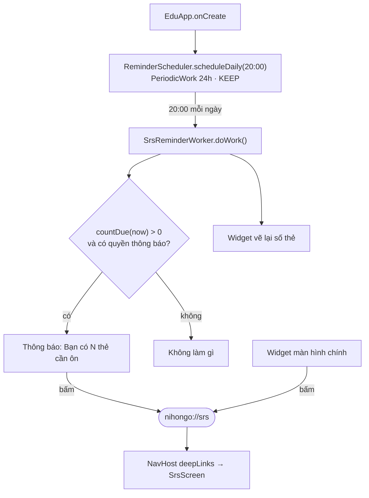
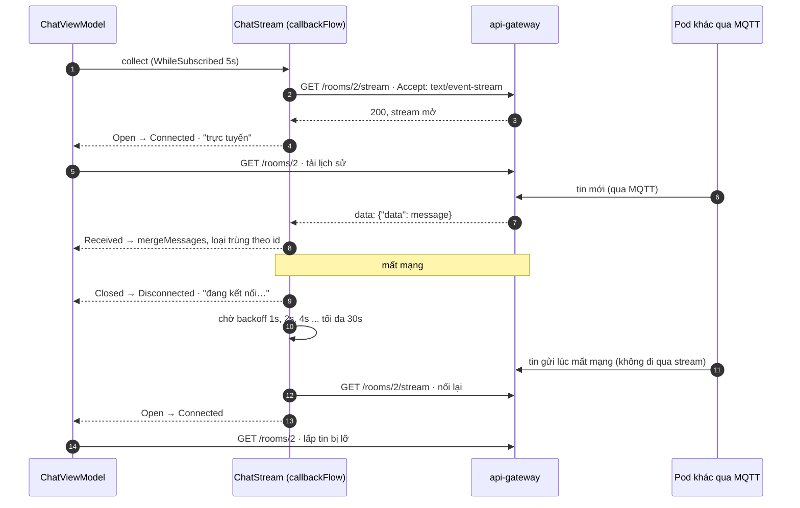
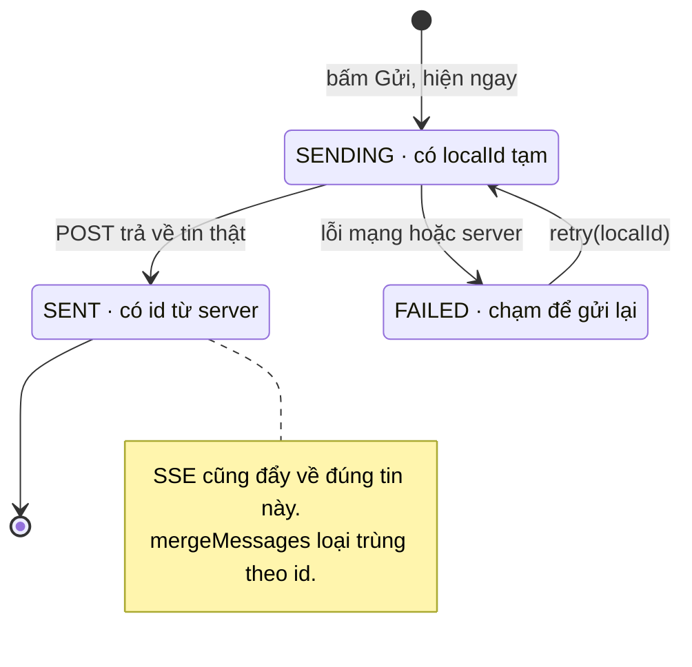
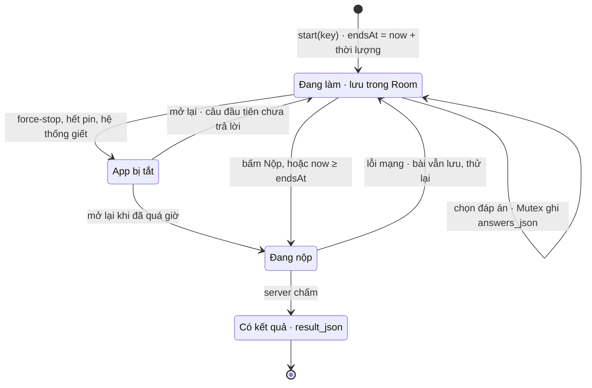

# Android — 9 Tính Năng Mới Và Những Gì Học Được Khi Làm

Tiếp nối [learn-android-kotlin.md](./learn-android-kotlin.md) (Kotlin, Compose, kiến trúc, 14 lỗi đã sửa). Cùng 9 tính năng này làm bằng SwiftUI: [learn-swift-ios.md](./learn-swift-ios.md). File này kể từng tính năng đã thêm vào `apps/nihongo-android`:

- Tính năng làm gì, nằm ở file nào.
- Kỹ thuật Android chính và lý do chọn.
- **Lỗi lộ ra khi chạy thật** trên emulator với backend thật. Đây là phần đáng học nhất: 5 lỗi, cả 5 đều đã qua unit test xanh mà vẫn sai.
- Test kiểm chứng.

Kết quả ngày 11/10/2026: **79 unit test** và **9 test trên emulator** (API 35) đều pass. Mọi luồng bên dưới đã chạy tay trên emulator với backend Docker thật, ở cả bản debug lẫn bản release (R8).

| # | Tính năng | Kỹ thuật chính |
| --- | --- | --- |
| 1 | Nhắc ôn SRS mỗi tối | `PeriodicWorkRequest`, `NotificationChannel`, quyền Android 13, deep link |
| 2 | Màn tiến độ học | Biểu đồ Canvas có `contentDescription`, cache Room, `combine` 5 nguồn |
| 3 | Chat cộng đồng realtime | SSE + `callbackFlow`, nối lại có backoff, lấp tin lỡ, gửi lạc quan |
| 4 | Ngữ pháp, Kanji, Đọc hiểu offline | Room `@Relation`, `TypeConverter`, tự chấm khi offline |
| 5 | Thi thử JLPT có giờ | Lưu bài trong Room, mốc `endsAt` tuyệt đối, tự nộp đúng một lần |
| 6 | Luyện kana | Chọn ngẫu nhiên có trọng số, `Random` inject được |
| 7 | Widget màn hình chính | Glance, `@EntryPoint` |
| 8 | R8 + Baseline Profile | Quy tắc keep cho Gson/Retrofit, Macrobenchmark |
| 9 | Test Compose UI + CI | `createComposeRule`, `ActivityScenario`, GitHub Actions + emulator |

---

## 0. Dữ liệu: DB version 3

Tất cả bảng mới vào một lần nâng cấp, `AutoMigration(from = 2, to = 3)`:

```text
progress_summary, study_day           ← tiến độ (cache, xóa khi đăng xuất)
grammar, grammar_example              ← ngữ pháp + ví dụ (khóa ngoại CASCADE)
kanji
reading_passage, reading_question     ← bài đọc + câu hỏi (lựa chọn lưu JSON qua TypeConverter)
exam_attempt                          ← bài thi đang làm
```

`app/schemas/.../3.json` được sinh khi build. Test `AppDatabaseMigrationTest.migrate1To3_keepsData_andCreatesNewTables` mô phỏng người dùng đang ở v1 cập nhật thẳng lên v3: Room chạy nối 1→2→3, và thẻ `PENDING` vẫn còn.

Sơ đồ dữ liệu các bảng mới (sinh từ `3.json` bằng `apps/nihongo-android/scripts/room_erd.py`; nét đứt là quan hệ không có khóa ngoại). Bảng từ vựng, SRS, hàng đợi sync: [learn-android-kotlin.md](./learn-android-kotlin.md) mục 29.

**Nội dung học**



**Tiến độ và bài thi**



`progress_summary` chỉ có một dòng (`id = 0`) cho người đang đăng nhập, `study_day` là các ngày của chính người đó; xóa cả hai khi đăng xuất. `exam_attempt` lưu câu hỏi và đáp án dạng JSON thay vì tách bảng: một bài thi luôn được đọc và ghi trọn vẹn, không bao giờ truy vấn từng câu.

Mọi tính năng nội dung theo **đúng một khuôn**, cũng là khuôn đã dùng để sửa lỗi L2:

```kotlin
// presentation/lessons/LessonContentViewModels.kt
abstract class CachedListViewModel<T> : ViewModel() {
    protected abstract fun source(): Flow<List<T>>     // Room
    protected abstract suspend fun fetch(): Result<Unit> // mạng → ghi Room

    val uiState = combine(source(), refreshing, error) { items, isRefreshing, err ->
        CachedListState(items, isLoading = items.isEmpty() && isRefreshing, error = err)
    }.stateIn(viewModelScope, SharingStarted.WhileSubscribed(5_000), CachedListState())
}

class GrammarViewModel(...) : CachedListViewModel<Grammar>() {
    override fun source() = content.observeGrammar(lesson)
    override suspend fun fetch() = content.refreshGrammar(lesson)
}
```

Thêm một màn danh sách offline mới chỉ tốn khoảng 10 dòng ViewModel. Khi kiến trúc đúng, tính năng mới gần như là lặp lại khuôn có sẵn.

---

## 1. Nhắc ôn SRS mỗi tối

```text
EduApp.onCreate → ReminderScheduler.scheduleDaily(20:00)
   PeriodicWorkRequest 24h, initialDelay = millisUntilNext(now, 20, 0), ExistingPeriodicWorkPolicy.KEEP
20:00 → SrsReminderWorker.doWork()
   srsDao.countDue(now)                ← đếm trong Room, không cần mạng
   > 0 → ReminderNotifier.showDueCards  ← thông báo "Bạn có N thẻ cần ôn"
   widgetRefresher.refresh()            ← widget cập nhật luôn
Bấm thông báo → Intent(ACTION_VIEW, "nihongo://srs") → NavHost deepLinks → màn SRS
```



Các quyết định đáng nói:

- **`millisUntilNext` là hàm thuần** (`utils/ReminderTime.kt`), dùng `Calendar` để cộng "1 ngày lịch" chứ không cộng cứng 24 giờ. Test `daylightSavingDay_keepsLocalTime` kiểm tra ngày đổi giờ mùa hè ở Berlin (ngày chỉ có 23 giờ): vẫn nhắc đúng 20:00 giờ địa phương. Không dùng `java.time` vì minSdk 24.
- **WorkManager, không dùng AlarmManager**: WorkManager có thể dời vài phút khi máy ở chế độ Doze. Với lời nhắc học bài thì không sao, đổi lại không cần quyền `SCHEDULE_EXACT_ALARM` và tiết kiệm pin.
- **Quyền thông báo xin theo ngữ cảnh**: Home có thẻ "Bật nhắc ôn tập" (chỉ hiện trên Android 13+ khi chưa có quyền), thay vì bật hộp thoại ngay lúc mở app. Từ chối 2 lần là hệ thống không hỏi lại nữa, nên lần hỏi phải là lúc người dùng hiểu lý do.
- **Deep link một nguồn**: hằng `SRS_DEEP_LINK = "nihongo://srs"` dùng chung cho thông báo, widget, `navDeepLink` và test. Manifest khai `<intent-filter>` với `scheme="nihongo" host="srs"`.

**Lỗi lúc kiểm chứng (của cách test, không phải của app).** Thử ép job chạy bằng `adb shell cmd jobscheduler run -f com.edu.nihongo <id>`: job bắt đầu rồi dừng sau 2 ms. WorkManager tự kiểm tra lịch của nó, work định kỳ chưa tới giờ thì không chạy dù JobScheduler bị ép. Cách đúng là `TestListenableWorkerBuilder` gọi thẳng `doWork()` (test `SrsReminderWorkerTest`, Room in-memory và `NotificationManager` thật).

Thêm một bẫy trong chính test đó: `notify()` đi qua hàng đợi của `system_server`, nên đọc `activeNotifications` ngay sau đó có thể chưa thấy gì. Test phải chờ (poll) tối đa 3 giây.

Tìm id job thật: `adb shell am broadcast -a androidx.work.diagnostics.REQUEST_DIAGNOSTICS -p com.edu.nihongo`, rồi đọc `adb logcat | grep WM-Diagnostics`.

---

## 2. Màn tiến độ học

Dùng API `/api/learning-progress` của backend (view + materialized view, xem [learn-mqtt-flyway-ddd.md](./learn-mqtt-flyway-ddd.md)). Kết quả trên emulator khớp với curl: 44 từ vựng, 5 kanji, biểu đồ 14 ngày.

- **`combine` 5 nguồn** trong `ProgressViewModel`: tiến độ (Room), các ngày học (Room), đang refresh, lỗi, cần đăng nhập. Chưa đăng nhập thì không gọi server mà hiện nút đăng nhập.
- **Biểu đồ vẽ tay bằng Canvas**, không thêm thư viện chart. Canvas không có chữ nên TalkBack không đọc được; gắn `Modifier.semantics { contentDescription = "Biểu đồ hoạt động. 10-04: 2, 10-05: 7, ..." }`. Test `ProgressContentTest.showsStats_andAccessibleChart` tìm node theo đúng `contentDescription` đó.
- **Composable không phụ thuộc ViewModel** (`ProgressContent(progress, days, error)`): preview và test UI truyền dữ liệu giả vào thẳng, không cần Hilt.
- **Xóa khi đăng xuất**: `AuthRepositoryImpl.logout()` gọi `progressDao.clear()`. Người đăng nhập sau trên cùng máy không thấy tiến độ của người trước.

---

## 3. Chat cộng đồng realtime

Dùng SSE `/api/community/rooms/{id}/stream`. Phía backend, tin đi giữa các pod qua MQTT (đã test hai pod).

```text
ChatStream.messages(roomId): Flow<StreamEvent>          ← callbackFlow bọc OkHttp EventSource
   onOpen  → Open
   onEvent → Message(dto)      (gateway gửi data: {"data": <message>})
   onClosed / onFailure → close(lỗi)
   retryWhen: 4xx (trừ 408/429) → dừng; còn lại → emit(Closed), chờ backoff 1-2-4-8-16-30s, nối lại
ChatViewModel
   Connected    → connected = true, TẢI LẠI LỊCH SỬ (lấp tin lỡ lúc mất kết nối)
   Disconnected → connected = false
   Received     → thêm vào danh sách live
   uiState = combine(history, live, pending, status, stream) → mergeMessages(...)
```



Trạng thái của một tin nhắn khi gửi lạc quan:



Các khái niệm chính:

- **`callbackFlow` + `awaitClose { source.cancel() }`**: không còn ai collect thì đóng kết nối. `uiState` dùng `WhileSubscribed(5_000)` nên app vào nền quá 5 giây là SSE đóng, tiết kiệm pin và server.
- **`retryWhen` chạy trên `FlowCollector`**: nhờ vậy `emit(StreamEvent.Closed)` được ngay trước khi chờ nối lại. Không có nó thì ViewModel không biết stream đã đứt.
- **Lấp tin lỡ**: tin gửi trong lúc mất kết nối không đi qua stream. Mỗi lần nối lại, ViewModel tải lại lịch sử bằng REST, rồi `mergeMessages` gộp và loại trùng theo `id`. Đây là cách xử lý chuẩn cho mọi hệ thống realtime: **stream để nhanh, REST để đúng**.
- **Gửi lạc quan**: tin hiện ngay với trạng thái `SENDING` và `localId` tạm. Server trả về thì thay bằng tin thật; lỗi thì `FAILED` và chạm để gửi lại. SSE cũng đẩy về đúng tin đó, `mergeMessages` loại trùng.
- **Tìm người dùng**: `query.debounce(300).distinctUntilChanged().mapLatest { search(it) }`. `mapLatest` hủy lần tìm cũ khi người dùng gõ tiếp, giống `switchMap` của RxJS.
- **Chữ đang gõ** nằm trong `SavedStateHandle.getStateFlow("draft")`, nên xoay màn hình không mất.

### Hai lỗi chỉ lộ ra trên emulator

**Lỗi 1: SSE nhận `200 OK` nhưng không bao giờ có tin.** Logcat cho thấy:

```text
<-- 200 OK http://10.0.2.2:8080/api/community/rooms/2/stream (515ms)
Content-Type: text/event-stream
```

Sau đó im lặng. Nguyên nhân: client SSE được tạo bằng `client.newBuilder()` nên thừa hưởng `HttpLoggingInterceptor` ở mức `BODY`. Interceptor này đọc **hết** body để in log. Body SSE không bao giờ kết thúc, nên interceptor nuốt cả stream. Unit test xanh vì client trong test không có logging.

Sửa (`di/AppModule.kt`):

```kotlin
fun sseClient(base: OkHttpClient): OkHttpClient =
    base.newBuilder()
        .apply { interceptors().removeAll { it is HttpLoggingInterceptor } }
        .readTimeout(0, TimeUnit.SECONDS)   // phòng im lặng cả giờ là bình thường
        .build()
```

Test `ChatStreamTest.sseClient_opensImmediately_evenWhenAppClientLogsBodies` cho MockWebServer gửi body thật chậm (khoảng 9 giây) và đòi `Open` phải tới trong 3 giây. Đã kiểm chứng: test **đỏ** (timeout) với client có logging, **xanh** với `sseClient`.

**Lỗi 2: mất mạng mà tiêu đề vẫn "trực tuyến".** ViewModel chỉ nghe được `Connected`, không biết khi nào đứt, vì việc nối lại nằm gọn trong `ChatStream`. Sửa: `emit(StreamEvent.Closed)` trong `retryWhen`. Kiểm chứng trên emulator: bật chế độ máy bay thì sau khoảng 2 giây hiện "đang kết nối…"; tắt thì sau khoảng 4 giây hiện "trực tuyến", và tin user khác gửi trong lúc mất mạng hiện ra sau khi nối lại.

---

## 4. Ngữ pháp, Kanji, Đọc hiểu: dùng được offline

- **Màn bài học có 3 tab** (`LessonDetailScreen`): Từ vựng / Ngữ pháp / Kanji. Ba ViewModel gắn với cùng back stack entry `vocab/{lesson}` nên cùng đọc được argument `lesson`. Tab đang chọn nằm trong `rememberSaveable`.
- **`@Relation`** (`GrammarWithExamples`): Room tự chạy 2 query (grammar, rồi mọi example của các grammar đó) và ghép lại. Cần `@Transaction` trên query để hai lần đọc nhất quán.
- **`replaceLesson` trong `@Transaction`**: xóa cả bài rồi chèn lại. Mẫu ngữ pháp bị xóa trên server cũng biến mất ở máy; `CASCADE` xóa example theo.
- **`TypeConverter`** (`data/local/Converters.kt`): Room chỉ lưu kiểu nguyên thủy; `List<String>` các lựa chọn được lưu dạng JSON.
- **Danh sách bài đọc không có nội dung**: API danh sách không trả `content`. `upsertSummaries` giữ lại `content` đã tải, nên làm mới danh sách không xóa mất bài đã mở.
- **Tự chấm khi offline**: API chi tiết trả cả `answer`, được lưu vào Room. Mất mạng (`IOException`) thì `gradeReading()` (hàm thuần) chấm tại máy, và màn hình ghi rõ "Chấm offline, kết quả chưa gửi lên server".
- **Đáp án đang chọn** nằm trong `SavedStateHandle`, kiểu `HashMap<String, String>` vì Bundle lưu được chắc chắn.

Kiểm chứng trên emulator ở chế độ máy bay: danh sách bài, ngữ pháp bài 1 và bài đọc đã mở đều hiện từ Room. Nộp bài thì được chấm offline 2/3.

### Lỗi trải nghiệm: hiện nguyên văn exception

Ở chế độ máy bay, màn hình hiện `Failed to connect to /10.0.2.2:8080`. Sửa bằng `utils/UserMessage.kt`:

```kotlin
fun Throwable.userMessage(): String = when (this) {
    is HttpException -> when (code()) { 401, 403 -> "Phiên đăng nhập đã hết hạn..."; in 500..599 -> "Máy chủ đang gặp sự cố..."; ... }
    is IOException -> "Không có kết nối mạng."
    else -> message ?: "Có lỗi xảy ra."
}
```

Mọi ViewModel đều dùng hàm này. Thứ tự `when` quan trọng: `HttpException` của Retrofit không phải `IOException`, nhưng `ConnectException` hay `SocketTimeoutException` thì có.

---

## 5. Thi thử JLPT có đếm giờ

```text
ExamListScreen ─ chọn đề ─▶ ExamRepository.start("n5")
   POST /api/mock-exams/n5/start → lưu exam_attempt: câu hỏi (JSON), answers = {}, endsAt = now + 50 phút
ExamScreen (ExamViewModel)
   uiState = combine(Room attempt, index, clock mỗi giây, local)
   remaining = endsAt - now                       ← tính lại mỗi giây, không đếm lùi một biến
   chọn đáp án → saveAnswer: Mutex { đọc → thêm → ghi answers_json }
   init: chờ tới endsAt → submit() đúng một lần   ← kể cả mở lại khi đã quá giờ
   câu nghe: audioText → TtsHelper.speak()
```



- **Bài thi lưu trong Room, không chỉ trong ViewModel**: hết pin, tắt app hay hệ thống giết process giữa giờ thi đều làm tiếp được.
- **Mốc `endsAt` tuyệt đối**: lưu "còn 49 phút" rồi đếm lùi sẽ sai khi app ở nền (coroutine bị dừng). Lưu mốc kết thúc và tính lại thì luôn đúng.
- **`Mutex` khi lưu đáp án**: chọn nhanh hai câu thì hai coroutine cùng đọc-sửa-ghi `answers_json`, và một lựa chọn bị ghi đè mất. Test `concurrentAnswers_areAllKept` dùng `yield()` trong DAO giả để lộ đúng race này.
- **Nộp hai lần chỉ gọi server một lần**: đã có `result_json` thì trả luôn.
- **`liveRegion = Polite`** cho đồng hồ: TalkBack đọc thời gian khi nó đổi mà không cắt ngang việc khác.

### Lỗi lộ ra khi giết app thật

Trên emulator: làm tới câu 2, chạy `adb shell am force-stop`, mở lại. Đáp án vẫn còn (2/33), đồng hồ vẫn đúng (49:44 → 49:18), nhưng **quay về câu 1**.

Nguyên nhân: `SavedStateHandle` chỉ được khôi phục khi **hệ thống** giết process. Khi **người dùng** tự tắt app (force-stop, vuốt khỏi danh sách gần đây), saved state bị bỏ, đó là hành vi đúng của Android. Sửa: không có index đã lưu (`-1`) thì mở ở câu đầu tiên chưa trả lời, tính từ đáp án trong Room (hàm thuần `resolveIndex`). Kiểm chứng lại: mở vào câu 3.

| Cách app chết | `SavedStateHandle` | Room |
| --- | --- | --- |
| Xoay màn hình | còn (ViewModel còn sống) | còn |
| Hệ thống giết process khi app ở nền | **còn** (khôi phục từ Bundle) | còn |
| Người dùng force-stop / vuốt khỏi recent | **mất** | còn |
| Gỡ app / xóa dữ liệu | mất | mất |

Giả lập hệ thống giết process (khác force-stop): bấm Home, rồi `adb shell am kill com.edu.nihongo`.

---

## 6. Luyện kana

- Dữ liệu tĩnh 46 chữ hiragana và katakana (`KanaData`), không cần mạng hay DB.
- **Chọn có trọng số**: trọng số = 1 + 2 × số lần sai. Chữ hay sai được hỏi lại nhiều hơn. Test `oftenMissedKana_isAskedMoreOften` chạy 500 câu với `Random(42)` cố định.
- **`Random` inject được**: ViewModel có constructor chính nhận `Random` (test truyền seed), và constructor phụ có `@Inject` (Hilt dùng `Random.Default`). Hilt chỉ cần đúng một constructor có `@Inject`.
- Nút "Luyện viết" dùng lại màn vẽ Canvas có sẵn (`kanji-draw/{kanji}/{kana}`).

---

## 7. Widget màn hình chính

`presentation/widget/DueCardsWidget.kt` hiện số thẻ cần ôn; bấm vào thì mở màn SRS bằng deep link.

- **Glance** viết giống Compose nhưng chạy trong process của launcher qua RemoteViews: chỉ dùng được composable của `androidx.glance`, không dùng được Material của app.
- **`@EntryPoint`**: widget không phải Activity hay Fragment nên không có `@AndroidEntryPoint`; lấy DAO qua `EntryPointAccessors.fromApplication(...)`.
- **Tầng data không phụ thuộc Glance**: Worker và repository chỉ biết interface `WidgetRefresher` (ở `data/sync`), bản thật `GlanceWidgetRefresher` nằm ở presentation. Widget được vẽ lại sau mỗi lần chấm thẻ và mỗi tối.
- **Tách nội dung** `DueCardsContent(due, onClick)` khỏi `provideGlance` để test bằng `runGlanceAppWidgetUnitTest` (`DueCardsWidgetTest`).

Ghim widget lên màn hình chính không làm được bằng adb (cần hộp thoại của launcher). Kiểm tra provider đã đăng ký: `adb shell dumpsys appwidget | grep edu.nihongo`.

Bẫy khi kiểm tra: `connectedDebugAndroidTest` **gỡ app sau khi chạy test**. Kiểm tra widget hay cài đặt ngay sau đó sẽ thấy "không có gì"; cần `installDebug` lại.

---

## 8. R8 và Baseline Profile

### R8

`app/build.gradle.kts`: `isMinifyEnabled = true`, `isShrinkResources = true`. Quy tắc giữ lại ở `app/proguard-rules.pro`.

| | Debug | Release (R8) |
| --- | --- | --- |
| Code (dex) | 73,4 MB | **5,8 MB** (−92%) |
| Cả APK | 119,8 MB | 95,8 MB |

APK vẫn nặng vì thư viện native (WebRTC của LiveKit, model ML Kit) được đóng gói cho **cả 4 kiến trúc CPU**: x86_64 26,5 MB, x86 23,1 MB, arm64 22,1 MB, armv7 13,0 MB. Mỗi máy chỉ cần một bản. Phát hành bằng App Bundle (`sh ./gradlew bundleRelease`) thì Google Play tự gửi đúng bản cho từng máy.

Quy tắc quan trọng nhất là **Gson**: Gson đọc tên field bằng reflection. R8 đổi tên field thì JSON không khớp nữa, mọi field ra `null`, và **không có lỗi nào báo ra**. Phải giữ field của:

- `data.remote.**`: DTO của Retrofit.
- `domain.entity.**`: những class được lưu dạng JSON trong Room (`ExamQuestion`, `ExamResult`, `SrsCard` trong `sync_queue`).

Kèm `-keepattributes Signature` để `TypeToken<List<ExamQuestion>>` còn thông tin generic.

Kiểm chứng: cài APK release lên emulator, chạy lại các luồng dùng Gson (đăng nhập, tiến độ, ngữ pháp, tạo đề thi, lưu đáp án qua force-stop với `Map<String, String>`, nhận tin chat qua SSE). Tất cả đều đúng, không crash.

`signingConfig = signingConfigs.getByName("debug")` cho bản release **chỉ để cài thử** trên máy dev và CI. Phát hành thật phải ký bằng keystore riêng, giữ trong secret của CI.

### Baseline Profile

Module `:baselineprofile`:

- `BaselineProfileGenerator`: chạy các luồng hay dùng (mở app, cuộn Home, mở luyện kana). ART ghi lại các class và method được dùng; danh sách đó (`app/src/release/generated/baselineProfiles/baseline-prof.txt`) được biên dịch trước (AOT) lúc cài, nên lần mở đầu không phải thông dịch hay JIT.
- `StartupBenchmark`: đo cold start có và không có profile.

```bash
sh ./gradlew :app:generateReleaseBaselineProfile                 # sinh profile (cần emulator API 33+)
sh ./gradlew :baselineprofile:connectedBenchmarkReleaseAndroidTest # đo khởi động
```

`profileinstaller` cài profile ngay cả khi app không đi qua Play Store. Luồng generator chỉ dùng màn offline (Home, kana) để không phụ thuộc backend.

Kết quả đo trên emulator `pixel_api_35`, cold start, 5 lần mỗi chế độ (`timeToInitialDisplayMs`):

| Chế độ | Median | Min – Max | Các lần đo |
| --- | --- | --- | --- |
| Không profile (`CompilationMode.None`) | 452 ms | 335 – 561 | 403, 455, 561, 452, 335 |
| Có Baseline Profile | **368 ms** | 340 – 498 | 364, 418, 368, 498, 340 |

Median nhanh hơn khoảng 19%, nhưng hai dải số chồng lên nhau. Với 5 lần đo trên emulator, đây là **xu hướng, chưa phải kết luận**. Muốn có số để báo cáo thì đo trên máy thật, 10 lần trở lên, máy đang sạc và đã tắt app khác.

Macrobenchmark mặc định từ chối chạy trên emulator (lỗi `ERRORS (not suppressed): EMULATOR`). Muốn so sánh tương đối trên emulator thì phải bỏ qua lỗi đó một cách tường minh:

```bash
sh ./gradlew :baselineprofile:connectedBenchmarkReleaseAndroidTest \
  -Pandroid.testInstrumentationRunnerArguments.androidx.benchmark.suppressErrors=EMULATOR
```

File profile sinh ra có 21.257 dòng quy tắc. Sinh mất khoảng 9 phút trên emulator.

---

## 9. Test Compose UI và CI

### Test trên thiết bị (`app/src/androidTest`)

| Test | Kiểm tra |
| --- | --- |
| `AppDatabaseMigrationTest` (2) | v1→v2, v1→v3 giữ dữ liệu, tạo bảng mới |
| `SrsReminderWorkerTest` (2) | Worker thật đăng thông báo đúng số thẻ; không có thẻ thì im |
| `ProgressContentTest` (2) | Composable hiện số liệu; biểu đồ đọc được bằng TalkBack; banner offline |
| `DeepLinkTest` (1) | App thật (Hilt, Room, NavHost) mở `nihongo://srs` vào thẳng màn SRS |
| `DueCardsWidgetTest` (2) | Nội dung widget và hành động bấm |

```bash
~/Library/Android/sdk/emulator/emulator -avd pixel_api_35 -no-window -no-audio &
sh ./gradlew connectedDebugAndroidTest
```

- `createComposeRule()`: test một composable riêng lẻ, không cần Activity.
- `createEmptyComposeRule()` + `ActivityScenario.launch(intent)`: test app thật mở bằng một intent cụ thể.
- Tìm node theo chữ (`onNodeWithText`) hoặc theo `contentDescription`. Test mà tìm được theo `contentDescription` thì TalkBack cũng đọc được: test giao diện đồng thời là test trợ năng.

### CI (`.github/workflows/ci.yml`)

- Job `android`: JDK 17 → `testDebugUnitTest` → `assembleRelease`. Build release trong CI để bắt lỗi R8 (thiếu quy tắc giữ) trước khi tới tay người dùng.
- Job `android-instrumented`: bật KVM cho runner Linux (thiếu bước này emulator chạy cực chậm) → `reactivecircus/android-emulator-runner` (API 34, x86_64) → `connectedDebugAndroidTest`.
- Lỗi thì tải báo cáo test lên làm artifact.

`gradlew` giờ có quyền thực thi trong git (`100644 → 100755`). Bản cũ làm `./gradlew` báo "permission denied" trên Mac và Linux.

---

## 10. Năm lỗi chỉ lộ ra khi chạy thật

| # | Lỗi | Vì sao unit test không bắt được | Bắt bằng |
| --- | --- | --- | --- |
| 1 | SSE `200 OK` nhưng không có tin (logging interceptor nuốt stream) | Client trong test không có logging | Đọc logcat trên emulator |
| 2 | Mất mạng vẫn hiện "trực tuyến" | Fake không mô phỏng việc đứt kết nối | Bật chế độ máy bay |
| 3 | Mở lại bài thi về câu 1 | Test giả lập "khôi phục process" bằng cùng một `SavedStateHandle`; force-stop thì saved state mất | `adb shell am force-stop` |
| 4 | Lỗi hiện nguyên văn `Failed to connect to /10.0.2.2:8080` | Test assert trên `e.message` do chính test đặt | Chế độ máy bay |
| 5 | (đợt trước) Cookie `Secure` không gửi qua HTTP | Cookie giả trong test không có `Secure` | curl với backend thật |

Bài học: unit test chỉ chứng minh code làm đúng **điều test giả định**. Giả định sai (client không có logging, cookie không `Secure`, process chết theo một kiểu) thì test vẫn xanh. Sau khi unit test xanh, luôn chạy thử trên thiết bị với backend thật. Khi tìm ra lỗi, **viết test tái hiện đúng điều kiện thật** (body SSE chảy chậm, đúng header cookie đo được, `resolveIndex(-1, ...)`), thấy nó đỏ, rồi mới sửa.

---

## 11. Câu hỏi phỏng vấn

**1. Thiết kế chat realtime trên mobile thế nào để không mất tin?**
SSE hoặc WebSocket để nhận nhanh; mỗi lần (nối lại) kết nối thì tải lại lịch sử bằng REST; gộp và loại trùng theo id; gửi lạc quan có trạng thái và nút thử lại; nối lại có backoff, dừng hẳn khi gặp 4xx. Kể lỗi logging interceptor nuốt stream.

**2. Vì sao lưu mốc `endsAt` chứ không lưu "còn bao nhiêu giây"?**
Coroutine và timer dừng khi app ở nền hoặc bị giết; tính lại từ mốc tuyệt đối thì luôn đúng.

**3. `SavedStateHandle` khác Room thế nào khi app bị giết?**
Bảng ở mục 5. Hệ thống giết thì `SavedStateHandle` còn; người dùng force-stop thì mất. Dữ liệu không được phép mất phải nằm trong Room.

**4. WorkManager khác AlarmManager?**
WorkManager: bền qua khởi động lại máy, có ràng buộc (mạng, pin), không đúng tới từng phút. AlarmManager exact: đúng giờ, nhưng cần quyền và tốn pin. Nhắc học bài thì chọn WorkManager.

**5. R8 làm hỏng app ở đâu, phát hiện thế nào?**
Reflection: Gson, Retrofit, và các thư viện tự đọc class. Triệu chứng là dữ liệu ra null chứ không crash. Phát hiện: build release trong CI và chạy thử bản release.

**6. Baseline Profile để làm gì?**
Biên dịch trước (AOT) code của các luồng hay dùng, giúp mở app lần đầu và cuộn mượt hơn. Đo bằng Macrobenchmark, so sánh `CompilationMode.None` với `Partial(BaselineProfileMode.Require)`.

**7. Test Compose thế nào? Liên quan gì tới trợ năng?**
Tách composable khỏi ViewModel để truyền dữ liệu giả vào; tìm node theo chữ hoặc `contentDescription`. Node tìm được bằng semantics thì TalkBack cũng đọc được.

**8. Kể một lỗi mà unit test không bắt được.**
Mục 10, chọn lỗi SSE: nói được triệu chứng (200 OK nhưng im lặng), cách tìm (logcat), nguyên nhân (interceptor đọc hết body), cách sửa và test tái hiện (body chảy chậm, đỏ trước khi sửa).
