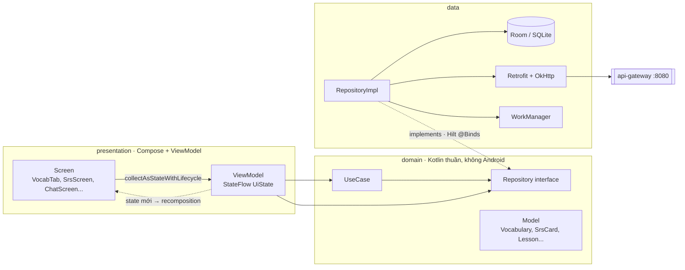
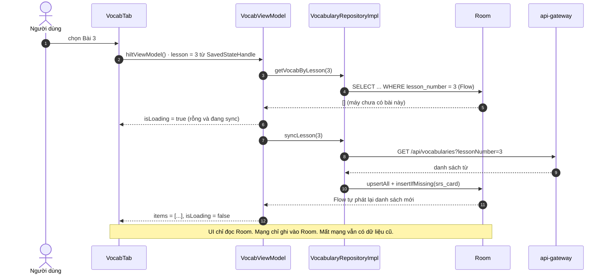
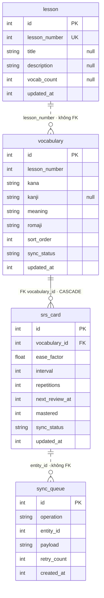
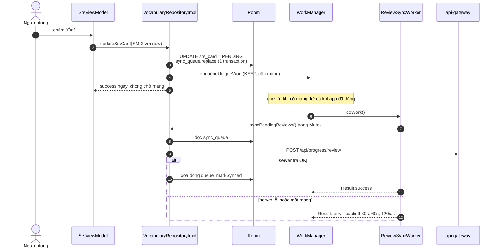
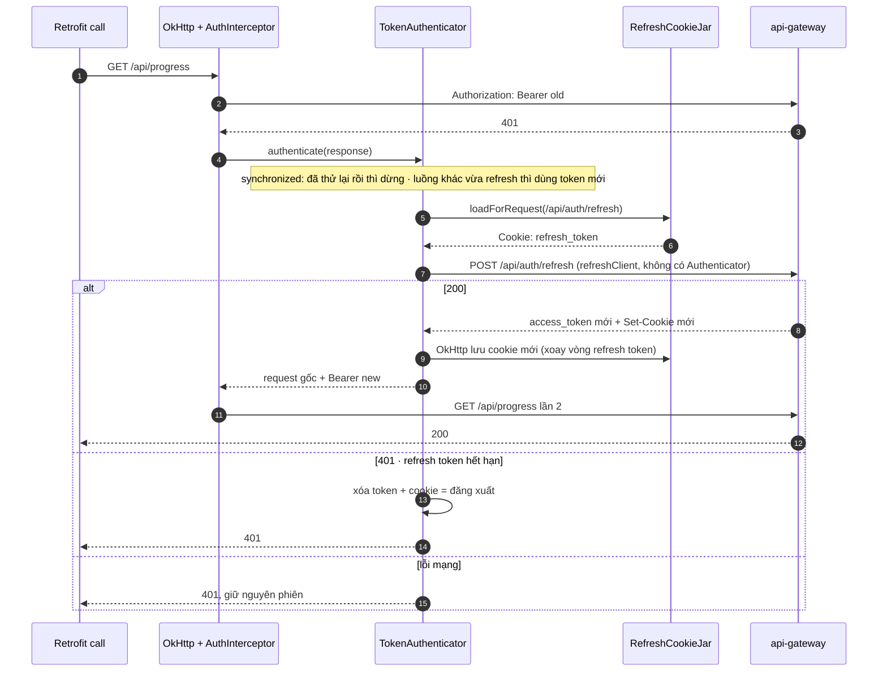

# Học Android Kotlin — Từ Code Thật Của `nihongo-android`

File này dạy Kotlin và Android bằng chính code trong `apps/nihongo-android` (49 file Kotlin, khoảng 4.900 dòng). Mỗi mục gồm:

- **Code thật** trích từ repo, có đường dẫn file và số dòng.
- **Giải thích vì sao** viết như vậy, và cái giá phải trả.
- **Bẫy → Đã sửa**: lỗi thật từng nằm trong code, cách nó gây hại, và bản sửa hiện có trong repo. Mục 35 gom cả 14 lỗi lại.
- **Tự kiểm tra**: câu hỏi kèm đáp án ngắn.

Mọi lệnh đã chạy thật trên macOS (Apple Silicon) ngày 11/10/2026: 79 unit test và 9 test trên emulator đều pass; app đã cài và chạy thử trên emulator API 35 với backend thật, cả bản debug lẫn release.

**Phần tiếp theo:** 9 tính năng mới (nhắc ôn, tiến độ, chat realtime, ngữ pháp/kanji/đọc hiểu offline, thi thử có giờ, kana, widget, R8 + Baseline Profile, test UI + CI) và 5 lỗi chỉ lộ ra khi chạy thật nằm ở [learn-android-features.md](./learn-android-features.md).

Cách học tốt nhất với file này: đọc phần "Bẫy", tự sửa trên bản code cũ (commit trước khi sửa, xem bằng `git log -- apps/nihongo-android`), rồi so với bản sửa.

Sơ đồ trong file viết bằng **Mermaid**: GitHub tự vẽ; trong VS Code cần extension "Markdown Preview Mermaid Support". Sơ đồ ER sinh tự động từ schema Room (`apps/nihongo-android/scripts/room_erd.py`).

Tài liệu liên quan: code mẫu theo từng thư viện Jetpack ở [roadmap-android.md](./roadmap-android.md) · chạy mobile ở [run-mobile.md](./run-mobile.md) · phỏng vấn ở [interview-mobile.md](./interview-mobile.md).

---

## Mục lục

- **Phần 0 — Chạy được app**: 1. Môi trường · 2. Bản đồ code · 3. Đi theo một lần bấm
- **Phần A — Kotlin qua code repo**: 4. Null safety · 5. Data class · 6. Default argument (bẫy) · 7. Extension function · 8. `object` · 9. `operator invoke` · 10. `Result`, `runCatching` (bẫy) · 11. Scope function · 12. Lambda, destructuring
- **Phần B — Coroutines và Flow**: 13. `suspend`, scope, dispatcher · 14. Flow lạnh từ Room · 15. StateFlow, SharedFlow, Channel · 16. `stateIn` · 17. `callbackFlow` · 18. Nối callback với coroutine · 19. `runBlocking`
- **Phần C — Jetpack Compose**: 20. Recomposition và state · 21. `collectAsStateWithLifecycle` · 22. Danh sách · 23. Side effect · 24. View cũ trong Compose · 25. Canvas, cử chỉ, px và dp
- **Phần D — Kiến trúc**: 26. Các lớp và chỗ đang lệch · 27. ViewModel, `SavedStateHandle` · 28. Navigation
- **Phần E — Dữ liệu**: 29. Room · 30. Offline-first và hàng đợi sync · 31. Retrofit, OkHttp, Hilt
- **Phần F — Tính năng native**: 32. AppAuth · 33. CameraX, ML Kit · 34. TTS, push, LiveKit
- **Phần G — Test**
- **Phần H — 14 lỗi đã tìm và sửa** (mục 35)
- **Phần I — Lộ trình 8 tuần** · **Phần J — Câu hỏi phỏng vấn**

---

# Phần 0 — Chạy được app

## 1. Môi trường trên macOS

| Thứ | Cần | Ghi chú |
| --- | --- | --- |
| JDK | **17** | Java 25 đi kèm Android Studio **không chạy được** Gradle 8.12 / Kotlin 2.0.21 |
| Android SDK | compileSdk 35, minSdk 24 | `~/Library/Android/sdk` |
| AGP / Kotlin / Gradle | 8.7.3 / 2.0.21 / 8.12 | khai báo ở `build.gradle.kts` gốc |
| Emulator | API 35 | máy này có AVD `pixel_api_35` |

### Lỗi JDK hay gặp nhất

```bash
cd ~/Projects/edu-app-nihongo/apps/nihongo-android
JAVA_HOME="/Applications/Android Studio.app/Contents/jbr/Contents/Home" sh ./gradlew testDebugUnitTest
# FAILURE: Build failed with an exception.
# * What went wrong:
# 25.0.3
```

Thông báo lỗi chỉ in số phiên bản Java, rất khó hiểu. Nguyên nhân: JBR của Android Studio bản mới là Java 25, mà Kotlin 2.0.21 chưa hiểu Java 25. Cách sửa:

```bash
brew install --cask temurin@17
export JAVA_HOME=$(/usr/libexec/java_home -v 17)
```

Trong Android Studio: **Settings → Build, Execution, Deployment → Build Tools → Gradle → Gradle JDK** → chọn JDK 17.

### `./gradlew: permission denied`

File `gradlew` trong git có mode `100644` (thiếu quyền thực thi). Chạy `sh ./gradlew ...` hoặc `chmod +x gradlew` một lần.

### Chạy test, build, cài app

```bash
cd ~/Projects/edu-app-nihongo/apps/nihongo-android
sh ./gradlew testDebugUnitTest      # 79 test, khoảng 2 phút lần đầu
sh ./gradlew installDebug           # cần emulator đang chạy

# mở emulator từ terminal
~/Library/Android/sdk/emulator/emulator -avd pixel_api_35 &
```

Kết quả test nằm ở `app/build/test-results/testDebugUnitTest/*.xml`, bản HTML ở `app/build/reports/tests/`.

### Backend cho app

```bash
cd ~/Projects/edu-app-nihongo
npm run docker:up:nihongo
curl -s -o /dev/null -w "%{http_code}\n" "localhost:8080/api/vocabularies?lessonNumber=1&limit=1"   # 200
```

App gọi `http://10.0.2.2:8080/api/` (`app/build.gradle.kts`, `API_BASE_URL`). Trong emulator, `localhost` là **chính emulator**; `10.0.2.2` là địa chỉ đặc biệt trỏ về máy Mac. Cổng 8080 là nginx, nginx chuyển tiếp `/api` sang api-gateway. Máy thật thì đổi thành IP LAN của Mac.

`AndroidManifest.xml` bật `usesCleartextTraffic="true"` vì backend local dùng HTTP. Bản release phải tắt và dùng HTTPS.

---

## 2. Bản đồ code

```text
app/src/main/java/com/edu/nihongo/
├── EduApp.kt                 @HiltAndroidApp; khởi tạo LiveKit, TTS
├── MainActivity.kt           @AndroidEntryPoint; setContent { NihongoTheme { NihongoApp() } }
├── presentation/             Compose Screen + ViewModel, mỗi tính năng một thư mục
│   ├── NihongoApp.kt         NavHost, toàn bộ route, deep link nihongo://srs
│   ├── vocab/  srs/  lessons/  login/  home/
│   ├── progress/  reading/  exam/  community/  kana/  widget/   (xem learn-android-features.md)
│   ├── common/               BackScaffold, LoadingBox, MessageBox dùng chung
│   ├── camera/               CameraX + ML Kit OCR
│   ├── live/                 LiveKit
│   ├── kanji/                Canvas vẽ chữ
│   └── pronunciation/  sentence_practice/  ai_tutor/
├── domain/
│   ├── entity/Entities.kt    Vocabulary, SrsCard, ReviewCard (model thuần)
│   ├── repository/           interface VocabularyRepository, AuthRepository...
│   ├── usecase/UseCases.kt   GetVocabByLesson, SyncLesson, GetReviewQueue
│   └── TimeSource.kt         nguồn thời gian inject được
├── data/
│   ├── local/                Room (AppDatabase v2, Daos, Entities), Mappers, TokenStore (DataStore)
│   ├── remote/               Retrofit API, AuthInterceptor, RefreshCookieJar, TokenAuthenticator, KeycloakAuth
│   ├── repository/           RepositoriesImpl.kt (Vocabulary, Lesson, Auth, Translate)
│   ├── sync/                 ReviewSyncWorker, SrsReminderWorker (WorkManager), SyncScheduler
│   ├── notifications/        ReminderNotifier (thông báo nhắc ôn)
│   └── NetworkMonitor.kt     trạng thái mạng dưới dạng Flow (implement NetworkStatus)
├── di/AppModule.kt           Hilt @Provides / @Binds
└── utils/                    SrsAlgorithm (SM-2), TtsHelper, runCatchingCancellable
app/schemas/                  schema Room từng version (1.json, 2.json), commit vào git
app/src/test/                 unit test JVM + testing/Fakes.kt
app/src/androidTest/          test migration, Compose UI, deep link, Worker, widget (chạy trên emulator)
baselineprofile/              sinh Baseline Profile + đo thời gian khởi động
```



Luật phụ thuộc: `presentation → domain ← data`. Domain không biết Room, Retrofit hay Android. Mục 26 kể hai chỗ bản cũ vi phạm luật này và cách đã sửa.

---

## 3. Đi theo một lần bấm: mở "Từ vựng bài 3"

Hiểu trọn luồng này là hiểu 70% app.

```text
HomeScreen ─ bấm "Từ vựng" ─▶ navController.navigate("lessons")
LessonListScreen ─ chọn bài 3 ─▶ navigate(Routes.vocab(3))  =  "vocab/3"
NavHost khớp "vocab/{lesson}", tạo VocabScreen(lessonNumber = 3)
VocabScreen gọi hiltViewModel() ─▶ Hilt tạo VocabViewModel
   │  SavedStateHandle chứa sẵn "lesson" = 3 (Navigation tự đưa argument vào)
   ├─ uiState = combine(Flow từ Room, syncing, syncError).stateIn(...)
   │      VocabularyDao.getByLesson(3) phát ngay list hiện có (lần đầu: rỗng)
   │      rỗng + đang sync → isLoading = true; có dữ liệu cũ → hiện luôn
   └─ init { launch { syncLesson(3); syncing = false } }
          VocabularyRepositoryImpl.syncLesson
          ├─ network.isOnline()?
          ├─ VocabularyRemoteDataSource.fetchAllForLesson(3)   ← Retrofit, phân trang 100, tối đa 50 trang
          │     OkHttp: AuthInterceptor gắn "Bearer ..." → GET /api/vocabularies
          │     401? TokenAuthenticator làm mới token rồi gửi lại (mục 31)
          ├─ vocabDao.upsertAll(entities)                       ← ghi Room
          │     Room thấy bảng vocabulary đổi → chạy lại query → combine phát state mới
          ├─ srsDao.insertIfMissing(...)                        ← thẻ SRS cho từ mới, một lệnh
          └─ syncScheduler.schedulePendingSync()                ← hẹn WorkManager gửi hàng đợi ôn tập
UI: collectAsStateWithLifecycle() ─▶ recomposition ─▶ LazyColumn hiện danh sách
```

Cùng luồng đó dưới dạng sơ đồ tuần tự:



Điểm mấu chốt của offline-first: **UI không bao giờ đọc thẳng từ mạng**. Mạng chỉ ghi vào Room, còn UI chỉ đọc Room. Mất mạng thì UI vẫn có dữ liệu cũ.

Lab: bật log rồi lọc Logcat theo `okhttp` để thấy request.

```bash
adb logcat | grep -i "okhttp"
```

`HttpLoggingInterceptor` bật mức `BODY` cho bản debug và che `Authorization`/`Cookie` (`di/AppModule.kt:81`).

---

# Phần A — Kotlin qua code repo

## 4. Null safety

```kotlin
// data/remote/Api.kt:9 — server có thể thiếu field, nên DTO cho phép null
data class VocabDto(
    val id: Long,
    val kana: String?,
    val kanji: String?,
    val meaning: String?,
    ...
)

// data/repository/RepositoriesImpl.kt:208 — DTO → entity: null thành chuỗi rỗng
VocabularyEntity(
    id = dto.id,
    kana = dto.kana.orEmpty(),   // String? → String
    kanji = dto.kanji,           // giữ null: nhiều từ không có kanji
    ...
)
```

| Cú pháp | Nghĩa | Trong repo |
| --- | --- | --- |
| `T?` | có thể null | `kanji: String?` |
| `a?.b` | null thì cả biểu thức là null | `res.data?.accessToken` |
| `a ?: b` | null thì lấy `b` | `entry.arguments?.getInt("lesson") ?: 1` |
| `.orEmpty()` | `String?` → `""`, `List?` → `emptyList()` | `envelope.data?.data.orEmpty()` |
| `require(cond) { msg }` | sai thì ném `IllegalArgumentException` | `require(!token.isNullOrBlank())` |
| `!!` | ép không null, null thì crash | repo không dùng; cố tránh |

Nguyên tắc trong repo: **nhận null ở biên** (DTO từ mạng), **xử lý ngay ở mapper**, và để domain dùng kiểu không null nhiều nhất có thể. `Vocabulary.kana` là `String`, không phải `String?`.

Smart cast: sau khi kiểm tra null, Kotlin tự coi biến là không null.

```kotlin
// RepositoriesImpl.kt:254
val vocab = card?.let { vocabDao.getById(it.vocabularyId) }   // VocabularyEntity?
if (card == null || vocab == null) { ...; continue }
vocab.kana                                                     // từ đây vocab là VocabularyEntity, card là SrsCard
```

**Tự kiểm tra:** vì sao `VocabDto.kana` là `String?` còn `Vocabulary.kana` là `String`? → Không kiểm soát được server, nhưng kiểm soát được model của mình. Chặn null ở biên thì phần còn lại của app khỏi phải kiểm tra.

---

## 5. Data class, `copy`, bất biến

```kotlin
// presentation/vocab/VocabViewModel.kt:18
data class VocabUiState(
    val items: List<Vocabulary> = emptyList(),
    val isLoading: Boolean = true,
    val error: String? = null,
)

// SrsViewModel.kt — đổi một phần state, giữ nguyên phần còn lại
_uiState.update { state -> state.copy(sessionTotal = state.sessionTotal + 1, ...) }
```

`data class` tự sinh `equals`, `hashCode`, `toString`, `copy`, `componentN`. Mọi field đều là `val`, muốn đổi thì tạo bản mới bằng `copy`.

Vì sao UI state phải bất biến:

1. `StateFlow` chỉ phát khi giá trị mới **khác** giá trị cũ (so bằng `equals`). Sửa trực tiếp object cũ thì `equals` vẫn trả `true`, UI không cập nhật.
2. Compose bỏ qua recomposition khi tham số không đổi; điều đó chỉ đáng tin khi dữ liệu bất biến.
3. Không có cảnh hai coroutine cùng sửa một object.

`update { }` (thay cho `_uiState.value = ...`) chạy kiểu compare-and-set: nếu coroutine khác vừa đổi state thì lambda chạy lại với giá trị mới nhất. `SrsViewModel` vừa nhận list thẻ từ Room vừa cập nhật điểm phiên ở hai coroutine khác nhau, nên `update` là đúng.

`VocabViewModel` bản mới đi cách khác: không giữ một `MutableStateFlow` chung mà **tính** state từ các nguồn bằng `combine` (mục 15, L2). Cách này tránh được loại lỗi "quên cập nhật một field".

---

## 6. Default argument — và một bẫy thật

```kotlin
// bản cũ — data/local/dao/Daos.kt
fun getReviewQueue(now: Long = System.currentTimeMillis(), limit: Int = 20): Flow<List<ReviewRow>>
```

Default argument được tính **mỗi lần gọi hàm**. `SrsViewModel` gọi hàm này **một lần** lúc khởi tạo, nên `now` bị đóng băng tại thời điểm mở màn hình.

Hệ quả: Room chạy lại query mỗi khi bảng đổi, nhưng luôn với **cùng một `now` cũ**. Thẻ nào đến hạn sau lúc mở màn hình (ví dụ mở lúc 9:00, thẻ đến hạn lúc 9:10) sẽ không xuất hiện cho tới khi rời màn hình rồi vào lại.

Đây là bẫy kinh điển khi kết hợp Flow với tham số thời gian.

**Đã sửa (L1).** DAO bỏ giá trị mặc định (`fun getReviewQueue(now: Long, limit: Int = 20)`), repository tự đưa thời gian vào theo nhịp:

```kotlin
// data/repository/RepositoriesImpl.kt — VocabularyRepositoryImpl
override fun getReviewQueue(): Flow<List<ReviewCard>> =
    ticker()                                                    // phát timeSource.now() mỗi 60 giây
        .flatMapLatest { now -> srsDao.getReviewQueue(now = now) }  // hủy query cũ, chạy query mới
        .map { rows -> rows.map { it.toDomain() } }
        .distinctUntilChanged()                                 // kết quả không đổi thì không phát
```

`flatMapLatest` giống `switchMap` của RxJS. Test: `VocabularyRepositoryImplTest.reviewQueue_showsCardThatBecomesDueWhileScreenIsOpen` dùng thời gian ảo của `runTest` để "tua" 2 phút.

---

## 7. Extension function

```kotlin
// data/local/Mappers.kt:13
fun VocabularyEntity.toDomain(): Vocabulary = Vocabulary(
    id = id, lessonNumber = lessonNumber, kana = kana, ...
    syncStatus = SyncStatus.valueOf(syncStatus),
)

// RepositoriesImpl.kt:157
vocabDao.getByLesson(lessonNumber).map { list -> list.map { it.toDomain() } }
```

Extension function thêm hàm cho class mà không sửa class đó. Đặt mapper trong `data/local` giúp entity Room không biết tới domain và ngược lại. Bên trong extension, `this` là đối tượng nhận (`VocabularyEntity`), nên viết thẳng `id`, `kana`.

Bẫy nhỏ: `SyncStatus.valueOf(syncStatus)` ném exception nếu DB chứa chuỗi lạ, ví dụ sau khi đổi tên enum. Room có `@TypeConverter` để lưu enum an toàn hơn.

Cũng là extension, nhưng là extension property có delegate:

```kotlin
// data/local/TokenStore.kt:15
private val Context.tokenDataStore: DataStore<Preferences> by preferencesDataStore("auth")
```

`by preferencesDataStore(...)` bảo đảm cả app chỉ có **một** DataStore tên `"auth"`. Tạo hai instance cùng file sẽ làm DataStore ném lỗi lúc chạy.

---

## 8. `object`, `companion object`, singleton

```kotlin
// utils/SrsAlgorithm.kt:8      — hàm thuần, không state
object SrsAlgorithm { fun calculateNextReview(card: SrsCard, quality: Int, now: Long): SrsCard { ... } }

// presentation/NihongoApp.kt:23 — hằng số route
object Routes { const val HOME = "home"; fun vocab(lesson: Int) = "vocab/$lesson" }

// data/local/AppDatabase.kt:36
companion object { const val DB_NAME = "edu_app.db" }

// utils/TtsHelper.kt:8          — singleton có state
object TtsHelper { private var tts: TextToSpeech? = null ... }
```

`object` là singleton do Kotlin tạo khi dùng lần đầu, an toàn với nhiều luồng. Nhưng có hai cái giá:

- **Khó test**: bản cũ của `SrsAlgorithm` gọi thẳng `System.currentTimeMillis()`, test phải chấp nhận sai số `± 5_000` ms. **Đã sửa (L6):** hàm nhận `now: Long` (`calculateNextReview(card, quality, now)`), ViewModel lấy giờ từ `TimeSource` inject bằng Hilt. Test giờ khẳng định chính xác `nextReviewAt == now + 6 * DAY_MS`.
- **Ẩn phụ thuộc**: `TtsHelper` là state toàn cục, Hilt không quản lý. So với `TokenStore`, được đánh dấu `@Singleton` và inject qua constructor nên thay bằng bản giả được.

Quy tắc: `object` dùng tốt cho hằng số và hàm thuần không phụ thuộc thời gian hay I/O. Cái gì có state hoặc I/O thì nên là class `@Singleton` inject bằng Hilt.

`TimeSource` (`domain/TimeSource.kt`) là một `fun interface`: interface chỉ có một hàm, nên tạo được bằng lambda: `TimeSource { System.currentTimeMillis() }` trong `AppModule`, `TimeSource { start + testScheduler.currentTime }` trong test. Không dùng `java.time.Clock` vì minSdk 24 chưa có `java.time` (cần API 26 hoặc desugaring).

---

## 9. `operator fun invoke` — use case gọi như hàm

```kotlin
// domain/usecase/UseCases.kt:14
class GetVocabByLessonUseCase @Inject constructor(private val repo: VocabularyRepository) {
    operator fun invoke(lessonNumber: Int) = repo.getVocabByLesson(lessonNumber)
}

// VocabViewModel.kt:39 — gọi như gọi hàm
combine(getVocabByLesson(lessonNumber), syncing, syncError) { ... }
```

`operator fun invoke` cho phép viết `useCase(x)` thay vì `useCase.execute(x)`. Use case trong repo hiện chỉ chuyển tiếp sang repository. Nó đáng giá khi có logic, ví dụ gộp hai repository hoặc lọc theo quyền. Use case chỉ chuyển tiếp là chi phí; nhiều team bỏ qua tầng này cho đến khi cần.

---

## 10. `Result`, `runCatching` — và bẫy với coroutine

```kotlin
// RepositoriesImpl.kt:202 (bản cũ dùng runCatching, bản mới dùng runCatchingCancellable)
override suspend fun syncLesson(lessonNumber: Int): Result<Unit> = runCatchingCancellable {
    if (!network.isOnline()) error("Không có mạng")
    ...
}

// VocabViewModel.kt:51
syncLesson(lessonNumber)
    .onSuccess { syncError.value = null }
    .onFailure { e -> syncError.value = e.message }
```

`Result<T>` gói hoặc giá trị, hoặc exception, để caller xử lý mà không cần `try/catch`. `error("...")` là hàm thư viện, ném `IllegalStateException`.

**Bẫy:** `runCatching` bắt **mọi** `Throwable`, kể cả `CancellationException`. Coroutine dùng exception này để báo "đã bị hủy". Nếu nuốt nó, coroutine bị hủy vẫn chạy tiếp như chưa có gì. Ví dụ: người dùng thoát màn hình giữa lúc sync, `viewModelScope` hủy coroutine, nhưng `runCatching` biến việc hủy thành `Result.failure`, rồi `onFailure` vẫn chạy và cập nhật state của một ViewModel đã chết.

**Đã sửa (L5).** `utils/RunCatchingCancellable.kt`:

```kotlin
inline fun <T> runCatchingCancellable(block: () -> T): Result<T> =
    try { Result.success(block()) }
    catch (e: CancellationException) { throw e }   // luôn ném lại tín hiệu hủy
    catch (e: Exception) { Result.failure(e) }
```

Hàm là `inline` nên bên trong `block` gọi được hàm `suspend` dù `block` không khai báo `suspend`. Mọi chỗ trong code `suspend` (repository, `LoginScreen`, `PushService`) đã đổi sang hàm này. `runCatching` thường chỉ còn ở chỗ không có coroutine (parse JSON trong `flushSyncQueue`). Test: `RunCatchingCancellableTest`.

---

## 11. Scope function: `let`, `apply`, `also`, `run`, `with`

| Hàm | Trong lambda gọi đối tượng là | Trả về | Dùng khi | Trong repo |
| --- | --- | --- | --- | --- |
| `let` | `it` | kết quả lambda | xử lý khi khác null | `vocab.kanji?.let { Text(it) }` (`VocabScreen.kt:101`) |
| `apply` | `this` | chính đối tượng | cấu hình object vừa tạo | `HttpLoggingInterceptor().apply { level = ... }` (`AppModule.kt:81`) |
| `also` | `it` | chính đối tượng | làm thêm việc phụ | `Preview.Builder().build().also { it.surfaceProvider = ... }` (camera VM:65) |
| `run` | `this` | kết quả lambda | tính một giá trị từ object | |
| `with(x)` | `this` | kết quả lambda | gọi nhiều hàm trên `x` | |

Mẹo nhớ: `apply`/`also` trả về **chính đối tượng** (dùng để cấu hình); `let`/`run` trả về **kết quả lambda** (dùng để biến đổi).

`return` sớm trong lambda: `cache[trimmed]?.let { return it }` (`RepositoriesImpl.kt:102`). `return` ở đây thoát khỏi **cả hàm** `translateJapanese`, được vì `let` là hàm `inline`.

---

## 12. Lambda, trailing lambda, destructuring

```kotlin
// SrsScreen.kt:206 — danh sách Triple, phần tử thứ ba là Pair
listOf(
    Triple("🔁", "Lại", Color(0xFFEF4444) to 1),
    ...
).forEach { (emoji, label, colorQuality) ->        // destructuring một Triple
    val (color, quality) = colorQuality              // destructuring một Pair
    RatingButton(emoji = emoji, ..., onClick = { onReviewed(card, quality) ... })
}
```

`a to b` tạo một `Pair`. Destructuring chạy được vì `Pair`/`Triple`/`data class` có `component1()`, `component2()`...

Viết vậy chạy được nhưng khó đọc. Một `data class Rating(val emoji: String, val label: String, val color: Color, val quality: Int)` sẽ rõ hơn nhiều. Đây là một refactor nhỏ tốt cho tuần đầu.

Trailing lambda: tham số cuối là hàm thì đưa lambda ra ngoài ngoặc. `Scaffold(topBar = { ... }) { padding -> ... }`: lambda sau dấu `)` chính là tham số `content`.

---

# Phần B — Coroutines và Flow

## 13. `suspend`, scope, dispatcher

```kotlin
// SrsViewModel.kt
init {
    viewModelScope.launch { getReviewQueue().collect { cards -> ... } }   // coroutine 1: sống mãi
}
fun onCardReviewed(card: ReviewCard, quality: Int) {
    viewModelScope.launch { ...; vocabRepo.updateSrsCard(updated) }      // coroutine 2, 3...: mỗi lần chấm
}
```

- `suspend fun`: hàm có thể **tạm dừng mà không chặn luồng**. Lúc chờ mạng, luồng main vẫn vẽ UI.
- `viewModelScope`: scope gắn với ViewModel, tự hủy mọi coroutine con khi ViewModel bị clear (màn hình bị pop khỏi back stack). Nhờ đó không bị rò rỉ.
- Các `launch` chạy **đồng thời**. `collect` không bao giờ kết thúc (Flow của Room sống mãi), nên đặt việc khác sau `collect` trong cùng một `launch` thì việc đó không bao giờ chạy.

`viewModelScope` mặc định chạy trên `Dispatchers.Main.immediate`. Gọi Retrofit hay Room từ main có ổn không? **Có**, vì `suspend fun` của Retrofit và Room tự chuyển sang luồng nền ("main-safe"). Chỉ cần `withContext(Dispatchers.IO)` khi tự làm việc chặn luồng, như đọc file hay tính toán nặng. Camera VM có dùng: `withContext(Dispatchers.IO) { lines.mapNotNull { ... translate ... } }`.

| Dispatcher | Dùng cho |
| --- | --- |
| `Main` | cập nhật UI, gọi hàm main-safe |
| `IO` | I/O chặn luồng (file, socket, API không có suspend) |
| `Default` | tính toán nặng CPU (parse JSON lớn, xử lý ảnh) |

Structured concurrency: coroutine con thuộc về scope cha. Cha bị hủy thì con bị hủy. Con lỗi (với `launch`) thì lỗi lan lên cha và hủy cả các con khác.

---

## 14. Flow lạnh từ Room

```kotlin
// Daos.kt:32
@Query("SELECT * FROM vocabulary WHERE lesson_number = :lessonNumber ORDER BY sort_order ASC")
fun getByLesson(lessonNumber: Int): Flow<List<VocabularyEntity>>
```

DAO trả `Flow` thì không có `suspend`. Gọi hàm chỉ tạo ra một "công thức"; query chỉ chạy khi có người `collect` (Flow lạnh). Khi đang được collect, Room theo dõi bảng `vocabulary`; bảng thay đổi ở bất kỳ đâu thì Room chạy lại query và phát list mới.

Hệ quả:

- Ghi vào Room là đủ để UI cập nhật; không cần "báo cho màn hình refresh".
- Room theo dõi **cả bảng**, không theo từng dòng. Ghi một dòng `lesson_number = 5` cũng làm query của bài 3 chạy lại. Kết quả không đổi thì vẫn phát list mới (bằng nhau). Thêm `.distinctUntilChanged()` để chặn.
- Toán tử `map` trên Flow (`RepositoriesImpl.kt:157`) chạy mỗi lần có list mới.

---

## 15. StateFlow, SharedFlow, Channel — state khác event

**State** (dữ liệu màn hình đang hiển thị) dùng `StateFlow`:

```kotlin
private val _uiState = MutableStateFlow(VocabUiState())
val uiState: StateFlow<VocabUiState> = _uiState.asStateFlow()   // bên ngoài chỉ đọc
```

Luôn có giá trị; subscriber mới nhận ngay giá trị hiện tại; bỏ qua giá trị trùng.

**Event** (điều hướng, toast; chỉ xảy ra một lần) thì bản cũ của repo có **hai cách**, và cả hai đều lỗi:

```kotlin
// Cách 1 (cũ) — presentation/live/LiveListViewModel.kt
private val _navigateViewer = MutableSharedFlow<Unit>()
...
_navigateViewer.emit(Unit)
// LiveListScreen.kt:55
LaunchedEffect(Unit) { viewModel.navigateViewer.collect { onNavigateViewer() } }

// Cách 2 (cũ) — presentation/login/LoginViewModel.kt
fun login(email: String, password: String, onSuccess: () -> Unit) {
    viewModelScope.launch { authRepo.login(...).onSuccess { ...; onSuccess() } }
}
```

| | Cách 1: `MutableSharedFlow()` | Cách 2: truyền lambda vào ViewModel |
| --- | --- | --- |
| Ưu | ViewModel không biết UI | đơn giản |
| Nhược | `replay = 0`, không buffer: phát lúc không ai collect (đang xoay màn hình) thì **mất** sự kiện | ViewModel giữ lambda của Composable. Xoay màn hình giữa lúc login thì lambda cũ vẫn chạy, gọi `navController` của màn hình đã bị hủy |

**Đã sửa (L7, L8)** bằng `Channel` có buffer, ở cả `LoginViewModel`, `LiveListViewModel` và `LiveHostViewModel`:

```kotlin
// presentation/login/LoginViewModel.kt
sealed interface LoginEvent { data object LoggedIn : LoginEvent }

private val _events = Channel<LoginEvent>(Channel.BUFFERED)
val events: Flow<LoginEvent> = _events.receiveAsFlow()   // mỗi event một người nhận, giữ lại khi chưa ai nghe
...
.onSuccess { ...; _events.send(LoginEvent.LoggedIn) }

// presentation/login/LoginScreen.kt
LaunchedEffect(viewModel) {
    viewModel.events.collect { event -> when (event) { LoginEvent.LoggedIn -> onBack() } }
}
```

`login(email, password)` không còn nhận lambda. Test `LoginViewModelTest.loggedInEvent_isBufferedUntilScreenCollects` và `LiveListViewModelTest.navigateEvent_emittedBeforeCollect_isNotLost` cố ý phát sự kiện **trước** khi có ai collect, đúng tình huống bản cũ làm mất sự kiện.

Cách khác theo hướng dẫn mới của Google: **biến event thành state** (`loggedIn = true` trong UiState), màn hình thấy thì điều hướng rồi báo lại ViewModel "đã xử lý".

---

## 16. `stateIn` và `WhileSubscribed(5_000)`

```kotlin
// presentation/home/HomeViewModel.kt:15
val isOnline = networkMonitor.isOnlineFlow.stateIn(
    scope = viewModelScope,
    started = SharingStarted.WhileSubscribed(5_000),
    initialValue = true,
)
```

`stateIn` biến Flow lạnh thành `StateFlow` nóng, dùng chung cho mọi subscriber.

- `WhileSubscribed(5_000)`: chỉ chạy Flow gốc khi có ít nhất một subscriber; subscriber cuối rời đi thì **đợi 5 giây** rồi mới dừng. 5 giây đủ để sống qua lúc xoay màn hình (Activity bị tạo lại, UI collect lại trong vài trăm ms) mà không phải đăng ký lại `NetworkCallback`. App vào nền quá 5 giây thì callback được gỡ, tiết kiệm pin.
- `Eagerly`: chạy ngay và chạy mãi. `Lazily`: chạy khi có subscriber đầu tiên rồi chạy mãi.
- `initialValue = true`: lạc quan coi là online cho tới khi biết chắc. Đánh đổi: có thể nháy "online" một chút trên máy đang offline.

---

## 17. `callbackFlow` — biến callback Android thành Flow

```kotlin
// data/NetworkMonitor.kt:36
val isOnlineFlow: Flow<Boolean> = callbackFlow {
    val callback = object : ConnectivityManager.NetworkCallback() {
        override fun onAvailable(network: Network) { trySend(isOnline()) }
        override fun onLost(network: Network) { trySend(isOnline()) }
        ...
    }
    connectivityManager.registerDefaultNetworkCallback(callback)
    trySend(isOnline())                                                       // giá trị ban đầu
    awaitClose { connectivityManager.unregisterNetworkCallback(callback) }    // dọn khi hết người nghe
}.distinctUntilChanged()
```

Ba phần bắt buộc:

1. Đăng ký callback.
2. `trySend` để đẩy giá trị. `trySend` không suspend, nên gọi được từ callback thường.
3. `awaitClose { ... }` giữ Flow sống và gỡ callback khi collector bị hủy. Quên `awaitClose` thì Flow ném lỗi; quên gỡ callback trong đó thì rò rỉ.

`distinctUntilChanged()` vì `onCapabilitiesChanged` gọi rất nhiều lần với cùng kết quả.

Ghi chú trong code (`NetworkMonitor.kt:23`) giải thích một quyết định thực tế: emulator thường không có `NET_CAPABILITY_VALIDATED` (biểu tượng Wi-Fi có dấu X) nhưng vẫn gọi được `10.0.2.2`. Nên app chỉ kiểm tra "có kết nối", không đòi "đã xác minh có internet".

---

## 18. Nối callback một lần với coroutine

```kotlin
// data/remote/KeycloakAuth.kt:92 (bản cũ dùng suspendCoroutine)
suspend fun exchangeCode(intent: Intent?): KeycloakTokens =
    suspendCancellableCoroutine { cont ->
        ...
        authService.performTokenRequest(request) { tokenResponse, tokenEx ->
            if (access.isNullOrBlank()) cont.resumeWithException(...)
            else cont.resume(KeycloakTokens(access, tokenResponse.idToken))
        }
    }
```

`callbackFlow` dành cho callback gọi **nhiều lần**. Callback gọi **một lần** thì dùng `suspendCoroutine` hoặc `suspendCancellableCoroutine`: tạm dừng coroutine, rồi `resume` khi callback trả kết quả.

Nên dùng `suspendCancellableCoroutine` thay vì `suspendCoroutine`: nếu coroutine bị hủy (người dùng thoát màn hình) thì coroutine kết thúc ngay chứ không treo tới khi mạng trả lời, và có `invokeOnCancellation { }` để dọn dẹp. **Đã đổi**: `KeycloakAuth.exchangeCode` dùng `suspendCancellableCoroutine`, và callback về muộn kiểm tra `if (!cont.isActive) return` trước khi `resume`.

---

## 19. `runBlocking` trong interceptor

```kotlin
// data/remote/AuthInterceptor.kt:19
override fun intercept(chain: Interceptor.Chain): Response {
    val token = runBlocking { tokenStore.get() }
    ...
}
```

`Interceptor.intercept` của OkHttp là hàm thường, chạy trên luồng của OkHttp (không phải main), nên không gọi `suspend` trực tiếp được. `runBlocking` chặn luồng đó tới khi DataStore đọc xong. Ở đây chấp nhận được vì không chặn main và DataStore có cache trong bộ nhớ sau lần đọc đầu.

**Tuyệt đối không** dùng `runBlocking` trên main thread: sẽ bị ANR (Application Not Responding) nếu chặn quá 5 giây. Cách sạch hơn: giữ token trong một `StateFlow` (đọc `.value` ngay, không cần suspend), cập nhật từ DataStore.

Bản hiện tại: interceptor bỏ qua request **đã có** header `Authorization`, vì request gửi lại sau khi refresh (mục 31) đã mang token mới. Nó nhận `TokenStorage` (interface) thay vì `TokenStore`, nên test thay được bằng bản giả.

---

# Phần C — Jetpack Compose

## 20. Recomposition và state

Composable là hàm vẽ UI **từ state**. State đổi thì Compose gọi lại (recompose) những hàm đọc state đó.

```kotlin
// presentation/login/LoginScreen.kt:52 (bản cũ dùng remember)
var email by rememberSaveable { mutableStateOf("") }
OutlinedTextField(value = email, onValueChange = { email = it }, ...)
```

| API | Sống qua | Ví dụ |
| --- | --- | --- |
| biến thường | không sống qua recomposition | không dùng cho state |
| `remember { mutableStateOf(x) }` | recomposition | `email`, `showAnswer` |
| `rememberSaveable { ... }` | recomposition **và** xoay màn hình, process death | nên dùng cho `email` |
| state trong ViewModel | xoay màn hình (không qua process death trừ khi dùng `SavedStateHandle`) | `uiState` |

**Bẫy (L9):** bản cũ của `LoginScreen` dùng `remember` cho `email` và `password`, xoay màn hình là mất chữ đã gõ. **Đã sửa:** `email` dùng `rememberSaveable`. `password` cố ý giữ `remember`: `rememberSaveable` ghi vào Bundle của hệ thống (saved instance state), không nên để mật khẩu ở đó.

`remember(key)` tính lại khi key đổi:

```kotlin
// SrsScreen.kt:154
var showAnswer by remember(card.card.id) { mutableStateOf(false) }
```

Sang thẻ mới (id khác) thì `showAnswer` tự về `false`. Không có key thì thẻ mới sẽ hiện luôn đáp án nếu thẻ trước đang mở.

`derivedStateOf` (`SrsScreen.kt:77`) chỉ đáng dùng khi state đầu vào đổi **thường xuyên hơn** kết quả (ví dụ vị trí cuộn → "có hiện nút lên đầu không"). Ở đây code đã dùng `remember(sessionTotal, cards.size)`, nên `derivedStateOf` bên trong là thừa. Một phép chia đơn giản tính thẳng là đủ.

---

## 21. `collectAsStateWithLifecycle`

```kotlin
// VocabScreen.kt:40
val uiState by viewModel.uiState.collectAsStateWithLifecycle()
```

Biến `StateFlow` thành `State` của Compose, và **ngừng collect khi app xuống dưới `STARTED`** (vào nền). `collectAsState()` thường thì vẫn collect khi app ở nền, tốn pin và làm việc vô ích.

`by` là property delegate: `uiState` đọc trực tiếp `VocabUiState`, không cần `.value`.

---

## 22. Danh sách: `LazyColumn` và `key`

```kotlin
// VocabScreen.kt:90
items(uiState.items, key = { it.id }) { vocab -> Card(...) { ... } }
```

`LazyColumn` chỉ dựng các item đang hiện trên màn hình (giống `RecyclerView`). Có `key` thì khi list đổi (thêm hay xóa ở giữa), Compose biết item nào là item nào: giữ đúng state và animation, chỉ vẽ lại phần đổi. Không có `key` thì Compose dựa vào vị trí, chèn một item ở đầu là mọi item phía sau bị coi như đổi.

---

## 23. Side effect: `LaunchedEffect`, `DisposableEffect`

Composable có thể chạy lại bất cứ lúc nào, nên không được gọi API hay đăng ký callback thẳng trong thân hàm. Dùng effect:

| API | Chạy khi | Dọn dẹp |
| --- | --- | --- |
| `LaunchedEffect(key)` | vào composition, và mỗi khi key đổi (chạy trong coroutine) | coroutine tự hủy khi rời đi hoặc key đổi |
| `DisposableEffect(key)` | như trên, nhưng không phải coroutine | bắt buộc có `onDispose { }` |
| `rememberCoroutineScope()` | scope để `launch` từ callback như `onClick` | hủy khi rời composition |

Dùng đúng: `LoginScreen.kt:58` tạo `KeycloakAuth` và `dispose()` nó trong `onDispose`. `LiveListScreen.kt:55` collect event trong `LaunchedEffect(Unit)`.

Bản cũ dùng chưa đúng ở `CameraTranslateScreen.kt`:

```kotlin
DisposableEffect(Unit) {
    if (!cameraPermission.status.isGranted) cameraPermission.launchPermissionRequest()
    onDispose { }        // không có gì để dọn
}
```

Không có gì để dọn thì nên là `LaunchedEffect(Unit)`. Tương tự với `DisposableEffect(lifecycleOwner, previewView) { viewModel.bindCamera(...); onDispose { } }`. **Đã đổi** cả hai sang `LaunchedEffect`.

---

## 24. Dùng View cũ trong Compose: `AndroidView`

```kotlin
// CameraTranslateScreen.kt
val previewView = remember { PreviewView(context).apply { ... } }
AndroidView(factory = { previewView }, update = { view -> viewModel.updatePreviewSize(view.width, view.height) })
```

CameraX cần một `PreviewView` (View kiểu cũ). `AndroidView` nhúng nó vào Compose. `factory` chạy một lần để tạo View; `update` chạy mỗi khi recompose.

Lưu ý: `bindCamera(lifecycleOwner, previewView)` truyền View và `LifecycleOwner` vào **ViewModel**. ViewModel sống lâu hơn View (qua xoay màn hình), nên giữ View trong ViewModel dễ rò rỉ. Ở đây ViewModel chỉ dùng chúng trong listener, nhưng đây là ranh giới cần nhớ: **ViewModel không giữ View, Activity hay Context của Activity**. Chỉ giữ `@ApplicationContext` như camera VM đang làm với `appContext`.

---

## 25. Canvas, cử chỉ — và lỗi px với dp

```kotlin
// presentation/kanji/KanjiDrawScreen.kt:119
Canvas(
    modifier = Modifier.fillMaxSize().pointerInput(Unit) {
        detectDragGestures(
            onDragStart = { offset -> current = listOf(offset) },
            onDrag = { change, _ -> change.consume(); current = current + change.position },
            onDragEnd = { if (current.size > 2) strokes += current; current = emptyList() },
        )
    },
) {
    (strokes + listOf(current)).forEach { stroke -> drawPath(Path().apply { ... }, ...) }
}
```

`pointerInput` nhận cử chỉ; `Offset` tính bằng **pixel**. `Canvas` vẽ bằng pixel. Mỗi lần kéo, `current = current + change.position` tạo list mới (O(n) mỗi điểm). Nét dài sẽ chậm dần; `mutableStateListOf` sẽ hiệu quả hơn.

Chấm điểm hiện chỉ đếm số điểm đã vẽ (`correct = total > 20`, dòng 176), không so hình dạng. Đây là chỗ để làm tiếp, ví dụ so với dữ liệu nét của KanjiVG.

### Lỗi thật (L4, đã sửa): px dùng như dp

```kotlin
// bản cũ — CameraTranslateScreen.kt
.offset(x = label.rect.left.dp, y = label.rect.top.dp)
```

`label.rect` do `mapRect` tính bằng **pixel** của `PreviewView`. `.dp` coi con số đó là dp, rồi Compose nhân với density. Máy có density 2.75 (phổ biến) thì nhãn dịch nằm xa gấp 2.75 lần, thường là ra ngoài màn hình.

```kotlin
// bản sửa — CameraTranslateScreen.kt
val density = LocalDensity.current
...
val maxWidth = with(density) {
    label.rect.width().coerceIn(48.dp.toPx(), 360.dp.toPx()).toDp()   // so sánh cùng đơn vị px rồi mới đổi ra dp
}
Text(
    modifier = Modifier
        .offset { IntOffset(label.rect.left.roundToInt(), label.rect.top.roundToInt()) }  // bản offset nhận pixel
        .widthIn(max = maxWidth),
    ...
)
```

`Modifier.offset { }` (bản lambda) nhận `IntOffset` tính bằng pixel, và chỉ đọc giá trị ở pha layout, nên đổi vị trí không làm recompose.

| Đơn vị | Là gì | Dùng cho |
| --- | --- | --- |
| px | điểm ảnh vật lý | Canvas, `Offset`, kích thước View, toạ độ từ CameraX/ML Kit |
| dp | điểm độc lập mật độ, 1 dp = 1 px ở 160 dpi | kích thước, padding trong UI |
| sp | như dp, nhân thêm cỡ chữ người dùng chọn | cỡ chữ |

---

# Phần D — Kiến trúc

## 26. Các lớp — và hai chỗ từng lệch

```text
presentation  ──▶  domain  ◀──  data
(Screen, VM)      (entity,       (Room, Retrofit,
                   repository     RepositoryImpl)
                   interface,
                   use case)
```

`VocabularyRepository` là interface trong `domain/`; `VocabularyRepositoryImpl` ở `data/`; Hilt nối hai bên bằng `@Binds` (`AppModule.kt:146`). ViewModel chỉ biết interface, nên test thay bằng bản giả được (mục G làm đúng như vậy).

Hai chỗ bản cũ không theo luật, giờ đã sửa:

1. **Domain import Android (L10).** `OverlayLabel(val rect: android.graphics.RectF, ...)` từng nằm trong `domain/entity`. Domain dính Android thì không test được bằng JVM thuần và không tách thành module Kotlin thuần được. **Đã chuyển** sang `presentation/camera/OverlayLabel.kt`, vì nó vốn là model của UI. Kiểm tra: `grep -rn "android\." app/src/main/java/com/edu/nihongo/domain/` không ra gì.
2. **ViewModel gọi thẳng API và đưa DTO lên UI (L11).** `LessonListViewModel` từng inject `LessonsApi` và đưa `LessonDto` (model mạng) thẳng tới Screen: server đổi tên field là UI hỏng theo, và màn bài học không chạy offline. **Đã sửa** theo đúng khuôn của Vocab: `domain/entity/Lesson` + `LessonRepository` (domain) ← `LessonRepositoryImpl` (data) + bảng Room `lesson`. ViewModel `combine` Flow từ Room với trạng thái refresh, nên offline vẫn thấy danh sách cũ kèm thông báo lỗi.

Biết chỉ ra chỗ lệch trong code của chính mình và nói được cái giá của nó là điều được đánh giá cao khi phỏng vấn.

---

## 27. ViewModel, `SavedStateHandle`, vòng đời

```kotlin
// VocabViewModel.kt:25
@HiltViewModel
class VocabViewModel @Inject constructor(
    savedStateHandle: SavedStateHandle,
    getVocabByLesson: GetVocabByLessonUseCase,
    private val syncLesson: SyncLessonUseCase,
) : ViewModel() {
    private val lessonNumber: Int = savedStateHandle.get<Int>("lesson") ?: 1
```

- `@HiltViewModel` + `@Inject constructor`: Hilt biết cách tạo. `hiltViewModel()` trong Composable lấy instance gắn với **back stack entry** của route đó.
- `SavedStateHandle` tự chứa argument của route (`"lesson"` từ `vocab/{lesson}`), và sống qua process death. ViewModel không cần Screen truyền `lessonNumber` vào.
- Tham số không có `val`/`private val` (như `getVocabByLesson`) chỉ dùng được trong `init` và khởi tạo property; không thành field.

Vòng đời: ViewModel sống qua xoay màn hình (Activity bị tạo lại, ViewModel thì không), và bị clear khi route bị pop. Lúc đó `onCleared()` chạy: camera VM đóng `recognizer` và `cameraExecutor` ở đây (`CameraTranslateViewModel.kt:188`).

Vì `init` chạy sync mỗi khi ViewModel được tạo, mỗi lần vào màn bài 3 là một lần gọi mạng. Xoay màn hình thì không gọi lại (ViewModel vẫn sống). Đây là hành vi đúng.

---

## 28. Navigation Compose

```kotlin
// NihongoApp.kt
const val VOCAB = "vocab/{lesson}"
fun vocab(lesson: Int) = "vocab/$lesson"

composable(route = Routes.VOCAB, arguments = listOf(navArgument("lesson") { type = NavType.IntType })) { entry ->
    VocabScreen(lessonNumber = entry.arguments?.getInt("lesson") ?: 1, onBack = { navController.popBackStack() })
}
```

- Route là chuỗi giống URL; argument dạng `{tên}` có kiểu (`IntType`, `StringType`).
- Chuỗi có ký tự đặc biệt phải encode: `Routes.pronunciation()` dùng `URLEncoder.encode(kana, "UTF-8")`, nơi nhận `URLDecoder.decode`. Không encode thì chữ có `/` sẽ làm hỏng route.
- Screen không giữ `navController`, chỉ nhận lambda `onBack`, `onOpenLesson`. Screen dễ preview và test, và chỉ `NihongoApp` biết về điều hướng.

**Vì sao có `LiveNavigationStore`** (`data/LiveNavigationStore.kt`): màn xem live cần token LiveKit. Đặt token vào route (`live/viewer?token=...`) thì token nằm trong back stack, có thể bị log, và có giới hạn độ dài. Nên ViewModel trước ghi vào một singleton, ViewModel sau đọc ra một lần (`consumeJoin()`). Đánh đổi: nếu process bị hệ điều hành giết khi đang ở màn viewer thì mất token, màn hình phải xử lý trường hợp `null`.

Navigation 2.8 hỗ trợ route an toàn kiểu (`@Serializable data class Vocab(val lesson: Int)`), thay cho chuỗi. Đây là refactor hay cho tuần 6.

---

# Phần E — Dữ liệu

## 29. Room

### Sơ đồ dữ liệu: từ vựng, SRS, hàng đợi sync

Sinh từ `app/schemas/.../3.json`. Nét liền là khóa ngoại thật trong SQLite; nét đứt là quan hệ chỉ có trong code (không có FK). Các bảng thêm ở v3 (tiến độ, ngữ pháp, kanji, đọc hiểu, bài thi) nằm ở [learn-android-features.md](./learn-android-features.md) mục 0.



`sync_queue.entity_id` trỏ tới `srs_card` nhưng không có khóa ngoại, nên DB không đảm bảo thẻ còn tồn tại. Code tự xử lý: `flushSyncQueue` gặp dòng mà từ vựng không còn thì **bỏ dòng đó, không gửi**, vì không còn kana và nghĩa để gửi lên server. Nếu thêm FK `ON DELETE CASCADE`, DB sẽ tự dọn các dòng này; đánh đổi là phải viết migration, và lỗi logic (xóa nhầm thẻ) sẽ lặng lẽ xóa luôn lần chấm chưa gửi.

`lesson` và `vocabulary` nối qua `lesson_number` cũng không có FK: hai bảng được tải độc lập (danh sách bài và từ của một bài), có FK thì phải tải bài trước mới ghi được từ.

### Entity, index, khóa ngoại

```kotlin
// data/local/entity/Entities.kt:28
@Entity(
    tableName = "srs_card",
    foreignKeys = [ForeignKey(entity = VocabularyEntity::class, parentColumns = ["id"],
                              childColumns = ["vocabulary_id"], onDelete = ForeignKey.CASCADE)],
    indices = [Index("vocabulary_id"), Index("next_review_at"), Index("sync_status")],
)
data class SrsCardEntity(@PrimaryKey val id: Long, @ColumnInfo(name = "vocabulary_id") val vocabularyId: Long, ...)
```

- `@ColumnInfo(name = "...")` đặt tên cột kiểu snake_case, field Kotlin vẫn là camelCase.
- Index trên `next_review_at` phục vụ `WHERE next_review_at <= :now ORDER BY next_review_at`.
- Khóa ngoại `CASCADE`: xóa từ vựng thì xóa luôn thẻ SRS. Room cảnh báo nếu cột khóa ngoại không có index, nên mới có `Index("vocabulary_id")`.

### Query có JOIN trả về class tự định nghĩa

```kotlin
// Daos.kt:52 — trả về ReviewRow, không phải entity
SELECT s.id, s.vocabulary_id AS vocabularyId, ..., v.kana, v.kanji, v.meaning, v.romaji
FROM srs_card s INNER JOIN vocabulary v ON v.id = s.vocabulary_id
WHERE s.next_review_at <= :now ORDER BY s.next_review_at ASC LIMIT :limit
```

Room kiểm tra SQL **lúc biên dịch** (qua KSP): sai tên cột là build lỗi chứ không đợi crash lúc chạy. `AS vocabularyId` để cột khớp tên field của `ReviewRow`. Flow này theo dõi **cả hai bảng** trong JOIN.

### Migration — chỗ nguy hiểm nhất (L3)

```kotlin
// bản cũ — di/AppModule.kt + AppDatabase.kt
Room.databaseBuilder(context, AppDatabase::class.java, AppDatabase.DB_NAME)
    .fallbackToDestructiveMigration()
    .build()
version = 1, exportSchema = false
```

`fallbackToDestructiveMigration()` nghĩa là: tăng `version` mà không có `Migration` thì Room **xóa sạch DB rồi tạo lại**. Từ vựng tải lại được, nhưng **thẻ SRS đang `PENDING` và `sync_queue` chưa gửi lên server sẽ mất vĩnh viễn**, tức người dùng mất lịch sử ôn tập. Cùng với `exportSchema = false`, không có file schema để viết hay test migration.

**Đã sửa**, theo đúng thứ tự cần làm:

1. Bật `exportSchema = true` + `ksp { arg("room.schemaLocation", "$projectDir/schemas") }` khi vẫn ở **version 1**, build một lần để có `app/schemas/.../1.json`. Đây là ảnh chụp schema mà người dùng đang có trên máy, là mốc để so.
2. Thêm bảng `lesson` (L11), nâng `version = 2`, khai báo `autoMigrations = [AutoMigration(from = 1, to = 2)]`. Room so `1.json` với schema mới và tự sinh `CREATE TABLE lesson ...`. Build lại có `2.json`.
3. Bỏ `fallbackToDestructiveMigration()`. Thiếu migration thì app crash ngay khi dev, dễ thấy hơn nhiều so với âm thầm xóa dữ liệu người dùng.
4. Test: `app/src/androidTest/.../AppDatabaseMigrationTest.kt` tạo DB v1, chèn một thẻ `PENDING` và một dòng `sync_queue`, chạy migration, kiểm tra dữ liệu còn nguyên và schema khớp `2.json`.

```bash
# test migration chạy trên emulator hoặc máy thật (MigrationTestHelper cần SQLite của Android)
~/Library/Android/sdk/emulator/emulator -avd pixel_api_35 -no-window &
sh ./gradlew connectedDebugAndroidTest
```

Commit các file `schemas/*.json` vào git: thiếu `1.json` thì không bao giờ test được migration từ v1 nữa.

AutoMigration làm được khi thêm bảng, thêm cột có default. Đổi tên hoặc xóa cột/bảng thì cần `@RenameColumn` / `@DeleteColumn` trong một `AutoMigrationSpec`, còn đổi kiểu dữ liệu hoặc tách bảng thì phải viết `Migration(1, 2) { db -> db.execSQL(...) }` tay.

---

## 30. Offline-first và hàng đợi sync

Luồng khi chấm một thẻ SRS:

```text
SrsScreen ─ bấm "Ổn" (quality 3) ─▶ SrsViewModel.onCardReviewed
   SrsAlgorithm.calculateNextReview(card, 3)     ← SM-2, hàm thuần, syncStatus = PENDING
   VocabularyRepositoryImpl.updateSrsCard(updated)
     1. srsDao.updateAfterReview(...)            ← ghi local trước, set sync_status = 'PENDING'
     2. syncQueueDao.replace(UPDATE_SRS, payload = JSON của card)   ← xóa lần chấm cũ của thẻ này rồi thêm, trong 1 transaction
     3. syncScheduler.schedulePendingSync()                          ← hẹn WorkManager, KHÔNG gửi ngay
WorkManager (khi có mạng, kể cả app đã đóng) ─▶ ReviewSyncWorker.doWork()
   repository.syncPendingReviews()
     chưa login → bỏ qua (lần login sau sẽ hẹn lại)
     flushMutex.withLock { lặp flushSyncQueue() tới khi hàng trống, tối đa 5 vòng }
           đọc sync_queue → gom thành ReviewSyncItem → POST /api/progress/review
           thành công: xóa dòng queue, markSynced (chỉ thẻ không còn lần chấm mới hơn trong hàng)
           server lỗi: ném lỗi → hàng giữ nguyên → Worker trả Result.retry() (backoff 30s, 60s, 120s...)
Room thấy srs_card đổi → getReviewQueue phát lại → thẻ vừa chấm (next_review_at ở tương lai) biến khỏi danh sách
```



Ghi local trước nên UI phản hồi ngay, chạy được khi offline; mạng có lại thì lần sau sẽ đẩy lên. Đây là **outbox pattern** phía client, cùng ý tưởng với `OutboxEvent` ở backend.

Bản cũ có 5 vấn đề (L12), giờ đã sửa:

| Vấn đề (bản cũ) | Hậu quả | Đã sửa bằng | Test |
| --- | --- | --- | --- |
| Không có ai gửi lại khi mạng có lại | Offline chấm 50 thẻ rồi đóng app → nằm chờ tới lần dùng sau | `ReviewSyncWorker` + `Constraints(CONNECTED)`; hẹn lại lúc mở app, sau login, sau sync bài | chạy trên emulator: log `Worker result SUCCESS` |
| Hai lần flush chạy cùng lúc | Gửi trùng | `Mutex` + `enqueueUniqueWork(..., KEEP)` | `concurrentSync_sendsOnce` |
| Mỗi lần chấm một dòng queue | Chấm 3 lần → gửi 3 item | `SyncQueueDao.replace` (`@Transaction`: xóa cũ + thêm mới) | `reviewingSameCardTwice_keepsOneQueueItem` |
| Gửi lỗi làm `updateSrsCard` báo lỗi | UI báo lỗi dù đã lưu máy | Lưu máy là kết quả; gửi là việc của Worker | `updateSrsCard_savesLocallyAndSchedules_withoutCallingServer`, `serverError_keepsQueue_thenRetrySucceeds` |
| Tạo thẻ SRS: 2 query mỗi từ | Bài 100 từ = 200 query | Một lệnh `@Insert(onConflict = IGNORE)` cho cả list | `syncLesson_keepsProgressOfExistingCards` |

Vì sao `ExistingWorkPolicy.KEEP` chứ không phải `APPEND` hay `REPLACE`: `REPLACE` hủy lượt đang gửi giữa chừng. `APPEND` nối thêm một lượt cho mỗi lần chấm, nên offline chấm 50 thẻ thành chuỗi 50 Worker. `KEEP` giữ đúng một lượt chờ; lượt đó đọc hàng đợi **lúc chạy** nên gửi luôn cả item mới. Item thêm vào **trong lúc** đang gửi thì `syncPendingReviews` tự lặp thêm vòng.

Nối WorkManager với Hilt cần ba thứ: `@HiltWorker` + `@AssistedInject constructor(@Assisted context, @Assisted params, ...)` trên Worker; `EduApp : Configuration.Provider` trả `HiltWorkerFactory`; và trong Manifest tắt `WorkManagerInitializer` mặc định (`tools:node="remove"`). Thiếu bước cuối thì WorkManager tự khởi tạo với factory mặc định, và Worker crash vì không tạo được dependency.

Còn lại một việc chưa làm: xung đột giữa nhiều thiết bị. `SyncStatus.CONFLICT` có khai báo nhưng chưa dùng; hai máy cùng chấm một thẻ thì máy gửi sau thắng. Cách sửa: so `updatedAt`, hoặc để server quyết định.

---

## 31. Retrofit, OkHttp, Hilt

### Retrofit: envelope và phân trang

```kotlin
// data/remote/Api.kt:31 — gateway luôn trả { success, data }
data class ApiEnvelope<T>(val success: Boolean? = null, val data: T? = null)

interface VocabularyApi {
    @GET("vocabularies")
    suspend fun list(@Query("lessonNumber") lessonNumber: Int, @Query("page") page: Int = 1,
                     @Query("limit") limit: Int = 100): ApiEnvelope<VocabPageDto>
}
```

Interface + annotation, Retrofit sinh code lúc chạy. `suspend fun` trả thẳng body; HTTP lỗi (4xx, 5xx) sẽ ném `HttpException`. Muốn đọc status code mà không bị ném lỗi thì trả `Response<T>`.

`VocabularyRemoteDataSource.fetchAllForLesson` lặp trang tới khi một trang trả ít hơn `limit`. Bản cũ không có điểm dừng nào khác: server lỗi mà trang nào cũng đủ 100 dòng là lặp mãi. **Đã thêm** giới hạn 50 trang và dừng khi đã lấy đủ `total`.

### OkHttp: thứ tự interceptor

```kotlin
// AppModule.kt:101
OkHttpClient.Builder()
    .addInterceptor(AuthInterceptor(tokenStore))   // 1: thêm header
    .addInterceptor(logging)                       // 2: log, nên thấy cả header vừa thêm (đã che token)
```

Interceptor chạy theo thứ tự thêm vào. Logging đặt sau Auth nên log thấy cả `Authorization`, tức **token lộ trong Logcat**. **Đã thêm** `redactHeader("Authorization")`, `"Cookie"`, `"Set-Cookie"`.

### Token hết hạn: CookieJar + Authenticator (L13)

Bản cũ không xử lý 401: token hết hạn là mọi request đều lỗi, app không làm mới, cũng không đăng xuất. Tệ hơn, refresh token **mất ngay sau khi login**: server gửi nó dưới dạng cookie httpOnly (`Set-Cookie: refresh_token=...; Path=/api/auth`), mà OkHttp mặc định không lưu cookie.

Bản sửa có ba phần:

```kotlin
// di/AppModule.kt
val cookieJar = RefreshCookieJar(tokenStore, allowSecureOverHttp = BuildConfig.DEBUG)
val refreshClient = OkHttpClient.Builder().cookieJar(cookieJar).build()   // không có Authenticator
OkHttpClient.Builder()
    .cookieJar(cookieJar)
    .addInterceptor(AuthInterceptor(tokenStore))
    .addInterceptor(logging)
    .authenticator(TokenAuthenticator(tokenStore, refreshClient, BuildConfig.API_BASE_URL.toHttpUrl()))
```

1. **`RefreshCookieJar`**: chỉ giữ cookie `refresh_token`, lưu bền vào DataStore (`TokenStorage.saveRefreshCookie`). `Cookie.matches(url)` bảo đảm cookie chỉ đi tới `/api/auth/...`, không đi kèm request thường.
2. **`TokenAuthenticator`**: OkHttp gọi khi gặp 401.
   - Request đã thử lại một lần (`response.priorResponse != null`) → dừng, không lặp vô hạn.
   - Luồng khác vừa refresh xong (token hiện tại khác token của request lỗi) → gửi lại bằng token mới, không refresh lần nữa.
   - Gọi `POST auth/refresh`. Thành công thì lưu token, gửi lại request. Server từ chối thì xóa token và cookie, tức là đăng xuất. **Lỗi mạng thì giữ nguyên**: mất mạng không phải lý do đăng xuất người dùng.
   - `synchronized(lock)`: mười request cùng nhận 401 thì chỉ một lần refresh.
3. **`refreshClient` riêng**, không có Authenticator: nếu chính lệnh refresh trả 401 thì không gọi ngược vào Authenticator.



Logout giờ cũng đúng: `authApi.logout()` mang theo cookie nên server thu hồi được refresh token.

**Một lỗi chỉ lộ ra khi chạy với backend thật.** Đo bằng curl qua nginx `:8080`:

```text
Set-Cookie: refresh_token=...; Max-Age=604800; Path=/api/auth; HttpOnly; Secure; SameSite=Lax
```

Gateway trong Docker chạy `NODE_ENV=production` nên đặt cờ `Secure` dù đang là HTTP. OkHttp đúng chuẩn **không gửi cookie `Secure` qua HTTP**, nên khi dev với `http://10.0.2.2` refresh sẽ không bao giờ chạy. Test với server giả đều pass vì cookie giả không có `Secure`. Sửa: `allowSecureOverHttp = BuildConfig.DEBUG`, chỉ bản debug và chỉ với URL HTTP mới bỏ cờ `Secure`; bản release vẫn đúng chuẩn. Bài học: **test với server giả chỉ tốt bằng độ giống thật của dữ liệu giả**. Test `secureCookie_overHttp_*` giờ dùng đúng header đã đo từ backend.

Test: `TokenAuthenticatorTest` (9 test) chạy OkHttp thật với `MockWebServer`.

### Hilt: `@Inject constructor`, `@Provides`, `@Binds`

| Cách | Khi nào | Ví dụ |
| --- | --- | --- |
| `@Inject constructor` | class của mình | `TokenStore`, `NetworkMonitor`, `WorkManagerSyncScheduler`, use case |
| `@Provides` trong `object` | class thư viện, cần builder, hoặc lambda | `OkHttpClient`, `Retrofit`, `AppDatabase`, `TimeSource` |
| `@Binds` trong `abstract class` | nối interface với implementation | `VocabularyRepository` ← `VocabularyRepositoryImpl`, `TokenStorage` ← `TokenStore`, `NetworkStatus` ← `NetworkMonitor`, `SyncScheduler` ← `WorkManagerSyncScheduler` |

Các interface `TokenStorage`, `NetworkStatus`, `SyncScheduler` được thêm vào chủ yếu **để test**: class thật cần `Context` của Android, bản giả trong `app/src/test/.../testing/Fakes.kt` thì không.

`@Binds` gọn hơn `@Provides` (không sinh thêm hàm factory), nhưng chỉ dùng được khi tham số chính là implementation.

Scope:

- `@Singleton` + `@InstallIn(SingletonComponent::class)`: một instance cho cả app.
- `@Provides` **không** `@Singleton` (như `provideVocabDao`, `provideVocabApi`) thì mỗi lần inject gọi lại hàm. Rẻ vì `db.vocabDao()` và `retrofit.create()` có cache nội bộ, nhưng cần hiểu là không phải singleton.
- `@ApplicationContext context: Context`: Context của Application, an toàn để giữ lâu. Không bao giờ inject Activity Context vào singleton.

---

# Phần F — Tính năng native

## 32. Đăng nhập Keycloak bằng AppAuth

Luồng OAuth 2.0 Authorization Code + PKCE (AppAuth tự sinh `code_verifier`):

```text
LoginScreen ─ bấm "Đăng nhập Keycloak"
  KeycloakAuth.fetchServiceConfig()     ← tự ghép URL thay vì đọc .well-known (giải thích bên dưới)
  launcher.launch(createAuthIntent)     ← mở Custom Tab trình duyệt tới trang login Keycloak
Người dùng đăng nhập trên trình duyệt
Keycloak redirect về com.edu.nihongo:/oauth2redirect?code=...
  AndroidManifest: RedirectUriReceiverActivity bắt scheme "com.edu.nihongo"
  → kết quả quay về launcher trong LoginScreen
KeycloakAuth.exchangeCode(intent)       ← đổi code lấy access_token (POST /token)
LoginViewModel.loginWithOidc(accessToken) ← gửi token Keycloak cho gateway: POST /api/auth/oidc
Gateway trả JWT của app → TokenStore.save()
```

Các quyết định đáng chú ý trong code:

- **Không dùng discovery** (`KeycloakAuth.kt:62`): Keycloak trả `issuer` là `auth.localhost`, emulator không phân giải được. Nên tự ghép URL từ `10.0.2.2`.
- **`HttpConnectionBuilder`**: AppAuth mặc định chỉ cho HTTPS; local Keycloak chạy HTTP. Chỉ dùng cho dev.
- **Đổi token Keycloak lấy JWT của app**: phần còn lại của app chỉ biết một loại token.
- **`manifestPlaceholders["appAuthRedirectScheme"]`** (`app/build.gradle.kts`): AppAuth cần biến này để khai báo activity nhận redirect.

Vì sao dùng trình duyệt chứ không dùng WebView: app không thấy được mật khẩu; trình duyệt có sẵn cookie SSO; Google cấm đăng nhập Google trong WebView. Chi tiết server: [keycloak-setup.md](./keycloak-setup.md).

## 33. CameraX + ML Kit: dịch chữ trực tiếp

```text
CameraX ImageAnalysis (STRATEGY_KEEP_ONLY_LATEST)   ← chậm thì bỏ frame cũ, không xếp hàng
  analyzer, mỗi frame:
    paused? / đang xử lý? / chưa đủ 900 ms?  → imageProxy.close(), bỏ qua
    InputImage.fromMediaImage(image, rotation)
    ML Kit TextRecognition (Japanese, chạy trên máy, không cần mạng)
      → textBlocks → lines (tối đa 8)
      → mỗi dòng: TranslateRepository (POST /api/translate, có cache)
      → mapRect: toạ độ ảnh → toạ độ preview (xử lý xoay 90/270 và scale kiểu fill)
    imageProxy.close()  ← BẮT BUỘC, không đóng thì camera ngừng gửi frame
UI vẽ nhãn chồng lên preview
```

- **Backpressure** có ba lớp: `KEEP_ONLY_LATEST`, cờ `processing`, và giới hạn 900 ms. Không có chúng thì OCR 30 frame mỗi giây sẽ làm nóng máy và gọi API dịch liên tục.
- **`imageProxy.close()`** nằm trong `addOnCompleteListener`, chạy cả khi thành công lẫn thất bại.
- **Luồng**: analyzer chạy trên `cameraExecutor` (một luồng riêng), callback ML Kit chạy trên main, xử lý kết quả trong `viewModelScope`. Bản cũ đọc ghi biến `processing` từ nhiều luồng mà không đồng bộ; chạy được nhờ throttle 900 ms, tức là may mắn. **Đã đổi** sang `AtomicBoolean` với `compareAndSet(false, true)`: chỉ một frame "giành" được quyền xử lý. `lastProcessedAt` là `@Volatile`.
- **Cache dịch**: bản cũ là `mutableMapOf` không giới hạn, không thread-safe. **Đã đổi** sang `LinkedHashMap(accessOrder = true)` với `removeEldestEntry` (LRU 200 mục), bọc `Collections.synchronizedMap`. Không dùng `android.util.LruCache` để class vẫn test được trên JVM.
- **Quyền**: `rememberPermissionState(CAMERA)` của Accompanist. Người dùng từ chối hai lần thì Android không hiện hộp thoại nữa; cần nút mở Settings (`shouldShowRationale`).
- Lỗi px/dp khi vẽ nhãn: mục 25.

## 34. TTS, push, LiveKit

- **`TtsHelper`**: `TextToSpeech` khởi tạo bất đồng bộ (callback `status`), nên có cờ `ready`. Gọi `speak` trước khi sẵn sàng thì im lặng bỏ qua, nên lần chạm đầu tiên có thể không có tiếng. `init` được gọi cả ở `EduApp` lẫn mỗi lần chạm trong `VocabScreen` (dư, nhưng vô hại nhờ `if (tts != null) return`). `shutdown()` không được gọi ở đâu.
- **Push (L14, mới sửa được một phần)**: bản cũ gửi `"android-" + ANDROID_ID` làm "token". Đó không phải token FCM; server lưu được nhưng không push được, lại làm rác bảng `PushDeviceToken`. Thêm nữa, backend hiện **chỉ gửi qua APNs** (`push.service.ts` lọc `platform: "ios"`). **Đã sửa:** không đăng ký token giả nữa, và lần login sau tự gỡ token giả cũ khỏi server. **Còn thiếu** để có push thật trên Android: Firebase project + `google-services.json`, thư viện `firebase-messaging`, `FirebaseMessagingService.onNewToken`, xin quyền `POST_NOTIFICATIONS` lúc chạy (Android 13+), và bộ gửi FCM ở backend (`firebase-admin`).
- **LiveKit**: `LiveKit.init(this)` trong `EduApp`; danh sách và tham gia qua `LiveApi`; token truyền qua `LiveNavigationStore` (mục 28). Màn host xin nhiều quyền cùng lúc bằng `rememberMultiplePermissionsState(CAMERA, RECORD_AUDIO)`.

---

# Phần G — Test

```bash
cd ~/Projects/edu-app-nihongo/apps/nihongo-android
sh ./gradlew testDebugUnitTest            # 79 unit test, JVM thuần
sh ./gradlew connectedDebugAndroidTest    # 9 test trên thiết bị, cần emulator đang chạy

# Bảng dưới là các test của 14 lỗi; test của 9 tính năng mới: learn-android-features.md mục 9
```

| File test | Số test | Kiểm tra |
| --- | --- | --- |
| `utils/SrsAlgorithmTest` | 8 | SM-2, chính xác tới mili giây nhờ truyền `now` (L6) |
| `utils/RunCatchingCancellableTest` | 2 | ném lại `CancellationException` (L5) |
| `presentation/vocab/VocabViewModelTest` | 7 | đọc argument, lỗi sync, không nháy rỗng (L2) |
| `presentation/lessons/LessonListViewModelTest` | 2 | offline vẫn có danh sách (L11) |
| `presentation/login/LoginViewModelTest` | 2 | sự kiện đăng nhập không mất (L7) |
| `presentation/live/LiveListViewModelTest` | 1 | sự kiện điều hướng không mất (L8) |
| `data/repository/VocabularyRepositoryImplTest` | 8 | hàng ôn tự cập nhật theo giờ (L1), hàng đợi sync (L12) |
| `data/remote/TokenAuthenticatorTest` | 9 | cookie, refresh, đăng xuất, không lặp, cookie `Secure` (L13) |
| `androidTest/.../AppDatabaseMigrationTest` | 1 | v1 → v2 giữ thẻ `PENDING` và hàng đợi (L3) |

## Test hàm thuần: `SrsAlgorithmTest`

Kiểm tra SM-2: điểm < 3 thì reset, lần đúng thứ 1 → 1 ngày, lần 2 → 6 ngày, lần 3 trở đi → `interval × ease`, ease không dưới 1.3, đạt "mastered" khi `reps ≥ 5` và `interval ≥ 21`.

Helper `card(...)` có giá trị mặc định, nên mỗi test chỉ ghi phần khác biệt (pattern "test data builder"). Vì `now` là tham số, test viết được `assertEquals(now + 6 * DAY_MS, next.nextReviewAt)`, chính xác tuyệt đối thay vì "khoảng ±5 giây" như bản cũ.

## Bản giả dùng chung: `testing/Fakes.kt`

```kotlin
class FakeTokenStorage(var token: String? = "token", ...) : TokenStorage
class FakeNetworkStatus(var online: Boolean = true) : NetworkStatus
class FakeSyncScheduler : SyncScheduler { var scheduled = 0 ... }
class FakeVocabularyDao : VocabularyDao            // MutableStateFlow thay Room, Flow tự phát lại khi ghi
class FakeSyncQueueDao : SyncQueueDao()            // kế thừa abstract class → dùng lại đúng hàm replace() thật
class FakeSrsCardDao(vocab, queue) : SrsCardDao    // mô phỏng cả WHERE next_review_at <= :now và JOIN
class FakeVocabularyApi : VocabularyApi            // đếm request, giả lỗi server, giả độ trễ
```

**Fake hay mock?** Fake là implementation thật nhưng đơn giản. Không cần thư viện mock, đọc dễ, và hành vi giống thật hơn mock. Cái giá là phải giữ fake đúng với SQL thật. Ví dụ `FakeSrsCardDao.markSynced` phải mô phỏng đúng điều kiện `NOT IN (SELECT entity_id FROM sync_queue ...)`. Test DAO thật (mục cuối) bù cho chỗ này.

## Test ViewModel có coroutine

```kotlin
// testing/MainDispatcherRule.kt — viewModelScope cần Dispatchers.Main, JVM không có
@get:Rule val main = MainDispatcherRule()

@Test
fun loggedInEvent_isBufferedUntilScreenCollects() = runTest(main.dispatcher) {
    val vm = LoginViewModel(FakeAuthRepository(), FakePushRegistrar())
    vm.login("a@b.c", "pw")
    advanceUntilIdle()                                      // login xong khi CHƯA có ai collect
    assertEquals(LoginEvent.LoggedIn, vm.events.first())    // vẫn nhận được: Channel có buffer
}
```

- **`StandardTestDispatcher`**: coroutine không chạy ngay mà xếp hàng; `advanceUntilIdle()` chạy hết. Nhờ vậy kiểm soát được thứ tự.
- **`CompletableDeferred`** (trong `VocabViewModelTest`): giữ sync ở trạng thái "đang chạy" tới khi test cho kết quả. Đây là cách test trạng thái loading.
- **`backgroundScope.launch { vm.uiState.collect {} }`**: `uiState` dùng `stateIn(WhileSubscribed)`, không ai collect thì không chạy. Test phải đóng vai UI. `backgroundScope` tự hủy khi test xong.
- **Thời gian ảo**: `runTest` có đồng hồ ảo. `advanceTimeBy(2 * 60_000 + 1)` "tua" 2 phút trong vài mili giây thật. `VocabularyRepositoryImplTest` truyền `TimeSource { start + testScheduler.currentTime }`, nên `delay()` của ticker và `timeSource.now()` chạy cùng một đồng hồ.

## Test OkHttp thật với `MockWebServer`

```kotlin
server.enqueue(MockResponse().setResponseCode(401))                        // request gốc
server.enqueue(MockResponse().setBody("""{"success":true,"data":{"access_token":"new"}}"""))  // refresh
server.enqueue(MockResponse().setBody("ok"))                               // gửi lại

assertEquals(200, get("/api/progress"))
assertEquals("Bearer old", server.takeRequest().getHeader("Authorization"))
assertEquals("/api/auth/refresh", server.takeRequest().path)
assertEquals("Bearer new", server.takeRequest().getHeader("Authorization"))
```

`MockWebServer` là server HTTP thật chạy trong test. OkHttp thật nói chuyện với nó, nên test được cả cookie, header, thứ tự request, lẫn lỗi mạng (`SocketPolicy.DISCONNECT_AT_START`).

## Test migration trên emulator

`MigrationTestHelper` cần SQLite thật của Android, nên nằm trong `androidTest` và chạy bằng `connectedDebugAndroidTest`. File schema JSON được đưa vào test qua `sourceSets { getByName("androidTest").assets.srcDir("$projectDir/schemas") }` trong `app/build.gradle.kts`.

## Test đã chứng minh lỗi trước khi sửa

Trước khi sửa L2, một test chạy thử trên bản cũ in ra:

```text
isLoading=false items=0 syncDone=false
```

Room phát list rỗng ngay lập tức, ViewModel cũ đặt `isLoading = false` dù sync chưa xong. Test `emptyRoom_whileSyncing_staysLoading` khẳng định điều ngược lại, nên thất bại với code cũ và pass với code mới. Thứ tự đúng khi sửa lỗi: **viết test tái hiện lỗi → thấy nó đỏ → sửa → thấy nó xanh**.

## Những loại test còn thiếu

| Loại | Công cụ | Nên test gì |
| --- | --- | --- |
| DAO thật | Room `inMemoryDatabaseBuilder` trong androidTest (hoặc Robolectric) | `getReviewQueue` lọc đúng hạn, `markSynced` đúng điều kiện `NOT IN` |
| Worker | `TestListenableWorkerBuilder` của `work-testing` | lỗi → `Result.retry()`, quá số lần → `failure()` |
| Flow | Turbine (`flow.test { awaitItem() }`) | chuỗi state loading → data → error |
| Compose UI | `createComposeRule`, `onNodeWithText` | bấm "Ổn" thì sang thẻ kế |
| Screenshot | Paparazzi hoặc Roborazzi | giao diện không vỡ |

Thêm về chiến lược test: [learn-testing.md](./learn-testing.md).

---

# Phần H — 14 lỗi đã tìm và sửa

## 35. Bảng tổng hợp

| # | Lỗi (bản cũ) | Hậu quả | Sửa ở | Kiểm chứng |
| --- | --- | --- | --- | --- |
| L1 | `now` mặc định bị đóng băng trong `getReviewQueue` | Thẻ đến hạn sau lúc mở màn hình không hiện | `Daos.kt`, `VocabularyRepositoryImpl.getReviewQueue` (ticker + `flatMapLatest`) | unit test, thời gian ảo |
| L2 | `isLoading = false` khi Room phát list rỗng | Nháy "Chưa có từ vựng" lúc đang sync | `VocabViewModel` (`combine` + `stateIn`) | unit test, đỏ với bản cũ |
| L3 | `fallbackToDestructiveMigration` + `exportSchema = false` | Nâng version DB → mất lịch sử ôn chưa sync | `AppDatabase` (v2, `AutoMigration`), `AppModule`, `schemas/` | test migration trên emulator |
| L4 | Nhãn dịch dùng px như dp | Nhãn lệch hoặc ra ngoài màn hình | `CameraTranslateScreen` (`offset { IntOffset }`, `LocalDensity`) | build; cần thử bằng camera thật |
| L5 | `runCatching` nuốt `CancellationException` | Coroutine bị hủy vẫn chạy tiếp | `utils/RunCatchingCancellable.kt` + mọi chỗ gọi | unit test |
| L6 | `SrsAlgorithm` đọc thẳng đồng hồ hệ thống | Test không chính xác được | `SrsAlgorithm(…, now)`, `TimeSource` | unit test chính xác tuyệt đối |
| L7 | Lambda điều hướng truyền vào ViewModel | Xoay màn hình lúc login → gọi navController cũ | `LoginViewModel` (`Channel` + `LoginEvent`), `LoginScreen` | unit test |
| L8 | Event `SharedFlow` không buffer | Mất sự kiện điều hướng khi đang xoay | `LiveListViewModel`, `LiveHostViewModel` (`Channel.BUFFERED`) | unit test |
| L9 | `remember` thay vì `rememberSaveable` | Mất email đã gõ khi xoay | `LoginScreen` | đọc code |
| L10 | Domain import `android.graphics.RectF` | Domain không còn là Kotlin thuần | chuyển `OverlayLabel` sang `presentation/camera` | `grep "android\." domain/` rỗng |
| L11 | ViewModel gọi thẳng API, DTO lên UI | Không offline, dính chặt format server | `Lesson`, `LessonRepository(Impl)`, bảng `lesson`, `LessonListViewModel` | unit test |
| L12 | Hàng đợi sync: không gộp, không `Mutex`, không WorkManager, lỗi gửi làm hỏng lần chấm | Gửi trùng; dữ liệu offline nằm chờ mãi | `SyncQueueDao.replace`, `Mutex`, `ReviewSyncWorker`, `WorkManagerSyncScheduler` | unit test + Worker chạy trên emulator |
| L13 | Không lưu refresh token, không xử lý 401 | Token hết hạn → mọi request lỗi, không tự đăng xuất | `RefreshCookieJar`, `TokenAuthenticator`, `AppModule` | unit test MockWebServer + curl với backend thật |
| L14 | Push token giả `android-<ANDROID_ID>` | Không có push thật; rác dữ liệu ở server | `PushService` (bỏ token giả, gỡ token cũ) | **chưa xong**, cần Firebase + backend FCM |

Sửa kèm theo (docs có nhắc tới):

- `KeycloakAuth`: `suspendCoroutine` → `suspendCancellableCoroutine`.
- Camera: cờ `processing` là `AtomicBoolean`; hai `DisposableEffect` rỗng → `LaunchedEffect`.
- `TranslateRepositoryImpl`: cache LRU 200 mục, an toàn đa luồng.
- `VocabularyRemoteDataSource`: giới hạn 50 trang, dừng khi đủ `total`.
- Log OkHttp: che `Authorization`, `Cookie`, `Set-Cookie`.

## Lỗi chỉ lộ ra khi chạy thật

Unit test đều xanh, nhưng ba việc kiểm chứng sau mới bắt được lỗi hoặc xác nhận được điều unit test không nói được:

1. **Cookie `Secure` qua HTTP** (mục 31): test với server giả pass; curl với backend thật lộ cờ `Secure` làm refresh không chạy khi dev. Đã sửa và thêm test dùng đúng header thật.
2. **WorkManager + Hilt**: cấu hình sai (quên `tools:node="remove"`, quên `Configuration.Provider`) chỉ crash lúc mở app. Đã cài lên emulator, mở app, thấy log `WM-WorkerWrapper: Worker result SUCCESS for ... ReviewSyncWorker`.
3. **Migration**: schema có thể khớp trên giấy mà sai trên SQLite thật. `MigrationTestHelper` chạy trên emulator xác nhận v1 → v2 giữ nguyên dữ liệu.

## Việc còn lại

| Việc | Vì sao chưa làm |
| --- | --- |
| Push FCM thật (L14) | Cần Firebase project của bạn và bộ gửi FCM ở backend (backend hiện chỉ gửi APNs) |
| Xung đột nhiều thiết bị (`SyncStatus.CONFLICT`) | Cần quyết định quy tắc nghiệp vụ: ai thắng khi hai máy cùng chấm một thẻ |
| Báo cho UI khi bị đăng xuất do refresh thất bại | Token đã bị xóa, nhưng màn hình chưa có chỗ hiện "phiên đã hết hạn" |
| Kiểm tra L4 bằng camera thật | Emulator không có camera hướng vào chữ Nhật |
| Đổi `Triple` trong `SrsScreen` thành `data class Rating` | Refactor cho dễ đọc, không phải lỗi; để làm bài tập tuần 1 |

---

# Phần I — Lộ trình 8 tuần

Code đã sửa xong, nên lộ trình là **tự sửa lại từng lỗi trên bản cũ rồi so với bản sửa**. Mở bản cũ của một file: `git log --oneline -- apps/nihongo-android` để tìm commit trước khi sửa, rồi `git show <commit>:apps/nihongo-android/<đường dẫn>`. Khoảng 1,5–2 giờ mỗi ngày.

| Tuần | Học | Tự làm lại, rồi so với bản sửa |
| --- | --- | --- |
| 1 | Mục 1–12: Kotlin | **L6** (truyền `now`), **L10**. Refactor `Triple` → `data class Rating` |
| 2 | Mục 13–19: coroutine, Flow | **L5**, `suspendCancellableCoroutine`, **L1** (ticker + `flatMapLatest`) |
| 3 | Mục 20–25: Compose | **L9**, **L4**. Thêm `@Preview` cho `VocabScreen` với dữ liệu giả |
| 4 | Mục 26–28: kiến trúc | **L11** (repository + Room cho bài học) |
| 5 | Phần G | Viết test cho **L2** trên bản cũ (phải đỏ), sửa cho xanh. Thêm test `SrsViewModel` |
| 6 | Mục 29 | **L3**: export schema v1, nâng v2, viết test migration. Thử thêm một cột ở v3 |
| 7 | Mục 30–31 | **L12** (WorkManager), **L13** (CookieJar + Authenticator), test với MockWebServer |
| 8 | Phần F + J | **L7**, **L8**. Bật R8 (`isMinifyEnabled = true`), sửa lỗi ProGuard. Ôn Phần J |

Cuối 8 tuần, bạn có một câu chuyện phỏng vấn trọn vẹn: tìm 14 lỗi trong app Android, mỗi lỗi có test chứng minh, và biết lỗi nào chỉ lộ ra khi chạy với backend và thiết bị thật.

---

# Phần J — Câu hỏi phỏng vấn (có đáp án theo code)

**1. Kể vòng đời một lần bấm, từ UI tới DB và quay lại.**
Mục 3. Ý chính: UI chỉ đọc Room; mạng chỉ ghi vào Room; Room phát Flow mới làm UI cập nhật.

**2. StateFlow khác SharedFlow khác Channel?**
StateFlow luôn có giá trị, bỏ qua giá trị trùng, dùng cho state. SharedFlow phát cho nhiều người, cấu hình được replay và buffer. Channel: mỗi phần tử chỉ một người nhận, có buffer, hợp cho event một lần. Kể L7, L8: bản cũ dùng lambda và `MutableSharedFlow()` không buffer, cả hai đều mất hoặc gọi sai sự kiện khi xoay màn hình; đã đổi sang `Channel.BUFFERED` + `receiveAsFlow()`.

**3. `WhileSubscribed(5_000)` để làm gì?**
Sống qua lúc xoay màn hình mà không khởi động lại Flow gốc; vào nền quá 5 giây thì dừng để tiết kiệm pin (mục 16). Hệ quả khi test: phải có collector (`backgroundScope.launch { uiState.collect {} }`).

**4. Vì sao không dùng `runCatching` bừa trong coroutine?**
Nó nuốt `CancellationException`, phá cơ chế hủy (mục 10, L5). Project có `runCatchingCancellable`.

**5. Default argument trong hàm trả Flow có gì nguy hiểm?**
Default argument tính một lần lúc gọi hàm; Flow chạy lại query mãi với giá trị cũ (L1). Đưa thời gian vào bằng ticker + `flatMapLatest`.

**6. `remember` khác `rememberSaveable`? Khi nào state nên ở ViewModel?**
Mục 20. State của UI thuần (ô đang mở, chữ đang gõ) để ở Composable bằng `rememberSaveable`; riêng mật khẩu không nên lưu vào Bundle. State nghiệp vụ hoặc dữ liệu tải về để ở ViewModel.

**7. ViewModel sống bao lâu? Không được giữ gì trong ViewModel?**
Sống qua xoay màn hình, chết khi route bị pop. Không giữ View, Activity, Context của Activity, hay lambda của Composable (L7); chỉ giữ `@ApplicationContext`.

**8. Offline-first thiết kế thế nào? Đồng bộ ra sao?**
Room là nguồn sự thật cho UI; ghi máy trước, đẩy hàng đợi lên server sau (outbox phía client). Kể bản sửa ở mục 30: gộp theo thẻ, `Mutex`, WorkManager với ràng buộc mạng và backoff, lý do chọn `KEEP`. Nêu luôn việc còn thiếu: xử lý xung đột. Đây là câu ghi điểm.

**9. Room migration làm sao cho an toàn?**
Export schema **trước khi** đổi (để có `1.json`), `AutoMigration` hoặc `Migration` tay, test bằng `MigrationTestHelper` trên thiết bị, commit file schema. Giải thích vì sao `fallbackToDestructiveMigration` nguy hiểm với dữ liệu chưa sync (L3).

**10. Token hết hạn thì app xử lý thế nào?**
`RefreshCookieJar` giữ refresh token (server gửi bằng cookie httpOnly); `TokenAuthenticator` nhận 401, refresh một lần cho nhiều request đồng thời, gửi lại, đăng xuất khi refresh bị từ chối, giữ phiên khi chỉ là lỗi mạng, và không lặp vô hạn (mục 31). Kể thêm lỗi cookie `Secure` chỉ lộ ra khi thử với backend thật.

**11. `@Provides` khác `@Binds`? Vì sao project có nhiều interface nhỏ như `TokenStorage`, `NetworkStatus`?**
Mục 31. Interface nhỏ để thay class cần `Context` bằng bản giả trong unit test JVM.

**12. Camera xử lý frame thế nào để không lag? Có vấn đề đa luồng nào?**
`KEEP_ONLY_LATEST`, `AtomicBoolean.compareAndSet` làm cờ đang xử lý, throttle 900 ms, OCR chạy trên máy, luôn `imageProxy.close()` (mục 33).

**13. px, dp, sp?**
Mục 25, kèm L4: toạ độ từ CameraX/ML Kit là px, dùng `Modifier.offset { IntOffset(...) }` hoặc đổi qua `LocalDensity`.

**14. Vì sao đăng nhập OAuth qua trình duyệt chứ không phải WebView? PKCE để làm gì?**
App không thấy mật khẩu, dùng lại SSO, Google cấm WebView. PKCE chống việc app khác chặn được `code` trên thiết bị (redirect bằng custom scheme có thể bị app khác đăng ký trùng).

**15. Test ViewModel và repository có coroutine thế nào?**
`MainDispatcherRule`, `StandardTestDispatcher`, `runTest`, `advanceUntilIdle`, thời gian ảo với `advanceTimeBy`, fake thay cho Room và mạng, `CompletableDeferred` để giữ trạng thái loading (Phần G).

**16. Kể một lỗi mà unit test không bắt được.**
Cookie `Secure` qua HTTP (Phần H). Bài học: dữ liệu giả phải lấy từ hệ thống thật; và luôn chạy thử với backend và thiết bị thật sau khi unit test đã xanh.

Thêm câu hỏi mobile: [interview-mobile.md](./interview-mobile.md) · Android trong [interview-backend-android-rn-swift.md](./interview-backend-android-rn-swift.md).
