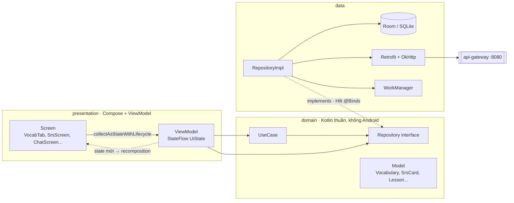
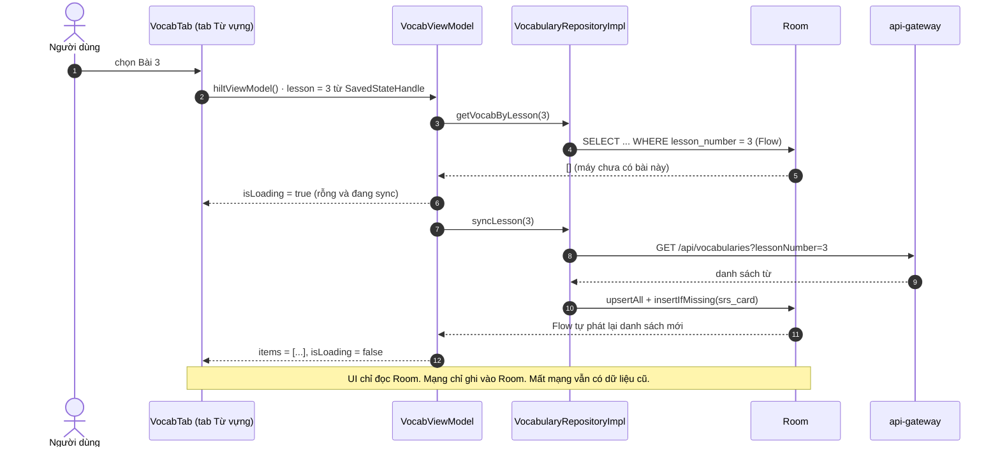

# Android 1: Kotlin, Coroutines và Compose qua code của `nihongo-android`

> **Mục tiêu:** Học xong bài này bạn:
> - build, chạy test và cài được app `apps/nihongo-android` lên emulator;
> - đọc hiểu Kotlin trong repo: null safety, data class, extension, `object`, scope function, lambda;
> - dùng được coroutine và Flow: `suspend`, dispatcher, `StateFlow` khác `SharedFlow` khác `Channel`, `stateIn`, `callbackFlow`;
> - viết được màn hình Compose: state và recomposition, danh sách, side effect, Canvas;
> - nhận ra 6 lỗi thật từng có trong code (L1, L4, L5, L6, L9, L10) và biết vì sao chúng sai.
>
> **Cần biết trước:** nhóm 0 ([learn-terminal.md](./learn-terminal.md), [setup-tools.md](./setup-tools.md), [learn-git.md](./learn-git.md)); biết một ngôn ngữ lập trình bất kỳ ở mức [learn-js-ts.md](./learn-js-ts.md). Cách cài Android Studio và emulator: [run-mobile.md](./run-mobile.md).
> **Thời gian:** khoảng 3 tuần, 1,5–2 giờ mỗi ngày.

Đây là bài **1/4** của lộ trình Android. Bốn bài chia theo góc nhìn, mỗi chủ đề chỉ giải thích kỹ ở một nơi:

| Bài | Học gì | Câu hỏi bài trả lời |
|---|---|---|
| **1. Bài này** | Ngôn ngữ Kotlin, coroutine/Flow, giao diện Compose | "Viết code Android thế nào?" |
| 2. [learn-android-architecture.md](./learn-android-architecture.md) | Kiến trúc, ViewModel, Room, offline, mạng, Hilt, tính năng native, test, 14 lỗi đã sửa | "Ghép các phần thành một app chạy được thế nào?" |
| 3. [learn-android-fundamentals.md](./learn-android-fundamentals.md) | Hệ điều hành Android: tiến trình, vòng đời, Intent, chạy nền, quyền, ANR, bảo mật | "Android chạy và giết app của mình thế nào?" |
| 4. [learn-android-features.md](./learn-android-features.md) | Nhật ký làm 9 tính năng và 5 lỗi chỉ lộ ra khi chạy thật | "Làm tính năng thật thì vấp ở đâu?" |
| Nâng cao: [learn-android-framework.md](./learn-android-framework.md) | Khởi động, system service, Binder, lab AIDL, SELinux, HAL, Android Automotive | "Bên dưới app, hệ thống chạy thế nào?" (vị trí Android ở công ty thiết bị, ô tô) |

Câu hỏi phỏng vấn của cả bốn bài nằm ở [interview-android.md](./interview-android.md); Java, OOP và thuật toán ở [interview-java-dsa.md](./interview-java-dsa.md), nên luyện song song từ tuần 1. Danh sách thư viện Jetpack kèm code mẫu: [roadmap-android.md](./roadmap-android.md) (tham khảo).

## Lộ trình 9 tuần cho cả bốn bài

Code đã sửa xong, nên cách học tốt nhất là **tự sửa lại từng lỗi trên bản cũ rồi so với bản sửa**. Tìm bản cũ của một file: `git log --oneline -- apps/nihongo-android` để tìm commit trước khi sửa, rồi `git show <commit>:apps/nihongo-android/<đường dẫn>`. Mã lỗi L1–L14 tra ở [bảng 14 lỗi](./learn-android-architecture.md#35-bảng-tổng-hợp).

| Tuần | Bài | Học | Tự làm lại, rồi so với bản sửa |
| --- | --- | --- | --- |
| 1 | 1 | Mục 1–12: Kotlin | **L6** (truyền `now`), **L10**. Refactor `Triple` → `data class Rating` |
| 2 | 1 | Mục 13–19: coroutine, Flow | **L5**, `suspendCancellableCoroutine`, **L1** (ticker + `flatMapLatest`) |
| 3 | 1 | Mục 20–25: Compose | **L9**, **L4**. Thêm `@Preview` cho `VocabScreen` với dữ liệu giả |
| 4 | 2 | Mục 26–28: kiến trúc | **L11** (repository + Room cho bài học) |
| 5 | 2 | Phần G: test | Viết test cho **L2** trên bản cũ (phải đỏ), sửa cho xanh. Thêm test `SrsViewModel` |
| 6 | 2 | Mục 29: Room | **L3**: export schema v1, nâng v2, viết test migration. Thử thêm một cột ở v3 |
| 7 | 2 | Mục 30–34: offline, mạng, native | **L12** (WorkManager), **L13** (CookieJar + Authenticator), **L7**, **L8**; test với MockWebServer |
| 8 | 3 | Mục 1–13: nền tảng Android | Tự tái hiện process death; đọc lại 3 lỗi nền tảng ở mục 13 |
| 9 | 4 | Cả bài | Bật R8 (`isMinifyEnabled = true`), sửa lỗi ProGuard; đọc 5 lỗi chỉ lộ ra khi chạy thật |
| 10–11 | Nâng cao | [learn-android-framework.md](./learn-android-framework.md) | Chạy lab AIDL, quan sát tiến trình bằng `adb`; thêm hàm vào hợp đồng AIDL kèm test |

Kiểm lại ngày 10/11/2026 trên macOS (Apple Silicon): **108 unit test** đều pass (`./gradlew testDebugUnitTest`). Lần chạy thử trên emulator API 35 với backend thật (cả bản debug lẫn release) được ghi ở bài 4.

## Cách đọc bài này

Mỗi mục gồm:

- **Code thật** trích từ repo, có đường dẫn file và số dòng.
- **Giải thích vì sao** viết như vậy, và cái giá phải trả.
- **Bẫy → Đã sửa**: lỗi thật từng nằm trong code, cách nó gây hại, và bản sửa hiện có trong repo.
- **Tự kiểm tra**: câu hỏi kèm đáp án ngắn.

Sơ đồ viết bằng **Mermaid**: GitHub tự vẽ; trong VS Code cần extension "Markdown Preview Mermaid Support".

**Tìm code được nhắc tới.** Đường dẫn trong comment như `// presentation/vocab/VocabViewModel.kt` tính từ thư mục `apps/nihongo-android/app/src/main/java/com/edu/nihongo/`. Bài không ghi số dòng, vì số dòng đổi mỗi lần code được sửa. Mở file bằng `Cmd+P` (VS Code) hoặc bấm `Shift` hai lần (Android Studio), rồi `Cmd+F` tìm tên hàm hay tên class có trong đoạn code.

## Từ khóa trong bài

| Từ | Nghĩa ngắn gọn |
|---|---|
| Kotlin | Ngôn ngữ chính để viết app Android. Giống TypeScript ở chỗ có kiểu dữ liệu, nhưng biên dịch ra mã chạy trên máy ảo Java |
| Gradle | Công cụ build: tải thư viện, biên dịch, chạy test, đóng gói app. Giống `npm` + `tsc` gộp lại |
| JDK | Bộ công cụ Java mà Gradle cần để chạy |
| Emulator / AVD | Điện thoại Android ảo chạy trên máy tính |
| APK | File cài đặt app Android |
| Activity | Một "cửa sổ" của app. App này chỉ có một: `MainActivity` |
| Jetpack Compose | Cách viết giao diện bằng hàm Kotlin, giống React viết bằng component |
| Composable | Hàm vẽ giao diện, đánh dấu `@Composable`. Giống một React component |
| ViewModel | Object giữ dữ liệu của một màn hình, sống qua lúc xoay màn hình |
| Coroutine | Việc chạy bất đồng bộ của Kotlin, giống `async`/`await` của JS |
| Flow | Dòng giá trị phát theo thời gian, ví dụ "danh sách từ vựng mỗi khi DB đổi" |
| Room | Thư viện lưu dữ liệu vào SQLite trên máy |
| Retrofit / OkHttp | Thư viện gọi API HTTP, giống `fetch` |
| Hilt | Thư viện tự tạo và truyền dependency (DI), giống DI của NestJS |

## Mục lục

- **Phần 0 — Chạy được app**: 1. Môi trường · 2. Bản đồ code · 3. Đi theo một lần bấm
- **Phần A — Kotlin qua code repo**: 4. Null safety · 5. Data class · 6. Default argument (bẫy) · 7. Extension function · 8. `object` · 9. `operator invoke` · 10. `Result`, `runCatching` (bẫy) · 11. Scope function · 12. Lambda, destructuring
- **Phần B — Coroutines và Flow**: 13. `suspend`, scope, dispatcher · 14. Flow lạnh từ Room · 15. StateFlow, SharedFlow, Channel · 16. `stateIn` · 17. `callbackFlow` · 18. Nối callback với coroutine · 19. `runBlocking`
- **Phần C — Jetpack Compose**: 20. Recomposition và state · 21. `collectAsStateWithLifecycle` · 22. Danh sách · 23. Side effect · 24. View cũ trong Compose · 25. Canvas, cử chỉ, px và dp

Mục 26 trở đi (kiến trúc, dữ liệu, native, test, 14 lỗi) ở bài 2: [learn-android-architecture.md](./learn-android-architecture.md).

---

# Phần 0 — Chạy được app

## 1. Chạy được app trên máy

### 1.1 Cần những gì

| Thứ | Cần | Kiểm bằng |
| --- | --- | --- |
| Android Studio | Bản mới | Mở được |
| Android SDK | compileSdk 35, minSdk 24 (Android Studio tự cài) | `ls ~/Library/Android/sdk` (macOS) |
| JDK | 17 trở lên. JDK đi kèm Android Studio (Java 25) chạy được: đã kiểm biên dịch toàn bộ ngày 10/11/2026 | `java -version` |
| Emulator | Một máy ảo API 35, ví dụ `pixel_api_35` | `~/Library/Android/sdk/emulator/emulator -list-avds` |
| Backend | Stack Docker của project đang chạy | Mục 1.4 |

Phiên bản công cụ build khai báo trong repo: Gradle **9.7.1** (`gradle/wrapper/gradle-wrapper.properties`), Android Gradle Plugin **8.7.3** và Kotlin **2.0.21** (`build.gradle.kts` gốc). Không cần tự cài Gradle: file `gradlew` (Gradle wrapper) tự tải đúng bản ở lần chạy đầu.

Cách tạo emulator và mở project bằng Android Studio: [run-mobile.md](./run-mobile.md).

### 1.2 Chạy unit test

Unit test chạy trên máy tính (JVM), không cần emulator. Đây là cách nhanh nhất để biết môi trường đã đúng chưa:

```bash
cd apps/nihongo-android        # tính từ thư mục gốc repo
./gradlew testDebugUnitTest
```

Windows: `gradlew.bat testDebugUnitTest`.

Lần đầu mất vài phút vì Gradle tải chính nó và thư viện. Kết quả đúng kết thúc bằng:

```
BUILD SUCCESSFUL in 57s
31 actionable tasks: 10 executed, 21 up-to-date
```

Dòng `Deprecated Gradle features were used in this build, making it incompatible with Gradle 10` phía trên là **cảnh báo**, không phải lỗi. Kết quả chi tiết nằm ở `app/build/reports/tests/testDebugUnitTest/index.html`: mở bằng trình duyệt, thấy 108 test, 0 lỗi.

### 1.3 Cài app lên emulator

```bash
~/Library/Android/sdk/emulator/emulator -avd pixel_api_35 &   # mở emulator (hoặc bấm ▶ trong Device Manager của Android Studio)
./gradlew installDebug                                          # build và cài bản debug
```

`installDebug` thành công in `Installed on 1 device.` rồi `BUILD SUCCESSFUL`. Mở app "Nihongo" trên emulator.

### 1.4 Backend cho app

App cần API của project:

```bash
cd ~/Projects/edu-app-nihongo       # thư mục gốc repo
npm run docker:up:nihongo
curl -s -o /dev/null -w "%{http_code}\n" "localhost:8080/api/vocabularies?lessonNumber=1&limit=1"
```

Ra `200` là backend sẵn sàng.

App gọi `http://10.0.2.2:8080/api/` (biến `API_BASE_URL` trong `app/build.gradle.kts`). Vì sao không phải `localhost`: trong emulator, `localhost` là **chính cái điện thoại ảo**. `10.0.2.2` là địa chỉ đặc biệt mà emulator dùng để trỏ về máy tính của bạn. Cổng 8080 là nginx, nginx chuyển `/api` sang api-gateway ([learn-web-http.md](./learn-web-http.md)). Chạy trên điện thoại thật thì đổi thành IP Wi-Fi của máy tính.

Backend local dùng HTTP thường (không mã hóa), nên app chỉ cho phép HTTP tới `10.0.2.2`, `localhost`, `127.0.0.1`; mọi domain khác bị chặn. Cấu hình này và lý do nằm ở [learn-android-fundamentals.md](./learn-android-fundamentals.md) mục 13.

### 1.5 Lỗi môi trường hay gặp

| Triệu chứng | Nguyên nhân | Cách sửa |
| --- | --- | --- |
| `./gradlew: permission denied` | File mất quyền chạy (thường do copy qua máy khác) | `chmod +x gradlew` một lần |
| `JAVA_HOME is not set` / `Unable to locate a Java Runtime` | Chưa có JDK, hoặc terminal không biết JDK ở đâu | Dùng JDK đi kèm Android Studio: `export JAVA_HOME="/Applications/Android Studio.app/Contents/jbr/Contents/Home"` (macOS) |
| Build lỗi, thông báo chỉ in một con số phiên bản Java (ví dụ `25.0.3`) | Gradle/Kotlin không hiểu bản Java đang dùng. Repo từng gặp lỗi này với Java 25 khi còn Gradle 8.12; Gradle 9.7.1 hiện tại đã chạy được | Kiểm `./gradlew --version`. Vẫn lỗi thì chọn JDK 17 hoặc 21: Android Studio → **Settings → Build, Execution, Deployment → Build Tools → Gradle → Gradle JDK** |
| `SDK location not found` | Thiếu file `local.properties` trỏ tới Android SDK | Mở project bằng Android Studio một lần (nó tự tạo), hoặc tạo file có dòng `sdk.dir=/Users/<bạn>/Library/Android/sdk` |
| App mở được nhưng báo lỗi kết nối | Backend chưa chạy, hoặc chạy trên máy thật mà vẫn dùng `10.0.2.2` | Mục 1.4 |
| `INSTALL_FAILED_NO_MATCHING_ABIS` hoặc `no connected devices` | Emulator chưa mở xong | Đợi màn hình khóa của emulator hiện ra rồi chạy lại `installDebug` |

---

## 2. Bản đồ code

```text
app/src/main/java/com/edu/nihongo/
├── EduApp.kt                 @HiltAndroidApp; khởi tạo LiveKit, TTS
├── MainActivity.kt           @AndroidEntryPoint; setContent { NihongoTheme { NihongoApp() } }
├── presentation/             Compose Screen + ViewModel, mỗi tính năng một thư mục
│   ├── NihongoApp.kt         NavHost, toàn bộ route, deep link nihongo://srs
│   ├── vocab/  srs/  lessons/  login/  home/    (lessons/LessonDetailScreen: 3 tab Từ vựng · Ngữ pháp · Kanji)
│   ├── progress/  reading/  exam/  community/  kana/  widget/   (xem learn-android-features.md)
│   ├── common/               BackScaffold, LoadingBox, MessageBox dùng chung
│   ├── camera/               CameraX + ML Kit OCR
│   ├── live/                 LiveKit
│   ├── kanji/                Canvas vẽ chữ
│   └── pronunciation/  sentence_practice/  ai_tutor/
├── domain/
│   ├── entity/Entities.kt    Vocabulary, SrsCard, ReviewCard (model thuần)
│   ├── repository/           interface VocabularyRepository, AuthRepository...
│   ├── usecase/UseCases.kt   GetVocabByLesson, SyncLesson, GetReviewQueue
│   └── TimeSource.kt         nguồn thời gian inject được
├── data/
│   ├── local/                Room (AppDatabase v3, Daos, Entities), Mappers, TokenStore (DataStore)
│   ├── remote/               Retrofit API, AuthInterceptor, RefreshCookieJar, TokenAuthenticator, KeycloakAuth
│   ├── repository/           RepositoriesImpl.kt (Vocabulary, Lesson, Auth, Translate)
│   ├── sync/                 ReviewSyncWorker, SrsReminderWorker (WorkManager), SyncScheduler
│   ├── notifications/        ReminderNotifier (thông báo nhắc ôn)
│   └── NetworkMonitor.kt     trạng thái mạng dưới dạng Flow (implement NetworkStatus)
├── di/AppModule.kt           Hilt @Provides / @Binds
└── utils/                    SrsAlgorithm (SM-2), TtsHelper, runCatchingCancellable
app/schemas/                  schema Room từng version (1.json, 2.json, 3.json), commit vào git
app/src/test/                 unit test JVM + testing/Fakes.kt
app/src/androidTest/          test migration, Compose UI, deep link, Worker, widget (chạy trên emulator)
baselineprofile/              sinh Baseline Profile + đo thời gian khởi động
```



Đọc sơ đồ: mũi tên là "gọi tới" hoặc "phụ thuộc vào". Luật phụ thuộc: `presentation → domain ← data`.

- **presentation** (giao diện) gọi **domain** (nghiệp vụ).
- **data** (Room, mạng) *cài đặt* các interface của **domain**.
- **domain** không biết Room, Retrofit hay Android là gì, nên test được bằng Kotlin thuần, chạy nhanh trên máy tính.

[Bài 2](./learn-android-architecture.md) mục 26 kể hai chỗ bản cũ vi phạm luật này và cách đã sửa.

---

## 3. Đi theo một lần bấm: mở "Từ vựng bài 3"

Hiểu trọn luồng này là hiểu 70% app.

```text
HomeScreen ─ bấm "Từ vựng" ─▶ navController.navigate("lessons")
LessonListScreen ─ chọn bài 3 ─▶ navigate(Routes.vocab(3))  =  "vocab/3"
NavHost khớp "vocab/{lesson}", mở LessonDetailScreen (3 tab: Từ vựng · Ngữ pháp · Kanji)
Tab "Từ vựng" là VocabTab, gọi hiltViewModel() ─▶ Hilt tạo VocabViewModel
   │  SavedStateHandle chứa sẵn "lesson" = 3 (Navigation tự đưa argument vào)
   ├─ uiState = combine(Flow từ Room, syncing, syncError).stateIn(...)
   │      VocabularyDao.getByLesson(3) phát ngay list hiện có (lần đầu: rỗng)
   │      rỗng + đang sync → isLoading = true; có dữ liệu cũ → hiện luôn
   └─ init { launch { syncLesson(3); syncing = false } }
          VocabularyRepositoryImpl.syncLesson
          ├─ network.isOnline()?
          ├─ VocabularyRemoteDataSource.fetchAllForLesson(3)   ← Retrofit, phân trang 100, tối đa 50 trang
          │     OkHttp: AuthInterceptor gắn "Bearer ..." → GET /api/vocabularies
          │     401? TokenAuthenticator làm mới token rồi gửi lại (mục 31, bài kiến trúc)
          ├─ vocabDao.upsertAll(entities)                       ← ghi Room
          │     Room thấy bảng vocabulary đổi → chạy lại query → combine phát state mới
          ├─ srsDao.insertIfMissing(...)                        ← thẻ SRS cho từ mới, một lệnh
          └─ syncScheduler.schedulePendingSync()                ← hẹn WorkManager gửi hàng đợi ôn tập
UI: collectAsStateWithLifecycle() ─▶ recomposition ─▶ LazyColumn hiện danh sách
```

Cùng luồng đó dưới dạng sơ đồ tuần tự:



Điểm mấu chốt của offline-first: **UI không bao giờ đọc thẳng từ mạng**. Mạng chỉ ghi vào Room, còn UI chỉ đọc Room. Mất mạng thì UI vẫn có dữ liệu cũ.

Lab: bật log rồi lọc Logcat theo `okhttp` để thấy request.

```bash
adb logcat | grep -i "okhttp"
```

`HttpLoggingInterceptor` bật mức `BODY` cho bản debug và che `Authorization`, `Cookie`, `Set-Cookie` (tìm `HttpLoggingInterceptor` trong `di/AppModule.kt`).

---

# Phần A — Kotlin qua code repo

### Hiểu nhanh: Kotlin so với TypeScript

Bạn đã biết TypeScript từ [learn-js-ts.md](./learn-js-ts.md). Phần lớn ý tưởng giống nhau, chỉ khác cách viết:

| Ý | TypeScript | Kotlin |
| --- | --- | --- |
| Biến không đổi / đổi được | `const x = 1` / `let x = 1` | `val x = 1` / `var x = 1` |
| Hàm | `function cong(a: number, b: number): number { return a + b }` | `fun cong(a: Int, b: Int): Int { return a + b }` |
| Hàm một dòng | `const cong = (a, b) => a + b` | `fun cong(a: Int, b: Int) = a + b` |
| Có thể null | `name: string \| null` | `name: String?` |
| Truy cập an toàn / mặc định | `a?.b ?? "x"` | `a?.b ?: "x"` |
| Ghép chuỗi | `` `Bài ${n}` `` | `"Bài $n"` hoặc `"Bài ${lesson.id}"` |
| Hàm truyền vào hàm | `list.map((x) => x * 2)` | `list.map { x -> x * 2 }` hoặc `list.map { it * 2 }` |
| Object chỉ chứa dữ liệu | `interface Lesson { id: number }` | `data class Lesson(val id: Int)` |
| `switch` | `switch (x) { case 1: ... }` | `when (x) { 1 -> ...; else -> ... }` |

Khác biệt lớn nhất: **Kotlin kiểm kiểu khi biên dịch, và lỗi kiểu làm build thất bại**. TypeScript chạy bằng Node vẫn chạy khi sai kiểu ([learn-js-ts.md](./learn-js-ts.md) mục 7.3); Kotlin thì không build được. Nhiều lỗi `null` trong JavaScript vì vậy bị chặn ngay từ lúc build.

Muốn thử Kotlin không cần Android: <https://play.kotlinlang.org> chạy code ngay trên trình duyệt.

## 4. Null safety

```kotlin
// data/remote/Api.kt — server có thể thiếu field, nên DTO cho phép null
data class VocabDto(
    val id: Long,
    val kana: String?,
    val kanji: String?,
    val meaning: String?,
    ...
)

// data/repository/RepositoriesImpl.kt — DTO → entity: null thành chuỗi rỗng
VocabularyEntity(
    id = dto.id,
    kana = dto.kana.orEmpty(),   // String? → String
    kanji = dto.kanji,           // giữ null: nhiều từ không có kanji
    ...
)
```

| Cú pháp | Nghĩa | Trong repo |
| --- | --- | --- |
| `T?` | có thể null | `kanji: String?` |
| `a?.b` | null thì cả biểu thức là null | `res.data?.accessToken` |
| `a ?: b` | null thì lấy `b` | `entry.arguments?.getInt("lesson") ?: 1` |
| `.orEmpty()` | `String?` → `""`, `List?` → `emptyList()` | `envelope.data?.data.orEmpty()` |
| `require(cond) { msg }` | sai thì ném `IllegalArgumentException` | `require(!token.isNullOrBlank())` |
| `!!` | ép không null, null thì crash | repo không dùng; cố tránh |

Nguyên tắc trong repo: **nhận null ở biên** (DTO từ mạng), **xử lý ngay ở mapper**, và để domain dùng kiểu không null nhiều nhất có thể. `Vocabulary.kana` là `String`, không phải `String?`.

Smart cast: sau khi kiểm tra null, Kotlin tự coi biến là không null.

```kotlin
// RepositoriesImpl.kt
val vocab = card?.let { vocabDao.getById(it.vocabularyId) }   // VocabularyEntity?
if (card == null || vocab == null) { ...; continue }
vocab.kana                                                     // từ đây vocab là VocabularyEntity, card là SrsCard
```

**Tự kiểm tra:** vì sao `VocabDto.kana` là `String?` còn `Vocabulary.kana` là `String`? → Không kiểm soát được server, nhưng kiểm soát được model của mình. Chặn null ở biên thì phần còn lại của app khỏi phải kiểm tra.

---

## 5. Data class, `copy`, bất biến

```kotlin
// presentation/vocab/VocabViewModel.kt
data class VocabUiState(
    val items: List<Vocabulary> = emptyList(),
    val isLoading: Boolean = true,
    val error: String? = null,
)

// SrsViewModel.kt — đổi một phần state, giữ nguyên phần còn lại
_uiState.update { state -> state.copy(sessionTotal = state.sessionTotal + 1, ...) }
```

`data class` tự sinh `equals`, `hashCode`, `toString`, `copy`, `componentN`. Mọi field đều là `val`, muốn đổi thì tạo bản mới bằng `copy`.

Vì sao UI state phải bất biến:

1. `StateFlow` chỉ phát khi giá trị mới **khác** giá trị cũ (so bằng `equals`). Sửa trực tiếp object cũ thì `equals` vẫn trả `true`, UI không cập nhật.
2. Compose bỏ qua recomposition khi tham số không đổi; điều đó chỉ đáng tin khi dữ liệu bất biến.
3. Không có cảnh hai coroutine cùng sửa một object.

`update { }` (thay cho `_uiState.value = ...`) chạy kiểu compare-and-set: nếu coroutine khác vừa đổi state thì lambda chạy lại với giá trị mới nhất. `SrsViewModel` vừa nhận list thẻ từ Room vừa cập nhật điểm phiên ở hai coroutine khác nhau, nên `update` là đúng.

`VocabViewModel` bản mới đi cách khác: không giữ một `MutableStateFlow` chung mà **tính** state từ các nguồn bằng `combine` (mục 15, L2). Cách này tránh được loại lỗi "quên cập nhật một field".

---

## 6. Default argument — và một bẫy thật

```kotlin
// bản cũ — data/local/dao/Daos.kt
fun getReviewQueue(now: Long = System.currentTimeMillis(), limit: Int = 20): Flow<List<ReviewRow>>
```

Default argument được tính **mỗi lần gọi hàm**. `SrsViewModel` gọi hàm này **một lần** lúc khởi tạo, nên `now` bị đóng băng tại thời điểm mở màn hình.

Hệ quả: Room chạy lại query mỗi khi bảng đổi, nhưng luôn với **cùng một `now` cũ**. Thẻ nào đến hạn sau lúc mở màn hình (ví dụ mở lúc 9:00, thẻ đến hạn lúc 9:10) sẽ không xuất hiện cho tới khi rời màn hình rồi vào lại.

Đây là bẫy kinh điển khi kết hợp Flow với tham số thời gian.

**Đã sửa (L1).** DAO bỏ giá trị mặc định (`fun getReviewQueue(now: Long, limit: Int = 20)`), repository tự đưa thời gian vào theo nhịp:

```kotlin
// data/repository/RepositoriesImpl.kt — VocabularyRepositoryImpl
override fun getReviewQueue(): Flow<List<ReviewCard>> =
    ticker()                                                    // phát timeSource.now() mỗi 60 giây
        .flatMapLatest { now -> srsDao.getReviewQueue(now = now) }  // hủy query cũ, chạy query mới
        .map { rows -> rows.map { it.toDomain() } }
        .distinctUntilChanged()                                 // kết quả không đổi thì không phát
```

`flatMapLatest` giống `switchMap` của RxJS. Test: `VocabularyRepositoryImplTest.reviewQueue_showsCardThatBecomesDueWhileScreenIsOpen` dùng thời gian ảo của `runTest` để "tua" 2 phút.

---

## 7. Extension function

```kotlin
// data/local/Mappers.kt
fun VocabularyEntity.toDomain(): Vocabulary = Vocabulary(
    id = id, lessonNumber = lessonNumber, kana = kana, ...
    syncStatus = SyncStatus.valueOf(syncStatus),
)

// RepositoriesImpl.kt
vocabDao.getByLesson(lessonNumber).map { list -> list.map { it.toDomain() } }
```

Extension function thêm hàm cho class mà không sửa class đó. Đặt mapper trong `data/local` giúp entity Room không biết tới domain và ngược lại. Bên trong extension, `this` là đối tượng nhận (`VocabularyEntity`), nên viết thẳng `id`, `kana`.

Bẫy nhỏ: `SyncStatus.valueOf(syncStatus)` ném exception nếu DB chứa chuỗi lạ, ví dụ sau khi đổi tên enum. Room có `@TypeConverter` để lưu enum an toàn hơn.

Cũng là extension, nhưng là extension property có delegate:

```kotlin
// data/local/TokenStore.kt
private val Context.tokenDataStore: DataStore<Preferences> by preferencesDataStore("auth")
```

`by preferencesDataStore(...)` bảo đảm cả app chỉ có **một** DataStore tên `"auth"`. Tạo hai instance cùng file sẽ làm DataStore ném lỗi lúc chạy.

---

## 8. `object`, `companion object`, singleton

```kotlin
// utils/SrsAlgorithm.kt      — hàm thuần, không state
object SrsAlgorithm { fun calculateNextReview(card: SrsCard, quality: Int, now: Long): SrsCard { ... } }

// presentation/NihongoApp.kt — hằng số route
object Routes { const val HOME = "home"; fun vocab(lesson: Int) = "vocab/$lesson" }

// data/local/AppDatabase.kt
companion object { const val DB_NAME = "edu_app.db" }

// utils/TtsHelper.kt          — singleton có state
object TtsHelper { private var tts: TextToSpeech? = null ... }
```

`object` là singleton do Kotlin tạo khi dùng lần đầu, an toàn với nhiều luồng. Nhưng có hai cái giá:

- **Khó test**: bản cũ của `SrsAlgorithm` gọi thẳng `System.currentTimeMillis()`, test phải chấp nhận sai số `± 5_000` ms. **Đã sửa (L6):** hàm nhận `now: Long` (`calculateNextReview(card, quality, now)`), ViewModel lấy giờ từ `TimeSource` inject bằng Hilt. Test giờ khẳng định chính xác `nextReviewAt == now + 6 * DAY_MS`.
- **Ẩn phụ thuộc**: `TtsHelper` là state toàn cục, Hilt không quản lý. So với `TokenStore`, được đánh dấu `@Singleton` và inject qua constructor nên thay bằng bản giả được.

Quy tắc: `object` dùng tốt cho hằng số và hàm thuần không phụ thuộc thời gian hay I/O. Cái gì có state hoặc I/O thì nên là class `@Singleton` inject bằng Hilt.

`TimeSource` (`domain/TimeSource.kt`) là một `fun interface`: interface chỉ có một hàm, nên tạo được bằng lambda: `TimeSource { System.currentTimeMillis() }` trong `AppModule`, `TimeSource { start + testScheduler.currentTime }` trong test. Không dùng `java.time.Clock` vì minSdk 24 chưa có `java.time` (cần API 26 hoặc desugaring).

---

## 9. `operator fun invoke` — use case gọi như hàm

```kotlin
// domain/usecase/UseCases.kt
class GetVocabByLessonUseCase @Inject constructor(private val repo: VocabularyRepository) {
    operator fun invoke(lessonNumber: Int) = repo.getVocabByLesson(lessonNumber)
}

// VocabViewModel.kt — gọi như gọi hàm
combine(getVocabByLesson(lessonNumber), syncing, syncError) { ... }
```

`operator fun invoke` cho phép viết `useCase(x)` thay vì `useCase.execute(x)`. Use case trong repo hiện chỉ chuyển tiếp sang repository. Nó đáng giá khi có logic, ví dụ gộp hai repository hoặc lọc theo quyền. Use case chỉ chuyển tiếp là chi phí; nhiều team bỏ qua tầng này cho đến khi cần.

---

## 10. `Result`, `runCatching` — và bẫy với coroutine

```kotlin
// RepositoriesImpl.kt (bản cũ dùng runCatching, bản mới dùng runCatchingCancellable)
override suspend fun syncLesson(lessonNumber: Int): Result<Unit> = runCatchingCancellable {
    if (!network.isOnline()) error("Không có mạng")
    ...
}

// VocabViewModel.kt
syncLesson(lessonNumber)
    .onSuccess { syncError.value = null }
    .onFailure { e -> syncError.value = e.message }
```

`Result<T>` gói hoặc giá trị, hoặc exception, để caller xử lý mà không cần `try/catch`. `error("...")` là hàm thư viện, ném `IllegalStateException`.

**Bẫy:** `runCatching` bắt **mọi** `Throwable`, kể cả `CancellationException`. Coroutine dùng exception này để báo "đã bị hủy". Nếu nuốt nó, coroutine bị hủy vẫn chạy tiếp như chưa có gì. Ví dụ: người dùng thoát màn hình giữa lúc sync, `viewModelScope` hủy coroutine, nhưng `runCatching` biến việc hủy thành `Result.failure`, rồi `onFailure` vẫn chạy và cập nhật state của một ViewModel đã chết.

**Đã sửa (L5).** `utils/RunCatchingCancellable.kt`:

```kotlin
inline fun <T> runCatchingCancellable(block: () -> T): Result<T> =
    try { Result.success(block()) }
    catch (e: CancellationException) { throw e }   // luôn ném lại tín hiệu hủy
    catch (e: Exception) { Result.failure(e) }
```

Hàm là `inline` nên bên trong `block` gọi được hàm `suspend` dù `block` không khai báo `suspend`. Mọi chỗ trong code `suspend` (repository, `LoginScreen`, `PushService`) đã đổi sang hàm này. `runCatching` thường chỉ còn ở chỗ không có coroutine (parse JSON trong `flushSyncQueue`). Test: `RunCatchingCancellableTest`.

---

## 11. Scope function: `let`, `apply`, `also`, `run`, `with`

| Hàm | Trong lambda gọi đối tượng là | Trả về | Dùng khi | Trong repo |
| --- | --- | --- | --- | --- |
| `let` | `it` | kết quả lambda | xử lý khi khác null | `vocab.kanji?.let { Text(it) }` (`VocabScreen.kt`, hàm `VocabTab`) |
| `apply` | `this` | chính đối tượng | cấu hình object vừa tạo | `HttpLoggingInterceptor().apply { level = ... }` (`AppModule.kt`) |
| `also` | `it` | chính đối tượng | làm thêm việc phụ | `Preview.Builder().build().also { it.surfaceProvider = ... }` (camera VM:65) |
| `run` | `this` | kết quả lambda | tính một giá trị từ object | |
| `with(x)` | `this` | kết quả lambda | gọi nhiều hàm trên `x` | |

Mẹo nhớ: `apply`/`also` trả về **chính đối tượng** (dùng để cấu hình); `let`/`run` trả về **kết quả lambda** (dùng để biến đổi).

`return` sớm trong lambda: `cache[trimmed]?.let { return it }` (`RepositoriesImpl.kt`). `return` ở đây thoát khỏi **cả hàm** `translateJapanese`, được vì `let` là hàm `inline`.

---

## 12. Lambda, trailing lambda, destructuring

```kotlin
// SrsScreen.kt — danh sách Triple, phần tử thứ ba là Pair
listOf(
    Triple("🔁", "Lại", Color(0xFFEF4444) to 1),
    ...
).forEach { (emoji, label, colorQuality) ->        // destructuring một Triple
    val (color, quality) = colorQuality              // destructuring một Pair
    RatingButton(emoji = emoji, ..., onClick = { onReviewed(card, quality) ... })
}
```

`a to b` tạo một `Pair`. Destructuring chạy được vì `Pair`/`Triple`/`data class` có `component1()`, `component2()`...

Viết vậy chạy được nhưng khó đọc. Một `data class Rating(val emoji: String, val label: String, val color: Color, val quality: Int)` sẽ rõ hơn nhiều. Đây là một refactor nhỏ tốt cho tuần đầu.

Trailing lambda: tham số cuối là hàm thì đưa lambda ra ngoài ngoặc. `Scaffold(topBar = { ... }) { padding -> ... }`: lambda sau dấu `)` chính là tham số `content`.

---

# Phần B — Coroutines và Flow

### Hiểu nhanh: coroutine so với `async`/`await`

| Ý | JavaScript | Kotlin |
| --- | --- | --- |
| Hàm chờ được | `async function load() { ... }` | `suspend fun load() { ... }` |
| Chờ kết quả | `const x = await fetch(...)` | `val x = api.list(...)` (gọi hàm `suspend` là tự chờ, không cần chữ `await`) |
| Chạy một việc bất đồng bộ | gọi hàm `async`, không `await` | `scope.launch { ... }` |
| Hủy việc đang chạy | `AbortController` (phải tự nối) | Hủy `scope` là mọi coroutine con dừng theo |
| Dòng giá trị theo thời gian | RxJS `Observable`, async iterator | `Flow` |

Hai ý mới so với JavaScript:

- **Scope (phạm vi).** Mỗi coroutine phải chạy trong một scope, ví dụ `viewModelScope` gắn với một màn hình. Màn hình đóng thì scope bị hủy, mọi việc đang chạy dừng theo. JavaScript không có gì tương đương: một `fetch` vẫn chạy tiếp dù người dùng đã rời trang.
- **Dispatcher (luồng chạy).** Android có một **main thread** vẽ giao diện. Việc nặng trên main thread làm app đứng hình. Dispatcher chọn luồng cho coroutine (mục 13).

## 13. `suspend`, scope, dispatcher

```kotlin
// SrsViewModel.kt
init {
    viewModelScope.launch { getReviewQueue().collect { cards -> ... } }   // coroutine 1: sống mãi
}
fun onCardReviewed(card: ReviewCard, quality: Int) {
    viewModelScope.launch { ...; vocabRepo.updateSrsCard(updated) }      // coroutine 2, 3...: mỗi lần chấm
}
```

- `suspend fun`: hàm có thể **tạm dừng mà không chặn luồng**. Lúc chờ mạng, luồng main vẫn vẽ UI.
- `viewModelScope`: scope gắn với ViewModel, tự hủy mọi coroutine con khi ViewModel bị clear (màn hình bị pop khỏi back stack). Nhờ đó không bị rò rỉ.
- Các `launch` chạy **đồng thời**. `collect` không bao giờ kết thúc (Flow của Room sống mãi), nên đặt việc khác sau `collect` trong cùng một `launch` thì việc đó không bao giờ chạy.

`viewModelScope` mặc định chạy trên `Dispatchers.Main.immediate`. Gọi Retrofit hay Room từ main có ổn không? **Có**, vì `suspend fun` của Retrofit và Room tự chuyển sang luồng nền ("main-safe"). Chỉ cần `withContext(Dispatchers.IO)` khi tự làm việc chặn luồng, như đọc file hay tính toán nặng. Camera VM có dùng: `withContext(Dispatchers.IO) { lines.mapNotNull { ... translate ... } }`.

| Dispatcher | Dùng cho |
| --- | --- |
| `Main` | cập nhật UI, gọi hàm main-safe |
| `IO` | I/O chặn luồng (file, socket, API không có suspend) |
| `Default` | tính toán nặng CPU (parse JSON lớn, xử lý ảnh) |

Structured concurrency: coroutine con thuộc về scope cha. Cha bị hủy thì con bị hủy. Con lỗi (với `launch`) thì lỗi lan lên cha và hủy cả các con khác.

---

## 14. Flow lạnh từ Room

```kotlin
// Daos.kt
@Query("SELECT * FROM vocabulary WHERE lesson_number = :lessonNumber ORDER BY sort_order ASC")
fun getByLesson(lessonNumber: Int): Flow<List<VocabularyEntity>>
```

DAO trả `Flow` thì không có `suspend`. Gọi hàm chỉ tạo ra một "công thức"; query chỉ chạy khi có người `collect` (Flow lạnh). Khi đang được collect, Room theo dõi bảng `vocabulary`; bảng thay đổi ở bất kỳ đâu thì Room chạy lại query và phát list mới.

Hệ quả:

- Ghi vào Room là đủ để UI cập nhật; không cần "báo cho màn hình refresh".
- Room theo dõi **cả bảng**, không theo từng dòng. Ghi một dòng `lesson_number = 5` cũng làm query của bài 3 chạy lại. Kết quả không đổi thì vẫn phát list mới (bằng nhau). Thêm `.distinctUntilChanged()` để chặn.
- Toán tử `map` trên Flow (`RepositoriesImpl.kt`) chạy mỗi lần có list mới.

---

## 15. StateFlow, SharedFlow, Channel — state khác event

**State** (dữ liệu màn hình đang hiển thị) dùng `StateFlow`:

```kotlin
private val _uiState = MutableStateFlow(VocabUiState())
val uiState: StateFlow<VocabUiState> = _uiState.asStateFlow()   // bên ngoài chỉ đọc
```

Luôn có giá trị; subscriber mới nhận ngay giá trị hiện tại; bỏ qua giá trị trùng.

**Event** (điều hướng, toast; chỉ xảy ra một lần) thì bản cũ của repo có **hai cách**, và cả hai đều lỗi:

```kotlin
// Cách 1 (cũ) — presentation/live/LiveListViewModel.kt
private val _navigateViewer = MutableSharedFlow<Unit>()
...
_navigateViewer.emit(Unit)
// LiveListScreen.kt
LaunchedEffect(Unit) { viewModel.navigateViewer.collect { onNavigateViewer() } }

// Cách 2 (cũ) — presentation/login/LoginViewModel.kt
fun login(email: String, password: String, onSuccess: () -> Unit) {
    viewModelScope.launch { authRepo.login(...).onSuccess { ...; onSuccess() } }
}
```

| | Cách 1: `MutableSharedFlow()` | Cách 2: truyền lambda vào ViewModel |
| --- | --- | --- |
| Ưu | ViewModel không biết UI | đơn giản |
| Nhược | `replay = 0`, không buffer: phát lúc không ai collect (đang xoay màn hình) thì **mất** sự kiện | ViewModel giữ lambda của Composable. Xoay màn hình giữa lúc login thì lambda cũ vẫn chạy, gọi `navController` của màn hình đã bị hủy |

**Đã sửa (L7, L8)** bằng `Channel` có buffer, ở cả `LoginViewModel`, `LiveListViewModel` và `LiveHostViewModel`:

```kotlin
// presentation/login/LoginViewModel.kt
sealed interface LoginEvent { data object LoggedIn : LoginEvent }

private val _events = Channel<LoginEvent>(Channel.BUFFERED)
val events: Flow<LoginEvent> = _events.receiveAsFlow()   // mỗi event một người nhận, giữ lại khi chưa ai nghe
...
.onSuccess { ...; _events.send(LoginEvent.LoggedIn) }

// presentation/login/LoginScreen.kt
LaunchedEffect(viewModel) {
    viewModel.events.collect { event -> when (event) { LoginEvent.LoggedIn -> onBack() } }
}
```

`login(email, password)` không còn nhận lambda. Test `LoginViewModelTest.loggedInEvent_isBufferedUntilScreenCollects` và `LiveListViewModelTest.navigateEvent_emittedBeforeCollect_isNotLost` cố ý phát sự kiện **trước** khi có ai collect, đúng tình huống bản cũ làm mất sự kiện.

Cách khác theo hướng dẫn mới của Google: **biến event thành state** (`loggedIn = true` trong UiState), màn hình thấy thì điều hướng rồi báo lại ViewModel "đã xử lý".

---

## 16. `stateIn` và `WhileSubscribed(5_000)`

```kotlin
// presentation/home/HomeViewModel.kt
val isOnline = networkMonitor.isOnlineFlow.stateIn(
    scope = viewModelScope,
    started = SharingStarted.WhileSubscribed(5_000),
    initialValue = true,
)
```

`stateIn` biến Flow lạnh thành `StateFlow` nóng, dùng chung cho mọi subscriber.

- `WhileSubscribed(5_000)`: chỉ chạy Flow gốc khi có ít nhất một subscriber; subscriber cuối rời đi thì **đợi 5 giây** rồi mới dừng. 5 giây đủ để sống qua lúc xoay màn hình (Activity bị tạo lại, UI collect lại trong vài trăm ms) mà không phải đăng ký lại `NetworkCallback`. App vào nền quá 5 giây thì callback được gỡ, tiết kiệm pin.
- `Eagerly`: chạy ngay và chạy mãi. `Lazily`: chạy khi có subscriber đầu tiên rồi chạy mãi.
- `initialValue = true`: lạc quan coi là online cho tới khi biết chắc. Đánh đổi: có thể nháy "online" một chút trên máy đang offline.

---

## 17. `callbackFlow` — biến callback Android thành Flow

```kotlin
// data/NetworkMonitor.kt
val isOnlineFlow: Flow<Boolean> = callbackFlow {
    val callback = object : ConnectivityManager.NetworkCallback() {
        override fun onAvailable(network: Network) { trySend(isOnline()) }
        override fun onLost(network: Network) { trySend(isOnline()) }
        ...
    }
    connectivityManager.registerDefaultNetworkCallback(callback)
    trySend(isOnline())                                                       // giá trị ban đầu
    awaitClose { connectivityManager.unregisterNetworkCallback(callback) }    // dọn khi hết người nghe
}.distinctUntilChanged()
```

Ba phần bắt buộc:

1. Đăng ký callback.
2. `trySend` để đẩy giá trị. `trySend` không suspend, nên gọi được từ callback thường.
3. `awaitClose { ... }` giữ Flow sống và gỡ callback khi collector bị hủy. Quên `awaitClose` thì Flow ném lỗi; quên gỡ callback trong đó thì rò rỉ.

`distinctUntilChanged()` vì `onCapabilitiesChanged` gọi rất nhiều lần với cùng kết quả.

Ghi chú trong code (`NetworkMonitor.kt`) giải thích một quyết định thực tế: emulator thường không có `NET_CAPABILITY_VALIDATED` (biểu tượng Wi-Fi có dấu X) nhưng vẫn gọi được `10.0.2.2`. Nên app chỉ kiểm tra "có kết nối", không đòi "đã xác minh có internet".

---

## 18. Nối callback một lần với coroutine

```kotlin
// data/remote/KeycloakAuth.kt (bản cũ dùng suspendCoroutine)
suspend fun exchangeCode(intent: Intent?): KeycloakTokens =
    suspendCancellableCoroutine { cont ->
        ...
        authService.performTokenRequest(request) { tokenResponse, tokenEx ->
            if (access.isNullOrBlank()) cont.resumeWithException(...)
            else cont.resume(KeycloakTokens(access, tokenResponse.idToken))
        }
    }
```

`callbackFlow` dành cho callback gọi **nhiều lần**. Callback gọi **một lần** thì dùng `suspendCoroutine` hoặc `suspendCancellableCoroutine`: tạm dừng coroutine, rồi `resume` khi callback trả kết quả.

Nên dùng `suspendCancellableCoroutine` thay vì `suspendCoroutine`: nếu coroutine bị hủy (người dùng thoát màn hình) thì coroutine kết thúc ngay chứ không treo tới khi mạng trả lời, và có `invokeOnCancellation { }` để dọn dẹp. **Đã đổi**: `KeycloakAuth.exchangeCode` dùng `suspendCancellableCoroutine`, và callback về muộn kiểm tra `if (!cont.isActive) return` trước khi `resume`.

---

## 19. `runBlocking` trong interceptor

```kotlin
// data/remote/AuthInterceptor.kt
override fun intercept(chain: Interceptor.Chain): Response {
    val token = runBlocking { tokenStore.get() }
    ...
}
```

`Interceptor.intercept` của OkHttp là hàm thường, chạy trên luồng của OkHttp (không phải main), nên không gọi `suspend` trực tiếp được. `runBlocking` chặn luồng đó tới khi DataStore đọc xong. Ở đây chấp nhận được vì không chặn main và DataStore có cache trong bộ nhớ sau lần đọc đầu.

**Tuyệt đối không** dùng `runBlocking` trên main thread: sẽ bị ANR (Application Not Responding) nếu chặn quá 5 giây. Cách sạch hơn: giữ token trong một `StateFlow` (đọc `.value` ngay, không cần suspend), cập nhật từ DataStore.

Bản hiện tại: interceptor bỏ qua request **đã có** header `Authorization`, vì request gửi lại sau khi refresh ([learn-android-architecture.md](./learn-android-architecture.md) mục 31) đã mang token mới. Nó nhận `TokenStorage` (interface) thay vì `TokenStore`, nên test thay được bằng bản giả.

---

# Phần C — Jetpack Compose

### Hiểu nhanh: Compose so với React

Nếu từng nghe về React ([roadmap-reactjs.md](./roadmap-reactjs.md)), Compose gần như cùng ý tưởng:

| Ý | React | Compose |
| --- | --- | --- |
| Thành phần giao diện | `function LessonCard(props) { return <div>…</div> }` | `@Composable fun LessonCard(lesson: Lesson) { Card { … } }` |
| State cục bộ | `const [open, setOpen] = useState(false)` | `var open by remember { mutableStateOf(false) }` |
| Vẽ lại khi state đổi | re-render | recomposition |
| Việc phụ (gọi API, đăng ký sự kiện) | `useEffect(() => { … }, [deps])` | `LaunchedEffect(key) { … }` |
| Danh sách dài | `list.map(x => <Item key={x.id} />)` | `LazyColumn { items(list, key = { it.id }) { … } }` |

Nguyên tắc chung: **giao diện là kết quả của state**. Không "sửa" giao diện trực tiếp; đổi state, Compose tự vẽ lại phần liên quan.

## 20. Recomposition và state

Composable là hàm vẽ UI **từ state**. State đổi thì Compose gọi lại (recompose) những hàm đọc state đó.

```kotlin
// presentation/login/LoginScreen.kt (bản cũ dùng remember)
var email by rememberSaveable { mutableStateOf("") }
OutlinedTextField(value = email, onValueChange = { email = it }, ...)
```

| API | Sống qua | Ví dụ |
| --- | --- | --- |
| biến thường | không sống qua recomposition | không dùng cho state |
| `remember { mutableStateOf(x) }` | recomposition | `email`, `showAnswer` |
| `rememberSaveable { ... }` | recomposition **và** xoay màn hình, process death | nên dùng cho `email` |
| state trong ViewModel | xoay màn hình (không qua process death trừ khi dùng `SavedStateHandle`) | `uiState` |

**Bẫy (L9):** bản cũ của `LoginScreen` dùng `remember` cho `email` và `password`, xoay màn hình là mất chữ đã gõ. **Đã sửa:** `email` dùng `rememberSaveable`. `password` cố ý giữ `remember`: `rememberSaveable` ghi vào Bundle của hệ thống (saved instance state), không nên để mật khẩu ở đó.

`remember(key)` tính lại khi key đổi:

```kotlin
// SrsScreen.kt
var showAnswer by remember(card.card.id) { mutableStateOf(false) }
```

Sang thẻ mới (id khác) thì `showAnswer` tự về `false`. Không có key thì thẻ mới sẽ hiện luôn đáp án nếu thẻ trước đang mở.

`derivedStateOf` (`SrsScreen.kt`) chỉ đáng dùng khi state đầu vào đổi **thường xuyên hơn** kết quả (ví dụ vị trí cuộn → "có hiện nút lên đầu không"). Ở đây code đã dùng `remember(sessionTotal, cards.size)`, nên `derivedStateOf` bên trong là thừa. Một phép chia đơn giản tính thẳng là đủ.

---

## 21. `collectAsStateWithLifecycle`

```kotlin
// presentation/vocab/VocabScreen.kt — hàm VocabTab
val uiState by viewModel.uiState.collectAsStateWithLifecycle()
```

Biến `StateFlow` thành `State` của Compose, và **ngừng collect khi app xuống dưới `STARTED`** (vào nền). `collectAsState()` thường thì vẫn collect khi app ở nền, tốn pin và làm việc vô ích.

`by` là property delegate: `uiState` đọc trực tiếp `VocabUiState`, không cần `.value`.

---

## 22. Danh sách: `LazyColumn` và `key`

```kotlin
// presentation/vocab/VocabScreen.kt — hàm VocabTab
items(uiState.items, key = { it.id }) { vocab -> Card(...) { ... } }
```

`LazyColumn` chỉ dựng các item đang hiện trên màn hình (giống `RecyclerView`). Có `key` thì khi list đổi (thêm hay xóa ở giữa), Compose biết item nào là item nào: giữ đúng state và animation, chỉ vẽ lại phần đổi. Không có `key` thì Compose dựa vào vị trí, chèn một item ở đầu là mọi item phía sau bị coi như đổi.

---

## 23. Side effect: `LaunchedEffect`, `DisposableEffect`

Composable có thể chạy lại bất cứ lúc nào, nên không được gọi API hay đăng ký callback thẳng trong thân hàm. Dùng effect:

| API | Chạy khi | Dọn dẹp |
| --- | --- | --- |
| `LaunchedEffect(key)` | vào composition, và mỗi khi key đổi (chạy trong coroutine) | coroutine tự hủy khi rời đi hoặc key đổi |
| `DisposableEffect(key)` | như trên, nhưng không phải coroutine | bắt buộc có `onDispose { }` |
| `rememberCoroutineScope()` | scope để `launch` từ callback như `onClick` | hủy khi rời composition |

Dùng đúng: `LoginScreen.kt` tạo `KeycloakAuth` và `dispose()` nó trong `onDispose`. `LiveListScreen.kt` collect event trong `LaunchedEffect(Unit)`.

Bản cũ dùng chưa đúng ở `CameraTranslateScreen.kt`:

```kotlin
DisposableEffect(Unit) {
    if (!cameraPermission.status.isGranted) cameraPermission.launchPermissionRequest()
    onDispose { }        // không có gì để dọn
}
```

Không có gì để dọn thì nên là `LaunchedEffect(Unit)`. Tương tự với `DisposableEffect(lifecycleOwner, previewView) { viewModel.bindCamera(...); onDispose { } }`. **Đã đổi** cả hai sang `LaunchedEffect`.

---

## 24. Dùng View cũ trong Compose: `AndroidView`

```kotlin
// CameraTranslateScreen.kt
val previewView = remember { PreviewView(context).apply { ... } }
AndroidView(factory = { previewView }, update = { view -> viewModel.updatePreviewSize(view.width, view.height) })
```

CameraX cần một `PreviewView` (View kiểu cũ). `AndroidView` nhúng nó vào Compose. `factory` chạy một lần để tạo View; `update` chạy mỗi khi recompose.

Lưu ý: `bindCamera(lifecycleOwner, previewView)` truyền View và `LifecycleOwner` vào **ViewModel**. ViewModel sống lâu hơn View (qua xoay màn hình), nên giữ View trong ViewModel dễ rò rỉ. Ở đây ViewModel chỉ dùng chúng trong listener, nhưng đây là ranh giới cần nhớ: **ViewModel không giữ View, Activity hay Context của Activity**. Chỉ giữ `@ApplicationContext` như camera VM đang làm với `appContext`.

---

## 25. Canvas, cử chỉ — và lỗi px với dp

```kotlin
// presentation/kanji/KanjiDrawScreen.kt
Canvas(
    modifier = Modifier.fillMaxSize().pointerInput(Unit) {
        detectDragGestures(
            onDragStart = { offset -> current = listOf(offset) },
            onDrag = { change, _ -> change.consume(); current = current + change.position },
            onDragEnd = { if (current.size > 2) strokes += current; current = emptyList() },
        )
    },
) {
    (strokes + listOf(current)).forEach { stroke -> drawPath(Path().apply { ... }, ...) }
}
```

`pointerInput` nhận cử chỉ; `Offset` tính bằng **pixel**. `Canvas` vẽ bằng pixel. Mỗi lần kéo, `current = current + change.position` tạo list mới (O(n) mỗi điểm). Nét dài sẽ chậm dần; `mutableStateListOf` sẽ hiệu quả hơn.

Chấm điểm hiện chỉ đếm số điểm đã vẽ (`correct = total > 20`, dòng 176), không so hình dạng. Đây là chỗ để làm tiếp, ví dụ so với dữ liệu nét của KanjiVG.

### Lỗi thật (L4, đã sửa): px dùng như dp

```kotlin
// bản cũ — CameraTranslateScreen.kt
.offset(x = label.rect.left.dp, y = label.rect.top.dp)
```

`label.rect` do `mapRect` tính bằng **pixel** của `PreviewView`. `.dp` coi con số đó là dp, rồi Compose nhân với density. Máy có density 2.75 (phổ biến) thì nhãn dịch nằm xa gấp 2.75 lần, thường là ra ngoài màn hình.

```kotlin
// bản sửa — CameraTranslateScreen.kt
val density = LocalDensity.current
...
val maxWidth = with(density) {
    label.rect.width().coerceIn(48.dp.toPx(), 360.dp.toPx()).toDp()   // so sánh cùng đơn vị px rồi mới đổi ra dp
}
Text(
    modifier = Modifier
        .offset { IntOffset(label.rect.left.roundToInt(), label.rect.top.roundToInt()) }  // bản offset nhận pixel
        .widthIn(max = maxWidth),
    ...
)
```

`Modifier.offset { }` (bản lambda) nhận `IntOffset` tính bằng pixel, và chỉ đọc giá trị ở pha layout, nên đổi vị trí không làm recompose.

| Đơn vị | Là gì | Dùng cho |
| --- | --- | --- |
| px | điểm ảnh vật lý | Canvas, `Offset`, kích thước View, toạ độ từ CameraX/ML Kit |
| dp | điểm độc lập mật độ, 1 dp = 1 px ở 160 dpi | kích thước, padding trong UI |
| sp | như dp, nhân thêm cỡ chữ người dùng chọn | cỡ chữ |

---

## Lỗi hay gặp khi viết code

| Triệu chứng | Nguyên nhân | Cách sửa |
| --- | --- | --- |
| `NullPointerException` | Dùng `!!` hoặc nhận null từ thư viện Java | Bỏ `!!`, dùng `?.`, `?:`; chặn null ở mapper (mục 4) |
| UI không cập nhật dù đã đổi dữ liệu | Sửa thẳng object/list cũ thay vì tạo bản mới | `copy(...)`, `_uiState.update { }` (mục 5) |
| Danh sách SRS không hiện thẻ vừa đến hạn | Thời gian bị "đóng băng" trong default argument | Đưa thời gian vào theo nhịp (mục 6, L1) |
| Thoát màn hình mà việc cũ vẫn chạy, cập nhật state lạ | `runCatching` nuốt `CancellationException` | `runCatchingCancellable` (mục 10, L5) |
| Code sau `collect { }` không bao giờ chạy | `collect` của Flow từ Room không kết thúc | Tách ra `launch` riêng (mục 13) |
| Mất điều hướng/thông báo khi xoay màn hình | Event phát lúc chưa ai nghe | `Channel(BUFFERED)` + `receiveAsFlow()` (mục 15, L7, L8) |
| Xoay màn hình là mất chữ đang gõ | `remember` thay vì `rememberSaveable` | Mục 20, L9 |
| App đứng hình, thông báo "Application Not Responding" | Việc nặng hoặc `runBlocking` trên main thread | `withContext(Dispatchers.IO)`, không `runBlocking` trên main (mục 13, 19) |
| Vẽ đúng số mà sai vị trí, lệch nhiều lần | Lẫn px với dp | Mục 25, L4 |

## Tự kiểm tra

1. Vì sao app gọi `10.0.2.2` thay vì `localhost`?
2. `val` khác `var` thế nào? `String?` nghĩa là gì?
3. Vì sao `VocabDto.kana` là `String?` mà `Vocabulary.kana` là `String`?
4. `suspend fun` khác hàm thường thế nào? `viewModelScope` bị hủy khi nào?
5. `StateFlow` dùng cho gì, `Channel` dùng cho gì?
6. `remember` khác `rememberSaveable` thế nào? Vì sao mật khẩu vẫn dùng `remember`?
7. Vì sao `LazyColumn` cần `key`?
8. Theo luồng ở mục 3: mất mạng thì màn từ vựng hiện gì?

<details>
<summary>Đáp án</summary>

1. Trong emulator, `localhost` là chính emulator. `10.0.2.2` trỏ về máy tính đang chạy backend.
2. `val` không gán lại được, `var` thì được. `String?` là chuỗi có thể null.
3. Dữ liệu từ server không kiểm soát được nên cho phép null; mapper đổi null thành chuỗi rỗng ở biên, phần còn lại của app khỏi phải kiểm.
4. Hàm `suspend` tạm dừng được mà không chặn luồng, nên lúc chờ mạng giao diện vẫn mượt. `viewModelScope` bị hủy khi ViewModel bị clear (màn hình bị đóng hẳn).
5. `StateFlow` cho state đang hiển thị (luôn có giá trị). `Channel` cho sự kiện một lần (điều hướng, thông báo): giữ lại khi chưa ai nghe, mỗi sự kiện một người nhận.
6. `remember` sống qua recomposition; `rememberSaveable` sống thêm qua xoay màn hình và process death bằng cách ghi vào Bundle của hệ thống. Không nên để mật khẩu trong Bundle.
7. Để Compose biết item nào là item nào khi danh sách đổi, giữ đúng state và chỉ vẽ lại phần đổi.
8. Danh sách cũ trong Room (nếu đã từng sync), kèm thông báo lỗi sync. UI chỉ đọc Room, mạng chỉ ghi vào Room.

</details>

## Bài tập

1. **Chạy được app.** Làm hết mục 1: unit test xanh, cài app lên emulator, mở "Từ vựng" bài 1. Kiểm: thấy danh sách từ vựng.
2. **Quan sát offline-first.** Mở từ vựng bài 1, bật chế độ máy bay trên emulator, thoát ra rồi vào lại. Kiểm: danh sách vẫn hiện. Mở một bài chưa từng mở: thấy thông báo cần mạng.
3. **Refactor nhỏ.** Trong `presentation/srs/SrsScreen.kt`, thay `Triple(...)` của các nút chấm điểm bằng `data class Rating(val emoji: String, val label: String, val color: Color, val quality: Int)` (mục 12). Kiểm: `./gradlew testDebugUnitTest` vẫn xanh, màn SRS vẫn bấm được 4 nút.
4. **Tự gây lỗi rồi sửa.** Tạm đổi `rememberSaveable` của ô email trong `presentation/login/LoginScreen.kt` thành `remember`, cài lại app, gõ email rồi xoay emulator (nút xoay trên thanh công cụ bên cạnh emulator). Thấy chữ biến mất. Đổi lại và kiểm chữ còn nguyên.


<!-- nav:start -->

---

## Đi tiếp

Bạn đang ở **9. Mobile** — bài 3/12.

- Bài trước: [run-mobile.md](./run-mobile.md) — Chạy các app mobile
- **Bài tiếp: [learn-android-architecture.md](./learn-android-architecture.md)** — Android 2/4: kiến trúc, Room, offline, mạng, Hilt, native, test, 14 lỗi đã sửa

Mục lục toàn bộ tài liệu: [docs/README.md](./README.md)

<!-- nav:end -->
