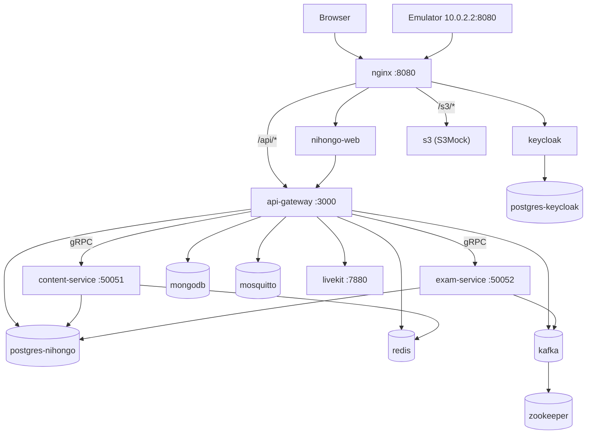

# Docker qua EDU APP: chạy stack, đọc compose và Dockerfile, giữ dữ liệu, gỡ lỗi

> **Mục tiêu:** Học xong bài này bạn làm được:
> - Dựng stack của project bằng một lệnh, biết container nào làm gì, mở đúng URL.
> - Đọc [docker-compose.yml](../docker-compose.yml) và một Dockerfile của project, giải thích từng dòng quan trọng.
> - Giải thích một request đi qua mạng Docker thế nào: vì sao trong container gọi `redis:6379`, còn trên máy gọi `localhost:6379`.
> - Build lại một service sau khi sửa code mà không làm mất dữ liệu; sao lưu, khôi phục, chuyển stack sang máy khác.
> - Tự tìm nguyên nhân khi một container "không lên".
>
> **Cần biết trước:** [learn-terminal.md](./learn-terminal.md), [setup-tools.md](./setup-tools.md) (đã cài Docker Desktop), [run-local.md](./run-local.md).
>
> **Thời gian:** khoảng 6–8 giờ, chia 3 buổi: mục 1–3 (chạy được), mục 4–7 (hiểu compose, mạng, Dockerfile), mục 8–12 (dữ liệu, vận hành, gỡ lỗi).

Đây là bài Docker duy nhất của project: trước đây chia làm `docker.md` (cách chạy) và `learn-docker.md` (khái niệm), người mới phải đọc qua lại hai nơi nên đã gộp làm một. Câu hỏi phỏng vấn về Docker, trả lời bằng code project: [interview-docker.md](./interview-docker.md). Docker trên Kubernetes: [learn-kubernetes.md](./learn-kubernetes.md). Cổng vào 8080 (nginx): [learn-nginx.md](./learn-nginx.md).

Lệnh viết cho macOS/Linux (zsh, bash). Trên Windows dùng PowerShell: lệnh `docker` giống hệt, chỉ khác cách xuống dòng (`` ` `` thay cho `\`) và đường dẫn (`D:\...`). Số liệu trong bài đo trên máy dev ngày 13/11/2026.

## Từ khóa trong bài

| Từ | Nghĩa ngắn gọn |
|---|---|
| Image | Gói **chỉ đọc**: hệ điều hành nhỏ + runtime + code + lệnh khởi động. Là khuôn, không chạy. |
| Container | Một tiến trình chạy từ image, có lớp ghi riêng. Xóa container là mất mọi thứ ghi trong đó. |
| Volume | Ổ đĩa do Docker quản lý, nằm ngoài container, giữ dữ liệu bền (DB). |
| Dockerfile | Công thức build image. |
| Docker Compose | Mô tả nhiều container cùng lúc trong một file YAML, dựng bằng một lệnh. |
| Service (compose) | Một mục trong `services:` của compose, ví dụ `api-gateway`. Khác với tên container `edu-gateway`. |
| Port mapping | `'5433:5432'`: cổng 5433 trên máy dẫn vào cổng 5432 trong container. |
| Network | Mạng ảo nối các container; trong mạng, container gọi nhau bằng tên service. |
| Healthcheck | Lệnh Docker chạy định kỳ để biết container đã thật sự sẵn sàng chưa. |
| Build context | Thư mục gửi cho Docker khi build; `COPY` chỉ lấy được file trong đây. |
| `.dockerignore` | Danh sách file **không** đưa vào build context (bí mật, `node_modules`…). |
| Multi-stage build | Dockerfile có nhiều `FROM`: stage đầu build, stage cuối chỉ chép kết quả sang. |
| Layer | Mỗi lệnh trong Dockerfile tạo một lớp; lớp không đổi thì dùng lại cache. |

---

## 1. Docker giải quyết vấn đề gì trong project này

Chạy EDU APP "trần" trên máy, bạn phải tự cài đúng phiên bản: Node 22, Postgres 16, Redis 7, MongoDB 7, Kafka + Zookeeper, Keycloak 26, nginx, LiveKit, Mosquitto… Máy mỗi người một kiểu, nên rất hay gặp câu "máy tôi chạy được mà máy bạn lỗi".

Docker đóng gói **cả môi trường** thành khối chạy được trên mọi máy có Docker. File [docker-compose.yml](../docker-compose.yml) mô tả toàn bộ hệ thống (hơn 20 service), và một lệnh dựng tất cả.

**So với máy ảo (VirtualBox, VMware):**

| | Máy ảo | Container |
|--|--------|-----------|
| Chứa gì | Cả hệ điều hành | Chỉ app + thư viện, **dùng chung nhân (kernel) Linux** |
| Khởi động | Vài phút | Vài giây (`edu-redis` lên trong chưa tới 1 giây) |
| Dung lượng | Hàng GB mỗi máy | `redis:7-alpine` 59 MB, `edu-app-nginx` 99 MB |

Trên macOS và Windows, Docker Desktop chạy ngầm **một** máy ảo Linux nhỏ, mọi container nằm trong đó. Vì thế Docker Desktop chiếm RAM ngay cả khi chưa chạy container nào, và `localhost` trong container không phải máy của bạn (mục 6).

## 2. Ba khái niệm phải nhớ: image, container, volume

### 2.1. Image

```bash
docker images --format '{{.Repository}}:{{.Tag}}\t{{.Size}}' | grep -E 'edu-app|redis:7|postgres:16'
```

```
edu-app-nihongo-web:latest       591MB
edu-app-api-gateway:latest       1.08GB
edu-app-content-service:latest   1.08GB
edu-app-signaling-service:latest 834MB
edu-app-nginx:latest             99.4MB
redis:7-alpine                   58.7MB
postgres:16-alpine               411MB
```

- Image **tải về** từ Docker Hub: `redis:7-alpine`, `postgres:16-alpine`. Không có Dockerfile trong repo.
- Image **tự build** từ code: `edu-app-*`. Tiền tố `edu-app-` đến từ dòng `name: edu-app` đầu file compose: tên image = `<tên project>-<tên service>`.
- Tên có dạng `tên:tag`. `latest` chỉ là tag mặc định, **không** có nghĩa là "mới nhất".

### 2.2. Container

Container là image đang chạy. Tên do `container_name:` trong compose đặt: service `api-gateway` → container `edu-gateway`.

```bash
docker ps --filter name=edu- --format 'table {{.Names}}\t{{.Status}}\t{{.Ports}}'
```

```
NAMES                  STATUS                  PORTS
edu-nginx              Up 2 hours (healthy)    0.0.0.0:8080->8080/tcp
edu-postgres-nihongo   Up 2 hours (healthy)    0.0.0.0:5433->5432/tcp
edu-redis              Up 2 hours (healthy)    127.0.0.1:6379->6379/tcp
```

Mọi thứ ghi vào container (file tạm, upload…) **mất khi container bị xóa**. Container dùng xong là bỏ, không phải chỗ cất dữ liệu.

### 2.3. Volume

Postgres ghi dữ liệu vào `/var/lib/postgresql/data`. Nếu thư mục đó nằm trong container, xóa container là mất DB. Gắn volume vào đó thì dữ liệu sống tiếp:

```yaml
postgres-nihongo:
  volumes:
    - postgres_nihongo_data:/var/lib/postgresql/data

volumes:
  postgres_nihongo_data:
    external: true                     # volume có sẵn: compose không tự tạo, không tự xóa
    name: nihongo-app_postgres_data    # tên thật, giữ từ stack cũ "nihongo-app"
```

Toàn bộ từ vựng, kanji, ngữ pháp, đề thi, tài khoản nằm trong volume `nihongo-app_postgres_data`.

### 2.4. Ghép lại

```text
Dockerfile ──docker build──▶ Image ──compose up──▶ Container ◀──gắn── Volume
(công thức)                  (khuôn)              (đang chạy)       (dữ liệu bền)
```

---

## 3. Chạy stack của project

### 3.1. Chọn kiểu chạy

| Bạn muốn | Lệnh (ở thư mục gốc repo) | Chạy gì |
|---|---|---|
| Sửa backend/web bằng `npm run dev:*` trên máy | `npm run docker:up:infra` | Chỉ hạ tầng: Postgres, Redis (mở `127.0.0.1:6379`), Mongo, Zookeeper, Kafka |
| Học app như người dùng, mọi thứ trong Docker | `npm run docker:up:nihongo` | Hạ tầng + S3 giả + content, exam, gateway, web, nginx; compose tự kéo thêm Keycloak, LiveKit, Mosquitto |
| Mọi service | `npm run docker:up` (`docker:up:build` nếu cần build lại) | Toàn bộ, trừ service có `profiles:` |
| Tắt (giữ dữ liệu) | `npm run docker:down` | Xóa container và mạng, **giữ volume** |

`npm run dev:gateway` tự bật Redis kèm cổng trước khi chạy gateway (script `predev:gateway`), xem mục 6.4.

Lần đầu trên máy mới cần hai bước trước:

```bash
cp .env.docker.example .env                     # rồi đặt JWT_SECRET, mật khẩu…
docker volume create nihongo-app_postgres_data  # volume external phải tự tạo
```

Thiếu `JWT_SECRET` thì compose dừng ngay với thông báo `JWT_SECRET chua dat - xem .env`. Đó là cố ý (mục 4.3).

### 3.2. Bản đồ container



| Service | Container | Cổng trên máy | Vai trò |
|---|---|---|---|
| `postgres-nihongo` | `edu-postgres-nihongo` | **5433** | DB chính `nihongo` |
| `flyway` | `edu-flyway` | — | Chạy migration SQL một lần rồi thoát (`restart: "no"`) |
| `redis` | `edu-redis` | không mở (chỉ `127.0.0.1:6379` khi bật bằng `docker:up:infra`) | Cache, rate-limit, signaling |
| `mongodb` | `edu-mongodb` | 27017 | Audit log ([mongodb.md](./mongodb.md)) |
| `zookeeper`, `kafka` | `edu-zookeeper`, `edu-kafka` | 2181, 9092 | Event thi thử, outbox |
| `mosquitto` | `edu-mosquitto` | `127.0.0.1:1883` | MQTT |
| `s3` | `edu-s3` | không mở, đi qua nginx `/s3/` | S3 giả cho ảnh upload ([media-storage.md](./media-storage.md)) |
| `postgres-keycloak`, `keycloak` | `edu-postgres-keycloak`, `edu-keycloak` | 5435, 8081 | Đăng nhập OIDC |
| `content-service`, `exam-service` | `edu-content`, `edu-exam` | 50051, 50052 | gRPC nội dung, thi |
| `api-gateway` | `edu-gateway` | **3000** | REST, Swagger `/api/docs` |
| `nihongo-web` | `edu-nihongo-web` | không mở, đi qua nginx | Next.js |
| `nginx` | `edu-nginx` | **8080** | Cổng vào duy nhất cho trình duyệt |
| `livekit`, `coturn`, `signaling-service` | `edu-livekit`, `edu-coturn`, `edu-signaling` | 7880, 3478, 3002 | Livestream, video call |
| `jaeger`, `prometheus`, `grafana`, `alertmanager`, `mailpit` | `edu-…` | 16686, 9090, 4000, 9093, 8025 | Quan sát, mail giả |
| `airflow`, `airflow-db` | | 8090 | Chỉ khi `--profile airflow` |
| `localstack` | `edu-localstack` | `127.0.0.1:4566` | Chỉ khi `--profile aws-learn` ([learn-aws-serverless.md](./learn-aws-serverless.md)) |

### 3.3. URL sau khi chạy

| Mục | URL |
|---|---|
| App tiếng Nhật | http://localhost:8080 |
| Keycloak | http://auth.localhost:8080 (cần dòng `127.0.0.1 nihongo.localhost auth.localhost` trong file hosts) |
| Swagger | http://localhost:3000/api/docs |
| Health | http://localhost:8080/health, http://localhost:3000/health |
| Grafana | http://localhost:4000 (`admin`/`admin`) |
| Mailpit | http://localhost:8025 |
| Postgres | `localhost:5433`, user `nihongo`, DB `nihongo` |

Tài khoản đăng nhập app: [accounts.md](./accounts.md).

---

## 4. Đọc docker-compose.yml

### 4.1. Một service đầy đủ

```yaml
postgres-nihongo:
  image: postgres:16-alpine                 # (1) dùng image có sẵn, không build
  container_name: edu-postgres-nihongo      # (2) tên container
  restart: unless-stopped                   # (3) tự bật lại, trừ khi bạn chủ động dừng
  environment:
    POSTGRES_USER: nihongo
    POSTGRES_PASSWORD: ${POSTGRES_PASSWORD:-nihongo}   # (4) lấy từ .env, không có thì "nihongo"
    POSTGRES_DB: nihongo
  ports:
    - '5433:5432'                           # (5) máy:container
  volumes:
    - postgres_nihongo_data:/var/lib/postgresql/data   # (6)
  healthcheck:                              # (7)
    test: ['CMD-SHELL', 'pg_isready -U nihongo -d nihongo']
    interval: 5s
    timeout: 5s
    retries: 10
```

(5): bên trong Postgres vẫn nghe 5432; máy bạn nối qua 5433 vì 5432 thường đã có Postgres cài sẵn hoặc của project khác.

### 4.2. Tên service khác tên container

| Dùng ở đâu | Dùng tên nào | Ví dụ |
|---|---|---|
| Lệnh `docker compose …` | tên **service** | `docker compose logs api-gateway` |
| Lệnh `docker …` | tên **container** | `docker logs edu-gateway` |
| Container gọi container khác | tên **service** (là tên DNS trong mạng) | `redis://redis:6379`, `postgres-nihongo:5432` |

### 4.3. Biến môi trường và `.env`

Compose tự đọc file `.env` cạnh `docker-compose.yml` và thay vào `${…}`. Project dùng cả ba cách viết, mỗi cách một ý:

| Cách viết | Nghĩa | Chỗ dùng thật |
|---|---|---|
| `${POSTGRES_PASSWORD:-nihongo}` | Không đặt **hoặc để trống** → dùng `nihongo` | Hầu hết biến |
| `${JWT_SECRET:?JWT_SECRET chua dat…}` | Không đặt → **dừng hẳn**, in thông báo | Bí mật không được có giá trị mặc định |
| `${AWS_ENDPOINT_URL-http://s3:9090}` (không có `:`) | Không đặt → mặc định; **để trống thì giữ trống** | Đặt `AWS_ENDPOINT_URL=` để chuyển sang S3 thật |

Xem giá trị cuối cùng sau khi thay biến:

```bash
docker compose config | grep -A3 'REDIS_URL'
```

### 4.4. `profiles`: service chỉ chạy khi gọi tên

`airflow`, `airflow-db` có `profiles: [airflow]`, `localstack` có `profiles: ['aws-learn']`. `docker compose up -d` bỏ qua chúng; muốn bật:

```bash
docker compose --profile airflow up -d airflow
```

### 4.5. File compose phụ (override)

Có thể ghép nhiều file: file sau đè lên file trước. Project có [docker-compose.host-dev.yml](../docker-compose.host-dev.yml) chỉ để mở cổng Redis cho máy:

```yaml
services:
  redis:
    ports:
      - '127.0.0.1:6379:6379'
```

```bash
docker compose -f docker-compose.yml -f docker-compose.host-dev.yml up -d redis
```

Lý do có file này nằm ở mục 6.4.

---

## 5. Thứ tự khởi động: `depends_on`, healthcheck, restart

### 5.1. "Đã chạy" khác "đã sẵn sàng"

Container Postgres "chạy" sau 1 giây, nhưng phải thêm vài giây mới nhận kết nối. Gateway lên trước lúc đó sẽ lỗi. Healthcheck giải quyết việc này:

```yaml
api-gateway:
  healthcheck:
    test: ['CMD-SHELL', 'wget -qO /dev/null http://127.0.0.1:3000/health/live || exit 1']
    interval: 10s
    retries: 5
    start_period: 90s    # 90 giây đầu, lỗi không bị tính (Nest + Prisma khởi động chậm)
    start_interval: 3s   # trong 90 giây đó kiểm 3 giây một lần, healthy là báo ngay
  depends_on:
    postgres-nihongo:
      condition: service_healthy   # đợi Postgres healthy
    content-service:
      condition: service_started   # chỉ cần đã bật
```

`/health/live` chỉ báo tiến trình Node đã nghe cổng, không gọi DB. Lý do: nếu healthcheck gọi DB, DB chậm một lúc là Docker coi gateway "unhealthy" và nginx (đang `depends_on: api-gateway: service_healthy`) không lên được, dù gateway không có lỗi gì.

Trạng thái xem ở cột STATUS: `(health: starting)` → `(healthy)` hoặc `(unhealthy)`.

### 5.2. Container chạy một lần: Flyway

```yaml
flyway:
  command: -connectRetries=60 migrate
  depends_on:
    postgres-nihongo:
      condition: service_healthy
  restart: "no"
```

Flyway áp migration rồi **thoát**. `docker ps -a` thấy `edu-flyway  Exited (0)`: mã 0 là thành công, không phải lỗi.

### 5.3. `restart: unless-stopped` không theo `depends_on`

Comment ở service `nginx` ghi lại một bài học thật: `depends_on` chỉ có tác dụng khi chạy `docker compose up`. Khi Docker Desktop tự bật lại container sau khi máy ngủ dậy, mọi container lên cùng lúc, nginx có thể lên trước gateway. Vì vậy cấu hình nginx phải tự chịu được khoảng chờ đó (xem [learn-nginx.md](./learn-nginx.md)), không dựa hết vào thứ tự.

---

## 6. Mạng: request đi đâu

### 6.1. Mạng mặc định và DNS theo tên service

```yaml
networks:
  default:
    name: edu-app_default
```

Mọi service vào mạng `edu-app_default`. Trong mạng này Docker có DNS riêng: gateway gọi `redis:6379`, `postgres-nihongo:5432`, `kafka:9092`. Không cần biết IP.

Thử:

```bash
docker exec edu-gateway getent hosts redis postgres-nihongo
# 172.18.0.5   redis
# 172.18.0.3   postgres-nihongo
```

(IP trên máy bạn sẽ khác; điều cần thấy là tên service phân giải được.)

### 6.2. `localhost` là ai?

| Bạn đang ở đâu | `localhost` là | Muốn gọi Redis thì |
|---|---|---|
| Terminal trên máy | Máy của bạn | `localhost:6379` (chỉ khi cổng được mở, mục 6.4) |
| Trong container `edu-gateway` | **Chính container đó** | `redis:6379` |
| Trong máy ảo Android | Chính máy ảo | không gọi thẳng; app gọi `10.0.2.2:8080` (máy bạn) |
| Container muốn gọi ra máy (Ollama) | — | `host.docker.internal:11434` |

Vì vậy `services/.env` (dùng khi chạy `npm run dev:*` trên máy) ghi `REDIS_URL=redis://localhost:6379`, còn compose ghi `REDIS_URL: redis://redis:6379` cho container. Cùng biến, khác giá trị, đều đúng.

### 6.3. `ports` và `expose`

- `ports: ['5433:5432']`: mở cổng ra máy (và cả mạng LAN, vì mặc định nghe `0.0.0.0`).
- `ports: ['127.0.0.1:1883:1883']` (Mosquitto): chỉ máy bạn vào được, máy khác cùng Wi-Fi thì không.
- `expose: ['6379']` (Redis): chỉ ghi chú cho container cùng mạng; **không** mở ra máy.
- Không ghi gì (`nihongo-web`, `s3`): container khác vẫn gọi được qua mạng; trình duyệt chỉ vào qua nginx.

### 6.4. Bài học thật: Redis không mở cổng

Commit `81eed11` (20/09/2026) bỏ `ports` của Redis vì trên Windows, Docker Desktop đôi khi làm Redis mất kết nối vào mạng `edu-app_default` sau khi máy ngủ. Hậu quả: gateway chạy bằng `npm run dev:gateway` trên máy báo `ECONNREFUSED 127.0.0.1:6379` dù container `edu-redis` đang `healthy`.

Cách sửa: không đổi file compose chính (giữ an toàn cho Windows) mà thêm file phụ `docker-compose.host-dev.yml` mở `127.0.0.1:6379`. `docker:up:infra` và `predev:gateway` dùng file phụ này.

Một hệ quả cần biết: nếu sau đó bạn chạy `npm run docker:up:nihongo` (chỉ file chính), compose thấy cấu hình Redis khác nên **tạo lại** container Redis không có cổng. Gateway trên máy lại mất Redis; chạy `npm run docker:up:redis-host` là có lại. Dữ liệu Redis ở đây chỉ là cache nên tạo lại không mất gì quan trọng.

### 6.5. Kafka: một broker, hai địa chỉ

```yaml
kafka:
  ports:
    - '9092:9093'
  environment:
    KAFKA_LISTENERS: INTERNAL://0.0.0.0:9092,EXTERNAL://0.0.0.0:9093
    KAFKA_ADVERTISED_LISTENERS: INTERNAL://kafka:9092,EXTERNAL://localhost:9092
```

Client Kafka nối vào broker xong, broker trả lại "địa chỉ của tôi là…" và client dùng địa chỉ đó cho các lần sau. Container cần nhận `kafka:9092`; máy bạn cần nhận `localhost:9092`. Hai listener giải quyết đúng việc đó: container vào cổng 9092 trong mạng, máy vào cổng 9092 của máy (dẫn tới 9093 của container). Chỉ có một listener thì một trong hai phía sẽ nhận địa chỉ không gọi được.

---

## 7. Dockerfile: đọc bản build của gateway và web

### 7.1. Multi-stage: build một nơi, chạy một nơi

[services/api-gateway/Dockerfile](../services/api-gateway/Dockerfile) rút gọn:

```dockerfile
FROM node:22-alpine AS builder          # ── stage 1: có đủ công cụ build
WORKDIR /app
COPY package.json package-lock.json ./  # (a) chép file khai báo thư viện trước
COPY packages ./packages
COPY services ./services
RUN npm ci                              # (b) cài đúng phiên bản trong lock file
RUN npm run build:all -w @edu/nihongo-services
RUN npm prune --omit=dev                # (c) bỏ thư viện chỉ dùng khi build/test

FROM node:22-alpine AS runner           # ── stage 2: chỉ thứ cần để chạy
RUN rm -rf /usr/local/lib/node_modules/npm /usr/local/bin/npm /usr/local/bin/npx   # (d)
ENV NODE_ENV=production
COPY --from=builder /app/node_modules /app/node_modules
COPY --from=builder /app/services/dist ./dist
USER node                               # (e)
CMD ["node", "dist/apps/api-gateway/services/api-gateway/src/main.js"]
```

- Stage `builder` có TypeScript, jest, mã nguồn… Image cuối **chỉ** có những gì được `COPY --from=builder`. Mã nguồn `.ts` không có trong image chạy.
- (c) `npm prune --omit=dev`: theo comment trong file, `ts-jest` kéo theo `handlebars` có lỗ hổng CRITICAL; bỏ thư viện dev trước khi chép sang là bỏ luôn lỗ hổng đó ([learn-devsecops.md](./learn-devsecops.md)).
- (d) App chạy bằng `node`, không cần `npm`. Xóa npm khỏi image chạy bớt được lỗ hổng mà Trivy tìm thấy và bớt công cụ cho kẻ tấn công.
- (e) `USER node`: chạy bằng user thường, không phải root. Kiểm:

```bash
docker run --rm --entrypoint id edu-app-api-gateway:latest
# uid=1000(node) gid=1000(node) groups=1000(node)
```

### 7.2. Biến lúc build và biến lúc chạy

[apps/nihongo-web/Dockerfile](../apps/nihongo-web/Dockerfile):

```dockerfile
ARG NEXT_PUBLIC_KEYCLOAK_URL=http://auth.localhost:8080
ENV NEXT_PUBLIC_KEYCLOAK_URL=$NEXT_PUBLIC_KEYCLOAK_URL
RUN npm run build
```

Next.js **chép thẳng** giá trị `NEXT_PUBLIC_*` vào JavaScript gửi cho trình duyệt lúc `npm run build`. Đổi biến trong `environment:` của compose rồi restart **không có tác dụng**: phải build lại. Vì thế compose truyền chúng qua `build.args`:

```yaml
nihongo-web:
  build:
    args:
      NEXT_PUBLIC_KEYCLOAK_URL: ${NEXT_PUBLIC_KEYCLOAK_URL:-http://auth.localhost:8080}
      NEXT_PUBLIC_MAPBOX_TOKEN: ${NEXT_PUBLIC_MAPBOX_TOKEN:-}
```

Biến **không** có `NEXT_PUBLIC_` (như `API_URL`, `MORI_PLAYBACK_SECRET`) chỉ server đọc, nên đặt ở `environment:` là đủ, đổi xong restart là có.

### 7.3. Cache theo lớp: vì sao chép `package.json` trước

Mỗi lệnh tạo một lớp. Build lại, Docker dùng lại lớp cũ cho tới lệnh đầu tiên có đầu vào thay đổi; từ đó trở đi chạy lại hết.

- Bạn sửa một file `.ts`. `COPY services ./services` đổi → `npm ci` và mọi thứ sau chạy lại.
- Nếu chỉ chép `package.json` rồi `npm ci`, rồi mới chép mã nguồn, thì sửa code **không** làm cài lại thư viện. Đó là thứ tự tối ưu. Dockerfile của web và gateway hiện chép cả thư mục trước `npm ci`, nên mỗi lần sửa code đều cài lại thư viện: một chỗ còn cải thiện được (bài tập 4).

### 7.4. Các lệnh Dockerfile cần biết

| Lệnh | Làm gì |
|---|---|
| `FROM image AS tên` | Bắt đầu một stage từ image gốc |
| `WORKDIR /app` | Đổi thư mục làm việc (tự tạo nếu chưa có) |
| `COPY nguồn đích` / `COPY --from=stage` | Chép từ build context / từ stage trước |
| `RUN lệnh` | Chạy lúc **build**, kết quả thành một lớp |
| `ARG` / `ENV` | Biến lúc build / biến có trong image khi chạy |
| `USER` | Đổi user cho các lệnh sau và khi chạy |
| `EXPOSE 8080` | Ghi chú cổng app nghe; **không** tự mở cổng ra máy |
| `HEALTHCHECK` | Healthcheck mặc định của image (nginx của project có) |
| `CMD` | Lệnh chạy khi container bật |

---

## 8. `.dockerignore`: sự cố bí mật nằm trong image

Mọi image của project build với `context: .` (cả thư mục repo). Ngày 13/11/2026, khi viết bài này, kiểm thử image web:

```bash
docker run --rm --entrypoint sh edu-app-nihongo-web:latest -c 'ls -a /app/apps/nihongo-web'
```

```
.env  .next  node_modules  package.json  public  server.js
```

Image chạy thật có file `.env`, trong đó có `MORI_PLAYBACK_SECRET` (khóa ký link xem video). Ai có image là đọc được khóa.

**Vì sao lọt vào?** Repo chưa có `.dockerignore`. `COPY apps/nihongo-web ./apps/nihongo-web` chép mọi thứ trong thư mục, kể cả những file Git bỏ qua: `.env`, `node_modules` (307 MB của máy Mac), `.next` (634 MB). Bản build `standalone` của Next.js lại chép `.env` sang thư mục chạy. `.gitignore` chỉ có tác dụng với Git, Docker không đọc file này.

**Đã sửa:** thêm [.dockerignore](../.dockerignore) ở gốc repo:

```gitignore
**/.env
**/.env.*
!**/.env.example
**/node_modules
**/.next
**/dist
.git
infra/backups
```

`NEXT_PUBLIC_MAPBOX_TOKEN` trước đây chỉ vào được bản build nhờ file `.env` bị chép theo, nên được chuyển sang `build.args` (mục 7.2). Nếu bạn dùng bản đồ `/japan-map`, đặt biến này trong `.env` ở **gốc** repo rồi build lại web.

**Bài học:**

1. Có build context là phải có `.dockerignore`, viết ngay khi tạo Dockerfile đầu tiên.
2. Bí mật vào container lúc **chạy** (`environment:`, secret của orchestrator), không vào lúc build.
3. Image đã từng chứa bí mật thì coi như bí mật đã lộ cho ai có image đó: đổi khóa (image này chỉ nằm trên máy dev, chưa đẩy lên registry).

---

## 9. Dữ liệu: volume, sao lưu, lệnh nào xóa dữ liệu

### 9.1. Xem volume

```bash
docker volume ls --format '{{.Name}}' | grep -E 'edu-app|nihongo'
```

```
edu-app_grafana_data
edu-app_mongodb_data
edu-app_s3_data
...
nihongo-app_postgres_data       ← DB chính (external)
nihongo_mongodb_data            ← sót lại từ stack cũ, compose hiện tại không dùng
```

Volume do compose tạo có tiền tố `edu-app_`. Volume `external` giữ đúng tên ghi trong `name:`.

### 9.2. Lệnh nào xóa dữ liệu?

| Lệnh | Container | Volume thường | Volume `external` |
|---|---|---|---|
| `docker compose stop` | giữ | giữ | giữ |
| `docker compose down` | **xóa** | giữ | giữ |
| `docker compose down -v` | **xóa** | **xóa** (Keycloak, Mongo, S3, Grafana…) | giữ |
| `docker volume rm nihongo-app_postgres_data` | — | — | **xóa DB chính** |

DB chính để `external` chính vì lý do này: gõ nhầm `down -v` cũng không mất từ vựng và tài khoản.

### 9.3. Sao lưu và khôi phục

```bash
npm run db:backup
# → infra/backups/nihongo_<ngày_giờ>.sql          (toàn bộ dữ liệu)
# → infra/backups/nihongo_schema_<ngày_giờ>.sql   (chỉ cấu trúc)

docker cp infra/backups/nihongo_<ngày_giờ>.sql edu-postgres-nihongo:/tmp/restore.sql
docker exec edu-postgres-nihongo psql -U nihongo -d nihongo -f /tmp/restore.sql
```

Bản sao lưu không commit vào Git ([ADR-0009](./adr/0009-db-backups-out-of-git.md)). Chi tiết: [infra/backups/README.md](../infra/backups/README.md).

---

## 10. Chuyển stack sang máy khác

Không "chép container". Chuyển **image hoặc mã nguồn + dữ liệu + cấu hình**.

**Cách 1 — clone repo và build (khuyên dùng):**

```bash
# máy cũ
npm run db:backup
# máy mới
git clone <url-repo> edu_app && cd edu_app
cp .env.docker.example .env           # đặt JWT_SECRET, mật khẩu, NGINX_HTTP_PORT…
docker volume create nihongo-app_postgres_data
npm run docker:up:nihongo
# đợi postgres healthy, rồi khôi phục như mục 9.3
```

Thiếu ảnh KanjiVG/OpenMoji thì chạy `npm install && npm run media:setup` rồi `docker compose build nihongo-web` ([media-storage.md](./media-storage.md)).

**Cách 2 — mang image bằng file (không có mạng hoặc không muốn build lại):**

```bash
# máy cũ
docker compose build
docker save -o edu-images.tar edu-app-api-gateway edu-app-content-service edu-app-exam-service \
  edu-app-nihongo-web edu-app-nginx edu-app-signaling-service
# máy mới
docker load -i edu-images.tar
```

File `.tar` chưa phải image: phải `docker load` rồi mới `compose up`. Image hạ tầng (`postgres`, `redis`, `kafka`…) máy mới tự tải lần đầu.

**Cách 3 — registry (cách làm khi triển khai thật):** `docker tag` + `docker push` lên registry, máy chạy dùng `image:` thay `build:` và `docker compose pull`. Xem [learn-release-cicd.md](./learn-release-cicd.md).

**Chuyển nguyên volume Postgres** (khi DB quá lớn để dump):

```bash
docker compose stop postgres-nihongo
docker run --rm -v nihongo-app_postgres_data:/data -v "$PWD":/backup alpine \
  tar czf /backup/postgres_volume.tar.gz -C /data .
# máy mới: docker volume create … rồi chạy lệnh tương tự với "tar xzf"
```

---

## 11. Dọn ổ đĩa

```bash
docker system df
```

```
TYPE            TOTAL     ACTIVE    SIZE      RECLAIMABLE
Images          54        32        32.93GB   9.332GB (28%)
Containers      43        5         559.1MB   558.7MB (99%)
Local Volumes   55        35        16.47GB   3.087GB (18%)
Build Cache     258       19        35.61GB   19.49GB
```

Build cache thường là thủ phạm lớn nhất. Dọn từ an toàn tới nguy hiểm:

| Lệnh | Xóa gì | Mức độ |
|---|---|---|
| `docker builder prune` | Cache build | An toàn; build sau chậm hơn chút |
| `docker image prune` | Image `<none>` sinh ra mỗi lần build lại | An toàn |
| `docker container prune` | Container đã dừng | Cẩn thận: có thể là container project khác đang tạm tắt |
| `docker image prune -a` | Mọi image không có container dùng | Lần sau phải tải/build lại |
| `docker system prune --volumes` | Tất cả trên **và volume** | Nguy hiểm: có thể mất DB |

Máy dev này còn container của project khác. Đừng dọn kiểu "xóa hết".

Windows: Docker Desktop lưu mọi thứ trong file đĩa ảo `docker_data.vhdx`; xóa image xong file **không tự co lại**. Tắt Docker Desktop rồi compact file (`Optimize-VHD`, quyền Admin).

---

## 12. Gỡ lỗi khi container "không lên"

Quy trình 4 bước, theo thứ tự:

1. **Trạng thái:** `docker compose ps` (hoặc `docker ps -a --filter name=edu-`). Đọc cột STATUS và mã thoát.
2. **Log:** `docker compose logs --tail 100 <service>`. Dòng lỗi đầu tiên thường là nguyên nhân, các dòng sau là hệ quả.
3. **Healthcheck:** `docker inspect --format '{{json .State.Health}}' edu-gateway` cho biết lần kiểm gần nhất in gì.
4. **Vào trong:** `docker exec -it edu-gateway sh` để kiểm biến môi trường (`env | grep REDIS`), tên miền (`getent hosts redis`), gọi thử (`wget -qO- http://127.0.0.1:3000/health/live`).

Đọc mã thoát:

| Mã | Nghĩa thường gặp |
|---|---|
| `Exited (0)` | Chạy xong bình thường (Flyway) hoặc bị dừng êm |
| `Exited (1)` | App tự báo lỗi rồi thoát: đọc log |
| `Exited (137)` | Bị giết bằng SIGKILL: hết RAM (OOM) hoặc `docker stop` quá hạn chờ |
| `Exited (143)` | Nhận SIGTERM và thoát: thường do `docker stop`/`down` |
| `Restarting (1)` liên tục | Lỗi ngay khi khởi động, `restart` cứ bật lại: đọc log lần đầu |

## Lỗi hay gặp

| Triệu chứng | Nguyên nhân | Cách sửa |
|---|---|---|
| `JWT_SECRET chua dat` khi `compose up` | Chưa có `.env` ở gốc repo | `cp .env.docker.example .env`, đặt `JWT_SECRET` |
| `external volume "nihongo-app_postgres_data" not found` | Máy mới chưa tạo volume | `docker volume create nihongo-app_postgres_data` |
| **502 Bad Gateway** ở `:8080` | Web/gateway/Keycloak chưa healthy | Đợi 30–60 giây, xem `docker compose ps`; vẫn lỗi thì xem log gateway |
| Cổng 8080 (hoặc 3000, 5433) đã bị dùng | Chương trình khác chiếm cổng | `NGINX_HTTP_PORT=8888` trong `.env` rồi `docker compose up -d nginx`; tìm chương trình: `lsof -nP -iTCP:8080` |
| `npm run dev:gateway` báo `ECONNREFUSED 127.0.0.1:6379` | Redis chạy nhưng không mở cổng ra máy | `npm run docker:up:redis-host` (mục 6.4) |
| Sửa code mà app trong Docker không đổi | Image cũ; container chạy code đã build | `docker compose up -d --build <service>` |
| Đổi `NEXT_PUBLIC_*` mà web không đổi | Biến được chép vào lúc build | Build lại `nihongo-web` (mục 7.2) |
| Gateway khởi động lại liên tục | Thiếu DB/Kafka/Mongo/Keycloak, hoặc sai biến | `docker compose logs api-gateway`, kiểm các service phụ thuộc |
| Container `Exited (137)` | Hết RAM | Docker Desktop → Settings → Resources tăng RAM; tắt bớt service (monitoring, Airflow) |
| Video `/mori` báo "Không phát được video" | Thư mục khóa học (`MORI_COURSE_DIR`) trên USB chưa cắm khi container bật | Cắm USB rồi `docker compose up -d --no-deps --force-recreate nihongo-web` ([media-storage.md](./media-storage.md)) |
| Thư mục Google Drive trong container rỗng | macOS chặn Docker đọc `~/Library/CloudStorage` | Chép dữ liệu ra thư mục thường hoặc USB |
| Đăng nhập lỗi CORS | `ALLOWED_ORIGINS` không có URL đang mở | Thêm URL vào `ALLOWED_ORIGINS` trong `.env`, `docker compose up -d api-gateway` |

## Tự kiểm tra

1. `docker compose down` và `docker compose down -v` khác nhau thế nào với DB chính của project?
<details><summary>Đáp án</summary>Cả hai xóa container. `-v` xóa thêm volume thường (Keycloak, Mongo, S3…), nhưng DB chính `nihongo-app_postgres_data` là `external` nên không bị xóa.</details>

2. Trong container `edu-gateway`, `REDIS_URL` phải là `redis://redis:6379` chứ không phải `redis://localhost:6379`. Vì sao?
<details><summary>Đáp án</summary>Trong container, `localhost` là chính container gateway. `redis` là tên service, được DNS của mạng `edu-app_default` phân giải ra IP container Redis.</details>

3. Vì sao đổi `NEXT_PUBLIC_KEYCLOAK_URL` trong `environment:` rồi restart web vẫn không có tác dụng?
<details><summary>Đáp án</summary>Next.js chép giá trị `NEXT_PUBLIC_*` vào JavaScript lúc build. Phải truyền qua `build.args` và build lại image.</details>

4. `EXPOSE 8080` trong Dockerfile nginx có mở cổng 8080 trên máy không?
<details><summary>Đáp án</summary>Không. `EXPOSE` chỉ là ghi chú. Cổng được mở nhờ `ports: ['${NGINX_HTTP_PORT:-8080}:8080']` trong compose.</details>

5. Healthcheck của gateway gọi `/health/live` chứ không gọi endpoint kiểm DB. Lý do?
<details><summary>Đáp án</summary>DB chậm một lúc thì gateway bị coi là unhealthy, kéo theo nginx (đợi gateway healthy) không lên, dù gateway vẫn chạy được. Healthcheck "sống" chỉ nên kiểm tiến trình còn phục vụ.</details>

6. `.gitignore` đã có `apps/nihongo-web/.env`. Vì sao file đó vẫn vào image?
<details><summary>Đáp án</summary>Docker không đọc `.gitignore`. Thứ quyết định file nào vào build context là `.dockerignore`, và repo khi đó chưa có file này.</details>

7. Vì sao Kafka cần hai listener?
<details><summary>Đáp án</summary>Broker trả cho client địa chỉ để nối tiếp. Container cần `kafka:9092`, máy cần `localhost:9092`; mỗi listener quảng bá đúng địa chỉ cho một phía.</details>

## Bài tập

1. **Đọc compose:** liệt kê mọi service có `depends_on … condition: service_healthy` và vẽ thứ tự khởi động. Tự kiểm: tắt hết (`npm run docker:down`), chạy `npm run docker:up:nihongo` và xem thứ tự `Started`/`Healthy` trong output có khớp.
2. **Làm hỏng có chủ đích:** trong `.env`, đổi `POSTGRES_PASSWORD` thành giá trị sai rồi `docker compose up -d --force-recreate api-gateway`. Dùng quy trình 4 bước ở mục 12 tìm ra lỗi trong log. Trả lại giá trị cũ. (Lưu ý: mật khẩu Postgres chỉ được đặt lần đầu tạo volume, nên đổi biến không đổi mật khẩu thật trong DB, chỉ làm gateway nối sai.)
3. **Kiểm `.dockerignore`:** build lại web (`docker compose build nihongo-web`), rồi chạy lệnh `ls -a` ở mục 8. Tự kiểm: không còn `.env` trong image.
4. **Tối ưu cache:** sửa Dockerfile của gateway để chép `package.json` của các workspace và chạy `npm ci` **trước** khi chép mã nguồn. Đo: sửa một dòng comment trong `api-gateway/src/main.ts`, build lại, so thời gian với trước khi sửa.
5. **Mạng:** từ trong `edu-gateway` chạy `getent hosts redis kafka mongodb`; từ máy chạy `nc -z localhost 6379` trước và sau `npm run docker:up:redis-host`. Giải thích kết quả bằng mục 6.

<!-- nav:start -->

---

## Đi tiếp

Bạn đang ở **1. Bắt đầu: chạy được project** — bài 2/5.

- Bài trước: [run-local.md](./run-local.md) — Chạy EDU APP Nihongo trên máy từng bước
- **Bài tiếp: [accounts.md](./accounts.md)** — Tài khoản dev đang dùng

Mục lục toàn bộ tài liệu: [docs/README.md](./README.md)

<!-- nav:end -->
