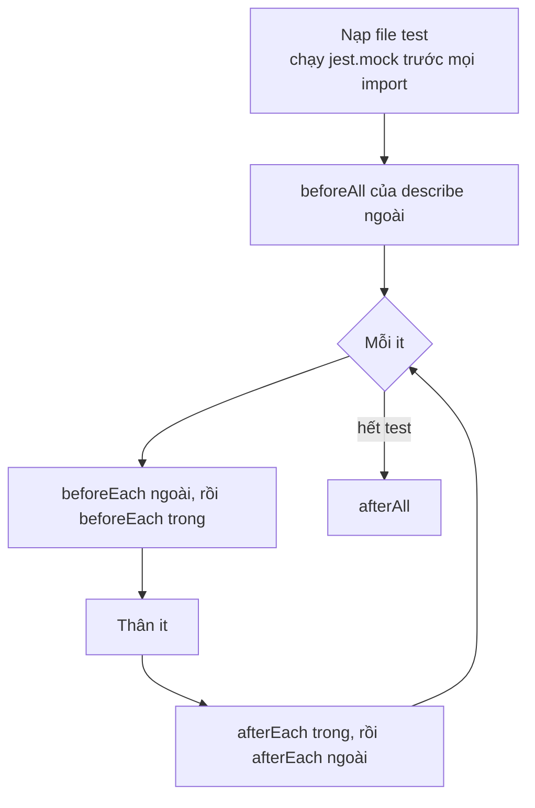

# Học Jest — Từ Test Thật Của Repo

Mọi ví dụ trong file này lấy từ test đang chạy trong repo. Đọc tới đâu, mở file test tương ứng ra xem tới đó.

Đọc kèm: [learn-testing.md](./learn-testing.md) (triết lý test, phân loại unit/integration/E2E), [learn-nestjs.md](./learn-nestjs.md) (DI của NestJS, cần để hiểu `Test.createTestingModule`).

## Mục lục

- [0. Jest ở đâu trong repo, chạy thế nào](#0-jest-ở-đâu-trong-repo-chạy-thế-nào)
- [1. Cấu hình, giải thích từng dòng](#1-cấu-hình-giải-thích-từng-dòng)
- [2. Khung một file test](#2-khung-một-file-test)
- [3. Matcher: so sánh thế nào cho đúng](#3-matcher-so-sánh-thế-nào-cho-đúng)
- [4. Test code bất đồng bộ](#4-test-code-bất-đồng-bộ)
- [5. Mock: `jest.fn`, `jest.spyOn`, `jest.mock`](#5-mock-jestfn-jestspyon-jestmock)
- [6. Dọn mock: clear, reset, restore](#6-dọn-mock-clear-reset-restore)
- [7. Test service NestJS](#7-test-service-nestjs)
- [8. Thời gian: fake timers và đồng hồ truyền vào](#8-thời-gian-fake-timers-và-đồng-hồ-truyền-vào)
- [9. Test chạy đồng thời và thứ tự](#9-test-chạy-đồng-thời-và-thứ-tự)
- [10. Fake class thay cho mock](#10-fake-class-thay-cho-mock)
- [11. Ba bài mẫu viết từ đầu](#11-ba-bài-mẫu-viết-từ-đầu)
- [12. Test E2E với supertest](#12-test-e2e-với-supertest)
- [13. Coverage: con số nói gì và không nói gì](#13-coverage-con-số-nói-gì-và-không-nói-gì)
- [14. Debug test](#14-debug-test)
- [15. Jest và Vitest](#15-jest-và-vitest)
- [16. Bài tập](#16-bài-tập)
- [17. Câu hỏi phỏng vấn](#17-câu-hỏi-phỏng-vấn)

---

## 0. Jest ở đâu trong repo, chạy thế nào

| Nơi                         | Công cụ                       | Ghi chú                                              |
| --------------------------- | ----------------------------- | ---------------------------------------------------- |
| `services/` và `packages/nest-*` | **Jest 30** + ts-jest 29.4 | Backend NestJS. Chủ đề chính của file này            |
| `services/test/`            | Jest + supertest              | E2E: dựng cả `AppModule`, cần Postgres và Redis      |
| `apps/nihongo-cli`          | Jest 29 + `@react-native/jest-preset` | App React Native CLI                         |
| `apps/nihongo-web`, `apps/nihongo-mobile` | **Vitest**      | API gần như giống Jest, xem mục 15                   |

Số liệu hiện tại của backend: **41 suite, 198 test, chạy hết khoảng 3 giây**.

```bash
cd services
npm test                                # chạy tất cả *.spec.ts
npm test -- auth.service                # chỉ file có "auth.service" trong đường dẫn
npm test -- -t "idempotency"            # chỉ test có tên chứa "idempotency"
npm run test:watch                      # chạy lại khi file đổi
npm run test:cov                        # kèm coverage, báo cáo ở ../coverage
npm run test:e2e                        # E2E, cần docker compose (Postgres, Redis)
```

Hai lệnh đầu cũng chạy được từ gốc repo: `npm test -w @edu/nihongo-services -- auth.service`.

---

## 1. Cấu hình, giải thích từng dòng

Cấu hình unit test nằm trong khóa `"jest"` của [services/package.json](../services/package.json):

```jsonc
"jest": {
  "moduleFileExtensions": ["ts", "js", "json"],
  "rootDir": ".",
  // Jest chỉ tìm test trong các thư mục này. packages/ nằm NGOÀI services/,
  // nên phải liệt kê thì test của nest-common, nest-prisma mới được chạy.
  "roots": [
    "<rootDir>/api-gateway", "<rootDir>/content-service",
    "<rootDir>/exam-service", "<rootDir>/payment-service",
    "<rootDir>/../packages/nest-common", "<rootDir>/../packages/nest-contracts",
    "<rootDir>/../packages/nest-prisma"
  ],
  // Đường dẫn rút gọn trong tsconfig (@app/common...) Jest KHÔNG tự hiểu.
  // Thiếu dòng nào là gặp "Cannot find module '@app/common'".
  "moduleNameMapper": {
    "^@app/common$": "<rootDir>/../packages/nest-common/src",
    "^@app/common/(.*)$": "<rootDir>/../packages/nest-common/src/$1",
    "^@prisma/client$": "<rootDir>/../packages/prisma-nihongo/generated/client",
    ...
  },
  "testRegex": ".*\\.spec\\.ts$",          // file test: *.spec.ts
  "transform": { "^.+\\.(t|j)s$": "ts-jest" },  // biên dịch TS trước khi chạy
  "collectCoverageFrom": ["**/*.(t|j)s"],
  "coverageDirectory": "../coverage",
  "testEnvironment": "node"                // không có window, document
}
```

Những điểm cần nhớ:

- **`moduleNameMapper` phải khớp `paths` trong tsconfig.** TypeScript dùng `paths` khi biên dịch; Jest tự tìm module lúc chạy và không đọc `paths`. Thêm alias mới vào tsconfig thì phải thêm vào cả đây và vào `test/jest-e2e.json`.
- **`@prisma/client` được trỏ vào client đã generate.** Chưa chạy `npm run generate -w @edu/prisma-nihongo` thì mọi test import `Role`, `PaymentStatus`... đều lỗi. CI chạy bước generate trước bước test vì lý do này.
- **`ts-jest` kiểm tra kiểu khi chạy test.** Sai kiểu là test fail với lỗi TypeScript, kể cả khi logic đúng. Đó là lý do test trong repo hay dùng `as never` hay `as unknown as X` cho object giả (mục 7).

Cấu hình E2E riêng ở [services/test/jest-e2e.json](../services/test/jest-e2e.json):

```jsonc
{
  "testTimeout": 30000,          // mặc định 5 giây, không đủ để dựng cả app và gọi DB
  "forceExit": true,             // xem bẫy ở mục 12
  "testRegex": ".e2e-spec.ts$",
  "setupFiles": ["<rootDir>/test/jest-e2e-setup.ts"],
  ...
}
```

`setupFiles` chạy **trước mỗi file test**, trước cả khi code của file được nạp. Nó dùng để đặt biến môi trường và mock module dùng chung:

```ts
// services/test/jest-e2e-setup.ts
process.env.STRIPE_SECRET_KEY ??= "sk_test_ci";
process.env.MONGODB_ENABLED = "off";

// jose chỉ có bản ESM — Jest (CommonJS) không parse được.
jest.mock("jose", () => ({
  createRemoteJWKSet: jest.fn(),
  jwtVerify: jest.fn(),
}));
```

---

## 2. Khung một file test



```ts
describe("BookingService", () => {          // nhóm theo đơn vị được test
  let service: BookingService;

  beforeEach(async () => {                  // MỖI test một bản mới, không dùng chung trạng thái
    service = ...;
  });

  describe("bookSession", () => {           // nhóm theo hàm
    it("throws ConflictException when slot is already booked", async () => {
      // Chuẩn bị (Arrange)
      prisma.coachingSession.findFirst.mockResolvedValue({ id: 99 });
      // Hành động (Act) + Kiểm tra (Assert)
      await expect(service.bookSession({ learnerId, coachId, scheduledAt }))
        .rejects.toThrow(ConflictException);
    });
  });
});
```

Quy ước trong repo:

- **Tên test là một câu mô tả hành vi**, đọc lên là hiểu yêu cầu. Code mới viết tên tiếng Việt, ví dụ trong [outbox-relay.service.spec.ts](../services/exam-service/src/kafka/outbox-relay.service.spec.ts): `"Kafka lỗi → KHÔNG mất event: tăng attempts, ghi lastError, để lượt sau thử lại"`. Khi test fail, tên test chính là thông báo lỗi đầu tiên mà người khác đọc.
- **Dùng `beforeEach`, không dùng `beforeAll`, cho object có trạng thái.** Mock tạo trong `beforeAll` bị dùng chung giữa các test: test trước gọi hàm thì test sau thấy `toHaveBeenCalled` đã đúng sẵn.
- **Hàm `setup()` thay cho `beforeEach` khi mỗi test cần cấu hình khác nhau.** Xem `setup(rows, sendImpl)` trong outbox-relay: mỗi test truyền vào đúng dữ liệu nó cần, không phải ghi đè mock sau `beforeEach`.

Chạy riêng một test hoặc tạm bỏ qua một test:

```ts
it.only("...", ...)   // chỉ chạy test này trong file (ĐỪNG commit)
it.skip("...", ...)   // bỏ qua
it.todo("hoàn tiền một phần")  // ghi chú việc cần test, hiện trong báo cáo
```

---

## 3. Matcher: so sánh thế nào cho đúng

| Matcher                  | So sánh                                    | Dùng khi                                  |
| ------------------------ | ------------------------------------------ | ----------------------------------------- |
| `toBe(x)`                | `Object.is`, tức cùng một giá trị/tham chiếu | Số, chuỗi, boolean, `null`                |
| `toEqual(x)`             | So sâu từng field, bỏ qua field `undefined` | Object, mảng                              |
| `toStrictEqual(x)`       | Như `toEqual` nhưng xét cả `undefined` và class | Cần chắc chắn không thừa field         |
| `toMatchObject(x)`       | Object thật **chứa** các field trong `x`   | Chỉ quan tâm vài field                    |
| `toHaveLength(n)`        | `.length === n`                            | Mảng, chuỗi                               |
| `toContain(x)`           | Mảng có phần tử `x` (so bằng `===`)        | Mảng giá trị đơn giản                     |
| `toThrow(X)`             | Hàm ném lỗi kiểu `X`, hoặc message khớp chuỗi/regex | Lỗi đồng bộ                      |
| `toBeInstanceOf(X)`      | `instanceof X`                             | Kiểm tra kiểu lỗi từ `.rejects`           |

```ts
expect({ a: 1, b: undefined }).toEqual({ a: 1 });        // pass
expect({ a: 1, b: undefined }).toStrictEqual({ a: 1 });  // fail
expect([{ id: 1 }]).toContain({ id: 1 });                // fail: hai object khác tham chiếu
expect([{ id: 1 }]).toContainEqual({ id: 1 });           // pass
```

**Asymmetric matcher** (`expect.any`, `expect.objectContaining`...) dùng **bên trong** giá trị mong đợi, khi một phần không biết trước hoặc không quan trọng. Repo dùng `expect.objectContaining` 60 lần, nhiều nhất trong các loại này:

```ts
// outbox-relay.service.spec.ts: publishedAt là "lúc chạy", không biết trước giá trị
expect(tx.outboxEvent.updateMany).toHaveBeenCalledWith({
  where: { id: { in: [1, 2] } },
  data: { publishedAt: expect.any(Date) },
});

// lastError chỉ cần chứa thông điệp gốc
data: { attempts: { increment: 1 }, lastError: expect.stringContaining("broker down") },
```

Các loại hay dùng: `expect.any(Date)`, `expect.anything()` (mọi thứ trừ `null`/`undefined`), `expect.stringContaining`, `expect.stringMatching(/regex/)`, `expect.arrayContaining([...])`, `expect.objectContaining({...})`.

**Đừng để matcher lỏng quá.** `expect(result).toBeDefined()` gần như luôn pass. Trong [auth.service.spec.ts](../services/api-gateway/src/auth/auth.service.spec.ts), `expect(result.refresh_token).toBeDefined()` không bắt được lỗi trả refresh token rỗng hay sai định dạng. Code tạo token dạng `${record.id}.${secret}`, với `secret` là 32 byte hex, nên kiểm tra chặt hơn là `expect(result.refresh_token).toMatch(/^\d+\.[a-f0-9]{64}$/)`.

---

## 4. Test code bất đồng bộ

Ba cách, cách đầu là cách repo dùng nhiều nhất:

```ts
// 1. .resolves / .rejects — PHẢI có await (hoặc return)
await expect(relay.tick()).resolves.toBe(2);
await expect(service.login(dto)).rejects.toThrow(UnauthorizedException);

// 2. await rồi kiểm tra kết quả
const result = await service.login(dto);
expect(result.access_token).toBe("mock-access-token");

// 3. Bắt lỗi để kiểm tra chi tiết (status, body của HttpException)
const error = await guard.canActivate(ctx).catch((e: unknown) => e);
expect((error as HttpException).getStatus()).toBe(429);
```

**Bẫy lớn nhất: quên `await`.**

```ts
it("sai mật khẩu bị từ chối", () => {
  expect(service.login(bad)).rejects.toThrow();   // không await, không return
});
```

Test kết thúc ngay, **luôn pass**, trước khi promise kịp reject. Jest có thể báo lỗi ở test **khác** chạy sau đó, rất khó lần ra. ESLint có rule `@typescript-eslint/no-floating-promises` và `jest/valid-expect` để bắt lỗi này.

**Kiểm tra "có thật sự chạy tới `expect`".** Với code bắt lỗi bằng `try/catch`, nếu hàm không ném thì khối `catch` không chạy và test pass oan:

```ts
it("ném lỗi khi ...", async () => {
  expect.assertions(1);         // fail nếu số expect chạy khác 1
  try {
    await doSomething();
  } catch (e) {
    expect(e).toBeInstanceOf(BadRequestException);
  }
});
```

Cách 3 ở trên (`.catch((e) => e)`) tránh được bẫy này mà không cần `expect.assertions`: hàm không ném thì `error` là giá trị trả về, `toBeInstanceOf` sẽ fail.

---

## 5. Mock: `jest.fn`, `jest.spyOn`, `jest.mock`

Đếm trong repo: `jest.fn` 181 lần, `.mockResolvedValue` 199 lần, `toHaveBeenCalledWith` 56 lần. Mock là kỹ năng dùng nhiều nhất khi test backend.

### 5.1 `jest.fn()`: hàm giả

```ts
const send = jest.fn();                                   // trả undefined
const send = jest.fn().mockResolvedValue(undefined);      // async, resolve
const handle = jest.fn().mockRejectedValue(new Error("always"));
const send = jest.fn((topic: string) =>                   // tự viết logic
  topic === "a" ? Promise.reject(new Error("x")) : Promise.resolve());
```

**Kết quả khác nhau theo lần gọi**, dùng `...Once` nối chuỗi. Lấy từ [exam-events.consumer.spec.ts](../services/exam-service/src/kafka/exam-events.consumer.spec.ts), test "lỗi tạm thời rồi thành công":

```ts
const handle = jest.fn()
  .mockRejectedValueOnce(new Error("db blip"))   // lần 1: lỗi
  .mockResolvedValue(true);                      // từ lần 2: thành công
await consumer.onMessage(payload(...));
expect(handle).toHaveBeenCalledTimes(2);
expect(producer.send).not.toHaveBeenCalled();    // không bị đẩy sang DLQ
```

**Đọc lại các lần gọi** qua `mock.calls` khi `toHaveBeenCalledWith` không đủ, ví dụ cần parse body JSON:

```ts
// brevo-mail.adapter.spec.ts
const body = JSON.parse((fetchMock.mock.calls[0][1] as RequestInit).body as string);
expect(body.to[0].email).toBe("a@b.com");
```

`mock.calls[i]` là mảng tham số của lần gọi thứ `i`. Ngoài ra có `mock.results[i].value` (giá trị trả về) và `mock.lastCall`.

### 5.2 `jest.spyOn`: theo dõi hoặc thay một method có sẵn

```ts
// Tắt log lỗi cho output test gọn, nhưng code vẫn gọi logger như thật
jest.spyOn(Logger.prototype, "error").mockImplementation(() => undefined);
```

Khác `jest.fn()`: `spyOn` thay method **trên object thật** và nhớ bản gốc để `mockRestore()` trả lại. Không restore thì method bị thay **cho cả các test sau trong cùng file**. Vì vậy luôn đi kèm `afterEach`/`afterAll` với `jest.restoreAllMocks()` (mục 6).

### 5.3 `jest.mock`: thay cả module

```ts
// auth.service.spec.ts
jest.mock("bcryptjs");          // mọi export của bcryptjs thành jest.fn() tự động
...
(bcrypt.compare as jest.Mock).mockResolvedValue(false);
expect(bcrypt.hash).toHaveBeenCalledWith("12345678", 12);
```

- **`jest.mock` được đưa lên đầu file** (hoisting) trước mọi `import`, kể cả khi bạn viết nó sau. Vì vậy factory của `jest.mock` không được dùng biến khai báo ở ngoài, trừ biến có tên bắt đầu bằng `mock`.
- **Tự động mock** (`jest.mock("bcryptjs")`) phù hợp khi module nặng, chậm hoặc có tác dụng phụ. Code dùng bcrypt với cost 12, mỗi lần hash mất cỡ vài trăm ms; mock đi thì cả file chạy trong vài ms, và test có thể kiểm tra cost bằng `toHaveBeenCalledWith("12345678", 12)`.
- **Factory** (`jest.mock("jose", () => ({...}))`) dùng khi module **không nạp được**. `jose` chỉ phát hành bản ESM, Jest chạy CommonJS nên nạp `jose` là lỗi `SyntaxError: Cannot use import statement outside a module`. Test không dùng OIDC thì thay `jose` bằng object giả là xong.

### 5.4 Thay global

```ts
// brevo-mail.adapter.spec.ts
const originalFetch = global.fetch;
afterEach(() => { global.fetch = originalFetch; });
...
global.fetch = jest.fn().mockResolvedValue({ ok: true, text: async () => "" }) as unknown as typeof fetch;
```

Gán lại bản gốc trong `afterEach` là bắt buộc. Cách gọn hơn: `jest.spyOn(global, "fetch").mockResolvedValue(...)` rồi `restoreAllMocks` tự trả lại.

### 5.5 Biến môi trường

```ts
// exam-events.consumer.spec.ts: dòng ĐẦU file, trước import
process.env.EXAM_CONSUMER_RETRY_DELAY_MS = "0";
import { ExamEventsConsumer } from "./exam-events.consumer";
```

Consumer thử lại 3 lần với độ trễ giữa các lần. Đặt độ trễ bằng 0 thì test không phải chờ thật. Cách này chạy được vì ts-jest biên dịch ra CommonJS và **giữ nguyên thứ tự** dòng lệnh với các `require`. Với Babel hoặc ESM, `import` được đưa lên trước mọi câu lệnh, nên biến môi trường sẽ được đặt quá muộn. Cách an toàn hơn: đặt trong `setupFiles`, hoặc cho class nhận độ trễ qua constructor.

---

## 6. Dọn mock: clear, reset, restore

| Hàm                      | Xóa `mock.calls`, `mock.results` | Xóa implementation (`mockResolvedValue`...) | Trả method gốc cho `spyOn` |
| ------------------------ | :---: | :---: | :---: |
| `jest.clearAllMocks()`   | ✓ | — | — |
| `jest.resetAllMocks()`   | ✓ | ✓ | — |
| `jest.restoreAllMocks()` | — | — | ✓ (Jest 30: chỉ tác động lên spy) |

Đọc đoạn này trong [auth.service.spec.ts](../services/api-gateway/src/auth/auth.service.spec.ts):

```ts
jwtService = { signAsync: jest.fn().mockResolvedValue("mock-access-token") };
const module = await Test.createTestingModule({ ... }).compile();
service = module.get(AuthService);
jest.clearAllMocks();
```

Vì sao `clearAllMocks` **sau** `compile()`? Lúc dựng module, NestJS có thể gọi vài hàm giả (ví dụ `config.get` trong constructor). `clearAllMocks` xóa lịch sử gọi đó, để `toHaveBeenCalledTimes` trong test chỉ đếm lần gọi của chính test. `signAsync` **vẫn** trả `"mock-access-token"`, vì `clear` không xóa implementation. Nếu dùng `resetAllMocks` ở đây, mọi test lấy token sẽ nhận `undefined`.

Có thể bật tự động trong config thay vì gọi tay: `"clearMocks": true` (gọi `clearAllMocks` trước mỗi test) hoặc `"restoreMocks": true`.

---

## 7. Test service NestJS

Repo có hai cách, chọn theo việc service có cần DI của NestJS hay không.

**Cách 1: `Test.createTestingModule`**, khi muốn đi qua DI thật (decorator `@Inject`, token, provider):

```ts
// booking.service.spec.ts
const module = await Test.createTestingModule({
  providers: [
    BookingService,                                   // class thật cần test
    { provide: PrismaService, useValue: prisma },     // phụ thuộc: object giả
    { provide: StripeService, useValue: stripe },
    { provide: RefundService, useValue: refundService },
  ],
}).compile();
service = module.get(BookingService);
```

Thiếu một provider là lỗi ngay khi `compile()`: `Nest can't resolve dependencies of the BookingService (PrismaService, ?, RefundService)`. Dấu `?` chỉ đúng vị trí bị thiếu trong constructor.

**Cách 2: `new` trực tiếp**, khi chỉ cần gọi hàm. Nhanh hơn và ngắn hơn:

```ts
// ownership.idor.spec.ts
const booking = new BookingService(prisma as never, {} as never, {} as never);
```

`as never` là cách ép kiểu ngắn nhất: `never` gán được cho mọi kiểu, nên TypeScript không đòi object giả phải có đủ hàng trăm method của `PrismaService`. Đổi lại, gõ nhầm tên method trong object giả thì TypeScript không báo. Kiểu khai báo tường minh như `let prisma: { user: { findUnique: jest.Mock } }` trong auth.service.spec an toàn hơn.

**Giả lập `$transaction` của Prisma**: cho hàm giả gọi lại callback với một `tx` giả.

```ts
// outbox-relay.service.spec.ts
const tx = {
  $queryRaw: jest.fn().mockResolvedValue(rows),
  outboxEvent: { updateMany: jest.fn().mockResolvedValue({ count: 0 }) },
};
const prisma = { $transaction: jest.fn((fn: (t: typeof tx) => unknown) => fn(tx)) };
```

**Giới hạn của mock Prisma:** test không biết câu SQL có đúng không, index có được dùng không, ràng buộc unique có chặn không. Ví dụ: nếu chống đặt trùng lịch chỉ bằng `findFirst` rồi mới `create`, hai request đồng thời có thể cùng qua bước kiểm tra. Mock không bao giờ lộ ra lỗi này; cần ràng buộc unique trong DB và test với hai request song song trên DB thật. Những thứ đó cần integration test với DB thật (xem [learn-testing.md](./learn-testing.md) mục 5, 6).

**Kiểm tra "không có gì xảy ra"** quan trọng không kém kiểm tra kết quả. File [ownership.idor.spec.ts](../services/payment-service/src/ownership.idor.spec.ts) test lỗ hổng IDOR (người dùng B đoán id để đụng vào dữ liệu của A):

```ts
it("B không yêu cầu hoàn tiền giao dịch của A", async () => {
  await expect(svc.refundPayment(50, { requestedByUserId: USER_B, role: Role.USER }))
    .rejects.toBeInstanceOf(ForbiddenException);
  expect(prisma.payment.update).not.toHaveBeenCalled();     // không ghi DB
  expect(stripe.client.refunds.create).not.toHaveBeenCalled(); // không gọi Stripe
});
```

Chỉ kiểm tra `ForbiddenException` là chưa đủ. Code có thể gọi Stripe hoàn tiền xong **rồi mới** kiểm tra quyền và ném lỗi.

---

## 8. Thời gian: fake timers và đồng hồ truyền vào

Code phụ thuộc thời gian (`Date.now()`, `setTimeout`, `setInterval`) có hai cách test.

**Cách A: fake timers của Jest.**

```ts
// srs.service.spec.ts
jest.useFakeTimers();
jest.setSystemTime(new Date("2026-06-27T12:00:00.000Z"));   // Date.now() trả mốc này
await service.reviewCard(userId, cardId, 4);
// ... kiểm tra nextReviewAt = mốc + 6 ngày
jest.useRealTimers();
```

```ts
// chat-events.service.spec.ts: setInterval dọn bộ nhớ chống trùng mỗi 60 giây
jest.useFakeTimers();
try {
  service.emit(event);
  service.emit(event);              // trùng → bị bỏ
  jest.advanceTimersByTime(60_000); // "tua" 60 giây trong 0 ms
  service.emit(event);              // đã dọn → nhận lại
  expect(received).toEqual([{ id: 5 }, { id: 5 }]);
} finally {
  jest.useRealTimers();
}
```

So sánh hai đoạn trên: chat-events đặt `useRealTimers` trong `finally`, còn srs.service đặt ở cuối test. Nếu một `expect` của srs.service fail, dòng `useRealTimers` không chạy, và **mọi test sau trong file chạy với đồng hồ giả**. Lỗi sau đó lan sang những test không liên quan, rất khó đoán. Cách chắc chắn nhất: `afterEach(() => jest.useRealTimers())`.

Các hàm hay dùng: `advanceTimersByTime(ms)`, `runAllTimers()` (chạy hết, cẩn thận với `setInterval` sẽ lặp vô hạn), `runOnlyPendingTimers()`, và bản async `advanceTimersByTimeAsync(ms)` khi callback của timer có `await`.

**Cách B: truyền đồng hồ vào** (dependency injection cho thời gian). Lấy từ [circuit-breaker.spec.ts](../packages/nest-common/src/grpc/circuit-breaker.spec.ts):

```ts
function breaker() {
  let t = 0;
  const b = new CircuitBreaker({ windowSize: 10, minimumCalls: 4,
    failureRateThreshold: 0.5, openMs: 1000, now: () => t });
  return { b, advance: (ms: number) => (t += ms) };
}

it("hết openMs → HALF_OPEN chỉ cho 1 lời gọi thử; thử OK → CLOSED", () => {
  const { b, advance } = breaker();
  for (let i = 0; i < 4; i += 1) b.recordFailure();
  advance(1000);
  expect(b.currentState).toBe("HALF_OPEN");
  ...
});
```

Cách B không đụng tới global, không phải dọn, và các test chạy song song không ảnh hưởng nhau. **Viết code mới thì ưu tiên cách B**; cách A dùng cho code có sẵn khó sửa. App iOS và Android trong repo cũng làm đúng như vậy: `SRSAlgorithm` nhận `now`.

---

## 9. Test chạy đồng thời và thứ tự

Lấy từ [outbox-relay.service.spec.ts](../services/exam-service/src/kafka/outbox-relay.service.spec.ts): "không chạy chồng lượt khi lượt trước chưa xong". Muốn test điều này, phải **giữ** lượt đầu ở trạng thái đang chạy:

```ts
it("không chạy chồng lượt khi lượt trước chưa xong", async () => {
  let release!: () => void;
  const { relay } = setup([row(6)], () => new Promise<void>((r) => (release = r)));

  const first = relay.tick();                        // lượt 1: kẹt ở kafka.send
  await new Promise((r) => setImmediate(r));         // nhường để lượt 1 chạy tới chỗ kẹt
  await expect(relay.tick()).resolves.toBe(0);       // lượt 2: thấy đang bận → bỏ
  release();                                         // thả lượt 1
  await expect(first).resolves.toBe(1);
});
```

Kỹ thuật này gọi là **deferred promise**: tạo promise mà test tự quyết định lúc nào resolve. Nhờ vậy test tái hiện đúng tình huống "lượt 2 tới khi lượt 1 chưa xong", không cần `sleep` và không chập chờn.

`setImmediate` ở dòng thứ hai rất quan trọng. `relay.tick()` cần vài nhịp microtask (`await $transaction`, `await $queryRaw`) mới tới được `kafka.send`. Bỏ dòng này thì lượt 2 có thể chạy khi lượt 1 chưa kịp đặt cờ "đang bận", và test sai theo thời điểm.

---

## 10. Fake class thay cho mock

Khi phụ thuộc có **hành vi** (luồng sự kiện, trạng thái kết nối), viết một class giả nhỏ thường dễ đọc hơn ghép nhiều `jest.fn()`:

```ts
// chat-events.service.spec.ts
class FakeMqtt {
  readonly connection$ = new BehaviorSubject(false);
  readonly published: { topic: string; payload: unknown }[] = [];
  readonly opened: Subject<ChatEvent>[] = [];

  publish(topic: string, payload: unknown) { this.published.push({ topic, payload }); }

  stream<T>(): Observable<T> {
    const subject = new Subject<ChatEvent>();
    this.opened.push(subject);       // test đẩy tin vào từng subscription bằng opened[i].next(...)
    return subject.asObservable() as Observable<T>;
  }
}
```

Test sau đó giả lập được những tình huống mà mock rất khó diễn tả: kết nối lại (`connection$.next(true)`), tin tới từ subscription **cũ** sau khi kết nối lại (phải bị bỏ), tin trùng id.

| Loại       | Là gì                                         | Ví dụ trong repo                     |
| ---------- | --------------------------------------------- | ------------------------------------ |
| Stub       | Trả dữ liệu cố định, không kiểm tra lời gọi   | `config = { get: () => "test-value" }` |
| Mock       | Ghi lại lời gọi để kiểm tra                   | `jest.fn()` + `toHaveBeenCalledWith` |
| Spy        | Bọc hàm thật, ghi lại hoặc thay hành vi       | `jest.spyOn(Logger.prototype, "error")` |
| Fake       | Bản cài đặt đơn giản nhưng chạy được thật     | `FakeMqtt`, Redis giả ở mục 11.3     |

---

## 11. Ba bài mẫu viết từ đầu

Ba file dưới đây được viết thêm cho tài liệu này, cho ba file code chưa có test. Chúng nằm trong repo và chạy cùng bộ test (20 test). Độ khó tăng dần.

### 11.1 Hàm thuần: [unsubscribe.util.spec.ts](../packages/nest-common/src/mail/unsubscribe.util.spec.ts)

Code cần test ký và kiểm tra token cho link hủy nhận email:

```ts
export function verifyUnsubscribeToken(userId, email, token, secret): boolean {
  const expected = signUnsubscribeToken(userId, email, secret);
  const a = Buffer.from(expected);
  const b = Buffer.from(token);
  return a.length === b.length && timingSafeEqual(a, b);
}
```

Cách nghĩ ra test: đọc từng nhánh và từng giả định ngầm của code.

- Ký rồi kiểm tra phải ra `true` (đường chính).
- `email.toLowerCase()` → test hoa thường.
- `base64url` → token phải an toàn trong URL.
- Mỗi thành phần (userId, email, secret) sai đều phải ra `false`.
- `a.length === b.length` có mặt vì `timingSafeEqual` **ném lỗi** khi hai buffer khác độ dài → test token sai độ dài phải trả `false`, không ném.

Bốn trường hợp "sai một thành phần" dùng chung một thân test, nên viết bằng `it.each`:

```ts
it.each([
  ["userId khác", 8, "a@b.com", SECRET],
  ["email khác", 7, "c@d.com", SECRET],
  ["secret khác", 7, "a@b.com", "other-secret"],
])("%s → từ chối", (_case, userId, email, secret) => {
  const token = signUnsubscribeToken(7, "a@b.com", SECRET);
  expect(verifyUnsubscribeToken(userId, email, token, secret)).toBe(false);
});
```

`%s` trong tên được thay bằng phần tử đầu của mỗi dòng, nên báo cáo hiện 3 test tên rõ ràng: "userId khác → từ chối"...

### 11.2 Guard NestJS: [roles.guard.spec.ts](../packages/nest-common/src/auth/roles.guard.spec.ts)

`RolesGuard` đọc metadata `@Roles(...)` bằng `Reflector` rồi so với `request.user.role`. Hai thứ cần giả: `ExecutionContext` và kết quả của `Reflector`.

```ts
/** ExecutionContext giả: guard chỉ dùng getHandler, getClass và switchToHttp().getRequest(). */
function context(user: unknown): ExecutionContext {
  return {
    getHandler: () => function handler() {},
    getClass: () => class Controller {},
    switchToHttp: () => ({ getRequest: () => ({ user }) }),
  } as unknown as ExecutionContext;
}
```

Chỉ giả **đúng những gì code dùng**. `ExecutionContext` thật có hơn chục method, guard này dùng ba.

`Reflector` dùng bản thật, chỉ `spyOn` method cần điều khiển:

```ts
jest.spyOn(reflector, "getAllAndOverride").mockReturnValue([Role.ADMIN]);
expect(guard.canActivate(context({ id: 2, role: Role.USER }))).toBe(false);
```

Trường hợp dễ quên: route cần role mà `user` là `null` hoặc `undefined` (token hợp lệ nhưng không gắn user, hoặc guard xác thực chạy sai thứ tự). Guard phải trả `false`, không được crash vì đọc `user.role`:

```ts
it.each([undefined, null])("route cần role mà user là %p → chặn, không crash", (user) => { ... });
```

### 11.3 Guard có Redis và thời gian: [sliding-window.guard.spec.ts](../packages/nest-common/src/rate-limit/sliding-window.guard.spec.ts)

Đây là guard giới hạn số request (`@RateLimit(5, 60)` cho `POST /auth/login`). Integration test của app iOS từng bị nó trả 429 vì đăng nhập quá 5 lần một phút. Code dùng Redis sorted set theo kiểu cửa sổ trượt:

```ts
const pipe = this.redis.pipeline();
pipe.zremrangebyscore(key, 0, now - window);   // 1. xóa request cũ hơn cửa sổ
pipe.zcard(key);                               // 2. đếm request còn lại
pipe.zadd(key, now, `${now}-${Math.random()}`); // 3. thêm request này
pipe.expire(key, config.windowSec + 1);        // 4. tự xóa khóa khi hết dùng
const results = await pipe.exec();
const count = (results?.[1]?.[1] as number) ?? 0;   // kết quả lệnh thứ 2
if (count >= config.limit) throw new HttpException(..., 429);
```

Ba khó khăn và cách giải:

1. **`pipeline()` trả object có method nối chuỗi.** Viết Redis giả mà mỗi method ghi lại lời gọi rồi `return pipe`:

   ```ts
   const pipe = {
     zremrangebyscore: jest.fn((...a) => (calls.push(["zremrangebyscore", ...a]), pipe)),
     zcard: jest.fn((...a) => (calls.push(["zcard", ...a]), pipe)),
     ...
     exec: jest.fn().mockResolvedValue([[null, 0], [null, countBefore], [null, 1], [null, 1]]),
   };
   ```

   `exec()` của ioredis trả mảng `[lỗi, kết quả]` cho từng lệnh. `countBefore` đặt ở vị trí thứ 2, đúng chỗ code đọc.

2. **`Date.now()` nằm trong code.** Dùng `jest.setSystemTime(NOW)`, nên khóa và điểm số trong Redis là giá trị biết trước, so sánh chính xác được. `useRealTimers` đặt trong `afterEach` (bài học từ mục 8).

3. **`Math.random()` trong member.** Không cần mock: dùng `expect.stringMatching(new RegExp(\`^${NOW}-\`))` để chỉ kiểm tra phần biết trước.

Test quan trọng nhất là **biên**: đúng bằng giới hạn thì phải chặn.

```ts
it("chưa tới giới hạn → cho qua", async () => {
  const { guard } = guardWith({ limit: 5, windowSec: 60 }, 4);
  await expect(guard.canActivate(context("1.2.3.4"))).resolves.toBe(true);
});

it("đủ giới hạn → ném 429 kèm retryAfter", async () => {
  const { guard } = guardWith({ limit: 5, windowSec: 60 }, 5);
  const error = await guard.canActivate(context("1.2.3.4")).catch((e: unknown) => e);
  expect((error as HttpException).getStatus()).toBe(HttpStatus.TOO_MANY_REQUESTS);
  ...
});
```

### 11.4 Test có bắt được lỗi thật không?

Test pass chưa chứng minh được gì. Cách kiểm tra nhanh: **cố tình làm hỏng code** rồi xem test có fail không (mutation testing làm tay). Đã thử với hai bài mẫu:

| Sửa hỏng code                                         | Kết quả                                 |
| ----------------------------------------------------- | --------------------------------------- |
| Guard: `count >= config.limit` thành `count > config.limit` | 1 test fail: "đủ giới hạn → ném 429" |
| Token: bỏ `a.length === b.length &&`                  | 1 test fail: "token sai độ dài → false" |

Nếu sửa hỏng mà mọi test vẫn pass, nghĩa là dòng đó chưa được test thật, dù coverage có thể báo 100%. Công cụ tự động cho việc này là [Stryker](https://stryker-mutator.io/).

---

## 12. Test E2E với supertest

[services/test/app.e2e-spec.ts](../services/test/app.e2e-spec.ts) dựng **cả** `AppModule`, đi qua pipe, interceptor, filter thật, và gọi DB thật:

```ts
beforeAll(async () => {
  const moduleFixture = await Test.createTestingModule({ imports: [AppModule] }).compile();
  app = moduleFixture.createNestApplication();
  app.useGlobalPipes(new ValidationPipe({ whitelist: true, transform: true }));
  app.useGlobalInterceptors(new ResponseInterceptor(app.get(Reflector)));
  app.useGlobalFilters(new AllExceptionsFilter());
  await app.init();
});
afterAll(async () => { await app.close(); });

it("POST /api/auth/login with wrong password returns 401", () =>
  request(app.getHttpServer())
    .post("/api/auth/login")
    .send({ email: testEmail, password: "wrong12" })
    .expect(401)
    .expect((res) => { expect(res.body.success).toBe(false); }));
```

- Dùng `beforeAll` (không phải `beforeEach`) vì dựng app mất vài giây.
- Pipe, interceptor, filter phải được đăng ký **giống `main.ts`**. Quên `ValidationPipe` thì test sẽ không thấy lỗi 400 của DTO, dù production có.
- `request(app.getHttpServer())` gọi thẳng vào server trong tiến trình, không cần mở cổng.

Ba điểm yếu trong file này, đáng học để tránh:

1. **Test phụ thuộc thứ tự.** Test `register` lưu `token`, test `me` dùng lại `token`. Chạy riêng test `me` bằng `-t` thì nó không có token.
2. **`if (!token) return;` làm test pass oan.** Nếu đăng ký lỗi, test `me` **không kiểm tra gì mà vẫn xanh**. Nên dùng `expect(token).toBeDefined()` ở đầu, hoặc tự đăng ký trong `beforeAll` của nhóm đó.
3. **`forceExit: true` che giấu rò rỉ.** Jest không tự thoát khi còn handle mở (kết nối Redis, Kafka, interval). `forceExit` buộc thoát, nên không ai biết có kết nối chưa đóng. Chạy `npm run test:e2e -- --detectOpenHandles` để xem cụ thể handle nào còn mở, rồi đóng nó trong `onModuleDestroy`.

Email test dùng `test-${Date.now()}@nihongo.test`, nên mỗi lần chạy là một tài khoản mới, không đụng dữ liệu cũ. Đổi lại, DB tích dần tài khoản test. Môi trường CI dùng Postgres mới cho mỗi lần chạy nên không sao; chạy local nhiều lần thì nên dọn.

---

## 13. Coverage: con số nói gì và không nói gì

```bash
cd services && npm run test:cov
```

Kết quả hiện tại (trước khi thêm 3 bài mẫu):

| Chỉ số       | Tỷ lệ  | Ý nghĩa                                      |
| ------------ | ------ | -------------------------------------------- |
| Statements   | 19,86% | Số câu lệnh đã chạy ít nhất một lần          |
| Branches     | 16,51% | Mỗi nhánh `if/else`, `??`, `?:` đã đi qua    |
| Functions    | 15,83% | Số hàm đã được gọi                           |
| Lines        | 19,24% | Số dòng đã chạy                              |

Đọc con số này thế nào:

- **Mẫu số bị thổi phồng.** `collectCoverageFrom: ["**/*.(t|j)s"]` tính cả `main.ts`, `*.module.ts`, DTO, controller chỉ chuyển tiếp. Những file này nên được test bằng E2E, không phải unit test. Loại chúng ra (`"!**/main.ts"`, `"!**/*.module.ts"`, `"!**/*.dto.ts"`) thì con số phản ánh đúng hơn phần logic.
- **Branches quan trọng hơn Lines.** Một hàm `if (count >= limit) throw` chỉ cần chạy qua với `count = 0` là đủ 100% line coverage, nhưng nhánh `throw` chưa bao giờ được thử.
- **Coverage cao không có nghĩa là test tốt.** Test không có `expect` vẫn tạo coverage. Mục 11.4 là cách kiểm tra chất lượng thật.
- **Đặt ngưỡng để không tụt**, không phải để đạt một con số đẹp:

  ```jsonc
  "coverageThreshold": {
    "global": { "branches": 16, "lines": 19 },
    "./payment-service/src/": { "branches": 70 }   // phần tiền bạc giữ cao hơn
  }
  ```

Ưu tiên test chỗ nào: tiền (payment, refund, webhook), phân quyền (IDOR, guard), dữ liệu không lấy lại được (outbox, sync), và logic có nhiều nhánh (SRS, circuit breaker). Repo đang làm đúng thứ tự này: các file test dài nhất là booking, webhook, subscription.

---

## 14. Debug test

| Muốn                                      | Lệnh / cách                                                 |
| ----------------------------------------- | ----------------------------------------------------------- |
| Chạy một file                             | `npm test -- booking.service`                               |
| Chạy một test                             | `npm test -- -t "slot is already booked"`                   |
| Xem tên từng test                         | `npm test -- --verbose`                                     |
| Chạy lại khi sửa                          | `npm run test:watch`, rồi bấm `p` (lọc file), `t` (lọc tên) |
| Đặt breakpoint                            | `npm run test:debug`, mở `chrome://inspect`, hoặc dùng "JavaScript Debug Terminal" của VS Code rồi chạy `npm test` |
| Chạy tuần tự (khi nghi test ảnh hưởng nhau) | `npm test -- --runInBand`                                 |
| Tìm handle chưa đóng                      | `npm test -- --detectOpenHandles`                           |
| Tắt log NestJS cho gọn                    | `npm test -- --silent`, hoặc `jest.spyOn(Logger.prototype, "log").mockImplementation()` |
| Xem chính xác giá trị mock nhận           | `console.log(mockFn.mock.calls)`                            |

Lỗi hay gặp:

| Thông báo                                              | Nguyên nhân thường gặp                                     |
| ------------------------------------------------------ | ---------------------------------------------------------- |
| `Cannot find module '@app/common'`                     | Thiếu alias trong `moduleNameMapper`                       |
| `SyntaxError: Cannot use import statement outside a module` | Module chỉ có bản ESM (như `jose`): mock nó, hoặc thêm vào `transformIgnorePatterns` |
| `Nest can't resolve dependencies of X (A, ?, C)`       | Thiếu provider ở vị trí `?` trong `createTestingModule`    |
| `Exceeded timeout of 5000 ms`                          | Promise không bao giờ resolve: thiếu `mockResolvedValue`, hoặc đang dùng fake timers mà không tua |
| `Jest did not exit one second after the test run has completed` | Còn kết nối hoặc timer mở: `--detectOpenHandles` |
| Test pass khi chạy riêng, fail khi chạy chung          | Trạng thái dùng chung: mock không được dọn, fake timers không trả lại, biến module-level |
| `Property 'x' does not exist on type`                  | ts-jest kiểm tra kiểu: sửa kiểu của object giả             |

---

## 15. Jest và Vitest

Web (`apps/nihongo-web`) và mobile Expo (`apps/nihongo-mobile`) dùng Vitest. Vitest cố ý giữ API giống Jest, nên phần lớn kiến thức ở trên dùng lại được:

| Jest                       | Vitest                     |
| -------------------------- | -------------------------- |
| `jest.fn()`                | `vi.fn()`                  |
| `jest.spyOn`               | `vi.spyOn`                 |
| `jest.mock("x")`           | `vi.mock("x")`             |
| `jest.useFakeTimers()`     | `vi.useFakeTimers()`       |
| `describe`, `it`, `expect` có sẵn toàn cục | Import từ `vitest`, hoặc bật `globals: true` |
| Cần ts-jest/Babel để chạy TS | Dùng Vite, chạy TS và ESM sẵn |
| CommonJS là mặc định       | ESM là mặc định (`jose` không gặp vấn đề) |

Backend vẫn dùng Jest vì NestJS CLI sinh sẵn cấu hình Jest, và `@nestjs/testing` có tài liệu, ví dụ viết cho Jest.

---

## 16. Bài tập

Làm theo thứ tự. Mỗi bài: viết test, chạy cho pass, rồi cố tình làm hỏng code để chắc test bắt được lỗi.

1. **Sửa bẫy fake timers** trong [srs.service.spec.ts](../packages/nest-prisma/src/srs.service.spec.ts): chuyển `jest.useRealTimers()` vào `afterEach`. Kiểm chứng: thêm tạm một `expect(1).toBe(2)` trước dòng `useRealTimers` cũ, chạy, xem test sau bị ảnh hưởng thế nào; rồi sửa và chạy lại.
2. **Bỏ `if (!token) return;`** trong `app.e2e-spec.ts`, thay bằng một cách không làm test pass oan.
3. **Test [noop-mail.adapter.ts](../packages/nest-common/src/mail/noop-mail.adapter.ts)**: đơn giản, làm quen `jest.spyOn(Logger.prototype, ...)`.
4. **Test [response.interceptor.ts](../packages/nest-common/src/interceptors/response.interceptor.ts)**: cần giả `ExecutionContext` và `CallHandler` (trả một `of(value)` của RxJS), rồi kiểm tra response được bọc `{ success, data }`.
5. **Test [optional-jwt-auth.guard.ts](../packages/nest-common/src/auth/optional-jwt-auth.guard.ts)**: token hợp lệ thì có user, không có token thì vẫn cho qua, token sai thì sao?
6. **Viết lại test circuit breaker bằng fake timers** thay vì đồng hồ truyền vào, rồi so sánh hai cách: cách nào ngắn hơn, cách nào ít rủi ro hơn?
7. **Loại file không có logic khỏi coverage** (`main.ts`, `*.module.ts`, `*.dto.ts`), chạy `test:cov`, so con số trước và sau.

---

## 17. Câu hỏi phỏng vấn

**1. `toBe` và `toEqual` khác nhau thế nào?**

`toBe` so bằng `Object.is`: cùng giá trị nguyên thủy, hoặc cùng một tham chiếu. `toEqual` so sâu từng field. Hai object `{ id: 1 }` tạo riêng thì `toEqual` pass, `toBe` fail. `toStrictEqual` còn xét field `undefined` và kiểu class.

**2. `clearAllMocks`, `resetAllMocks`, `restoreAllMocks` khác nhau ra sao?**

`clear` xóa lịch sử gọi, giữ implementation. `reset` xóa cả implementation, hàm giả trả `undefined`. `restore` trả method gốc cho các `spyOn`. Ví dụ: auth.service.spec gọi `clearAllMocks` sau khi dựng module, để xóa lời gọi lúc khởi tạo mà vẫn giữ `signAsync` trả token giả.

**3. Vì sao `jest.mock` đặt ở đâu trong file cũng chạy trước `import`?**

Jest (qua babel-jest hoặc ts-jest) đưa lệnh `jest.mock` lên đầu file khi biên dịch, để module đã bị thay **trước khi** code được test import nó. Hệ quả: factory không được dùng biến bên ngoài, trừ biến tên bắt đầu bằng `mock`.

**4. Test async bị pass oan vì sao? Cách phòng?**

Quên `await` hoặc `return` với `.resolves`/`.rejects`, nên test kết thúc trước khi promise xong. Hoặc lỗi được bắt trong `try/catch` mà hàm không ném, nên khối `expect` không chạy. Phòng: luôn `await expect(...)`, dùng `expect.assertions(n)`, bật rule ESLint `no-floating-promises`.

**5. Mock, stub, spy, fake khác nhau thế nào? Khi nào viết fake class?**

Stub trả dữ liệu cố định. Mock ghi lại lời gọi để kiểm tra. Spy bọc hàm thật. Fake là bản cài đặt đơn giản chạy được thật. Viết fake khi phụ thuộc có trạng thái hoặc luồng sự kiện, như `FakeMqtt` với kết nối lại và nhiều subscription: diễn tả bằng chuỗi `jest.fn()` sẽ rất khó đọc.

**6. Test code dùng `Date.now()` và `setTimeout` thế nào?**

Hai cách: fake timers (`useFakeTimers`, `setSystemTime`, `advanceTimersByTime`), hoặc truyền đồng hồ vào làm tham số (`now: () => t`). Cách truyền vào tốt hơn cho code mới: không đụng global, không cần dọn. Dùng fake timers thì phải trả lại đồng hồ thật trong `afterEach` hoặc `finally`.

**7. Test một tình huống race condition (hai lượt chạy chồng nhau) thế nào mà không chập chờn?**

Dùng deferred promise để giữ lượt đầu ở trạng thái đang chạy, gọi lượt hai, kiểm tra, rồi mới resolve lượt đầu. Không dùng `sleep`. Ví dụ: test "không chạy chồng lượt" của OutboxRelayService.

**8. Unit test với Prisma mock có những giới hạn gì?**

Không kiểm tra câu SQL, ràng buộc unique, transaction isolation, hay race condition giữa hai request thật. Mock chỉ chứng minh service gọi Prisma với tham số đúng. Logic phụ thuộc DB (chống đặt trùng, idempotency của webhook) cần integration test với Postgres thật.

**9. Coverage 80% có nghĩa test tốt không?**

Không. Coverage chỉ đo dòng nào đã chạy, không đo test có kiểm tra đúng không. Test không có `expect` vẫn tạo coverage. Branch coverage có ý nghĩa hơn line coverage. Cách đo chất lượng: mutation testing, tức sửa hỏng code và xem test có fail không.

**10. `Test.createTestingModule` hay `new Service(...)`? Chọn thế nào?**

`createTestingModule` khi cần kiểm tra DI thật (token, `@Inject`, provider tùy chỉnh) hoặc dựng nhiều class phụ thuộc nhau. `new` trực tiếp khi chỉ test logic của một class: nhanh hơn, ngắn hơn. Cả hai đều truyền phụ thuộc giả vào.

**11. Test pass khi chạy riêng nhưng fail khi chạy cả bộ. Tìm nguyên nhân thế nào?**

Thường do trạng thái dùng chung: mock tạo trong `beforeAll`, spy không restore, fake timers không trả lại, biến môi trường bị sửa, biến module-level. Cách tìm: `--runInBand` để chạy tuần tự, rồi chia đôi tập test cho tới khi tìm ra cặp test ảnh hưởng nhau.

**12. Jest không thoát sau khi test xong. Vì sao, và vì sao không nên dùng `forceExit`?**

Còn handle mở: kết nối DB, Redis, Kafka, `setInterval`. `forceExit` chỉ che triệu chứng; rò rỉ đó có thể cũng xảy ra trên production khi app shutdown. Dùng `--detectOpenHandles` để tìm, rồi đóng tài nguyên trong `afterAll` hoặc `onModuleDestroy`.

**13. Test E2E nên kiểm tra gì mà unit test không làm được?**

Toàn bộ chuỗi request thật: routing, guard, `ValidationPipe` (DTO sai trả 400), interceptor bọc response, exception filter, và truy vấn DB thật. Unit test không bắt được lỗi quên đăng ký pipe hoặc thứ tự guard sai.

**14. Viết test cho một guard rate limit thế nào?**

Giả Redis vừa đủ (`pipeline` với các lệnh nối chuỗi và `exec`), cố định thời gian bằng `setSystemTime`, rồi test các biên: dưới giới hạn cho qua, **đúng bằng** giới hạn thì chặn với 429, route không có cấu hình thì không gọi Redis. Kiểm tra cả khóa Redis được tạo đúng (theo IP, controller, handler). Xem [sliding-window.guard.spec.ts](../packages/nest-common/src/rate-limit/sliding-window.guard.spec.ts).
