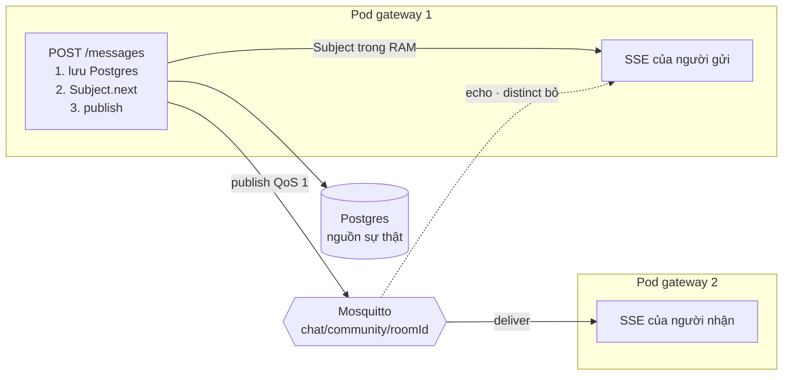
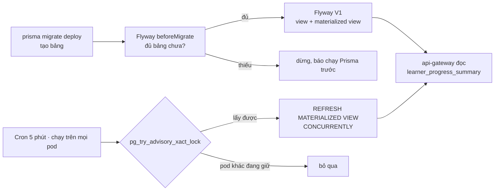

# Học MQTT, RxJS, Flyway, View và DDD — Từ Project Này

File này học đúng phần đã gắn vào repo: chat nhiều pod qua MQTT, luồng RxJS trên SSE, migration Flyway chạy cạnh Prisma, view / materialized view, và module tiến độ học theo clean architecture.

Mọi lệnh trong file đã chạy thật trên stack local. Kết quả in kèm là dữ liệu thật ngày 11/10/2026.

Mục 7 ghi lại 8 lỗi tìm được khi review bản đầu (do Cursor viết) và cách sửa. Đọc mục đó kỹ: đây là chất liệu tốt nhất để kể khi phỏng vấn. Câu hỏi phỏng vấn theo JD nằm ở [interview-nestjs-mqtt-db.md](./interview-nestjs-mqtt-db.md).

| Đã có docs | File |
| --- | --- |
| NestJS | [learn-nestjs.md](./learn-nestjs.md) |
| Kafka, outbox | [learn-kafka.md](./learn-kafka.md) |
| Postgres, index, EXPLAIN | [learn-postgres.md](./learn-postgres.md), [learn-sql.md](./learn-sql.md) |
| Thiết kế bảng | [learn-db-design.md](./learn-db-design.md) |
| Redis | [redis.md](./redis.md) |
| Docker, Kubernetes | [learn-docker.md](./learn-docker.md), [learn-kubernetes.md](./learn-kubernetes.md) |
| CI/CD | [learn-release-cicd.md](./learn-release-cicd.md) |

Kafka và MQTT cùng có trong project, mỗi cái một việc. Kafka chuyển việc giữa các service (nộp bài, thanh toán, outbox), giữ log để đọc lại khi consumer chết. MQTT đẩy tin realtime tới các pod gateway và tới thiết bị đang online.

---

## 0. Bật môi trường

```bash
cd ~/Projects/edu-app-nihongo
docker compose up -d mosquitto            # broker, có healthcheck
docker compose run --rm flyway            # tạo view (cần bảng Prisma có sẵn)
docker compose up -d --build api-gateway  # image phải build lại mới có code MQTT
```

Thứ tự quan trọng:

1. Prisma tạo bảng (`npm run migrate:deploy -w @edu/prisma-nihongo`).
2. Flyway tạo view dựa trên các bảng đó.
3. Gateway đọc view.

Compose không tự chạy bước 1 vì nó sẽ âm thầm sửa DB local của bạn. Thiếu bước 1 thì callback `beforeMigrate.sql` của Flyway dừng ngay với lỗi `Chưa có bảng của Prisma...`.

Biến môi trường:

| Biến | Compose | Chạy gateway trên host |
| --- | --- | --- |
| `MQTT_URL` | `mqtt://mosquitto:1883` | `mqtt://localhost:1883` |
| `MQTT_USERNAME` | `gateway` | `gateway` |
| `MQTT_PASSWORD` | lấy từ `MQTT_GATEWAY_PASSWORD` (mặc định `gateway-dev`) | `gateway-dev` |

Để trống `MQTT_URL` thì `MqttBus` không nối broker. Chat vẫn chạy, nhưng chỉ trong một process.

Kiểm tra gateway đã nối broker:

```bash
docker logs edu-gateway 2>&1 | grep "MQTT đã nối"
docker logs edu-mosquitto 2>&1 | grep "u'gateway'"
```

---

## 1. Vì sao cần MQTT: chat chạy nhiều pod

Ban đầu `ChatEventsService` chỉ có một `Subject` trong RAM. Trên k8s, api-gateway có HPA nên chạy nhiều pod. User A mở SSE ở pod 1, user B gửi tin vào pod 2. `Subject` của pod 2 phát tin, nhưng pod 1 không biết, nên A không nhận được.

```text
            ┌──────── Mosquitto ────────┐
            │  topic chat/community/1   │
            └──▲──────────────────┬─────┘
     publish   │                  │  deliver (cả pod 1 và pod 2)
┌──────────────┴───┐        ┌─────▼────────────┐
│ pod 1            │        │ pod 2            │
│ POST /messages   │        │ SSE của user 4   │
│ → lưu Postgres   │        │                  │
│ → Subject.next   │        │                  │
│ → mqtt.publish   │        │                  │
└──────────────────┘        └──────────────────┘
```

Cùng luồng dưới dạng sơ đồ:



Tin luôn được lưu vào Postgres trước. MQTT chỉ là đường đẩy realtime. Broker mất thì lịch sử chat vẫn còn, client mở lại phòng sẽ tải từ DB.

Có những cách khác cho cùng bài toán: Redis Pub/Sub (repo đã có Redis), Socket.IO Redis adapter, Postgres `LISTEN/NOTIFY`. MQTT được chọn vì sau này app mobile cũng subscribe được thẳng `user/{id}/notify` qua WebSocket (cổng 9001), điều mà Redis không làm được cho client.

### Topic

| Topic | Ai publish | Ai subscribe | Payload |
| --- | --- | --- | --- |
| `chat/community/{roomId}` | gateway, sau khi lưu tin nhóm | các pod gateway | cả `ChatEvent` |
| `chat/support/{threadId}` | gateway, sau khi lưu tin support | các pod gateway | cả `ChatEvent` |
| `user/{userId}/notify` | gateway (`notifyUsers`) | thiết bị của đúng user đó | `{ type, roomId/threadId, messageId, preview }` |

### QoS

| QoS | Ý nghĩa | Dùng cho |
| --- | --- | --- |
| 0 | gửi một lần, mất thì thôi | presence "đang online", vị trí GPS |
| 1 | ít nhất một lần, có thể trùng | tin chat (project dùng mức này) |
| 2 | đúng một lần, bắt tay 4 bước, chậm | hiếm khi cần; dedupe ở app rẻ hơn |

QoS 1 nghĩa là code phải chịu được tin trùng. Xem `distinct` ở mục 2.

### Mất kết nối thì sao

`MqttBus.publish` chỉ kiểm tra `if (!this.client)`. Khi đang mất kết nối, mqtt.js tự giữ tin QoS 1 trong hàng đợi rồi gửi khi nối lại. Bản đầu kiểm tra `client.connected` rồi `return`, tức là tự tay vứt tin (lỗi #3, mục 7).

Gateway nối với `clean: true` (mặc định) và `clientId` ngẫu nhiên mỗi lần start. Broker không giữ subscription cũ, nên handler `connect` subscribe lại mọi topic trong `topicRefs`.

### Bảo mật: auth và ACL

`infra/mqtt/mosquitto.conf` tắt anonymous. `entrypoint.sh` tạo password file từ env lúc container start, nên không có mật khẩu nào bị commit. `infra/mqtt/acl.conf`:

```text
user gateway
topic readwrite chat/#
topic write user/+/notify
topic read $SYS/#

pattern read user/%u/notify
```

`%u` là username lúc connect. Client đăng nhập với username `4` chỉ đọc được `user/4/notify`. Không có ACL thì ai cũng subscribe được `user/+/notify` và đọc trộm preview tin nhắn của mọi người (lỗi #1).

Hiện chưa cấp tài khoản cho client. Khi làm thì nên xác thực bằng JWT (ví dụ plugin `mosquitto-go-auth`) thay vì password file.

### Lab: thử ACL

```bash
# anonymous bị từ chối
docker exec edu-mosquitto mosquitto_sub -h 127.0.0.1 -t 'user/+/notify' -C 1 -W 2
# → Connection error: Connection Refused: not authorised

# tạo tạm user "4" để thử (mất khi container restart)
docker exec edu-mosquitto sh -c 'mosquitto_passwd -b /mosquitto/passwd 4 pw4 && kill -HUP 1'

# terminal 1: user 4 nghe cả hộp thư của mình lẫn của user 5
docker exec -it edu-mosquitto mosquitto_sub -h 127.0.0.1 -u 4 -P pw4 \
  -t user/5/notify -t user/4/notify -v

# terminal 2: gateway gửi cho cả hai
docker exec edu-mosquitto sh -c '
  mosquitto_pub -h 127.0.0.1 -u gateway -P "$MQTT_GATEWAY_PASSWORD" -q 1 -t user/5/notify -m to5
  mosquitto_pub -h 127.0.0.1 -u gateway -P "$MQTT_GATEWAY_PASSWORD" -q 1 -t user/4/notify -m to4'
```

Kết quả thật: terminal 1 chỉ in `user/4/notify to4`. Tin `to5` bị broker chặn.

**Câu hỏi tự test**

- Vì sao tin chat vẫn ghi Postgres trước khi publish?
- QoS 1 có đảm bảo đúng một lần không? Vậy ai chịu trách nhiệm chống trùng?
- Vì sao gateway chỉ có quyền `write` trên `user/+/notify`, không có `read`?

Đáp án ngắn: Postgres là nguồn sự thật, MQTT có thể mất. QoS 1 là ít nhất một lần, app phải dedupe theo `message.id`. Gateway không cần đọc hộp thư của user; cấp ít quyền nhất có thể (least privilege).

---

## 2. RxJS: luồng SSE của chat

`ChatEventsService.observe` (`services/api-gateway/src/realtime/chat-events.service.ts`):

```typescript
return this.mqtt.connection$.pipe(
  switchMap(() =>
    merge(
      this.subject.asObservable(),        // tin do chính pod này phát
      this.mqtt.stream<ChatEvent>(topic), // tin từ broker (pod khác + echo của mình)
    ).pipe(filter((e) => e.type === type && e.roomId === roomId)),
  ),
  distinct(chatEventKey, interval(DEDUPE_WINDOW_MS)),
  map((e) => ({ data: e.message }) as MessageEvent),
);
```

| Operator | Việc nó làm ở đây |
| --- | --- |
| `BehaviorSubject` (`connection$`) | Giữ trạng thái broker hiện tại. SSE mở muộn vẫn nhận ngay giá trị `true`. `Subject` thường không replay nên subscriber tới sau sẽ không biết broker đang sống. |
| `switchMap` | Mỗi lần broker lên/xuống thì hủy pipeline cũ, mở pipeline mới. Tin bắn vào stream cũ không lọt ra. |
| `merge` | Gộp tin local và tin broker vào một ống. |
| `filter` | Subject local chứa tin mọi phòng; chỉ giữ phòng đang mở. |
| `distinct(key, flushes)` | Bỏ tin trùng theo `type:roomId:message.id`. `interval(60s)` xóa Set định kỳ. |
| `map` | SSE của Nest cần dạng `{ data }`. |

### Vì sao có tin trùng

Pod 1 lưu tin, gọi `subject.next` (SSE ở pod 1 nhận ngay), rồi publish lên broker. Pod 1 cũng đang subscribe topic đó nên broker gửi lại chính tin ấy cho pod 1, gọi là echo. Không có `distinct` thì người gửi thấy tin của mình hai lần.

### Vì sao `distinct` cần `interval`

`distinct(key)` giữ mọi key đã thấy trong một `Set`, tới khi subscription kết thúc. Kết nối SSE có thể mở hàng giờ, nên Set phình mãi (lỗi #2). Echo về chỉ sau vài mili giây, nên xóa Set mỗi 60 giây là đủ an toàn.

Hệ quả: `interval` tạo một timer. Subscription nào không unsubscribe thì timer giữ process sống mãi. Lúc sửa lỗi này, Jest bị treo vì một test quên `sub.unsubscribe()`. Đó cũng chính là cách SSE rò rỉ nếu Nest không hủy subscription khi client ngắt.

### Vì sao `distinct` nằm ngoài `switchMap`

Nếu đặt trong, mỗi lần reconnect Set sẽ trống lại, và echo của tin vừa gửi trước lúc reconnect sẽ lọt qua. Đặt ngoài thì Set sống qua các lần reconnect.

### `MqttBus.stream`: đếm tham chiếu

Mười tab cùng phòng chỉ gửi một lệnh `SUBSCRIBE` lên broker. `retain(topic)` tăng bộ đếm, lần đầu thì subscribe. Teardown gọi `release`, về 0 thì unsubscribe. Đây là kiểu ref-counting giống `share()` của RxJS, nhưng làm bằng tay vì phải gọi broker.

### Lab: hai pod gateway

```bash
SP=/tmp/gw2 && mkdir -p $SP
docker inspect edu-gateway -f '{{range .Config.Env}}{{println .}}{{end}}' | grep -v '^$' > $SP/gw2.env
docker run -d --name edu-gateway-2 --network edu-app_default \
  --env-file $SP/gw2.env -p 3001:3000 edu-app-api-gateway

# ký JWT cho user 3 và 4 bằng secret của gateway
tok() { docker exec edu-gateway sh -c "cd /app/services && node -e \"const j=require('jsonwebtoken');console.log(j.sign({sub:$1,email:'x',role:'USER'},process.env.JWT_SECRET||'change-me-in-production',{expiresIn:'10m'}))\""; }
T3=$(tok 3); T4=$(tok 4)

# user 3 mở chat 1:1 với user 4 (ở pod 1) → lấy id phòng trong response
curl -s -X POST localhost:3000/api/community/rooms/direct \
  -H "Authorization: Bearer $T3" -H 'Content-Type: application/json' -d '{"userId":4}'
ROOM=1   # thay bằng id vừa nhận

# user 4 nghe ở pod 2, user 3 nghe ở pod 1
curl -sN localhost:3001/api/community/rooms/$ROOM/stream -H "Authorization: Bearer $T4" &
curl -sN localhost:3000/api/community/rooms/$ROOM/stream -H "Authorization: Bearer $T3" &

# user 3 gửi vào pod 1
curl -s -X POST localhost:3000/api/community/rooms/$ROOM/messages \
  -H "Authorization: Bearer $T3" -H 'Content-Type: application/json' \
  -d '{"content":"xin chào từ pod 1"}'
```

Kết quả thật: SSE ở pod 2 nhận tin (đi qua MQTT), SSE ở pod 1 nhận **đúng một lần** (echo bị `distinct` bỏ). Xong thì `docker rm -f edu-gateway-2` và xóa phòng test trong DB.

Lab này còn làm lộ một lỗi có từ trước: `POST /rooms/direct` trả `property userId should not exist`. Ba DTO trong `community.controller.ts` không có decorator của class-validator. `ValidationPipe` toàn cục bật `forbidNonWhitelisted` nên coi mọi field là lạ. Giờ chúng nằm ở `http/dto/community.dto.ts` với `@IsInt() @IsPositive()`...

**Câu hỏi tự test**

- MQTT nhấp nháy liên tục: `switchMap` và `mergeMap` cho kết quả khác nhau thế nào?
- `connection$` là `Subject` thường thì SSE mở sau khi broker đã nối sẽ ra sao?
- Bỏ `interval(...)` khỏi `distinct` thì hỏng gì? Vì sao test không phát hiện?

Đáp án ngắn: `mergeMap` giữ cả pipeline cũ, nên có hai subscription cùng topic và tin bị nhân đôi. Với `Subject`, SSE mở muộn không nhận được sự kiện nào nên không bao giờ subscribe broker. Bỏ `interval` thì rò bộ nhớ chậm theo thời gian; unit test ngắn không đo bộ nhớ nên không thấy.

---

## 3. Flyway: SQL có phiên bản, chạy cạnh Prisma

Chia việc:

| Công cụ | Sở hữu | Bảng lịch sử |
| --- | --- | --- |
| Prisma | bảng, cột, index (`packages/prisma-nihongo/migrations`) | `public._prisma_migrations` |
| Flyway | view, materialized view (`infra/flyway/sql`) | `flyway.flyway_schema_history` |

Prisma không quản lý materialized view, và nếu để Prisma tự sinh SQL cho view thì dễ bị `DROP` khi schema lệch. Vì vậy read model giao cho Flyway.

### Bảng lịch sử để ở schema riêng

Compose đặt `FLYWAY_DEFAULT_SCHEMA=flyway` và `FLYWAY_SCHEMAS=flyway`. Nếu bảng `flyway_schema_history` nằm trong `public`, `prisma migrate dev` có thể thấy một bảng lạ, coi là drift và đòi reset DB.

Hệ quả: lúc migrate, `search_path` bắt đầu bằng `flyway`. Tên không ghi schema sẽ rơi vào schema `flyway`, nên SQL ghi rõ `public."StudySession"`, `public.learner_daily_study`.

Schema `flyway` mới tạo nên trống, không cần baseline. Baseline chỉ cần khi Flyway tiếp quản một schema đã có sẵn đối tượng.

```bash
docker exec edu-postgres-nihongo psql -U nihongo -d nihongo -c \
  'SELECT installed_rank, version, description, type, success FROM flyway.flyway_schema_history ORDER BY installed_rank;'
```

```text
 installed_rank | version |         description          |  type  | success
----------------+---------+------------------------------+--------+---------
              0 |         | << Flyway Schema Creation >> | SCHEMA | t
              1 | 1       | learner progress views       | SQL    | t
```

### Quy tắc file

- `V{n}__mo_ta.sql`: versioned, chạy đúng một lần theo thứ tự. Flyway lưu checksum; sửa file đã chạy thì `validate` báo lỗi.
- `R__mo_ta.sql`: repeatable, chạy lại mỗi khi checksum đổi, sau tất cả các file `V`. Hợp cho view: sửa định nghĩa thì sửa tại chỗ, không cần V2, V3...
- `beforeMigrate.sql`: callback. Ở đây nó kiểm tra bảng Prisma đã có chưa.

`V1` bị sửa trực tiếp trong đợt review vì code chưa commit và mới chỉ chạy trên máy local. Khi migration đã chạy ở môi trường dùng chung thì không được sửa nữa, phải viết `V2`, hoặc chuyển view sang `R__`.

### Thứ tự chạy và refresh



### Chạy ở đâu

| Nơi | Flyway chạy khi nào |
| --- | --- |
| Compose | `docker compose run --rm flyway`, chạy xong thì thoát (`restart: "no"`) |
| CI (`ci.yml`) | ngay sau `prisma migrate deploy` trên DB trắng, nên mọi PR đều chạy thử SQL của view |
| k8s (`deploy.yml`) | **chưa có**, xem bài tập ở mục 8 |

Thiếu view thì API tiến độ trả 503 (`ProgressViewsMissingError`), còn cron chỉ log warning.

**Câu hỏi tự test**

- Vì sao SQL phải ghi `public.` khi `defaultSchema=flyway`?
- View nên là `V__` hay `R__`? Materialized view thì sao?
- Khi nào cần `baselineOnMigrate`?

Đáp án ngắn: `search_path` lúc migrate bắt đầu bằng schema `flyway`. View hợp `R__`. Materialized view cũng được, nhưng mỗi lần đổi định nghĩa sẽ `DROP` + `CREATE` lại và chạy lại toàn bộ query, nên phải cân nhắc khi bảng lớn. Baseline cần khi đưa Flyway vào một schema đã có dữ liệu.

---

## 4. Chuẩn hóa, JOIN, view, materialized view

### Chuẩn hóa

`DailyActivity` là một dòng cho mỗi `(userId, date, kind)`, với `kind` là `vocab` hoặc `kanji`. Thêm loại hoạt động mới thì thêm dòng, không thêm cột. Unique `(userId, date, kind)` vừa chống trùng, vừa là index cho JOIN.

Có một điểm chưa chuẩn: `DailyActivity.date` là `String` (`'YYYY-MM-DD'`), còn `StudySession.date` là kiểu `date`. Muốn JOIN phải ép kiểu (`to_char`, `::date`). Cách đúng là đổi cột về kiểu `date` bằng một migration Prisma (bài tập ở mục 8).

### View `learner_daily_study`: bẫy LEFT JOIN

Bản đầu viết `FROM "StudySession" s LEFT JOIN "DailyActivity" ...`. `LEFT JOIN` giữ mọi dòng của bảng **bên trái**. Ngày nào chỉ có `DailyActivity` mà không có `StudySession` thì biến mất. DB local có 0 dòng `StudySession` và 17 dòng `DailyActivity`, nên view trả rỗng (lỗi #5).

Bản sửa lấy tập ngày từ cả hai bảng trước:

```sql
WITH days AS (
  SELECT "userId", date AS "studyDate" FROM public."StudySession"
  UNION
  SELECT "userId", date::date FROM public."DailyActivity"
)
SELECT d."userId", d."studyDate",
       COALESCE(s.seconds, 0)::int AS seconds, ...
FROM days d
LEFT JOIN public."StudySession" s ON s."userId" = d."userId" AND s.date = d."studyDate"
LEFT JOIN public."DailyActivity" v ON ... AND v.kind = 'vocab'
LEFT JOIN public."DailyActivity" k ON ... AND k.kind = 'kanji';
```

`UNION` (không phải `UNION ALL`) để bỏ ngày trùng. Kết quả thật sau khi sửa:

```text
 userId | studyDate  | seconds | cardsReviewed | vocabCount | kanjiCount
--------+------------+---------+---------------+------------+------------
      1 | 2026-10-06 |       0 |             0 |          7 |          0
      1 | 2026-10-05 |       0 |             0 |          5 |          2
      1 | 2026-10-04 |       0 |             0 |          2 |          0
```

Có thể dùng `FULL OUTER JOIN` thay cho CTE, nhưng với ba bảng thì điều kiện `COALESCE` trên khóa JOIN rất rối. CTE dễ đọc hơn.

Hiệu năng: từ PostgreSQL 12, CTE không đệ quy và chỉ dùng một lần sẽ được inline. Điều kiện `WHERE "userId" = 1` đặt ngoài view vẫn được đẩy xuống cả hai nhánh `UNION`. Plan thật (rút gọn):

```text
->  Append
      ->  Bitmap Index Scan on "StudySession_userId_date_key"
            Index Cond: ("userId" = 1)
      ->  Seq Scan on "DailyActivity"
            Filter: ("userId" = 1)
```

`DailyActivity` vẫn seq scan vì bảng chỉ có 17 dòng; khi lớn lên, planner sẽ dùng unique index `(userId, date, kind)`. Lệnh để tự xem: `EXPLAIN SELECT * FROM learner_daily_study WHERE "userId" = 1;`

### View và materialized view

| | View | Materialized view |
| --- | --- | --- |
| Lưu gì | chỉ câu query | kết quả của query (lưu trên đĩa) |
| Đọc | chạy lại query mỗi lần | đọc thẳng, như một bảng |
| Độ tươi | luôn mới | cũ tới lần `REFRESH` kế |
| Index | không | tạo được |

`learner_progress_summary` gom sẵn tổng giây, thẻ, vocab, kanji và streak theo user. Trang tiến độ không phải `SUM` cả lịch sử. Đổi lại, số liệu có thể trễ tới 5 phút.

`REFRESH MATERIALIZED VIEW CONCURRENTLY` cho phép đọc trong lúc refresh. Nó cần một unique index (`learner_progress_summary_user_idx`) để so dòng cũ với dòng mới và chỉ ghi phần khác. Đổi lại, nó chậm hơn refresh thường.

### Refresh trên nhiều pod: advisory lock

Cron `@Cron(EVERY_5_MINUTES)` chạy trên **mọi** pod. Năm pod là năm lệnh refresh xếp hàng chờ nhau (lỗi #4). Bản sửa:

```typescript
await this.prisma.$transaction(async (tx) => {
  const [{ locked }] = await tx.$queryRaw`
    SELECT pg_try_advisory_xact_lock(hashtext('learner_progress_summary')) AS locked`;
  if (!locked) return false;           // pod khác đang làm → bỏ qua
  await tx.$executeRawUnsafe("REFRESH MATERIALIZED VIEW CONCURRENTLY learner_progress_summary");
  return true;
}, { timeout: 120_000 });
```

- `try_`: không chờ; lấy không được thì trả `false` ngay.
- `xact_`: lock gắn với transaction, tự nhả khi commit/rollback, kể cả khi pod chết. Lock theo session (`pg_advisory_lock`) nguy hiểm với connection pool: lock nằm ở connection, có thể nhả nhầm hoặc không bao giờ nhả.
- Đã thử: `REFRESH ... CONCURRENTLY` chạy được trong transaction (khác `CREATE INDEX CONCURRENTLY`).

Cách khác: chuyển refresh sang k8s `CronJob` (chỉ chạy một nơi), hoặc dùng job queue kiểu BullMQ trên Redis.

### EXPLAIN: so cho công bằng

`GET /api/learning-progress/explain?analyze=true` so hai cách đọc. Bản đầu so materialized view với một câu chỉ `SUM(seconds)`, không tính những gì view tính, nên phép so vô nghĩa (lỗi #6). Giờ câu live join cho kết quả y hệt view (đã kiểm bằng `EXCEPT`, ra 0 dòng).

| | `EXPLAIN` | `EXPLAIN (ANALYZE, BUFFERS)` |
| --- | --- | --- |
| Chạy query thật | không | có (cẩn thận với UPDATE/DELETE) |
| Cho biết | cost ước tính (đơn vị tùy ý, không phải ms) | thời gian thật, số dòng thật, số page đọc |
| Dùng khi | xem planner định làm gì | tìm vì sao chậm |

Kết quả thật trên DB local (1 user có dữ liệu):

```text
materialized view : cost 1.01, 0.01 ms, Seq Scan
live join         : 0.093 ms
```

Bảng chỉ một dòng thì Postgres chọn `Seq Scan` dù có unique index, vì đọc một page rẻ hơn mở index. Khi dữ liệu lớn, lookup theo `userId` sẽ dùng index. Đừng kết luận gì về hiệu năng từ DB chỉ có vài dòng.

Response có trường `basis`: `execution_time` khi có ANALYZE, `estimated_cost` khi không. Có thời gian thật thì tin thời gian thật.

### API

| Method | Path | Ai |
| --- | --- | --- |
| GET | `/api/learning-progress` | user đang đăng nhập |
| GET | `/api/learning-progress/explain[?analyze=true]` | `ADMIN` |
| POST | `/api/learning-progress/refresh` | `ADMIN`, trả `{ ok, refreshed }` |

**Câu hỏi tự test**

- Vì sao `REFRESH ... CONCURRENTLY` cần unique index?
- Vì sao dùng `pg_try_advisory_xact_lock` mà không dùng `pg_advisory_lock`?
- `EXPLAIN` báo cost 1.01, vậy query chạy mất 1.01 ms?

Đáp án ngắn: cần khóa để so dòng cũ với dòng mới. Lock theo transaction tự nhả và an toàn với connection pool. Cost không phải ms, chỉ là đơn vị ước tính tương đối của planner.

---

## 5. DDD và clean architecture: module tiến độ học

```text
services/api-gateway/src/learning-progress/
  domain/
    learner-progress.ts              aggregate LearnerProgress, compareQueryPlans
    learner-progress.repository.ts   port (interface), không biết Prisma
  application/
    get / explain / refresh-learner-progress.ts   use case
    learner-progress.scheduler.ts    cron
    tokens.ts                        Symbol để inject port
  infrastructure/
    prisma-learner-progress.repository.ts         adapter: $queryRaw, advisory lock
  learning-progress.controller.ts    HTTP, JWT, role, đổi lỗi domain → 503
  learning-progress.module.ts        nối port với adapter
```

Luật phụ thuộc chỉ đi vào trong: controller → application → domain ← infrastructure. Domain không import Nest hay Prisma.

Module nối port với adapter:

```typescript
{ provide: LEARNER_PROGRESS_REPOSITORY, useExisting: PrismaLearnerProgressRepository }
```

Interface TypeScript biến mất lúc runtime nên không làm DI token được. Vì vậy cần một `Symbol`. Use case `@Inject(LEARNER_PROGRESS_REPOSITORY)`, còn test truyền repository giả, không cần Postgres.

`LearnerProgress` có constructor `private`, tạo qua `empty()` hoặc `rehydrate()`. `rehydrate` ép invariant: streak dài nhất ≥ streak hiện tại, mọi số ≥ 0.

Thành thật về giới hạn: đây là một **read model** (phía Query của CQRS). Aggregate gần như chỉ giữ dữ liệu, chưa có hành vi. Logic nghiệp vụ thật (tính streak khi học) vẫn nằm ở service khác. DDD đầy đủ sẽ đưa `recordStudy(date)` vào aggregate phía ghi, và materialized view là phía đọc được dựng từ đó.

So với `exam-service`: exam có command, query, event (`SubmitExamCommand`, `ExamSubmittedEvent`) và outbox Kafka. Đó là CQRS + event. Module tiến độ là một lát clean architecture đủ vòng.

```bash
cd services
npx jest api-gateway/src/learning-progress api-gateway/src/realtime
```

**Câu hỏi tự test**

- Vì sao repository là interface trong `domain/`, còn class Prisma nằm ở `infrastructure/`?
- `ProgressViewsMissingError` là lỗi domain, nhưng ai đổi nó thành HTTP 503? Vì sao không throw `ServiceUnavailableException` ngay trong repository?
- Module này có thật sự là DDD không?

Đáp án ngắn: domain nói cần gì, infrastructure quyết định lấy từ đâu (dependency inversion). Controller đổi lỗi, vì repository không nên biết HTTP. Đây là clean architecture cho một read model; DDD đầy đủ cần aggregate có hành vi ở phía ghi.

---

## 6. Kubernetes và CI/CD

| File | Việc |
| --- | --- |
| `infra/k8s/mqtt/mosquitto.yaml` | Deployment + Service + ConfigMap (config, ACL, entrypoint), probes, resources |
| `infra/k8s/configmap.yaml` | `MQTT_URL`, `MQTT_USERNAME` |
| `infra/k8s/api-gateway.yaml` | `MQTT_PASSWORD` từ Secret `edu-app-secrets` |
| `.github/workflows/deploy.yml` | apply mosquitto cùng Postgres/Redis, ghi `MQTT_PASSWORD` vào Secret |
| `.github/workflows/ci.yml` | Flyway migrate sau Prisma trên DB trắng |

Trước lần deploy đầu tiên: tạo GitHub secret `MQTT_PASSWORD`. Thiếu nó thì Secret có giá trị rỗng và broker không start (`entrypoint.sh` dừng vì `MQTT_GATEWAY_PASSWORD` trống).

Mosquitto trên k8s dùng `emptyDir` chứ không dùng PVC, và đó là cố ý: gateway dùng clean session, tin chat đã nằm trong Postgres. Broker chỉ chuyển tiếp, restart mất trạng thái cũng không sao.

`replicas: 1` là single point of failure. Broker chết thì các pod rơi về chế độ chỉ chat trong một process cho tới khi broker lên lại. Muốn HA thì dùng broker có cluster (EMQX, HiveMQ, VerneMQ); Mosquitto bản mã nguồn mở không có cluster.

---

## 7. Tám lỗi tìm được khi review và cách sửa

| # | Lỗi | Hậu quả | Sửa |
| --- | --- | --- | --- |
| 1 | Broker `allow_anonymous true`, mở cổng ra ngoài | Ai cũng subscribe `user/+/notify` đọc được tin người khác | Password file + ACL `%u`, bind `127.0.0.1` |
| 2 | `distinct(key)` không xóa Set | SSE mở lâu phình bộ nhớ | `distinct(key, interval(60s))` |
| 3 | `publish` return khi `!connected` | Mất tin lúc broker chập chờn | Để mqtt.js tự xếp hàng offline |
| 4 | Cron refresh trên mọi pod | N lệnh refresh xếp hàng, tốn DB | `pg_try_advisory_xact_lock` |
| 5 | View bắt đầu từ `StudySession` rồi LEFT JOIN | Ngày chỉ có vocab/kanji biến mất (local: 0 dòng) | CTE `UNION` tập ngày từ hai bảng |
| 6 | EXPLAIN so view với câu không tương đương | Kết luận sai | Live join tương đương + `ANALYZE` |
| 7 | Bảng lịch sử Flyway nằm trong `public`; Flyway không chờ Prisma | Prisma có thể báo drift; DB trắng thì lỗi khó hiểu | `defaultSchema=flyway`, callback `beforeMigrate`, Flyway trong CI |
| 8 | Bắt lỗi theo chuỗi `"does not exist"`; k8s thiếu env, probes | Thiếu cột cũng báo 503 "chưa chạy Flyway"; gateway trên k8s không nối broker | Chỉ mã `42P01`; configmap, secret, probes |
| + | DTO community thiếu decorator (lỗi có từ trước) | API tạo nhóm / chat 1:1 / thêm thành viên luôn 400 | `http/dto/community.dto.ts` |

Bài học chung:

- Code do AI viết thường **chạy được và có test pass**. Lỗi nằm ở chỗ test không chạm tới: nhiều pod, chạy lâu, dữ liệu thật, bảo mật.
- Mỗi lỗi trên đều chỉ lộ ra khi chạy thật: hai pod, DB có dữ liệu, broker bật auth. Unit test với fake không bắt được.
- Khi kể lại, nói được **hậu quả cụ thể** và **cách kiểm chứng** quan trọng hơn chỉ nói cách sửa.

---

## 8. Bài tập tự làm (chưa có trong code)

1. **Flyway trên k8s.** `deploy.yml` mới chạy Prisma Job, chưa chạy Flyway, nên trên cụm chưa có view. Viết `infra/k8s/jobs/flyway-migrate.job.yaml` chạy sau Prisma Job và trước rollout.
2. **Đổi `DailyActivity.date` sang kiểu `date`.** Migration Prisma đổi kiểu (`USING date::date`), rồi sửa view bỏ `to_char`. Đo `EXPLAIN ANALYZE` trước và sau.
3. **Index.** Seed 100k dòng `StudySession`, chạy `EXPLAIN (ANALYZE, BUFFERS)` câu live join, xem có index nào giúp không. Ghi kết quả vào [learn-sql.md](./learn-sql.md).
4. **Cache Redis** cho `GET /api/learning-progress` với TTL 5 phút, bằng chu kỳ refresh. Nghĩ xem cache này có thừa không khi đã có materialized view.
5. **Integration test** bằng testcontainers: Postgres thật, chạy Prisma + Flyway, kiểm tra view trả đúng ngày chỉ có `DailyActivity`. Test này sẽ bắt được lỗi #5.
6. **Chuyển view sang `R__learner_progress_views.sql`** và so cách làm với V1/V2.

Xong mục 8 là nói được trọn vòng: thiết kế, viết, đo, sửa, deploy.
