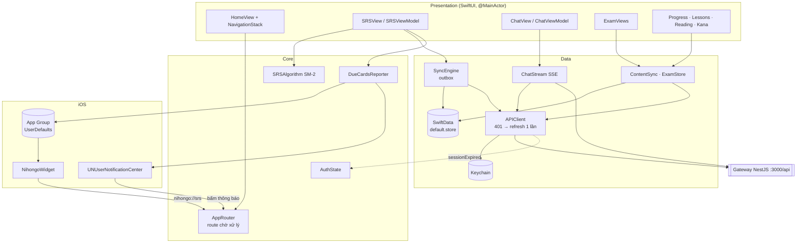
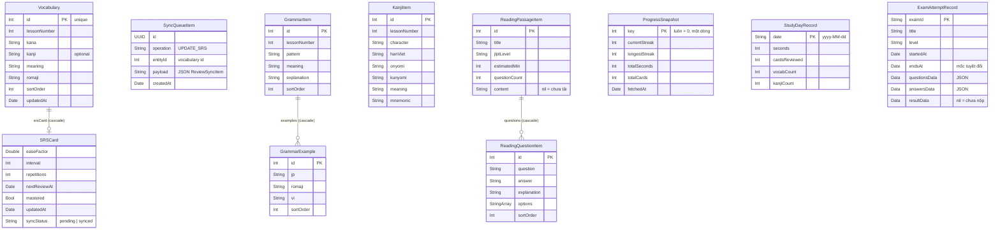
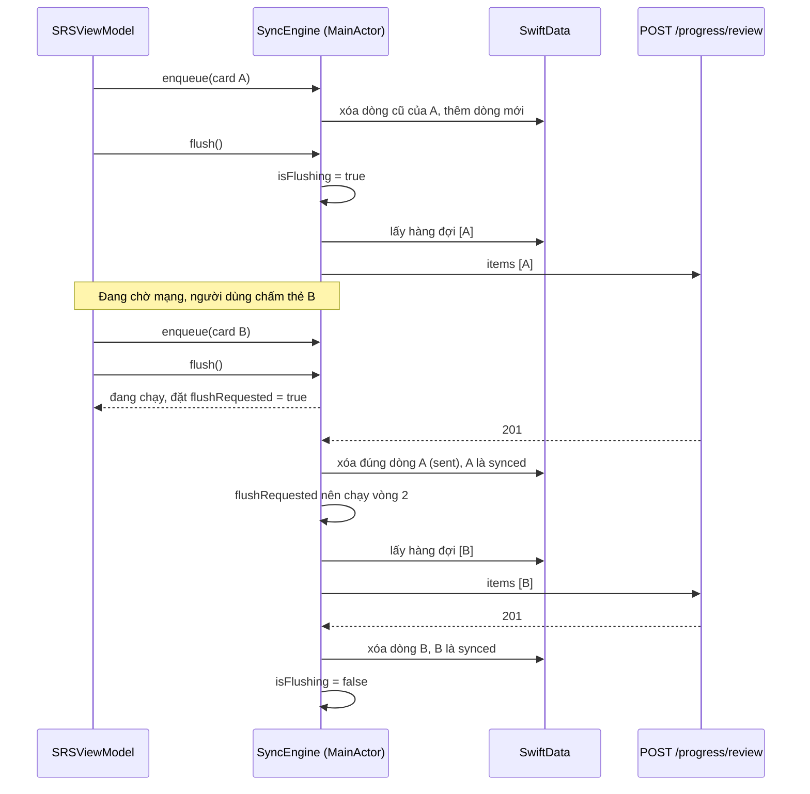
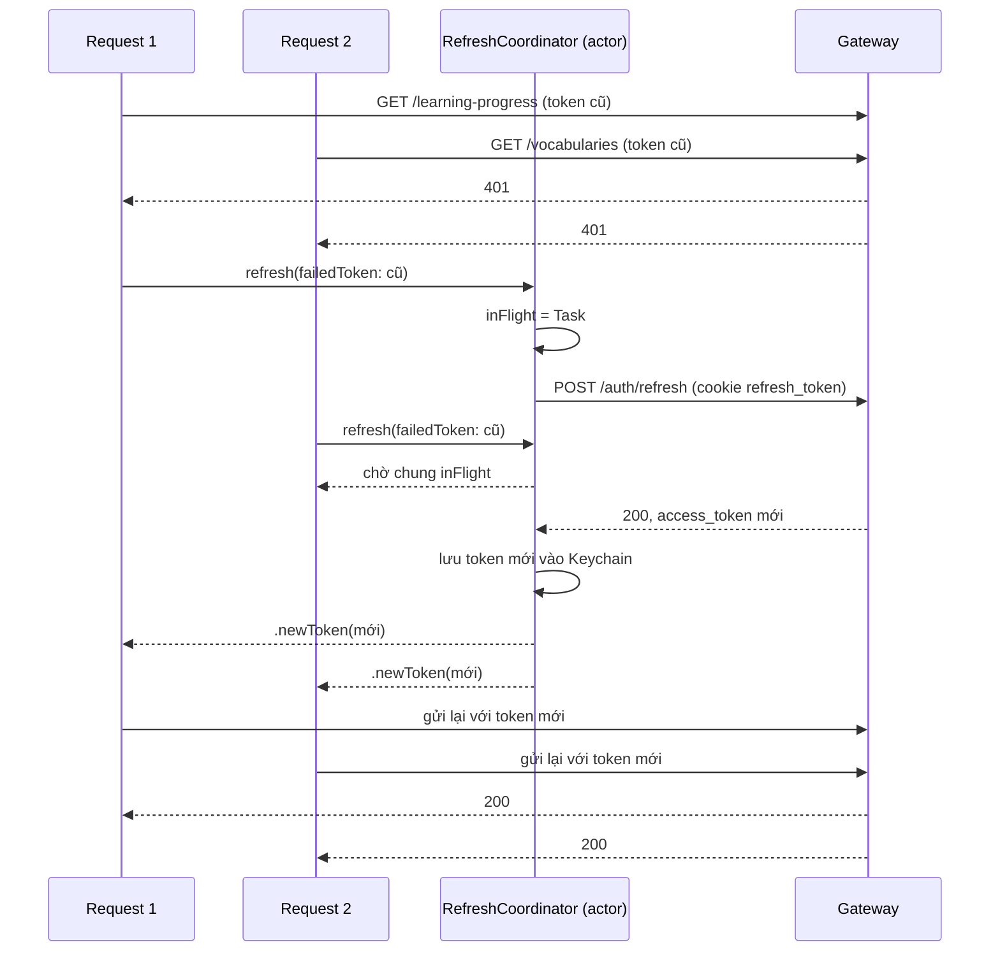
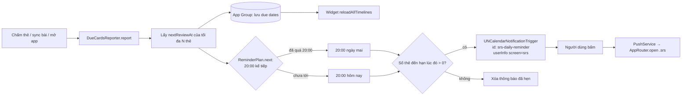
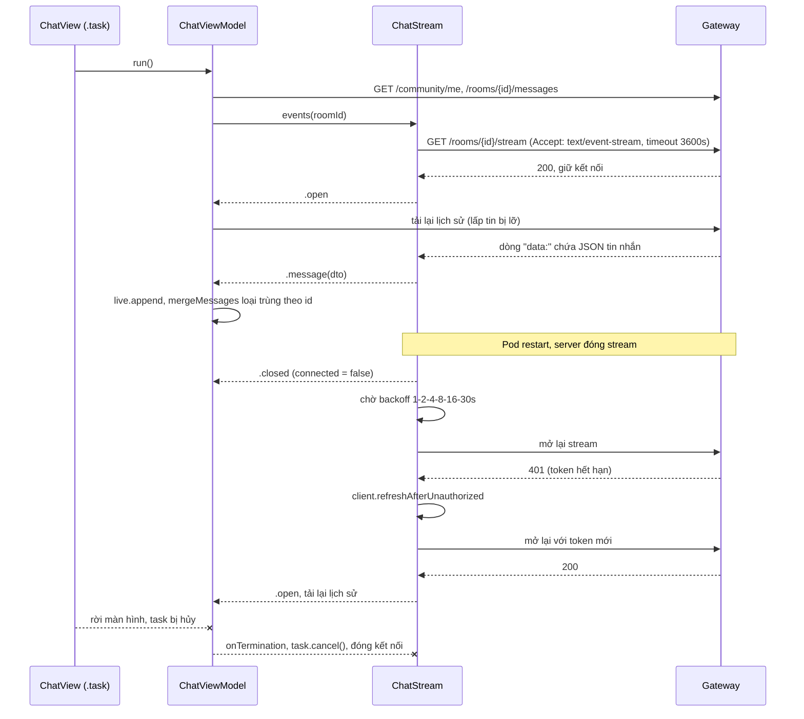
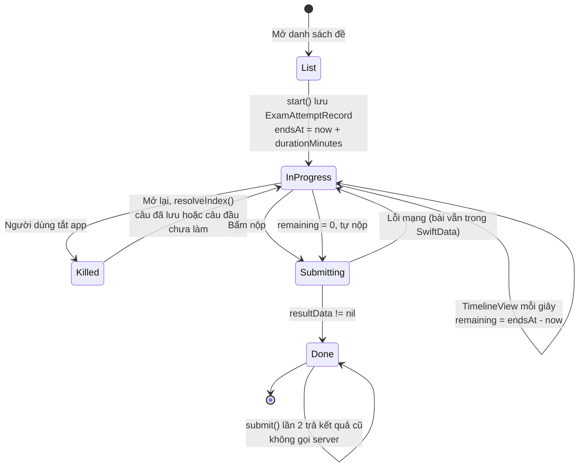

# Học Swift/SwiftUI — Từ Code Thật Của `nihongo-ios`

Tài liệu này đi theo đúng quy trình đã làm cho app iOS: đọc code, tìm lỗi, sửa kèm test, thêm 9 tính năng (giống bên Android), rồi chạy với backend thật. Mỗi mục ghi:

- code cũ sai ở đâu;
- lỗi được phát hiện bằng cách nào;
- cách sửa, và test nào giữ cho lỗi không quay lại.

Đọc kèm:

- [learn-android-kotlin.md](./learn-android-kotlin.md) và [learn-android-features.md](./learn-android-features.md): cùng tính năng, làm bằng Kotlin. Nhiều lỗi iOS có "anh em" bên Android, có ghi mã L tương ứng.
- [roadmap-swift.md](./roadmap-swift.md): lộ trình học Swift theo tuần.

## Mục lục

- [Phần 0 — Chạy được app](#phần-0--chạy-được-app)
- [Phần 1 — Bản đồ code và sơ đồ](#phần-1--bản-đồ-code-và-sơ-đồ)
- [Phần 2 — 18 lỗi đã sửa (S1–S18)](#phần-2--18-lỗi-đã-sửa-s1s18)
- [Phần 3 — 9 tính năng mới](#phần-3--9-tính-năng-mới)
- [Phần 4 — Test](#phần-4--test)
- [Phần 5 — Lỗi chỉ lộ ra khi chạy thật](#phần-5--lỗi-chỉ-lộ-ra-khi-chạy-thật)
- [Phần 6 — Việc còn tồn](#phần-6--việc-còn-tồn)
- [Phần 7 — Câu hỏi phỏng vấn](#phần-7--câu-hỏi-phỏng-vấn)

---

# Phần 0 — Chạy được app

Cần macOS, Xcode (đã thử với Xcode 26, simulator iPhone 18 Pro) và XcodeGen.

```bash
brew install xcodegen
cd apps/nihongo-ios
xcodegen generate            # sinh NihongoEDU.xcodeproj từ project.yml

# unit test (60 test, không cần backend)
xcodebuild test -project NihongoEDU.xcodeproj -scheme NihongoEDU \
  -destination 'platform=iOS Simulator,name=iPhone 18 Pro' -only-testing:NihongoEDUTests

# UI test (deep link, kana, đo thời gian khởi động)
xcodebuild test -project NihongoEDU.xcodeproj -scheme NihongoEDU \
  -destination 'platform=iOS Simulator,name=iPhone 18 Pro' -only-testing:NihongoEDUUITests

# integration test với backend thật (cần docker compose đang chạy, gateway ở :3000)
TEST_RUNNER_INTEGRATION=1 xcodebuild test ... -only-testing:NihongoEDUTests/IntegrationTests
```

`TEST_RUNNER_` là tiền tố đặc biệt: `xcodebuild` bỏ tiền tố rồi chuyển biến vào tiến trình test. Trong test đọc là `INTEGRATION`.

Simulator gọi `http://localhost:3000/api`: simulator dùng chung mạng với máy Mac. Emulator Android phải dùng `10.0.2.2`, simulator iOS thì không.

**Quy tắc với `project.yml`:** đừng sửa `.xcodeproj` bằng tay. Mọi thiết lập (target, Info.plist, entitlements, scheme) nằm trong `project.yml`. Sửa xong chạy lại `xcodegen generate`. CI cũng sinh lại file project, nên sửa tay trong Xcode sẽ bị mất.

---

# Phần 1 — Bản đồ code và sơ đồ

```
apps/nihongo-ios/
├── project.yml                 XcodeGen: 4 target (app, widget, unit test, UI test)
├── Shared/DueDates.swift       Dùng chung app + widget (App Group)
├── NihongoEDU/
│   ├── App/                    @main, AppDelegate (APNs)
│   ├── Core/                   SRSAlgorithm, AppRouter, PushService, AuthState,
│   │                           DueCardsReporter (nhắc ôn + widget), UserMessage
│   ├── Domain/                 @Model của SwiftData
│   ├── Data/Local/             AppSchema (migration), SyncEngine, TokenStore,
│   │                           ContentSync, ExamStore
│   ├── Data/Remote/            APIClient (401 → refresh), các API, ChatStream (SSE)
│   └── Presentation/           Màn hình SwiftUI theo tính năng
├── NihongoWidget/              Widget "Thẻ đến hạn"
├── NihongoEDUTests/            Unit + integration test
└── NihongoEDUUITests/          XCUITest
```

## 1.1 Kiến trúc



Ba quy tắc rút ra từ các lỗi bên dưới:

1. **Mọi request có đăng nhập đi qua `APIClient.send`.** Đó là nơi duy nhất gắn token và xử lý 401 (S7).
2. **Mọi thao tác SwiftData của UI chạy trên `@MainActor`.** `ModelContext` không thread-safe (S4, S6).
3. **Hàm nào phụ thuộc thời gian thì nhận `now` làm tham số.** Nhờ vậy test được (S5, S16).

## 1.2 Dữ liệu: SwiftData schema V2



`SyncQueueItem` không có quan hệ với `SRSCard`. Nó chỉ giữ `entityId` (id từ vựng) và một payload JSON tự đủ thông tin. Lý do: outbox phải gửi được kể cả khi thẻ đã bị xóa hay đổi.

`ExamAttemptRecord` lưu câu hỏi và đáp án dạng `Data` (JSON) thay vì tách bảng. Bài thi chỉ đọc và ghi nguyên khối, không bao giờ cần truy vấn từng câu.

---

# Phần 2 — 18 lỗi đã sửa (S1–S18)

| Mã  | Lỗi                                                           | Hậu quả                                        | Tìm ra bằng                    |
| --- | ------------------------------------------------------------- | ---------------------------------------------- | ------------------------------ |
| S1  | `SWIFT_VERSION` rỗng ở target test                            | Target test chưa từng biên dịch được           | Chạy test lần đầu              |
| S2  | Thiếu `ENABLE_TESTABILITY`, arch lệch giữa 2 target           | "Unable to resolve Swift module dependency"    | So sánh build settings         |
| S3  | Payload sync thiếu `mastered`, `lastReviewedAt`               | **Mọi** lần sync từ iOS bị server trả 400      | Đọc DTO backend, gọi curl thật |
| S4  | Flush xóa mọi dòng, đánh dấu mọi thẻ `synced`                 | Mất lần chấm thêm vào trong lúc chờ mạng       | Đọc code                       |
| S5  | `SRSAlgorithm` tự gọi `Date()`                                | Không test được, sai khi đổi giờ mùa hè        | Viết test                      |
| S6  | Hàng đợi trùng theo thẻ, flush chạy chồng nhau                | Gửi trùng, gửi một thẻ nhiều lần               | Đọc code                       |
| S7  | Không xử lý 401; Live, AI Tutor tự gắn token                  | Token hết hạn thì mọi request đều lỗi          | Đọc code                       |
| S8  | Nhiều request cùng 401 thì mỗi request tự refresh             | Refresh token bị xoay vòng, bị đăng xuất oan   | Thiết kế lại khi sửa S7        |
| S9  | Cookie `Secure` không được gửi qua HTTP (dev)                 | Refresh luôn thất bại khi chạy local           | Integration test               |
| S10 | `AuthState` không biết token đổi, không chạy trên MainActor   | UI vẫn hiện "đã đăng nhập" sau khi hết phiên   | Đọc code                       |
| S11 | Keychain còn sau khi gỡ app                                   | Cài lại vẫn "đăng nhập" bằng token cũ          | Kiến thức iOS                  |
| S12 | Lỗi mở store thì xóa **cả** Application Support               | Mất thẻ chưa sync và mọi file khác             | Đọc code                       |
| S13 | `VocabAPI.fetchAll` không có điểm dừng                        | Lặp vô hạn nếu server bỏ qua `page`            | Đọc code                       |
| S14 | Cache dịch là `static var` dictionary                         | Data race, bộ nhớ tăng mãi                     | Đọc code                       |
| S15 | Bấm thông báo lúc app tắt hẳn: sự kiện mất; token APNs không đăng ký lại | Không vào màn SRS; server không có token | Đọc code                       |
| S16 | Truy vấn thẻ đến hạn loại thẻ `mastered`, lọc trong RAM       | Thẻ đã thuộc không bao giờ được ôn lại         | Đọc code                       |
| S17 | OCR camera chạy trên main thread                              | Giật UI mỗi giây khi dùng camera dịch          | Đọc code                       |
| S18 | Hiện `error.localizedDescription` nguyên văn                  | Người dùng thấy "The operation couldn't..."    | Đọc code                       |

## S1, S2 — Target test chưa từng biên dịch

Lần đầu chạy `xcodebuild test`, target test báo `SWIFT_VERSION '' is unsupported`. Nghĩa là **bộ test có sẵn chưa bao giờ chạy**. Ai đó viết test nhưng không có CI nào chạy nó.

Sửa trong `project.yml`:

```yaml
settings:
  base:
    SWIFT_VERSION: "5.0"                       # áp cho MỌI target, không chỉ app
    "EXCLUDED_ARCHS[sdk=iphonesimulator*]": x86_64
  configs:
    Debug:
      ONLY_ACTIVE_ARCH: YES
      ENABLE_TESTABILITY: YES                  # cho phép @testable import
```

Sửa xong lỗi đầu, lỗi thứ hai lộ ra: "Unable to resolve Swift module dependency". Cách tìm: chạy `xcodebuild -showBuildSettings` cho từng target rồi `diff` hai kết quả. Target app thiếu `ENABLE_TESTABILITY`, nên `@testable import NihongoEDU` không thấy được các kiểu `internal`.

**Bài học:** test không chạy trong CI là test không tồn tại. Vì thế đã thêm job `ios` vào CI (mục 3.9).

## S3 — Mọi lần sync từ iOS đều bị từ chối

**Code cũ** dựng payload bằng `[String: Any]`:

```swift
reviewItems.append([
    "kana": json["kana"] as? String ?? "",
    "kanji": json["kanji"] as? String as Any,
    "meaning": json["meaning"] as? String ?? "",
    "lessonNumber": json["lessonNumber"] as? Int ?? 0,
    "wrongCount": ...,
    "reviewStreak": ...,
    // thiếu "mastered" và "lastReviewedAt"
])
```

**Cách tìm:**

1. Đọc `ReviewItemDto` của backend: `mastered` có `@IsBoolean()` và không có `@IsOptional()`.
2. Gửi đúng payload của iOS bằng curl tới backend thật. Server trả `400 items.0.mastered must be a boolean value`.

Lỗi bị nuốt vì code cũ `catch { /* giữ pending */ }`. App không báo gì, hàng đợi cứ dài mãi.

**Sửa:** payload là `struct ReviewSyncItem: Codable` (`Data/Local/SyncService.swift`). Thiếu field là **lỗi biên dịch**, không còn là lỗi lúc chạy:

```swift
struct ReviewSyncItem: Codable, Equatable {
    let kana: String
    let kanji: String?
    let meaning: String
    let lessonNumber: Int
    let wrongCount: Int
    let reviewStreak: Int
    let mastered: Bool
    let lastReviewedAt: String
}
```

**Test:**

- `SyncEngineTests.testPayloadContainsEveryFieldBackendRequires`
- `IntegrationTests.testReviewSyncIsAcceptedByRealServer`, gửi lên backend thật.

**Bài học:** `[String: Any]` là JSON không có kiểu. Với API, luôn dùng `Codable`.

## S4, S6 — Outbox làm mất và gửi trùng dữ liệu

**Code cũ** sau khi upload thành công:

```swift
for card in cards where card.syncStatus == "pending" { card.syncStatus = "synced" }
for item in pending { modelContext.delete(item) }
```

Upload mất khoảng 1 giây. Trong lúc đó, nếu người dùng chấm thêm một thẻ, thẻ mới đó:

- bị đánh dấu `synced` dù chưa được gửi;
- nếu tình cờ nằm trong mảng `pending` thì dòng hàng đợi của nó còn bị xóa.

Ngoài ra:

- chấm một thẻ 3 lần lúc offline tạo 3 dòng trong hàng đợi;
- mỗi lần chấm lại gọi `flushPending` trong một `Task` mới, nên nhiều lượt flush chạy chồng lên nhau và cùng gửi một nội dung.

**Sửa:** `SyncEngine` (`@Observable @MainActor`):

| Vấn đề                   | Cách sửa                                                                                         |
| ------------------------ | ------------------------------------------------------------------------------------------------ |
| Trùng theo thẻ           | `enqueue` xóa dòng cũ cùng `entityId` trước khi thêm. Mỗi thẻ chỉ giữ lần chấm mới nhất          |
| Flush chồng nhau         | Cờ `isFlushing`. Lượt gọi sau chỉ bật `flushRequested`, lượt đang chạy làm thêm vòng (tối đa 5)  |
| Xóa nhầm                 | Chỉ xóa đúng các dòng trong mảng `sent`                                                          |
| Đánh dấu `synced` nhầm   | Chỉ đánh dấu thẻ đã gửi **và** không còn dòng mới hơn trong hàng đợi                             |
| Payload hỏng chặn hàng đợi | Giải mã lỗi thì xóa dòng đó, không để nó làm lỗi cả lượt mãi mãi                               |



Vì sao **không** cần `actor` hay khóa? Mọi thứ chạy trên `@MainActor`, và giữa hai `await` không có gì xen vào được. Đoạn `if isFlushing { ... } isFlushing = true` không có `await` ở giữa, nên không có race. Đây là điểm khác Android, nơi phải dùng `Mutex`.

**Test** (`SyncEngineTests`):

- `testReviewingSameCardTwiceKeepsOneQueueItem`
- `testConcurrentFlushesSendOnce`
- `testItemAddedDuringUploadIsSentInNextRound`
- `testServerErrorKeepsQueueThenRetrySucceeds`
- `testCorruptPayloadIsDroppedNotBlockingQueue`
- `testOfflineOrLoggedOutDoesNothing`

## S5 — Thời gian phải đi vào từ bên ngoài

`SRSAlgorithm.calculateNextReview` cũ tự gọi `Date()` bên trong, nên test không thể khẳng định "ôn lại đúng 6 ngày sau". Bản mới nhận `now:` và `calendar:`, và cộng **ngày lịch** thay vì `interval * 86400` giây:

```swift
let next = calendar.date(byAdding: .day, value: interval, to: now)!
```

Khác biệt chỉ lộ ra khi đổi giờ mùa hè: ngày đó dài 23 hoặc 25 giờ, nên cộng giây sẽ lệch một tiếng. Test `testDaylightSavingUsesCalendarDays` dùng múi giờ `America/New_York` để bắt đúng trường hợp này. Bên Android là lỗi L6.

## S7, S8 — Không có refresh token, rồi refresh chồng nhau

**Code cũ:**

- `HTTPClient.authorizedRequest` tự đọc token từ Keychain và gắn vào header;
- `PushService`, `AuthAPI.logout`, Live và AI Tutor mỗi nơi lại tự gắn token một kiểu;
- không nơi nào xử lý 401;
- access token sống 15 phút, nên sau đó mọi request đều lỗi, cho tới khi người dùng tự đăng xuất rồi đăng nhập lại.

**Sửa:** `APIClient.send` (`Data/Remote/APIClient.swift`):

```swift
func send(_ original: URLRequest) async throws -> (Data, HTTPURLResponse) {
    let sentToken = tokens.accessToken()
    let (data, http) = try await perform(original, token: sentToken)
    guard http.statusCode == 401, !Self.isAuthPath(original.url) else {
        return try Self.checked(data, http)
    }
    switch await refresher.refresh(tokens: tokens, failedToken: sentToken, perform: { await self.performRefresh() }) {
    case .newToken(let token):      // gửi lại ĐÚNG MỘT lần
        let (d2, h2) = try await perform(original, token: token)
        return try Self.checked(d2, h2)
    case .rejected:                 // refresh token hết hạn hoặc bị thu hồi: đăng xuất
        tokens.clear()
        NotificationCenter.default.post(name: .sessionExpired, object: nil)
        throw APIError.badStatus(401)
    case .networkError:             // mất mạng: GIỮ phiên, đừng đăng xuất oan
        throw APIError.badStatus(401)
    }
}
```

Bốn chi tiết quan trọng:

1. **Không refresh cho chính các endpoint auth** (`isAuthPath`). Sai mật khẩu ở `/auth/login` cũng trả 401; nếu refresh ở đó sẽ thành vòng lặp.
2. **Chỉ gửi lại một lần.** Request gửi lại vẫn 401 thì trả lỗi, không lặp.
3. **Lỗi mạng khác với bị từ chối.** Đang ở trong thang máy mà bị đăng xuất là trải nghiệm tệ.
4. **`RefreshCoordinator` là `actor`** (S8). Mười request cùng nhận 401 thì chỉ chạy **một** lần refresh, chín request còn lại `await` chung một `Task`:

```swift
actor RefreshCoordinator {
    private var inFlight: Task<RefreshOutcome, Never>?

    func refresh(tokens: TokenStoring, failedToken: String?, perform: @escaping () async -> RefreshOutcome) async -> RefreshOutcome {
        if let current = tokens.accessToken(), current != failedToken {
            return .newToken(current)        // luồng khác vừa refresh xong
        }
        if let task = inFlight { return await task.value }
        let task = Task { await perform() }
        inFlight = task
        let outcome = await task.value
        inFlight = nil
        if case .newToken(let token) = outcome { tokens.saveAccessToken(token) }
        return outcome
    }
}
```

Vì sao mười lần refresh lại hỏng? Backend xoay vòng refresh token: mỗi lần refresh, token cũ bị vô hiệu. Request thứ hai gửi token cũ nên bị từ chối, và người dùng bị đăng xuất dù mọi thứ vẫn bình thường.



`RefreshCoordinator` nhận `perform` là một closure thay vì nhận `APIClient`. Lý do: `APIClient` là `final class`, nên test không tạo subclass giả được. Truyền hàm vào thì test thay hàm là xong.

**Test** (`APIClientTests`, dùng `StubURLProtocol`):

- `testOn401RefreshesAndRetriesOnceWithNewToken`
- `testRefreshRejectedLogsOutAndPostsSessionExpired`
- `testNetworkErrorDuringRefreshKeepsSession`
- `testStillUnauthorizedAfterRefreshDoesNotLoop`
- `testAuthEndpointsNeverTriggerRefresh`
- `testConcurrent401sShareOneRefresh`

## S9 — Cookie `Secure` không đi qua HTTP

Refresh token nằm trong cookie `httpOnly` mà gateway đặt khi đăng nhập. `URLSession` tự lưu cookie vào `HTTPCookieStorage` và tự gửi kèm. Test giả thì pass, nhưng integration test với backend thật thì refresh **luôn** thất bại.

Nguyên nhân: gateway chạy trong Docker với `NODE_ENV=production`, nên đặt cờ `Secure` cho cookie, trong khi local chạy `http://localhost`. `URLSession` làm đúng chuẩn: cookie `Secure` không bao giờ được gửi qua HTTP. Web trên Chrome không gặp lỗi này vì Chrome coi `localhost` là "secure context"; `URLSession` thì không.

Sửa có giới hạn: chỉ khi build **DEBUG** và URL là `http`, `performRefresh` tự đọc cookie từ storage rồi gắn header `Cookie`. Bản Release (HTTPS) không bị ảnh hưởng.

Có hai integration test để chứng minh lỗi là thật, không phải đoán:

- `testWithoutWorkaroundSecureCookieIsNotSentOverHTTP`: tắt cách sửa thì refresh bị từ chối;
- `testRefreshWorksWithSecureCookieOverHTTP`: bật cách sửa thì refresh thành công.

## S10, S11 — Trạng thái đăng nhập

**S10.** `AuthState` cũ chỉ đọc Keychain khi được tạo ra. Khi token bị xóa ở nơi khác (refresh bị từ chối), UI vẫn hiện "đã đăng nhập". Bản mới:

- là `@MainActor`;
- nghe hai thông báo: `.authTokensChanged` (do `TokenStore` bắn mỗi lần ghi hoặc xóa) và `.sessionExpired`.

Test: `AuthStateTests.testUpdatesWhenTokensChangeElsewhere`.

**S11.** Khác `UserDefaults`, **Keychain không bị xóa khi gỡ app**. Gỡ rồi cài lại, app tưởng vẫn đăng nhập với một token đã hết hạn từ lâu. Sửa bằng `TokenStore.clearIfFreshInstall()`:

- lần chạy đầu sau khi cài, cờ trong `UserDefaults` chưa có (gỡ app xóa `UserDefaults`);
- khi đó xóa Keychain, rồi đặt cờ.

Test: `testFreshInstallClearsKeychainOnce`.

## S12 — Migration xóa sạch dữ liệu

**Code cũ:**

```swift
} catch {
    // Schema đổi — xoá store cũ (dev) rồi tạo lại.
    try? FileManager.default.removeItem(at: appSupport)   // XÓA CẢ THƯ MỤC
```

Thêm một `@Model` mới là đủ làm mở store lỗi, và khi đó người dùng mất mọi thẻ SRS chưa sync. Comment ghi "(dev)", nhưng code chạy cả trên bản phát hành.

**Sửa** (`Data/Local/AppSchema.swift`):

1. `SchemaV1` mô tả đúng 3 entity của bản đã phát hành. `SchemaV2` thêm 8 entity mới.
2. `NihongoMigrationPlan` có một stage `.lightweight(V1 → V2)`. Thêm entity hay thêm field có giá trị mặc định là lightweight. Đổi kiểu dữ liệu, hay tách hoặc gộp field, thì cần `.custom`.
3. Nếu vẫn lỗi (store hỏng thật): **chuyển** store cùng các file `-wal`, `-shm` sang `Quarantine/<thời điểm>/`, rồi tạo store mới. Dữ liệu cũ còn đó để cứu.
4. Đường dẫn là `default.store`, đúng tên mặc định SwiftData đã dùng cho bản cũ. Đổi tên file thì migration sẽ không bao giờ thấy store cũ.

**Test** (`MigrationTests`):

- `testUnversionedV1StoreUpgradesKeepingPendingReview`: tạo store kiểu bản cũ (không có version), mở bằng plan mới, thẻ và hàng đợi vẫn còn;
- `testUnreadableStoreIsQuarantinedNotDeleted`: ghi rác vào file store, file được chuyển sang Quarantine chứ không bị xóa.

## S13 — Phân trang không có điểm dừng

```swift
while true {
    let batch = try await fetchPage(lessonNumber: lessonNumber, page: page)
    all.append(contentsOf: batch)
    if batch.count < 100 { break }
    page += 1
}
```

Nếu server bỏ qua `page`, hoặc trả đúng 100 phần tử mỗi trang, vòng lặp chạy mãi. Bản mới dừng khi gặp điều kiện nào trước trong ba điều kiện:

- đủ `total` server báo;
- trang trả về ngắn hơn `limit`;
- chạm `maxPages = 50`.

Test: `testStopsAtMaxPages`, `testStopsWhenTotalReached`.

## S14 — Cache dùng chung giữa các luồng

`private static var cache: [String: String]` bị đọc và ghi từ nhiều `Task` cùng lúc. `Dictionary` của Swift không thread-safe, nên có thể crash. Cache cũng không bao giờ được dọn.

Bản mới là `actor TranslationCache`, LRU giới hạn 200 mục. `actor` bảo đảm mỗi lúc chỉ một tác vụ chạm vào `values`. Test: `testEvictsLeastRecentlyUsed`.

## S15 — Thông báo và push

**Lỗi 1: bấm thông báo lúc app đã tắt hẳn (cold start).** Code cũ làm thế này:

```swift
NotificationCenter.default.post(name: .navigateToSRS, object: nil)
```

Khi app khởi động lạnh, delegate nhận sự kiện **trước** khi `HomeView` kịp gắn `.onReceive`. Sự kiện bắn ra mà không ai nghe, nên app chỉ mở Home.

Sửa bằng `AppRouter`: router **giữ** route đang chờ (`pending`) cho tới khi màn hình lấy ra bằng `consume()`. `HomeView` dùng `.task(id: router.pending)`, nên dù xuất hiện trước hay sau sự kiện, nó đều thấy route. Bên Android cũng vậy: thay `SharedFlow` bằng `Channel(BUFFERED)` (L8).

**Lỗi 2: token APNs.** `requestPermissionIfNeeded` chỉ gọi `registerForRemoteNotifications` khi quyền đang là `.notDetermined`, tức chỉ một lần trong đời app. Token APNs có thể đổi (cài lại app, khôi phục máy), và nếu người dùng cấp quyền khi chưa đăng nhập thì backend không bao giờ nhận được token. Bản mới:

- `registerIfAuthorized()` chạy mỗi lần mở app;
- `registerWithBackend(client:)` chạy sau khi đăng nhập, đi qua `APIClient`.

Test: `AppRouterTests` (route chờ tới khi được lấy đúng một lần; chỉ nhận URL `nihongo://`).

## S16 — Thẻ đã thuộc không bao giờ được ôn lại

```swift
@Query(sort: \SRSCard.nextReviewAt) private var allCards: [SRSCard]
private var dueCards: [SRSCard] {
    allCards.filter { !$0.mastered && $0.nextReviewAt <= now }
}
```

Có ba vấn đề:

1. `!$0.mastered` loại thẻ đã thuộc **vĩnh viễn**. SM-2 vẫn cần ôn thẻ đã thuộc, chỉ là cách nhau xa (≥ 21 ngày). Nếu không ôn, người dùng sẽ quên.
2. Tải **mọi** thẻ lên RAM rồi mới lọc.
3. `now` chỉ được tính khi view dựng lại. Để màn hình mở qua giờ đến hạn thì thẻ không tự hiện ra.

**Sửa:**

- `SRSQueries.due(at:)` trả `#Predicate { $0.nextReviewAt <= now }`, lọc ngay trong SQLite;
- `SRSView` bọc trong `TimelineView(.periodic(from: .now, by: 60))`, mỗi phút dựng lại `@Query` với `now` mới.

Test: `testDueIncludesMasteredAndExcludesFuture`.

## S17 — OCR trên main thread

Code cũ nhận frame trên camera queue, rồi nhảy về `Task { @MainActor in ... handler.perform([request]) }`. Tức là Vision OCR (chế độ `.accurate`, mất hàng trăm ms) chạy trên **main thread** mỗi giây một lần, nên UI giật.

Bản mới:

- `FrameGate` chạy trên camera queue (serial queue, nên không cần khóa) và cho qua tối đa 1 frame mỗi 0,95 giây, không cho qua khi frame trước chưa xong;
- `JapaneseOCR.recognize` chạy ngay trên camera queue;
- chỉ phần `show()` (cập nhật overlay) về main.

Test: `FrameGateTests.testLetsThroughOneFramePerIntervalAndNotWhileBusy`.

## S18 — Thông báo lỗi cho người dùng

`error.localizedDescription` của `URLError` là tiếng Anh kỹ thuật ("The request timed out."), còn của `DecodingError` thì vô nghĩa với người dùng. `Core/UserMessage.swift` thêm `Error.userMessage`, đổi lỗi thành câu tiếng Việt:

- mất mạng, timeout → "Không có kết nối mạng.";
- 401, 403 → "Phiên đăng nhập đã hết hạn. Đăng nhập lại nhé.";
- 429 → "Bạn thao tác hơi nhanh, thử lại sau ít phút.";
- 5xx → "Máy chủ đang gặp sự cố, thử lại sau.".

Mọi màn hình dùng `userMessage`. Test: `UserMessageTests.testFriendlyMessages`. Bên Android có lỗi tương tự (hiện nguyên văn exception).

---

# Phần 3 — 9 tính năng mới

## 3.0 Màn Home

`HomeView` dùng `NavigationStack(path:)` với `enum AppRoute: Hashable`:

```swift
enum AppRoute: Hashable {
    case vocab, srs, progress, reading, readingDetail(id: Int),
         exams, exam(id: String), kana, community, chat(roomId: Int), ...
}
```

Nhờ có `enum` này, điều hướng từ ngoài app (thông báo, widget, URL) chỉ cần `path.append(route)`.

## 3.1 Nhắc ôn SRS mỗi tối

**Ràng buộc của iOS:** app không thể chạy code đúng 20:00. `BGAppRefreshTask` chỉ là "cơ hội", hệ thống quyết định giờ chạy. Bên Android có `WorkManager`, còn iOS thì không có cách tương đương.

**Cách làm:** đếm **trước**, rồi hẹn sẵn một thông báo cục bộ có nội dung cố định. Mỗi khi dữ liệu đổi thì hẹn lại.



- Dùng một identifier cố định (`srs-daily-reminder`). Hẹn lại sẽ **thay** thông báo cũ, không bị chồng nhiều thông báo.
- `ReminderPlan.next(dueDates:now:hour:minute:calendar:)` là hàm thuần. Test: `testCountsCardsDueByTonight`, `testAfterEightMovesToTomorrow`, `testNothingDueMeansNoReminder`.
- Xin quyền thông báo bằng thẻ `ReminderPermissionCard` trên Home, có giải thích lý do. Không xin ngay khi mở app: người dùng bấm "Không cho phép" một lần là app không được xin lại nữa.

## 3.2 Màn tiến độ học

- `GET /learning-progress/mine` được lưu vào `ProgressSnapshot` (một dòng, `key = 0`) và `StudyDayRecord` (mỗi ngày một dòng).
- Màn hình đọc từ SwiftData bằng `@Query`, nên mở offline vẫn có dữ liệu lần trước.
- Biểu đồ 14 ngày dùng **Swift Charts** (`BarMark`).

Test: `ProgressTests.testSaveReplacesSnapshotAndDays`.

## 3.3 Chat cộng đồng realtime (SSE)

Android dùng MQTT; iOS dùng SSE của gateway: `GET /community/rooms/{id}/stream`. Không cần thư viện ngoài, vì `URLSession.bytes(for:)` cùng `.lines` là đủ.



Những điểm đáng học:

- **`AsyncStream` cùng `onTermination`.** Rời màn hình thì `.task` bị hủy, vòng `for await` dừng, `onTermination` hủy task mạng. Không cần `deinit` hay `disconnect()` bằng tay.
- **`timeoutInterval = 3600`.** `URLSession` mặc định hủy request nếu **60 giây không có byte nào** (idle timeout). Phòng chat im lặng hơn một phút là chuyện bình thường. Bên Android là bẫy `readTimeout` y hệt.
- **Phân loại lỗi.** 5xx, 408 và 429 thì thử lại; các 4xx khác thì dừng hẳn; 401 thì refresh rồi mở lại.
- **Gửi lạc quan (optimistic send).** Tin mới vào mảng `pending` ngay lập tức. Server trả về bản thật thì bỏ khỏi `pending`; lỗi thì đánh dấu `failed` và cho bấm gửi lại.
- **`mergeMessages(history:live:pending:)` là hàm thuần.** Một tin có thể tới từ cả REST lẫn SSE (nhất là sau khi nối lại), nên loại trùng theo `serverId`.
- **Tìm phòng có debounce** bằng `.task(id: query)` cộng `Task.sleep(300ms)`. Gõ phím mới thì task cũ tự hủy.

Test:

- `ChatStreamTests`: nhận tin sau `.open`, tự nối lại, refresh bị từ chối thì dừng, backoff, parse;
- `ChatViewModelTests`;
- `IntegrationTests.testChatStreamReceivesRealMessage`: hai tài khoản thật, một bên nghe stream, một bên gửi.

## 3.4 Ngữ pháp, Kanji, Đọc hiểu dùng được offline

`ContentSync` tải từ API rồi ghi vào SwiftData. Màn hình chỉ đọc từ SwiftData.

- **Thay theo bài.** `syncGrammar(lesson:)` xóa ngữ pháp cũ của bài đó rồi chèn bản mới. `@Relationship(deleteRule: .cascade)` tự xóa các ví dụ theo. Test: `testGrammarReplacesLessonAndCascadesExamples`.
- **Giữ nội dung đã tải.** Danh sách bài đọc chỉ có tiêu đề; `content` và câu hỏi chỉ tải khi mở bài. Đồng bộ lại danh sách thì **không** được xóa nội dung đã tải. Test: `testReadingListKeepsDownloadedContent`.
- **`CachedListContainer`** dùng chung: có dữ liệu thì hiện ngay, đồng thời làm mới ngầm. Lỗi mạng mà đã có cache thì chỉ hiện một dòng nhỏ, không che nội dung.
- **Chấm bài đọc offline.** `gradeReading` so đáp án sau khi `trim`. Test: `testGradeReadingTrimsAndCounts`.
- Trong `VocabView` có tab Từ vựng, Ngữ pháp, Kanji (`Picker(.segmented)`). Tab đang chọn lưu bằng `@SceneStorage`.

## 3.5 Thi thử JLPT có đếm giờ



- **Lưu mốc tuyệt đối `endsAt`,** không lưu "còn bao nhiêu giây". Tắt app 10 phút rồi mở lại thì đồng hồ đã chạy đúng 10 phút. Test: `testRemainingIsComputedFromDeadline`.
- **Nộp idempotent.** `submit` thấy `resultData` đã có thì trả luôn. Bấm hai lần hoặc tự nộp trùng lúc người dùng bấm thì server chỉ nhận một lần. Test: `testStartPersistsAbsoluteDeadlineAndSubmitOnce`.
- **`@SceneStorage` là bản iOS của `SavedStateHandle`.** Nó giữ câu đang xem khi hệ thống tạm hủy scene. Nhưng giống Android, **người dùng tự vuốt tắt app thì `@SceneStorage` bị xóa**. Vì vậy `resolveIndex(saved:questions:answers:)` khi không có giá trị đã lưu sẽ tìm câu đầu tiên chưa trả lời. Test: `testResolveIndex`.
- Không cần khóa như bên Android: `ExamStore` là `@MainActor`, nên các lần `saveAnswer` chạy tuần tự.

## 3.6 Luyện kana

`KanaQuiz` (`@Observable`) có:

- 4 lựa chọn khác nhau, luôn có đáp án đúng;
- mỗi câu chỉ tính điểm một lần;
- `mistakes[char]` đếm số lần sai, chữ hay sai được hỏi lại nhiều hơn (chọn có trọng số).

Bộ sinh số ngẫu nhiên được **truyền vào** (`RandomNumberGenerator`), nên test dùng seed cố định và kết quả lặp lại được. Test: `KanaQuizTests` (4 test).

## 3.7 Widget màn hình chính

Widget là một **tiến trình khác**: nó không đọc được SwiftData store của app (nằm trong sandbox của app). Cách chia sẻ:

1. App Group `group.com.edu.nihongo.ios` được khai báo trong entitlements của **cả hai** target.
2. App ghi danh sách `nextReviewAt` (tối đa 500 mốc, `DueDates.maxStored`) vào `UserDefaults(suiteName:)` (`Shared/DueDates.swift`, file được biên dịch vào cả hai target).
3. Widget dựng **timeline** gồm các entry, mỗi entry tại một mốc đến hạn: `DueDates.timeline(dates, now:, hours: 12)`. Số trên widget tự tăng đúng giờ mà app không cần chạy.
4. App gọi `WidgetCenter.shared.reloadAllTimelines()` mỗi khi thẻ đổi.
5. `.widgetURL(URL(string: "nihongo://srs"))`: bấm widget thì mở app, `onOpenURL` chuyển cho `AppRouter.handle(url:)`, rồi app vào màn SRS.

Vì sao chỉ lưu các mốc thời gian mà không lưu "số thẻ đến hạn"? Con số đó sai ngay khi tới mốc tiếp theo. Lưu mốc thời gian thì widget tự tính được cho mọi thời điểm. Test: `testEntriesAtEachUpcomingDueMoment`.

## 3.8 Hiệu năng

| Việc                         | Trước                             | Sau                                               |
| ---------------------------- | --------------------------------- | ------------------------------------------------- |
| Truy vấn thẻ đến hạn         | Tải mọi thẻ, lọc trong RAM        | `#Predicate` lọc trong SQLite (S16)               |
| Widget/nhắc ôn đọc thẻ       | —                                 | `propertiesToFetch = [\.nextReviewAt]`, `fetchLimit` |
| OCR camera                   | Main thread                       | Camera queue cùng `FrameGate` (S17)               |
| Dịch lặp lại                 | Cache không giới hạn, race        | `actor` LRU 200 (S14)                             |
| Đo khởi động                 | Không đo                          | `XCTApplicationLaunchMetric`                      |

Kết quả đo khởi động (Debug, simulator): **2,543 giây trung bình**, độ lệch chuẩn tương đối 2,48%. Số này chỉ dùng để **so sánh trước và sau** trên cùng một máy, không phải con số thật của người dùng. Bản Release trên máy thật nhanh hơn nhiều.

iOS không có thứ tương đương R8 hay Baseline Profile bên Android. Trình biên dịch Swift đã tối ưu khi build Release (`-O`, whole module optimization), còn dyld thì tự cache.

## 3.9 UI test và CI

`NihongoEDUUITests` (XCUITest, chạy app thật trong simulator):

- `testHomeListsNewFeatures`: Home hiện đủ các mục mới;
- `testDeepLinkOpensReviewScreen`: mở `nihongo://srs` thì vào màn SRS;
- `testKanaQuizCountsAnswer`: chọn đáp án thì điểm tăng;
- `testLaunchPerformance`: đo thời gian khởi động.

Các test chạy offline, không cần đăng nhập.

Job `ios` trong `.github/workflows/ci.yml`, chạy trên `macos-15`:

1. `brew install xcodegen` rồi `xcodegen generate` (luôn build đúng `project.yml`);
2. chọn iPhone simulator đầu tiên có sẵn (tên simulator đổi theo image của runner, không ghi cứng);
3. chạy unit test;
4. chạy UI test, **bỏ** `testLaunchPerformance` vì máy CI quá nhiễu để đo;
5. build Release để bắt sớm lỗi chỉ có ở cấu hình Release.

---

# Phần 4 — Test

| Nhóm             | Số  | Chạy ở đâu                     | Ghi chú                                       |
| ---------------- | --- | ------------------------------ | --------------------------------------------- |
| Unit             | 60  | CI, local                      | Không mạng: `StubURLProtocol` + SwiftData in-memory |
| Integration      | 4   | Local, `TEST_RUNNER_INTEGRATION=1` | Backend thật ở `localhost:3000`           |
| UI (XCUITest)    | 4   | CI (trừ đo khởi động), local   | Offline                                       |

Công cụ trong `NihongoEDUTests/TestSupport.swift`:

- **`StubURLProtocol`.** Đăng ký vào `URLSessionConfiguration.ephemeral.protocolClasses`, chặn mọi request và trả response do test định sẵn. Không phải sửa code app: `APIClient` nhận `session` qua `init`.
- **`MemoryTokenStore`.** Thay Keychain (test không nên chạm vào Keychain thật của simulator).
- **`makeMemoryContainer()`.** `ModelConfiguration(isStoredInMemoryOnly: true)`, mỗi test có một store sạch.
- **`fixedNow`.** Một mốc thời gian cố định cho mọi test có thời gian.

**Test bất đồng bộ không được dựa vào "đợi vài nhịp".** Hai test chat từng chập chờn:

- `testFailedSendCanBeRetried`: ban đầu đếm số lần `Task.yield()`, máy chậm hơn là sai. Sửa bằng helper `waitUntil { điều kiện }`, kiểm tra lặp có giới hạn thời gian.
- `testReconnectReloadsHistoryAndTogglesOnlineFlag`: lỗi 3/4 lần chạy. Nguyên nhân: test `yield` sự kiện vào `AsyncStream` **trước khi** view model kịp bắt đầu nghe, nên `continuation` vẫn còn `nil` và sự kiện bị mất. Sửa bằng cách chờ `chat.continuation != nil` rồi mới đẩy sự kiện. Sau đó chạy liên tiếp 5 lần, cả 5 lần đều pass.

Cách bắt test chập chờn: chạy cả bộ nhiều lần liên tiếp (`for i in 1 2 3 4 5; do xcodebuild test ...; done`), rồi lọc đúng tên test lỗi. Đừng `tail` vài dòng cuối, vì sẽ mất tên test.

---

# Phần 5 — Lỗi chỉ lộ ra khi chạy thật

Test giả đều pass, nhưng chạy với backend thật thì lộ thêm:

| Hiện tượng                                     | Nguyên nhân                                                    | Xử lý                                                         |
| ---------------------------------------------- | -------------------------------------------------------------- | ------------------------------------------------------------- |
| Sync bị 400 `mastered must be a boolean value` | S3: payload thiếu field                                        | `Codable` struct                                              |
| Refresh luôn bị từ chối khi chạy local         | S9: cookie `Secure` qua HTTP                                   | Gắn cookie tay (chỉ DEBUG + http)                             |
| Integration test bị 429                        | Backend giới hạn 5 lần đăng nhập / 60 giây / IP                | Mỗi tài khoản đăng nhập một lần cho cả lớp test; test cần session riêng thì chép cookie sang |
| Mở phòng chat 1:1 bị 400 "Dùng trang Hỗ trợ để liên hệ admin" | Backend chặn chat trực tiếp với admin  | Test dùng hai tài khoản học viên (`ios-e2e-sender`, `ios-e2e-receiver`) |
| Stream SSE tự đứt sau 60 giây im lặng          | Idle timeout mặc định của `URLSession`                         | `timeoutInterval = 3600`                                      |

Ghi chú về 429: đây là backend **làm đúng** (chống brute force), không phải lỗi. Test phải tôn trọng giới hạn này, không được tắt nó đi.

---

# Phần 6 — Việc còn tồn

- **Khóa Gemini nằm phía client.** `APIConfig.geminiAPIKey` đọc từ biến môi trường, và `GeminiAPI` gọi thẳng Google với `?key=`. Khóa nằm trong app thì ai cũng lấy được bằng cách bắt request. Cách đúng là gọi qua backend (backend đã có endpoint AI), giống việc cần làm bên Android. Chưa sửa vì cần đổi cả API backend.
- Chưa test trên máy thật: push APNs thật cần tài khoản Apple Developer và chứng chỉ.
- Đo khởi động mới có số trên simulator ở bản Debug.

---

# Phần 7 — Câu hỏi phỏng vấn

**1. `@MainActor` giải quyết vấn đề gì? Khi nào cần `actor` riêng?**

`@MainActor` buộc code chạy trên main thread: UI và `ModelContext` của SwiftData bắt buộc như vậy. Trên cùng một actor, đoạn code giữa hai `await` chạy liền mạch, nên `SyncEngine` dùng cờ `isFlushing` mà không cần khóa. Cần `actor` riêng khi trạng thái được dùng từ nhiều nơi và không muốn đẩy lên main, ví dụ `RefreshCoordinator` và `TranslationCache`.

**2. Actor reentrancy là gì? Có ảnh hưởng tới `RefreshCoordinator` không?**

Tại mỗi `await` bên trong actor, actor có thể nhận lời gọi khác (reentrant). Vì vậy `RefreshCoordinator` gán `inFlight = task` **trước** khi `await task.value`. Lời gọi thứ hai vào trong lúc chờ sẽ thấy `inFlight` và chờ chung, không tạo refresh mới. Nếu gán sau `await`, có thể có hai lần refresh.

**3. Mười request cùng nhận 401 thì xử lý sao?**

Chỉ refresh một lần, các request khác chờ chung kết quả. So token hiện tại với token của request lỗi: nếu đã khác thì một luồng khác vừa refresh xong, dùng luôn. Không làm vậy thì với refresh token xoay vòng, request thứ hai sẽ gửi token cũ và bị đăng xuất.

**4. Phân biệt lỗi refresh do mạng và do bị từ chối. Vì sao quan trọng?**

Bị từ chối (refresh token hết hạn hoặc bị thu hồi) thì đăng xuất. Lỗi mạng thì giữ phiên và báo lỗi. Gộp hai trường hợp làm một thì người dùng bị đăng xuất mỗi khi mạng chập chờn.

**5. Vì sao cookie đăng nhập chạy trên Chrome nhưng không chạy trên `URLSession` ở local?**

Cookie có cờ `Secure`. Chrome coi `http://localhost` là secure context nên vẫn gửi; `URLSession` theo chuẩn, không gửi cookie `Secure` qua HTTP. Production dùng HTTPS nên không bị.

**6. SwiftData migration: lightweight và custom khác nhau thế nào? Vì sao cần `VersionedSchema` ngay từ bản đầu?**

- Lightweight: thêm entity, thêm field optional hoặc có giá trị mặc định, đổi tên có `@Attribute(originalName:)`. SwiftData tự làm.
- Custom: đổi kiểu, tách hoặc gộp dữ liệu, cần `willMigrate`/`didMigrate`.

Không có `VersionedSchema` thì không có mốc để migrate từ đó. App này phải dựng `SchemaV1` khớp đúng 3 entity của bản cũ, và có test mở store "không version" để chắc chắn nâng cấp được.

**7. Mở store lỗi thì nên làm gì?**

Không bao giờ xóa dữ liệu người dùng một cách âm thầm. Chuyển store sang thư mục cách ly, tạo store mới, ghi log hoặc báo cáo. Dữ liệu chưa sync (outbox) là thứ không lấy lại được từ server.

**8. Outbox pattern phía client cần những bảo đảm gì?**

- Ghi local trước, gửi sau.
- Mỗi thực thể chỉ giữ thao tác mới nhất (hoặc server idempotent).
- Chỉ xóa những gì đã gửi thành công.
- Không cho hai lượt gửi chạy chồng nhau.
- Payload hỏng không được chặn cả hàng đợi.
- Đánh dấu "đã sync" phải xét cả thao tác mới hơn đang chờ.

**9. Vì sao `NotificationCenter.post` không đủ cho deep link từ thông báo?**

Post là sự kiện "bắn rồi quên". Lúc app khởi động lạnh chưa có ai nghe, nên sự kiện mất. Cần một nơi **giữ trạng thái** route đang chờ, màn hình lấy ra khi sẵn sàng (`AppRouter.pending` cùng `consume()`). Đây là khác biệt giữa event và state.

**10. iOS không cho chạy code đúng giờ. Làm nhắc ôn lúc 20:00 thế nào?**

Tính trước số thẻ đến hạn lúc 20:00, hẹn `UNCalendarNotificationTrigger` với nội dung cố định, và hẹn lại mỗi khi dữ liệu đổi (dùng cùng identifier để thay thế). Background refresh chỉ là cơ hội, không bảo đảm giờ chạy.

**11. Widget lấy dữ liệu từ app thế nào? Vì sao widget không tự gọi API?**

Qua App Group (`UserDefaults(suiteName:)` hoặc file trong container chung). Widget có ngân sách thời gian chạy rất hạn chế. Gọi API thì phải xử lý đăng nhập và có thể thất bại. Tốt hơn là app ghi sẵn các mốc thời gian, widget dựng timeline nhiều entry để tự cập nhật đúng giờ.

**12. SSE trên iOS: đọc stream thế nào, đóng khi nào, bẫy nào hay gặp?**

- Đọc: `URLSession.bytes(for:)`, rồi `for try await line in bytes.lines`, tách dòng `data:`.
- Đóng: bọc trong `AsyncStream`; `onTermination` hủy task khi view rời đi (`.task` tự hủy).
- Bẫy:
  - idle timeout 60 giây mặc định;
  - không tải lại lịch sử sau khi nối lại, nên mất tin;
  - nhận trùng tin từ REST và SSE, phải loại trùng theo id;
  - thử lại cả với 4xx, làm server bị dội request.

**13. `@SceneStorage`, `@AppStorage`, SwiftData: dùng cái nào khi nào?**

- `@SceneStorage`: trạng thái UI của một scene (tab, câu đang xem). Mất khi người dùng tự tắt app.
- `@AppStorage`: cài đặt nhỏ, lưu trong `UserDefaults`.
- SwiftData: dữ liệu thật cần bền vững (đáp án bài thi, thẻ SRS).

Bài thi dùng cả ba lớp: đáp án nằm trong SwiftData, câu đang xem trong `@SceneStorage`, và `resolveIndex` dự phòng khi `@SceneStorage` mất.

**14. Keychain hay `UserDefaults` cho token? Có bẫy gì?**

Dùng Keychain (được mã hóa, có `kSecAttrAccessibleAfterFirstUnlockThisDeviceOnly`). Bẫy: Keychain **còn sau khi gỡ app**. Phải dùng cờ trong `UserDefaults` (bị xóa khi gỡ app) để phát hiện lần cài mới và xóa Keychain.

**15. Làm sao test code mạng mà không cần server?**

- Dùng `URLProtocol` tùy chỉnh gắn vào `URLSessionConfiguration`, test định nghĩa response cho từng request.
- Code app nhận `URLSession` qua `init` (dependency injection), không dùng `URLSession.shared` cứng.
- Cần thêm integration test với server thật cho những gì stub không mô phỏng được: cookie `Secure`, validation DTO, rate limit.

**16. Test bất đồng bộ bị chập chờn: nguyên nhân thường gặp và cách sửa?**

- Nguyên nhân: dựa vào thời gian hoặc số lần `yield`; đẩy sự kiện trước khi bên nghe đăng ký.
- Cách sửa: chờ theo **điều kiện** có timeout; đồng bộ điểm bắt đầu (chờ `continuation` sẵn sàng); thời gian truyền vào được (`now`, `sleep`).
- Kiểm chứng: chạy lặp nhiều lần.

**17. So sánh SwiftUI với Jetpack Compose qua app này.**

| Khái niệm               | SwiftUI                               | Compose                                   |
| ----------------------- | ------------------------------------- | ----------------------------------------- |
| State quan sát được     | `@Observable`                         | `StateFlow` + `collectAsStateWithLifecycle` |
| Việc gắn với vòng đời   | `.task {}` / `.task(id:)`             | `LaunchedEffect(key)`                     |
| Lưu khi scene bị hủy    | `@SceneStorage`                       | `rememberSaveable` / `SavedStateHandle`   |
| Truy vấn DB tự cập nhật | `@Query`                              | Room `Flow`                               |
| Cập nhật theo thời gian | `TimelineView(.periodic)`             | `LaunchedEffect` + `delay`                |
| Luồng sự kiện           | `AsyncStream`                         | `callbackFlow` / `Channel`                |
| Khóa tránh race         | `actor` / `@MainActor`                | `Mutex` / `Dispatchers.Main`              |
| Việc nền đúng giờ       | Không có (hẹn thông báo trước)        | `WorkManager`                             |
