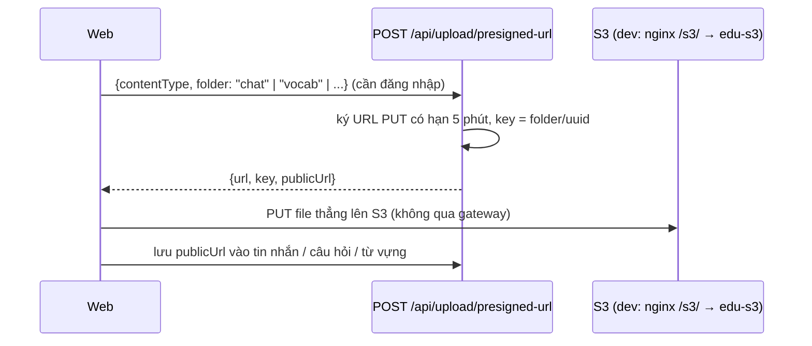

# Ảnh và file media được lưu ở đâu

Hệ thống có **bốn kiểu lưu** ảnh và file, tùy ảnh đó do ai tạo ra:

| Kiểu | Dùng cho | Nằm ở đâu | Có trong git? | Sao lưu bằng |
|------|----------|-----------|---------------|--------------|
| **1. File tĩnh trong repo** | Ảnh minh họa từ vựng, nét kanji, ảnh đề thi | `packages/vocab-images/media/` → chép sang `apps/nihongo-web/public/media/` | Có | git |
| **2. Object storage (S3)** | Ảnh người dùng upload: tệp đính kèm chat, ảnh admin tải lên | Dev: S3 giả lập (container `edu-s3`, volume `s3_data`). Production: bucket S3 thật (`AWS_S3_BUCKET`) | Không | Dev: volume `s3_data`. Production: versioning / sao chép bucket |
| **3. Nhúng thẳng trong DB** | Banner trang, ảnh từ vựng upload khi chưa cấu hình S3 | Cột text trong Postgres, dạng `data:image/...;base64,...` | Không | `infra/backups/backup.sh` |
| **4. Thư mục gắn vào container** | Audio sách, video khóa học | Thư mục trên máy, bind mount vào `nihongo-web` | Không (đã `.gitignore`) | Tự sao lưu thư mục |

Còn một trường hợp nữa: ảnh đại diện từ Google được lưu dạng **link ngoài** (`User.avatarUrl` = `https://lh3.googleusercontent.com/...`). Hệ thống không giữ file này.

Số liệu trong tài liệu đo ngày 03/11/2026 trên DB dev. Cùng ngày đã bật S3 giả lập cho dev (mục 2): trước đó gateway chưa cấu hình S3 nên gửi file trong chat bị lỗi.

---

## 1. File tĩnh trong repo

### Thư mục

```text
packages/vocab-images/media/          ← BẢN GỐC, sửa ở đây
├── openmoji/   412 file  (2 MB)     ảnh minh họa từ vựng (OpenMoji, SVG)
├── kanji/      511 file  (4 MB)     ảnh kanji (kanji512/…)
├── kanjivg/   2417 file  (14 MB)    nét chữ KanjiVG (thứ tự nét, cây cấu tạo)
└── exam/        34 file  (244 KB)   tranh cho câu hỏi đề thi thử (n5/, n4/, n3/…)

apps/nihongo-web/public/media/        ← BẢN CHÉP, Next.js phục vụ ở /media/...
├── (cùng 4 thư mục trên)
├── kanji-components.json  (624 KB)  chỉ mục cấu tạo kanji, sinh từ KanjiVG
└── book-audio/, mori-course/        xem mục 4
```

### Luồng

1. Thêm hoặc sửa ảnh trong `packages/vocab-images/media/`.
2. Chạy `npm run media:sync` (`packages/vocab-images/scripts/sync-public.mjs`) để chép sang `apps/nihongo-web/public/media/`.
3. Build lại web: `docker compose build nihongo-web`. Ảnh được **đóng vào image** (Dockerfile chép cả thư mục `public/`).
4. Trình duyệt tải ảnh ở `http://localhost:8080/media/...`, đi qua nginx tới Next.js. Request ảnh không qua gateway.

Máy mới chưa có ảnh: `npm run media:setup` (= `media:download` + `media:sync` + `seed:vocab-images`).

### DB chỉ lưu đường dẫn, không lưu ảnh

| Bảng.cột | Ví dụ giá trị | Số dòng có ảnh |
|----------|---------------|----------------|
| `Vocabulary.imageUrl` | `/media/openmoji/1F4C5.svg` | phần lớn ảnh từ vựng |
| `KanjiEntry.imageUrl` | `/media/kanji/kanji512/...` | 996 |
| `MockExamQuestion.imageUrl` | `/media/exam/n5/...` | 14 |
| `MockExamQuestionOption.imageUrl` | `/media/exam/...` | 20 |
| `Lesson.thumbnailUrl` | (chưa dùng) | 0 |

Ngoài ra, từ điển hình ảnh tự chọn ảnh **ngay trên trình duyệt** bằng `resolveVocabImage` (`packages/vocab-images/src/index.ts`) cho cả những từ chưa có `imageUrl`. Xem [core-flows.md mục 14](./core-flows.md#14-từ-điển-hình-ảnh).

**Lưu ý:** đổi tên hoặc xóa một file trong `media/` sẽ làm hỏng mọi dòng DB đang trỏ tới nó. Hãy tìm trước, ví dụ: `SELECT count(*) FROM "Vocabulary" WHERE "imageUrl" = '/media/openmoji/1F4C5.svg';`

---

## 2. Object storage (S3)

Dùng cho file **người dùng tạo ra lúc chạy**, nên không thể nằm trong git.

### Luồng upload (pre-signed URL)



- **Vì sao không gửi file qua gateway:** file đi thẳng từ trình duyệt lên S3, nên gateway không phải gánh băng thông và RAM của file lớn.
- **File:**
  - server: `services/api-gateway/src/http/upload/upload.service.ts`, `upload.controller.ts`; test `upload.service.spec.ts`;
  - web: `apps/nihongo-web/src/api/index.ts` (`getPresignedUploadUrl`), `utils/vocabImageUpload.ts`, các panel chat (`GroupChatPanel.tsx`, `SessionChatPanel.tsx`, `SupportChatPanel.tsx`), `components/MockExamQuestionEditor.tsx`.
- **Cấu hình** (biến môi trường của `api-gateway`):

  | Biến | Ý nghĩa | Mặc định trong docker-compose |
  |------|---------|-------------------------------|
  | `AWS_S3_BUCKET` | Tên bucket | `edu-app-dev` |
  | `AWS_REGION` | Vùng | `ap-southeast-1` (Singapore) |
  | `AWS_ACCESS_KEY_ID`, `AWS_SECRET_ACCESS_KEY` | Khóa truy cập. Dùng S3 giả lập thì bỏ trống được (code tự gắn key giả) | trống |
  | `AWS_ENDPOINT_URL` | Địa chỉ **gateway** gọi S3 (trong mạng Docker) | `http://s3:9090` |
  | `AWS_PUBLIC_ENDPOINT_URL` | Địa chỉ **trình duyệt** dùng để PUT/GET file; URL upload được ký theo địa chỉ này | `http://localhost:8080/s3` |
  | `ASSET_BASE_URL` | Gốc URL công khai, ví dụ CloudFront (thắng `AWS_PUBLIC_ENDPOINT_URL`) | trống |

### Dev: S3 giả lập (S3Mock)

Container `edu-s3` (image `adobe/s3mock:3.12.0`) giả lập S3:

- **Giữ file sau khi restart:** file nằm trong volume `s3_data`.
- **Tự tạo bucket** `edu-app-dev` khi khởi động.
- **Không mở cổng ra máy.** Trình duyệt vào qua nginx: `http://localhost:8080/s3/<bucket>/<key>`. Nginx cắt tiền tố `/s3` rồi chuyển sang `s3:9090`. Vì cùng origin với web nên không cần CORS.
- **Hai địa chỉ cho cùng một S3:** gateway gọi S3 bằng `http://s3:9090` (tên service trong mạng Docker). Trình duyệt không biết tên đó, nên URL upload được ký bằng client thứ hai trỏ `AWS_PUBLIC_ENDPOINT_URL`. Ký URL là phép tính cục bộ, không gọi mạng, nên client này không cần kết nối được tới địa chỉ đó.

Vì sao không dùng LocalStack hay MinIO: bản LocalStack miễn phí **mất hết bucket và file khi restart** (đã thử ngày 03/11/2026). Image MinIO không còn trên Docker Hub và quay.io.

Xem file đã upload:

```bash
docker exec edu-s3 ls /data/edu-app-dev          # mỗi file là một thư mục theo id
curl -I http://localhost:8080/s3/edu-app-dev/chat/<tên file>
```

S3Mock **chỉ dùng cho dev**: nó không kiểm chữ ký, không phân quyền.

### Chuyển sang S3 thật

Trong `.env` (để **trống** hai biến endpoint để tắt S3 giả lập):

```bash
AWS_ENDPOINT_URL=
AWS_PUBLIC_ENDPOINT_URL=
AWS_S3_BUCKET=ten-bucket-that
AWS_ACCESS_KEY_ID=...        # hoặc bỏ trống khi chạy trên ECS/EC2 có IAM role
AWS_SECRET_ACCESS_KEY=...
```

Bucket thật cần CORS cho phép `PUT` từ domain của web, vì lúc này trình duyệt PUT sang domain khác. Xem [learn-aws.md](./learn-aws.md).

---

## 3. Nhúng thẳng trong DB (data URL)

| Bảng.cột | Nội dung | Hiện có |
|----------|----------|---------|
| `PageBanner.imageData` | Ảnh banner của trang (base64 JPEG) | 2 dòng, ~188 KB |
| `Vocabulary.imageUrl` (khi bắt đầu bằng `data:`) | Ảnh admin upload lúc S3 chưa cấu hình | 3 dòng |

- **Ưu điểm:** không cần S3; sao lưu DB là có luôn ảnh.
- **Nhược điểm:** ảnh base64 to hơn file gốc khoảng 33%, làm DB và file backup phình ra. Mỗi request đọc dòng đó cũng kéo theo cả ảnh, và ảnh không được cache riêng như file tĩnh.
- **Khi nào nên chuyển sang S3:** khi số ảnh tăng lên. Với 2 banner thì chưa đáng.
- **File:** `services/api-gateway/src/http/banners.service.ts`, `apps/nihongo-web/src/utils/vocabImageUpload.ts` (`readVocabImageFile`, `resizeImageDataUrl`).

---

## 4. Thư mục gắn vào container (audio, video)

Khai báo trong [docker-compose.yml](../docker-compose.yml), service `nihongo-web`:

| Thư mục trên máy | Trong container | Nội dung |
|------------------|-----------------|----------|
| `apps/nihongo-web/public/media/book-audio/` | `/app/apps/nihongo-web/public/media/book-audio` | Audio sách |
| `${MORI_COURSE_DIR}` (mặc định `apps/nihongo-web/public/media/mori-course/`) | `/media/mori-course` (chỉ đọc) | Video khóa học, trang `/mori` |
| volume `mori_hls_cache` | `/tmp/mori-hls` | Bản HLS sinh ra khi phát video (tạo lại được) |

- Hai thư mục đầu nằm trong `.gitignore` vì nặng và có bản quyền. **Máy mới phải tự chép sang.**
- Vì là bind mount, thêm file vào thư mục trên máy thì container thấy ngay, không cần build lại.

---

## 5. Tóm tắt: mất thì lấy lại từ đâu

| Mất cái gì | Lấy lại bằng |
|------------|--------------|
| `apps/nihongo-web/public/media/` (OpenMoji, KanjiVG, exam…) | `npm run media:sync` (từ `packages/vocab-images/media/`), hoặc `git checkout` |
| Banner, ảnh từ vựng dạng data URL | Khôi phục DB từ `infra/backups/` |
| File người dùng upload | Dev: volume `s3_data` (mất nếu chạy `docker volume rm` hoặc `down -v`). Production: chỉ có trên S3, nên bật versioning cho bucket |
| Audio sách, video khóa học | Bản sao lưu riêng của bạn (không có trong git, không có trong DB) |
| Ảnh đại diện Google | Không cần: lần đăng nhập Google sau sẽ cập nhật lại link |

<!-- nav:start -->

---

## Đi tiếp

Bạn đang ở **2. Kiến trúc hệ thống** — bài 4/6.

- Bài trước: [microservices-communication.md](./microservices-communication.md) — Các service nói chuyện với nhau bằng gì, vì sao
- **Bài tiếp: [learn-system-design.md](./learn-system-design.md)** — Tư duy system design qua các quyết định của project

Mục lục toàn bộ tài liệu: [docs/README.md](./README.md)

<!-- nav:end -->
